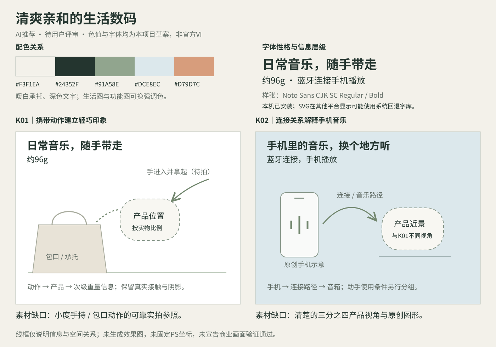

# 小度随身音箱｜产品美术方向提案

日期：2026-10-28。状态：**产品与品牌依据已分析，用户已指定按本提案生成三张VI概念参考；三图效果已审核通过，项目大纲已整理，旧图重做与最终制作尚未开始。**

本轮承接用户要求：“现在先重新指定提案，确定产品美术方向，分析产品资料和品牌调性适合什么样的风格，再去找类似的案例给我看。”范围仍为作品集独立概念套系，暂不绑定平台。已采用的三张海报和历史M图保留。

## 先给结论

**推荐主方向：清爽亲和的生活数码。核心主张草案：日常音乐，随手带走。**

以真实尺度、携带动作和有触感的产品摄影表现轻巧与日常陪伴；用简洁的连接、音乐或时间图形解释功能。整套共享产品身份、字体性格和色彩关系，不固定同一个正面、米白底和标题位置。

这个方向来自产品事实、品牌历史设计理念与本项目取舍共同判断。它是本次创作建议，不是小度官方VI。用户已指定据此生成概念参考，用户现已审核通过三图概念效果，正式制作以此为美术基准。

## 1. 产品依据怎样影响风格

| 已有依据 | 能支持的美术表达 | 不能由此推出的内容 |
| --- | --- | --- |
| 资料标称约96g、约80×57mm；浅色圆润机身 | 小、轻、容易带入日常；手持、拿起和包口动作比产品与包袋并置更直接 | 两个尺寸不补成完整长宽高；不承诺所有口袋都装得下，不套用其他音箱的手指比例 |
| ABS外壳、金属透音网；实拍可见双键、孔纹、接缝与正面深色图案 | 用侧向光和近景区分柔和外壳与细密网罩，形成可触摸的数码质感 | 不改成玻璃、镜面金属或镀铬机身；不凭虚焦照片编造孔纹和隐藏结构 |
| 手机蓝牙播放；助手依赖手机小度App与按键 | 生活中的手机音乐设备，连接关系可以图形化 | 不画成独立智能家居中枢，不演示喊“小度小度”直接唤醒 |
| 约10小时播放，原资料附70%音量实验室条件 | 在功能内容中使用时间弧与节奏意象，约数和条件一起可读 | 不推出全天、快充、实测电量曲线或超越竞品 |
| 3W额定功率、40mm全频单元；没有声学实测 | 配置可以清楚说明，40mm可进入详情配置 | 不把配置当成旗舰Hi-Fi、重低音或巨大派对声场的证据 |
| 无防水功能 | 干燥书桌、居家与短途随行场景 | 不采用泼水、雨淋或水边功能演示 |

事实来源：[产品规格](../../素材/产品资料/音箱/规格资料/product-specs.md)与[原始资料索引](../../素材/产品资料/音箱/规格资料/source-index.md)。上述参数为资料标称，未作实物测试。本轮实际查看：N03正面、N02顶部、002生活主视觉、012材质家居、023结构、024时长、028手持、029沙发及已采用的轻出行PS v01；不同代理共同完成，4032像素实拍以全幅缩放查看，不声称逐像素检验。

## 2. 品牌调性：可确认什么

- [DuerOS官方设计访谈，2019-07-17](https://dueros.baidu.com/html/2019/activity_0717/328.html)将小度硬件设计起点概括为“科技、艺术、温暖”，并说明家族简洁造型、细节和R角的一致性。文章对象为Play等家用产品，只用作历史设计理念依据，不移植其布料、四键、色款或声学结构。
- [小度官方白皮书概述](https://xiaodu.baidu.com/saiya/docs/dueros-secure-white-paper-global/1.html)说明企业面向大众、在不同场景提供便捷服务。它支持亲近、易懂的品牌解释，不证明随身版具有其他小度设备的全部能力。
- 已上传的002、012、028、029实际使用自然光、织物、生活空间和携带动作；023、024又使用冷色与功能图形。可据此发展“生活摄影为主、清楚数码表达为辅”，而非要求每一张复制暖木桌面。
- 001商城标识有红蓝元素，但商城标识不等于完整产品VI。本轮未取得该型号的官方字体、完整VI手册或标准HEX色值。

2026-10-28重新访问随身版商城页时，浏览器只取得导航与页脚，未取得完整详情；产品依据仍来自已上传资料与实物。当前没有可靠售价与消费者研究，不把“亲和”改写为已验证的价格定位或年龄画像。

## 3. 风格判断与具体美术语言

| 表达方式 | 本项目建议 | 理由 |
| --- | --- | --- |
| 自然光生活数码 | 主方向 | 圆润浅色外观、轻巧携带与品牌温暖语气相容，也能复用用户喜欢的野餐光色 |
| 明亮棚拍与简洁功能图形 | 同一套系的辅助语言 | 补足产品孔纹、双键和手机连接的可读性，让功能页与生活主视觉拥有不同结构 |
| 冷峻旗舰科技、夜店能量或高奢器物 | 本轮不推荐为主方向 | 缺少相应产品性能、材料与定位依据；颜色或特效强度本身不能解决卖点表达 |

| 维度 | 推荐规则与作用 |
| --- | --- |
| 摄影与光线 | 自然或模拟自然的侧光；产品有清楚的亮面、暗面和接触阴影。生活图保持适度景深，网罩与双键可辨，避免白色主体融入过曝背景 |
| 场景与道具 | 每张只用承担作用的少量物件：手说明尺度，包口说明携带，手机说明音乐来源，织物或木面说明承托。需要更强数码感时可以用冷灰或淡蓝背景 |
| 材质 | 保留浅色ABS、金属透音网的差异；外部搭配帆布、浅木、纸或干燥石面。材质选择要衬托产品，不将道具做成额外主角 |
| 构图 | 主视觉建立拿起/带走的动作；功能图建立手机—音箱或时间—播放关系；产品近景可以局部裁切，但先保证身份识别。相同元素重复要有职责 |
| 色彩草案 | 暖白 #F3F1EA、深灰绿 #24352F、灰绿 #91A58E、淡蓝灰 #DCE8EC、少量暖杏 #D79D7C。是本提案配色候选，不是官方标准色；按画面选择强调色 |
| 字体草案 | 中文以清楚的现代无衬线为主，标题用粗体、说明用常规体。示意样张使用本机已安装的Noto Sans CJK SC Regular/Bold；它不是已识别的小度品牌字体，正式执行前再确认用户PS中的可用字库 |
| 文字与图形 | 主标题短而具体；数字与“约”、必要条件保持同组。声音线、时间弧和连接路径用作概念与阅读线索，不冒充测量结果 |

## 4. 按方向找到的四组参考

以下编号仅用于本提案评审，均未归入“审美参考包”的用户认可。只在文档引用原图链接，研究下载保存在仓库外。所有来源及列出图片均在本轮实际读取；可访问不代表允许提取品牌资产或公开再分发原图。

### A01｜Lexon MINO+：真实手持说明小体积

[官方产品视觉](https://pro.lexon-design.com/us/mino-alu)。产品设计署名Quaglio & Simonelli；摄影/传播美术作者未单独署名。它是官方产品展示，不称为已核实的独立广告全案。

- **实际读取**：手持01、桌面03各600×600；另读无线充电02和双机04用于判断不迁移的功能，未看完整图库或视频。[桌面03原图](https://pro.lexon-design.com/media/wysiwyg/PDP-600x600px-Mino_-03.jpg)。
- **可见关系**：手与产品建立尺度；手机和书本说明日常使用关系；方向光及阴影让小产品保持体积。
- **迁移到小度**：用真实手掌轻握或从包口取出小度，按自身实物比例构图；手机可以解释音乐来源。
- **取舍**：MINO的铝外壳、两指捏起尺度、无线充电和双机功能不迁移。600像素图用于比较摄影机制，不作为制作母图。两张照片不含主广告排版，不能据此推断字体系统。

### A02｜Sony SRS-XB100：携带动作成为主信息

[官方产品视觉](https://www.sony-asia.com/wireless-speakers/products/srs-xb100)。摄影/渲染作者原页未单独署名。

- **实际读取**：携包图2880×1748、[产品识别图1440×875](https://sony.scene7.com/is/image/sonyglobalsolutions/00-4?$large360ViewerImage$&fmt=png-alpha)；大图以全幅缩放查看，未看完整360交互或视频。
- **可见关系**：产品附在包侧，人物姿态与出门情境共同解释便携；另一张白底三分之四视角负责产品识别。两种职责无需同一构图。
- **迁移到小度**：借“看见动作就理解可以带走”，改成有实拍依据的拿起/包口动作；为小度降低阳光反差，保留清楚产品明暗。
- **取舍**：不照搬外悬挂结构、黑色圆柱外形或户外耐用叙事；Sony的防水、防尘、续航和音质不用于小度。本组素材同样不用于猜测品牌字体。

### A03｜Made by Google：生活空间中的亲近科技

[STUDIO/BOWEN原作品页](https://www.studio-bowen.com/work/madebygoogle)。页面自述参与Google Brand Studios摄影美术指导及MadeByGoogle社交美术指导；这是包含多设备的商业作品集，本轮只选音箱画面。

- **实际读取**：灰色音箱/桌面06、珊瑚色Home Mini/绘画材料08，各1080×1080；另看手机10作排除，未看全项目或动效。
- **可见关系**：近景裁切仍保留设备识别；织物、陶器、木面与温暖生活色建立可触的环境，产品和物件具有真实承托关系。
- **迁移到小度**：借自然生活色与少量有意义物件，让产品在书桌、阅读或干燥随行场景中成立；用光影和构图建立精致感。
- **取舍**：Google的织物机身、独立语音与智能家居能力不迁移；小度仍保持ABS与金属网罩。该图不意味着要复制整桌餐具或绘画材料，也不证明小度官方配色。

### A04｜Bang & Olufsen SS19：近景中的孔纹与曲面

[Kusk Studio原商业摄影项目](https://www.kusk.de/home/bang-olufsen-ss19)。客户Bang & Olufsen，摄影/艺术指导Lasse Kusk，代理Trouble，创意总监Jakob Kahlen；SS19为项目名，原页未清楚标注完整发布日期。

- **实际读取**：浅色产品人物近景00（801×1200）、冷灰携带04（801×1200）、深绿产品近景07（1280×854）；未看全套或视频。
- **可见关系**：同色系背景与服装降低杂讯，孔纹、曲面、皮肤和织物以不同反射区分；产品可以占据显著比例并成为视觉焦点。
- **迁移到小度**：借侧向柔光、清楚网孔、轮廓明暗以及同色环境关系，改善产品本身的吸引力。生活化可以有商业摄影的完成度。
- **取舍**：只借摄影方法，不把小度改成B&O的高端定位、金属外壳或皮绳产品；不照搬贴脸或甩绳姿势，不由画面推出音质优势。

## 5. 两张代表画面的构图草案

这两张用于验证同一美术方向能承担不同任务，示意关系见上方线框；尚未生成或制作最终效果图。不按旧M编号硬凑数量，也不在此阶段固定全部坐标。

| 草案 | 希望观众记住什么 | 画面关系与素材 | 通过标准 |
| --- | --- | --- | --- |
| K01 日常音乐，随手带走 | 这是一台小巧、可带走的音乐设备 | 真实手掌拿起产品/从帆布包口取出；斜向动作引导到产品；干燥承托与少量生活背景；“约96g”作次级信息。优先用实物补拍手持参照，不能用MINO尺寸代替 | 遮住标题仍能指出携带动作；产品比例、接触与光线可信；产品身份清楚，数值保留约数和资料标称说明 |
| K02 手机里的音乐，换个地方听 | 手机是音乐来源，音箱负责播放 | 手机与小度分置两个空间层次，以一条清楚路径和简洁音乐符号建立关系；小度用近景三分之四角度。复用可靠产品图，手机用原创示意而非伪造官方App界面 | 看得出两端关系；画面结构区别于K01；产品孔纹与曲面可读，普通蓝牙播放和助手App条件不混淆 |

约10小时与40mm暂作为后续时长/配置内容，不强行各占一张核心KV。具体图数由新提案的信息优先级决定。

## 6. 当前可复用内容与素材缺口

- 已有野餐、居家和窗边素材可作为光色与生活空间基础；已采用三张海报继续保留，不因本轮定向自动返工。
- R01候选B可以作布局工作素材，网罩、蓝色标记等未核细节仍按实物检查；参考摄影不替代结构真值。
- K01缺可靠的小度手持/包口动作素材，优先用户补拍简洁参照；K02需要更清楚的产品三分之四视角及原创手机示意。进入制作时再针对缺口给PS步骤或必要提示词。
- 来源中没有完整的本型号官方VI、可靠售价或消费者研究；本提案的受众为“希望把手机音乐带入居家和短途干燥出行的人”这一创意假设。
- 品牌、案例及产品照片可读范围已记录；未复制第三方图片文件进公开仓库。未将候选案例记为用户认可。方向分析阶段未调用生图；随后按用户新请求生成三张概念，见第7节。Skill未修改。

## 7. 本轮完成状态与评审

用户最新反馈“三张图效果都不错，通过审核”。已记录三图概念效果认可，并整理[项目大纲与最终交付清单](../../作品项目/小度音箱/项目大纲与最终交付清单.md)；正式制作保留已认可的美术效果，按实际产品参照校准细节，不重新选方向。

用户随后明确要求按提案制作三张VI概念图，审核后再重做旧图；[三图现已完成并通过用户概念效果审核](../../作品项目/小度音箱/参考示范/VI概念提案-2026-10-28/README.md)。该请求授权本轮生成，之前的默认不生图分工不限制此次执行。原分析与线框作为生成前的提案版本保留。

已完成产品/品牌分析、方向推荐、四组匹配参考的实际读图、色板/字体性格及两张关系线框。随后已补三张AI概念参考；尚未完成：旧图重做、最终商业成图、详情适配和源文件交付。

评审时具体指出要保留或修改的是：手持尺度、生活光色、产品近景、字体气质，还是功能图形。本轮三图认可按用户原话记录，不扩大为其他外部参考也已认可。随后先验证K01/K02，再决定套系扩展。

[返回验证任务](README.md) · [音箱当前任务](../../作品项目/小度音箱/README.md) · [历史源图对照](../../复盘记录/小度音箱/商业视觉复盘与方向重整.md)
