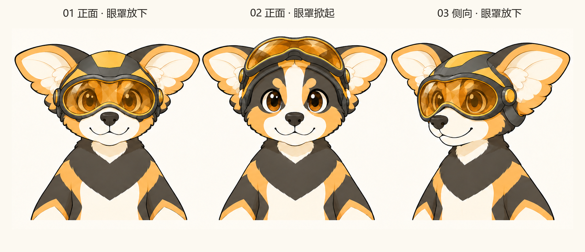

# AC3 揭面盔与潜水镜蜂眼｜讨论稿 V08

**2026-11-13 背景蓝本补充：** 本人提出 AIGC 多元宇宙中的灵感探险家，已扩写[角色背景讨论稿 V01](../04_角色设计/角色世界观与背景设定_讨论稿_V01.md)。头盔作为探索观察装备是候选用途，尚非本人确认的功能或超能力；本轮未修改本页图片或验证机构。

日期：2026-11-13。**已制作二维概念，等待本人审阅；尚非定稿或可制作的机构方案。**

## 本人新要求

面具改为揭面盔，遮眼区域采用潜水镜造型并保留蜂眼特征；下半脸不挡，保留小狗鼻嘴与脸部。本人随后上传四张灵感图，见[来源与提炼记录](参考图/2026-11-13_用户头盔灵感/灵感来源与提炼记录.md)。原[三种脸部对照 V07](AC3蜂眼与面具_对照讨论稿_V07.md)保留过程，本轮在佩戴装备的分支继续探索，不据此认定直接蜂眼已被永久否定。

本轮将“揭面盔”暂落实为**固定上部壳体、眼罩整体向上翻起**，并比较放下与掀起状态。这是为制作概念选择的解释，具体揭面范围、是否连壳体一并上翻仍需看稿确认。

## 最新概念

[完整 V03 原图](概念图/2026-11-13_AC3揭面盔/AC3_揭面盔潜水镜蜂眼_概念图_V03.png) · [三次提示词、输入与真实检查](概念图/2026-11-13_AC3揭面盔/提示词与生成记录_V01.md)

| 部件 | 本轮视觉方案 | 仍需判断 |
| --- | --- | --- |
| 上部壳体 | 包裹头顶与头侧，以蜂蜜黄和炭黑大块面形成整体 | 厚度和分色是否抢过角色本身，是否需要连同前额壳体揭起 |
| 眼罩 | 宽幅连贯曲面、深色边框与琥珀色分面，提取潜水镜的包围感 | 曲面与镜框是否过重，视线在小尺寸下是否仍清楚 |
| 蜂眼 | 放在镜片分面和反光中；掀起后是原有普通眼睛 | 联想是否像蜂眼，还是更像宝石／一般镜片 |
| 下半脸 | 不加罩鼻、呼吸器、口罩、下颌护栏，黑鼻、嘴、浅色口鼻与下脸颊外露 | 侧面眼罩边缘对脸颊的遮挡是否可接受 |
| 翼耳 | 经修正恢复横向展开与上下叶识别，穿出壳体侧边 | 铰链、耳根与翻起路径是否冲突，下叶形状是否还需统一 |

潜水镜常见的罩鼻部分与“鼻嘴不挡”有冲突，因此本轮只提取它的宽框与镜面关系，省略罩鼻。面部装备的具体用途仍未定，不因为参考角色的服装就赋予战斗、飞行、武器或全身机械设定。

## 灵感怎样被转译

从本人图中能看到的关系是上头部壳体、横向金色眼区、侧边连接与裸露表情之间的对照。图02／03带 WASP 标注，但原发布页、作者及版本未核实；图04具体影视作品未核实。不能从静态图推导出真实翻起机构。

本轮保留这些关系，重新适配 AC3 的短吻和翼耳，不沿用参考中的封闭下颌、独特尖角、背翼、武器或整套服装。四张原图在参考目录留档，只有图02的头盔局部作为本轮辅助生图输入；第三方图片不算 Migo 自有品牌资产。

## 过程与未解决问题

[初稿 V01](概念图/2026-11-13_AC3揭面盔/AC3_揭面盔潜水镜蜂眼_概念图_V01.png)偏圆壳双孔护目镜，且将翼耳画得偏窄。[参考修正 V02](概念图/2026-11-13_AC3揭面盔/AC3_揭面盔潜水镜蜂眼_概念图_V02.png)加强眼罩连续性后，耳形仍未恢复；因此只针对耳部做一次修正，形成 V03，所有过程稿保留。

三幅画面能讨论外观和状态，但不等于已验证翻起动作。铰链位于耳根附近，眼罩向上运动是否擦到翼耳、上翻后是否稳定，以及三状态的镜框大小和轴位是否一致，尚待结构校准。镜片分面仍较强，可能让眼睛显得拥挤；这些留给本人实际反馈，不继续自动扩图。

当前只制作头胸二维概念；未做 3D、动图、全身装备或标准图。名称与配色未最终确认。下一步先反馈：壳体包裹程度、眼罩宽度和上翻方式是否符合想象，再决定局部修正或绘制结构关键姿态。

[视觉概念入口](README.md) · [任务清单](../07_项目管理/品牌任务清单.md)
