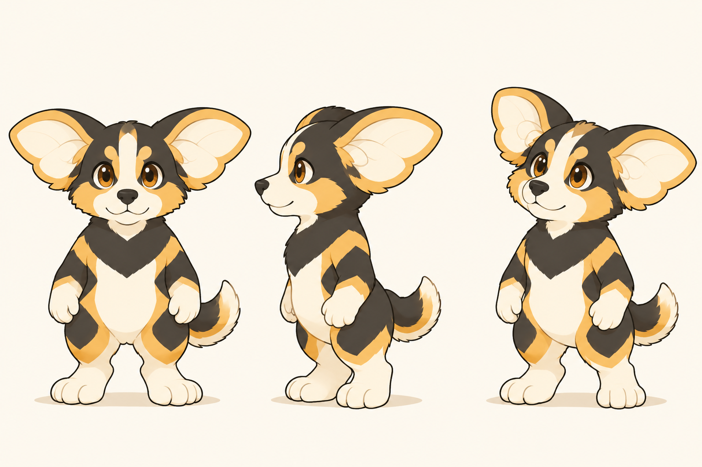
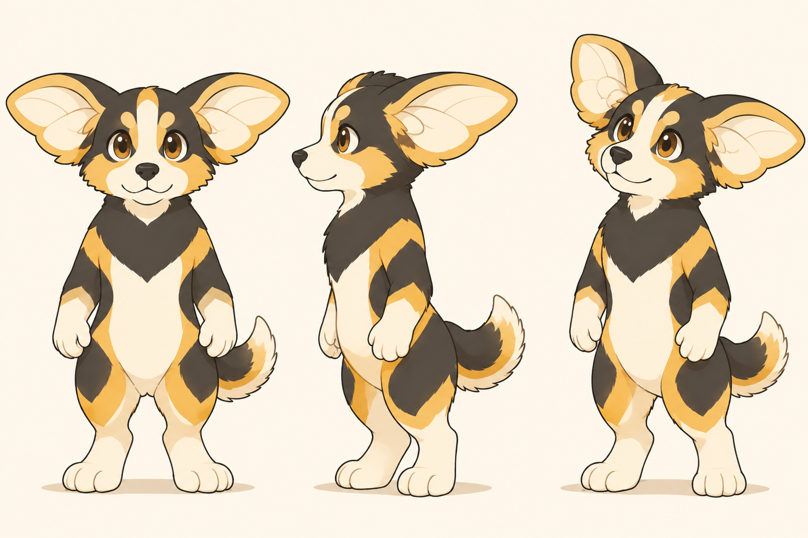

# AC3 简化基础形象｜讨论稿 V06

日期：2026-11-12。**已生成并查看，待本人审阅；不是标准三视图或角色定稿。** 本轮执行[需求与验证任务书 V05](AC3需求与验证任务书_V05.md)中的基础形象部分。

## 本轮修正稿

[查看原尺寸修正稿](概念图/2026-11-12_AC3简化基础/AC3_简化基础形象_概念图_V02.png)

## 改了什么，为什么

| 部位 | 本轮处理 | 需要本人判断的地方 |
| --- | --- | --- |
| 比例 | 放大头部相对占比，缩短躯干和腿，保留宽脚与站立重心 | 紧凑程度是否合适，是否过于幼态或削弱力量感 |
| 毛发 | 减少身体碎毛，胸毛收为整体深色色块 | 是否仍保留喜欢的毛发感和一点野性 |
| 分色 | 保留深色头罩、蜜色眉斑、浅色面中线与口鼻，手臂和大腿合并为大块分区 | 色块数量和深色胸部的视觉重量是否合适 |
| 耳翼 | 保留每侧一个耳根、上下两叶相连的基本轮廓 | 是否仍喜欢此识别特征；耳内弯曲线条还要不要减少 |
| 手脚 | 双足站立，双手自然下垂，短腿与宽脚更紧凑 | 后续观察与尝试动作能否保持自然，需要实际画面验证 |

这些是本轮设计分析，不是用户已确认的效果。核心印象仍为“有自己的想法，愿意探索，也能认真把想法落实”；静态形象主要承载识别与情绪，认真和探索还需动作、项目说明及真实过程共同证明。角色没有被要求一眼显示 AIGC 职业身份。

## 初稿与修正的依据

初稿已减少碎毛，但长躯干与腿仍接近旧 AC3，因此保留初稿并进行一次针对比例的修正，形成上方 V02。没有继续扩散新方向或以添加元素替代这次简化。

[前轮 AC3 原图](概念图/2026-11-12_双足拟人五方向/AC3_双叶耳翼分色双足_概念图_V02.png) · [完整提示词、参数与生成记录](概念图/2026-11-12_AC3简化基础/提示词与生成记录_V01.md)

## 已检查与未完成

已实际查看两稿；PNG 均为 1536×1024。可见双足、两臂、犬类短吻、翼耳、尾巴，画面完整且无可读文字；未增加蜂眼、佩戴面具、机械、服装或武器。

修正稿比例明显紧凑，但约 2.5 头身只是工作目标，尚未用统一骨架校准。侧面带透视，各视角耳根、耳内曲线和毛色交接仍需统一；耳内线条与尾部毛尖尚可再简化。当前不能直接作为建模、动画或标准形象的唯一依据。

本轮只制作基础形象概念。观察／尝试动作、头像、单色轮廓、封面与扇耳动态均未制作或测试。蜂眼和面具继续保留候选，名称与配色仍开放。

## 本轮先看什么

请先比较：这个头身比例是否比旧 AC3 更接近你想要的 IP；毛发减到这里是否还能保留你喜欢的性格；翼耳与脸部有没有值得继续收紧的地方。先收集本人真实反馈，再决定结构修正或进入动作验证，不将文件同步视为方案通过。

[任务书 V05](AC3需求与验证任务书_V05.md) · [视觉概念入口](README.md)
