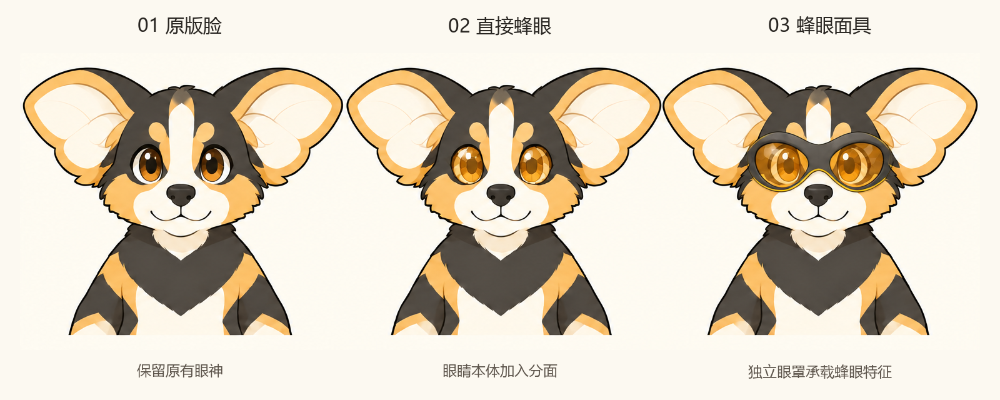

# AC3 蜂眼与面具｜对照讨论稿 V07

**2026-11-13 本人新增方向：** 将佩戴面具分支推进为揭面盔与潜水镜式蜂眼眼罩，下半脸外露；新灵感图与已制作概念见[V08](AC3揭面盔与潜水镜蜂眼_讨论稿_V08.md)。本页保留三方案历史，未据此永久否定直接蜂眼分支。

日期：2026-11-13。**已制作并查看，等待本人对新方案反馈。** 本轮只比较脸部，不进入 3D。

## 本人反馈与本轮范围

本人对[简化基础稿 V06](AC3简化基础形象_讨论稿_V06.md)说明“比例性格识别特征都还可以”，明确暂不做 3D，希望继续此前提出的其他效果。随后接受“原版脸／蜂眼脸／面具脸”的同角度比较并要求制作概念图。

据此将 V06 作为可继续探索的基础，不把“还可以”写成角色、精确比例或全部细节最终验收。蜂眼与面具从候选区恢复为本轮实际比较；翼耳动态仍保留，未被取消，也未在本图中制作。

## 三方案对照

[完整原始概念图](概念图/2026-11-13_AC3蜂眼与面具/AC3_原版蜂眼面具_对照概念图_V01.png) · [完整提示词、实际输入与检查记录](概念图/2026-11-13_AC3蜂眼与面具/提示词与生成记录_V01.md)

| 方案 | 画面中的实际变化 | 帮助判断什么 | 当前局限 |
| --- | --- | --- | --- |
| 01 原版脸 | 保留常规琥珀色眼睛及高光 | 作为对照，观察其他方案是否增加价值 | 本轮只重新呈现头胸，不代表新全身标准稿 |
| 02 直接蜂眼 | 眼睛自身出现琥珀色多边形分面，保留深色视线线索 | 不依赖配件能否增加蜂类联想，同时保留表情 | 分面也可能让人联想到宝石；亲和力、眨眼与小尺寸效果待验证 |
| 03 蜂眼面具 | 增加连接双眼的深色眼罩框与琥珀色分面镜片，口鼻露出 | 通过独立配件增加角色状态，观察是否抢过耳翼和表情 | 当前更像护目镜式眼罩，蜜蜂面部结构仍可深化；摘戴和固定方式未解决 |

三个方案沿用同一正面头胸角度、耳翼和分色，主要变量集中在眼区。AI 重绘仍可能造成细微轮廓差异，不能声称逐像素一致。对蜂眼的处理是虚构角色的视觉提炼，并非仅凭六边形就证明还原复眼。

## 本轮判断建议

先看哪一种仍像你想表达的 AC3，再看蜂类联想是否增加了价值。面具的视觉存在感最大，但也增加了配件维护与使用理由；本轮没有给它编定战斗、工具或变身人设。

可以只反馈喜欢的编号与局部，例如保留原版眼神、喜欢蜂眼分面但减弱高光，或希望面具更像蜜蜂面部而少一点护目镜感。新增效果并不必然比原版更合适，选择仍由实际看稿反馈推动。

翼耳的休息／展开／弯折姿态与后续二维动态可以继续探索，本轮没有生成动作或动画；不自动赋予飞行能力。角色名称、配色和正式应用仍未定稿。

[概念深化 V04](AC3角色概念深化_讨论稿_V04.md) · [需求任务书 V05](AC3需求与验证任务书_V05.md) · [视觉概念入口](README.md)
