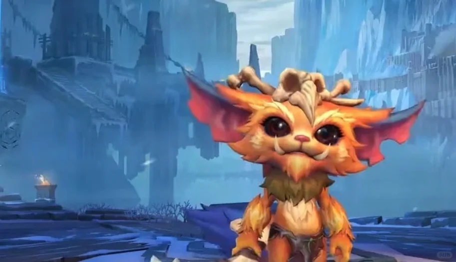
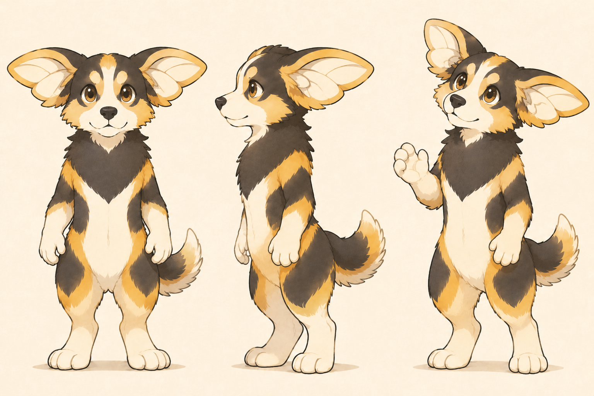

# AC3 角色概念深化｜比例、翼耳与蜂眼 · 讨论稿 V04

**2026-11-13 执行更新：** 本人对简化基础“都还可以”，明确暂不做 3D，并要求继续此前效果。蜂眼／面具现已恢复推进并完成[二维同角度比较 V07](AC3蜂眼与面具_对照讨论稿_V07.md)，新方案待反馈；下方“暂后移”保留此前阶段安排。翼耳动态与其他动作／应用尚未制作。

**2026-11-12｜核心印象已确认，先做需求验证：** 本人确认希望传达“有自己的想法，愿意探索，也能认真把想法落实”。当前以[AC3 需求与验证任务书 V05](AC3需求与验证任务书_V05.md)收紧下一轮：识别、观察／尝试动作、头像与封面应用；具体验证方法为 AI 建议、尚未执行。蜂眼与面具保留候选并暂后移，比例未定稿，AIGC 通过实际过程与成果留证据，不预设科技化外形。

日期：2026-11-12。状态：本人提出的新概念已记录，方法与具体参数为工作建议；未生成新图、未制作动画，也未确认最终形象。

## 1. 本人这次提出了什么

1. 提供纳尔形象图作为参考，调整 AC3 头身比，希望更像个人品牌 IP 角色。
2. 翼耳更加灵动，能够像蜜蜂或昆虫翅膀一样扇动。
3. 增加蜂眼／蜜蜂面部的结构特征：可以直接进入眼睛，也可以通过角色面具承载；面具概念联想到真人电影大黄蜂。

这三项为本人提出的探索要求。具体头身比例、耳翼如何运动、直接蜂眼与面具孰先孰后、面具是否可摘及用途，尚未选定。面具作为新增可比较方向，更新了前轮“当前不加配饰”的工作边界；不据此扩大为全身机械化、战斗装备或第二形态。B-dog 仍为此前讨论候选，本轮不据新概念正式更名。

## 2. 这次看了哪两张图

来源：本人本轮上传的图片，原文件名 `codex-clipboard-0f34cf6f-da55-4b56-b433-8017c1493e31.png`。角色为 Riot Games《英雄联盟》纳尔；截图的原发布页、具体模型／画质版本和完整身体画面未核实。该图作为比例与造型讨论参考，不作 Migo 自有资产或直接复刻目标；画面下缘未完整露出脚部，不以此精确量出全身头身比。

已实际查看上述两图。补充官方原皮插画与来源事实见[前轮纳尔研究](../../03_学习资料/案例分析/品牌设计案例/纳尔/01_原皮视觉与AC3比较.md)。此次用户图和前轮官方插画分开记录，不把它们当作同一姿态或已核实的同一模型。

**实际观察：** 用户参考图的头部及横向耳部占据显著画面面积，身体较紧凑、四肢较短；眼睛偏圆，口鼻与脸颊较集中。AC3 当前躯干和腿部相对修长，胸颈毛、手臂、腿部的细节较多，耳部双叶虽清楚，身体仍保留较多犬类自然形态。

## 3. 比例：让形象更集中，而非只放大头

“IP 形象”没有唯一头身比例。用户真正要比较的是更集中、更容易记忆和延展的角色表达；比例、轮廓、细节层级与动作需要一起调整。不能仅缩短身体就宣布完成了 IP 化。

**本轮建议目标：** 从此前约 3～3.5 头身的工作目标，转向约 2.5 头身的紧凑试稿；必要时用约 2.25 与 2.75 作为少量两端对照。头长仍以头顶至下巴计算，排除翼耳，数字均为设计建议，不是从所附纳尔图测量所得，也不是用户已确认参数。

- 缩短胸腹与小腿，整理为紧凑的胸腹／骨盆体块；保留稳定脚掌和可辨认的手，避免短到无法做动作。
- 头部整体适度放大，保留 AC3 犬类短吻、黑鼻、面部分色与双叶耳翼；不沿用纳尔骨质头饰、獠牙和同款耳形。
- 胸毛先归为少数大体块，毛色边界减少碎裂；使眼睛、耳翼先于碎毛被看见。
- 亲近感已经是当前倾向，若再缩短比例，可能更幼态。后续同时检查“可爱、有行动力、认真观察”三者是否共存，不用大眼或肌肉单独代替人格。

## 4. 翼耳：从静态轮廓变成非语言表达

本人明确希望可扇动；建议把翼耳的运动设计成稳定的结构规则，继续保留每侧双叶相连、共用耳根的概念。每只翼耳不是多个分离器官。以下是虚构角色结构与动画建议，不是对真实昆虫翅膀／犬耳的生物学复原。

**建议的运动关系：** 耳根控制展开与方向，翼面发生轻微弯曲，耳尖稍后跟随；上叶与下叶作为同一结构联动。先明确耳根位置、休息时的折叠和展开极限，再画动作，不只添加运动线。

| 情绪或行为 | 翼耳工作建议 | 需要验证 |
| --- | --- | --- |
| 安静观察 | 小幅调整角度，一侧略抬，配合目光锁定对象 | 是否读成专注，不只是紧张 |
| 发现新东西 | 短暂展开，轻快扇动后停住观察 | 展开时仍保持双叶识别 |
| 犹豫或疑惑 | 左右略有不同步，一侧轻收 | 结构能否解释，避免每张图换耳形 |
| 兴奋准备尝试 | 幅度稍大的一小段扇动，随后进入行动 | 身体、耳翼和视线能否形成同一意图 |

扇动频率、是否发声、是否能辅助跳跃或飞行均未决定。“能够扇耳”不自动等于能飞。本轮不预设具体帧率、物理速度或原生动画接口能力；未来制作动图时再核实工具与输出方式。

## 5. 蜂眼：比较直接融入与面具承载

蜂眼可以从复眼的多面感、表面反光和眼区组织提炼视觉线索。蜂巢网格和复眼结构在概念上分开处理：不能仅贴满六边形就声称还原真实蜂眼。本轮尚未做带来源的蜂眼微观形态研究，以下只定义拟进行的视觉转译。

| 比较项 | 直接融入眼睛 | 增加角色面具 |
| --- | --- | --- |
| 本人提出的机制 | 角色自身的眼睛具有蜂眼特征 | 面具眼区或额面承载蜂眼／蜜蜂面部结构 |
| 建议试法 | 保留可辨的视线与眼睑，用少量大分面或克制反光表现多面感 | 用轻量眼罩／半面具比较，保留口鼻、犬类表情和耳根活动空间 |
| 优点假设 | 识别直接属于角色本体，不依赖穿戴状态 | 日常表情可保留，面具为后续情境表达提供可能 |
| 主要代价 | 密集分面或整片黑眼可能削弱眼神方向和亲和力，小尺寸易糊 | 增加有无面具两套资产与动作维护，可能遮住表情、抢过耳翼 |
| 当前待定 | 分面强度、瞳孔／视线表达方式，是否会影响眨眼 | 面具是否可摘、出现原因、佩戴方式，以及使用场景 |

真人电影大黄蜂在此只提供“面部装备可成为角色状态”的联想。没有指定具体电影、镜头或头盔版本，本轮不声称已核对其面具结构；也不因其名字包含 Bumblebee 就认为现成面具能代表真实蜜蜂面部。

**建议先保留两个分支。** 若试面具，可暂用“观察／探索时使用的面具”作为可验证假设，而非立即确立为战斗面甲或已确认人设。面具是轻量有机结构还是带科技感，后续看具体草案；此前“机械化暂不重点强调”仍为整体优先级，不把它扩大成永久禁止任何科技细节。

## 6. 怎样避免三个想法叠加后失去主次

建议层级：**翼耳负责远看轮廓，脸部与眼神负责情绪，毛色负责整体节奏。** 蜂眼或面具的细节强度围绕这条层级比较。头大、耳大、胸毛大、面具复杂同时拉满，可能让形象更难读、更难做动作；这需要实际草案检验。

下一轮建议用同一比例、同一姿态、同一画风作三项比较：

1. **基准稿：** 紧凑 AC3＋灵动翼耳，暂保留现有眼神，用于判断身体与耳部变化是否成立。
2. **直接蜂眼稿：** 保持基准身体与耳形，改变眼区，以便看清蜂眼对表情的影响。
3. **面具稿：** 保持基准身体与耳形，比较面具佩戴／摘下的识别关系；用途仍为假设。

这三项是制作方法建议，不是用户新增要求的三种固定方案名，也不是已经生成的图片。先用少量静态草案选取舍，再画翼耳休息—展开—扇动极限的结构关键姿态，之后按明确制作任务决定是否做动画。

## 7. 下一步还要补什么

- **由设计过程补：** 紧凑比例的正侧面校准，翼耳根部与扇动关键姿态，直接蜂眼／面具两分支的表情与头像尺寸测试。
- **由研究补：** 蜜蜂复眼、头部与翅膀的带来源观察；如细化电影面具，核对本人所指镜头／版本，再提炼机制。
- **待本人看稿取舍：** 身体紧凑程度、蜂眼强弱、面具是否值得保留，是否需要赋予飞行能力；这些不必在看到草案之前全部定死。
- **继续有效：** Migo 为主品牌；角色通常用动作和情绪表达；AC3 为重点但未定稿；名字与配色仍开放；不以本次参考证明原创性或商业成效。

[上轮双足讨论稿 V03](蜜蜂与小狗_双足拟人概念讨论稿_V03.md) · [视觉概念入口](README.md) · [任务清单](../07_项目管理/品牌任务清单.md)
