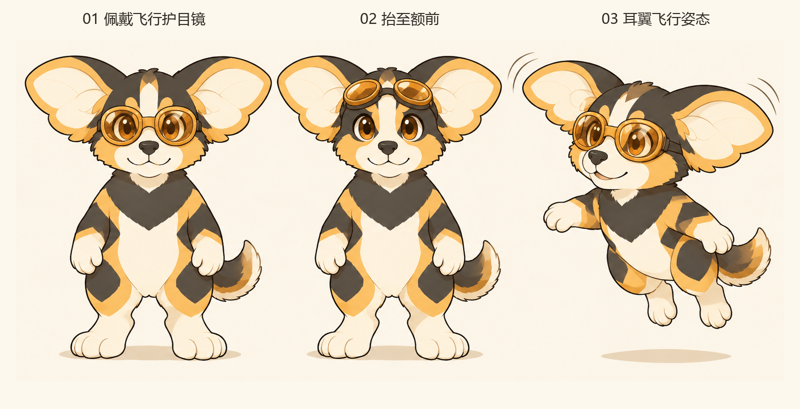

# AC3 飞行护目镜与耳翼飞行｜概念讨论稿 V09

**2026-11-14 后续反馈：** 本人认为只有眼镜较单调，现保留①复古皮革与③ HGU-55/P 两类[头盔参考](../04_角色设计/飞行头盔参考_两方向待选_V01.md)。本稿无硬壳是当轮试稿，不是最终头部装备决定；新头盔图尚未制作。

日期：2026-11-14。**已生成、查看与归档，待本人审阅。** 二维静态试稿，不是角色标准图或已验证动画。

## 本轮要求与采用基础

本人在新增耳翼飞行设定、讨论飞行护目镜后要求：“先按照目前的形象做概念图”。本轮以[简化 AC3 V02](概念图/2026-11-12_AC3简化基础/AC3_简化基础形象_概念图_V02.png)为本体，保留紧凑比例、犬类脸部、宽双叶翼耳、胸毛和黑黄分色，试做无硬质头盔的轻量飞行护目镜。

该方案承接[耳翼飞行与护目镜设定讨论](../04_角色设计/耳翼飞行与飞行护目镜_设定讨论稿_V01.md)，不代表本人已永久删除头盔、确认具体镜框或完成全部外形验收。[揭面盔V08](AC3揭面盔与潜水镜蜂眼_讨论稿_V08.md)继续保留过程。

## 三状态概念

[完整原图](概念图/2026-11-14_AC3飞行护目镜/AC3_飞行护目镜与耳翼飞行_概念图_V01.png) · [完整提示词与生成记录](概念图/2026-11-14_AC3飞行护目镜/提示词与生成记录_V01.md)

| 状态 | 实际呈现 | 需要判断 |
| --- | --- | --- |
| 01 覆眼佩戴 | 轻量连体双镜，琥珀色蜂眼分面与原眼神共存，鼻嘴外露 | 镜框是否太圆、偏复古，蜂眼分面是否仍清楚 |
| 02 额前停放 | 同款镜框抬到额前，露出眉斑、面中线与眼睛，无硬壳和铰链 | 额前停放位置是否自然，镜带怎样避开耳根 |
| 03 耳翼飞行 | 侧向身体离地，手臂平衡、脚放松，耳侧运动线辅助表达拍动 | 是否读成耳翼带动飞行，还是一般跳起／悬浮；还需结构关键姿态核对 |

## 本轮取舍与观察

去掉硬壳后，原脸和头部毛色直接露出，耳翼在轮廓中的作用更明显；这是一项画面观察，不等同于已证明探险感增强。护目镜为连体双镜，与前轮连续宽面潜水镜有所区别。无需自动补飞行员皮帽、围巾、衣服或更多工具来说明身份。

飞行图的离地间隙和耳旁运动线提供基本联想，但没有形成完整耳根—耳面—耳尖的拍动序列。三幅中身体透视、镜框大小和镜带松紧也仍须统一，不能直接拿来制作标准动作或宣称飞行已验证。

耳翼飞行为本人已提出的能力；速度、距离、疲劳及宇宙穿越机制继续开放。镜片如何固定、停放时是否压到耳根，也尚未解决。角色名称与最终色值未定。

## 本轮审阅重点

先反馈护目镜与当前AC3是否搭配、额前状态是否自然，以及飞行姿态是否保留原有性格。局部取舍明确后再处理结构，避免一次改变耳形、身体、画风与装备。本轮只有一张原始生图与中文排版预览，没有新增3D、动图、场景或全套飞行规则。

[世界观背景讨论](../04_角色设计/角色世界观与背景设定_讨论稿_V01.md) · [视觉概念入口](README.md) · [任务清单](../07_项目管理/品牌任务清单.md)
