# 蜜蜂与小狗｜A、C、AC 方向迭代讨论稿 V02

日期：2026-11-12。状态：九张概念图已生成、逐张查看，待本人审阅；角色、名字、配色与画风均未定稿。

## 1. 本人反馈与本轮范围

> “b方案太丑了，我很喜欢A耳翼的形象特征，c的犬毛峰身的纹路分色也结合得不错。现在A、C、AC结合三个方案分别生成三张概念图”

按上下文将“犬毛峰身”理解为犬毛与蜂身的纹路分色。本轮落实为 A、C、AC 三组，各三张独立概念图，共九张。B 停止本轮推进，旧文件与历史讨论保留。

已明确的是：本人不喜欢 B，喜欢 A 耳翼特征与 C 纹路分色；不能据此推导本人已接受整套 A/C 的头身比例、幼态程度、插画风格或最终色板。角色通常以动作和情绪表达，机械化暂不重点强调，名称仍开放。

## 2. 如何看这轮图片

A 组改变耳翼，C 组调整毛色分区，AC 组比较融合后的信息主次。每张原图有三个角度，先看外轮廓，再看分色，再看两者是否互相抢注意力。为便于比较，沿用原稿的画风和候选配色；当前插画仍偏亲切幼态，不等于已达成年轻、独立、认真细致的完整品牌表达。

本轮请求模型统一为 **`gpt-image-2.6-flare`**，使用已授权的 CLI/API 图像编辑；不是旧图复制改名。完整输入角色、参数和九份提示词见[生成记录](概念图/2026-11-12_AC九图迭代/概念图提示词与生成记录_V01.md)。

## 3. 九张概念图

### A组｜耳翼形态

以下预览裁取每张的第三个角度，完整三角度原图在其后。

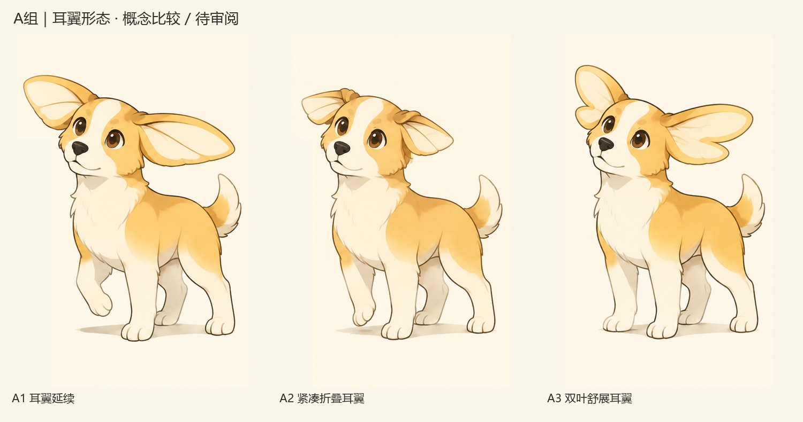

#### A1｜耳翼延续

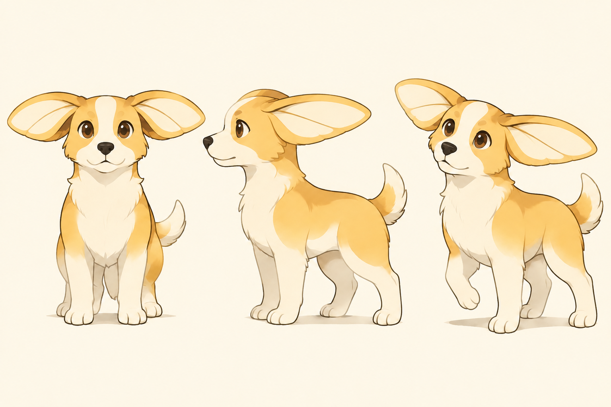

**实际观察与取舍：** 宽耳翼延续原 A，内部分区较简洁；侧面仍有明显横向伸展。适合与 A2 比较展开幅度。

#### A2｜紧凑折叠耳翼

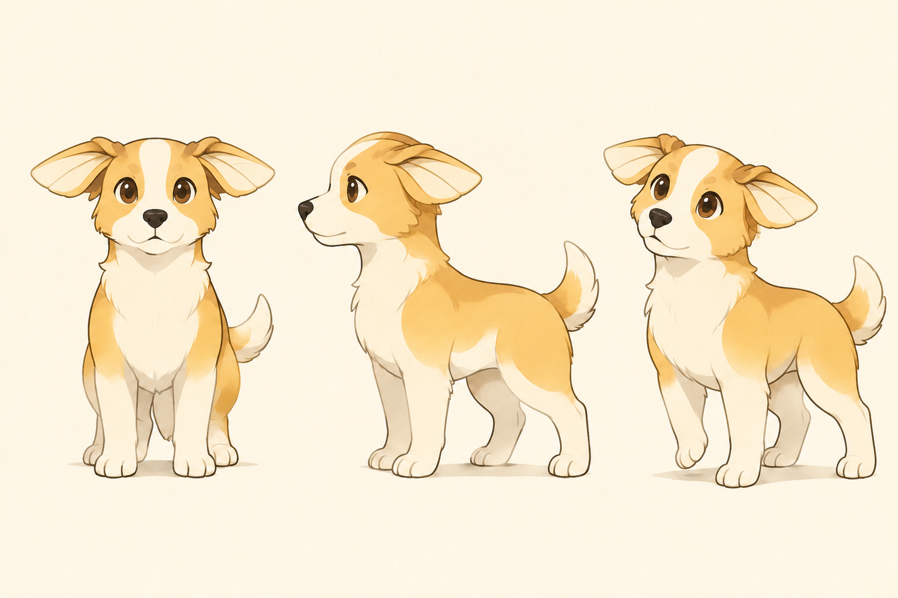

**实际观察与取舍：** 耳翼较紧凑，耳根折叠更明显，整体轮廓收拢。折叠到展开的连续运动尚未验证。

#### A3｜双叶舒展耳翼

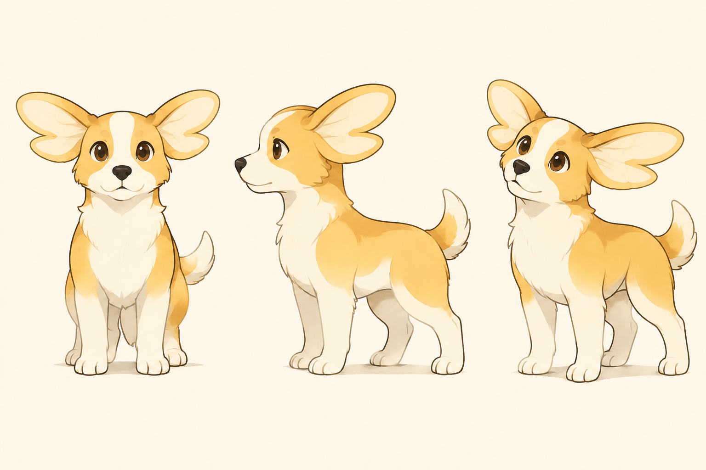

**实际观察与取舍：** 耳翼上下双叶及缺口清楚，轮廓更活跃；也更容易产生蝴蝶联想，不预先认定更像蜜蜂。

### C组｜毛色分区

以下预览裁取每张的第三个角度，完整三角度原图在其后。

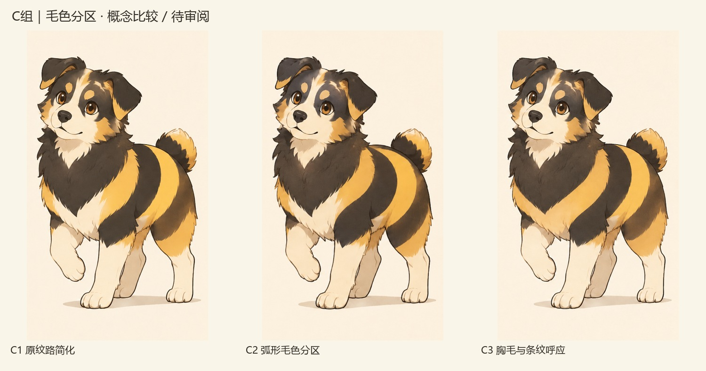

#### C1｜原纹路简化

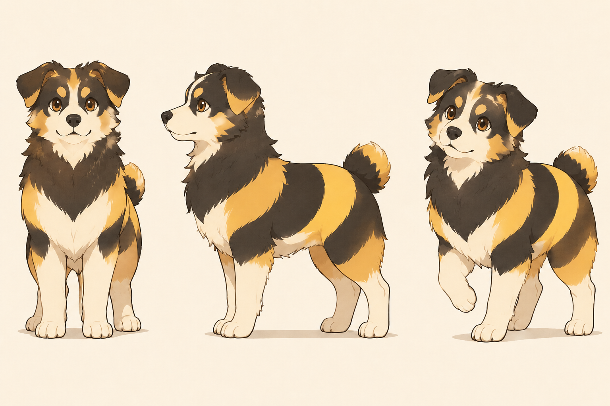

**实际观察与取舍：** 保留深色胸颈毛和宽条纹，毛色边界略作整理；仍有细碎毛发，与原 C 的差别较小。

#### C2｜弧形毛色分区

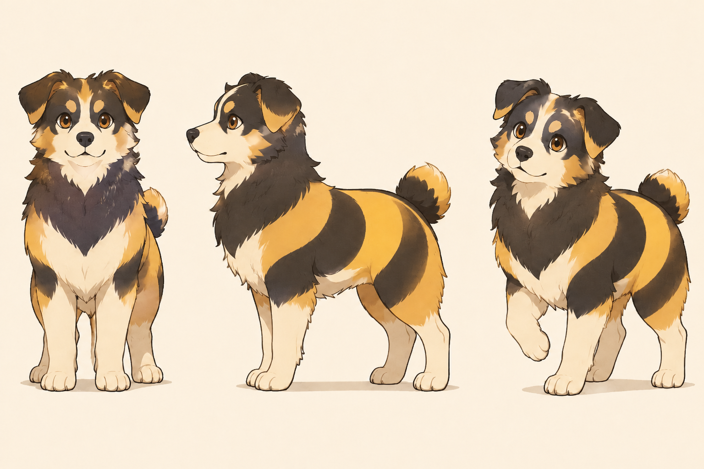

**实际观察与取舍：** 侧腹色带的弧度和体表走向更明显；与 C1 属于细节层面的变化，不是完全不同的角色。

#### C3｜胸毛与条纹呼应

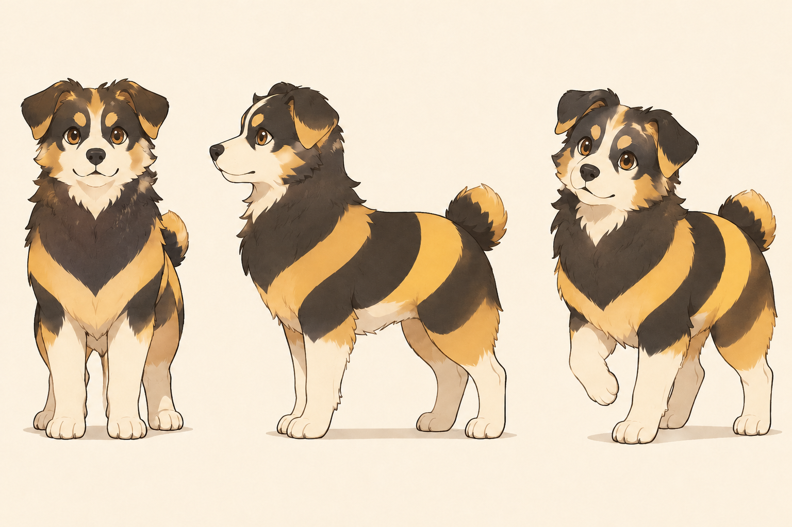

**实际观察与取舍：** 深色胸毛下探，浅色胸口缩小，与侧腹斜向色带形成呼应；正面深色占比更强。

### AC组｜耳翼 × 分色

以下预览裁取每张的第三个角度，完整三角度原图在其后。

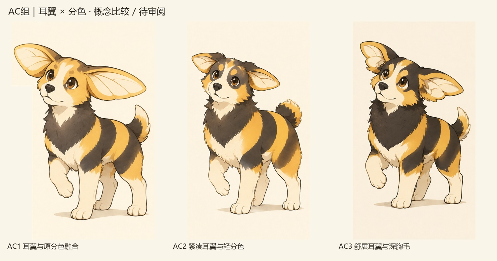

#### AC1｜耳翼与原分色融合

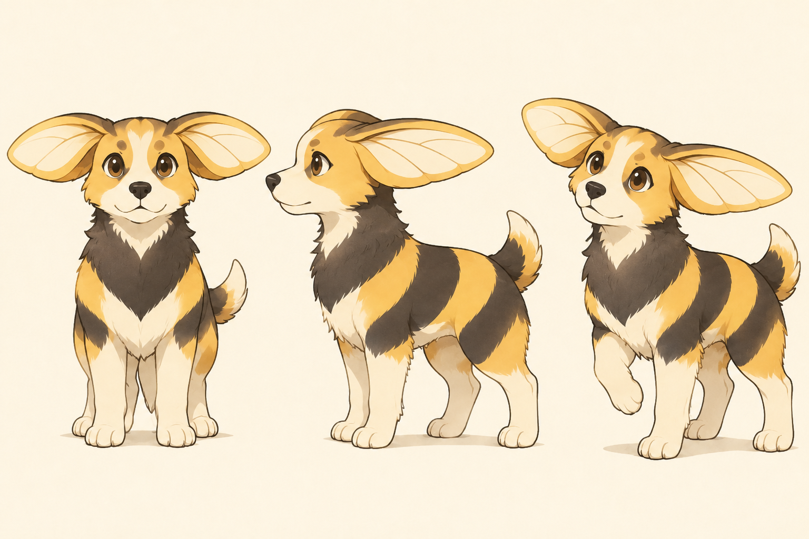

**实际观察与取舍：** A 的宽耳翼与 C 的深色胸毛、腹部条纹同时可见，融合最直接；耳翼与胸颈毛都在争取注意力。

#### AC2｜紧凑耳翼与轻分色

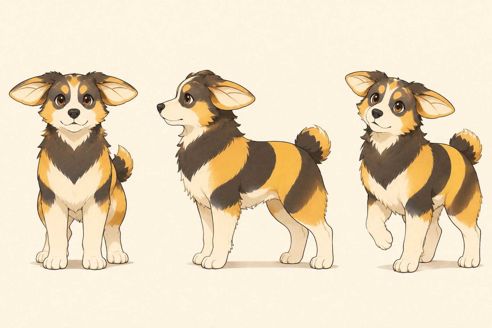

**实际观察与取舍：** 耳翼明显收拢；预设为较轻分色，但实际侧腹仍以宽色带为主，轻量化并不充分。头部也继承了 C 的深色面罩，偏离保留 A 金色脸部的目标，需单独判断是否喜欢。

#### AC3｜舒展耳翼与深胸毛

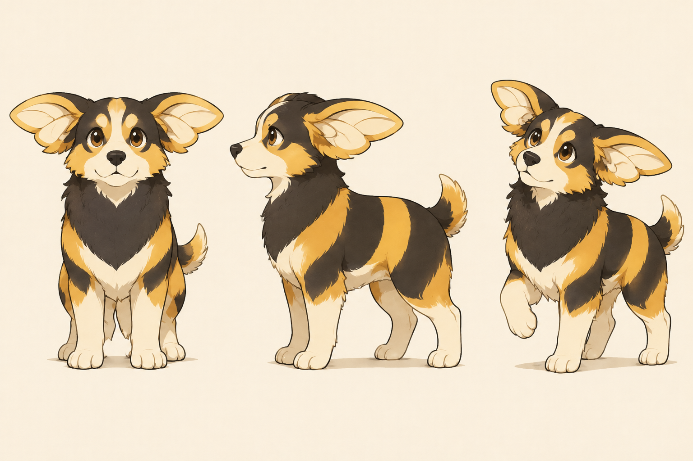

**实际观察与取舍：** 双叶耳翼与深色胸毛结合，耳缘层次和深浅对比都较强；同样继承了 C 的深色面罩。细节负担及蝴蝶联想需要后续比较。

## 4. 当前比较结论与下一步

从实际画面看，A 的区分集中在头像轮廓；C 的差异主要在躯干，头像单独使用时会丢失大部分条纹信息。AC 同时保留两种特征，但加法不自动带来更好的识别：耳翼、胸毛与条纹需要确定主次。以上是设计分析，尚无陌生受众识别测试。

**建议先比较 A1、A2 与 AC1、AC2：** 判断是否需要保留身体条纹，以及宽耳翼还是紧凑耳翼更像自己。A3、AC3 则检验双叶是否更有趣，或产生不希望的蝴蝶联想。C 三张作为毛色对照保留，不因变化较细就要求本人从中强行选出赢家。

反馈可以只写编号和局部，例如“AC2 的耳翼＋C3 的胸毛，但眼睛不要这么幼态”。先选值得继续的特征，再做轮廓、单色、头像尺寸与一组动作检验；不急于给角色命名或增加世界观。

尚未完成：严格结构与三视角校准、小尺寸与单色测试、自然形态观察、同类角色检索、原创性与商业应用验证。当前概念图不当作最终可交付规范。

[上一轮三方向与原图](蜜蜂与小狗_形态融合讨论稿_V01.md) · [视觉概念任务书 V02](视觉概念任务书_V02.md) · [视觉概念入口](README.md)
