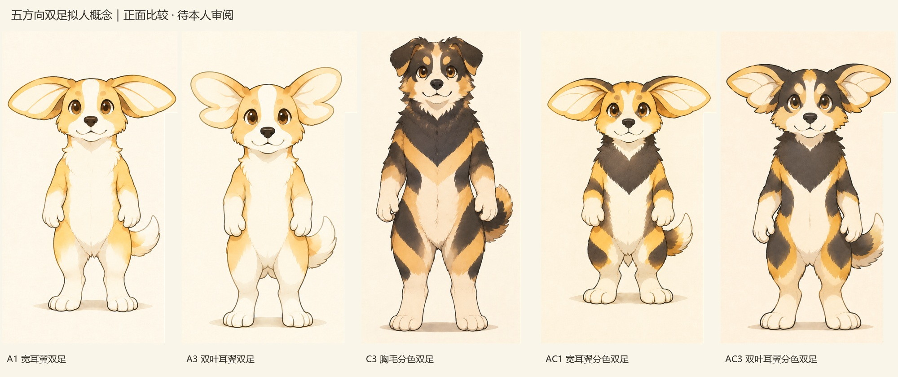
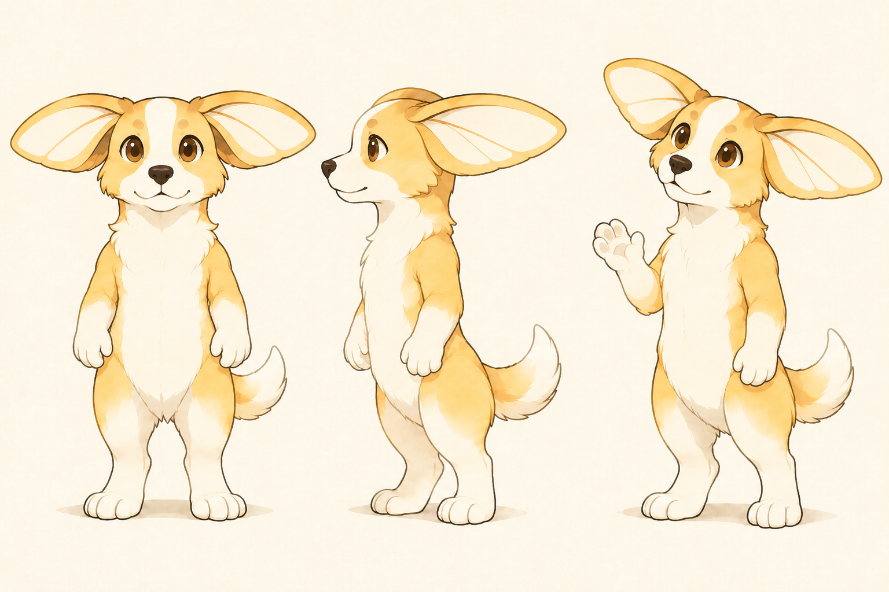
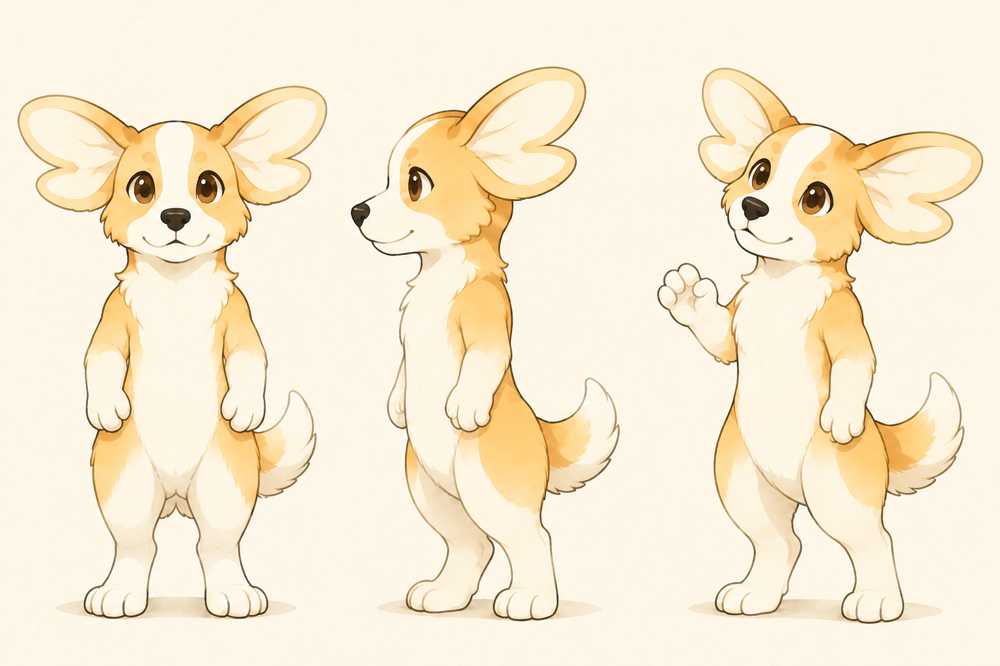
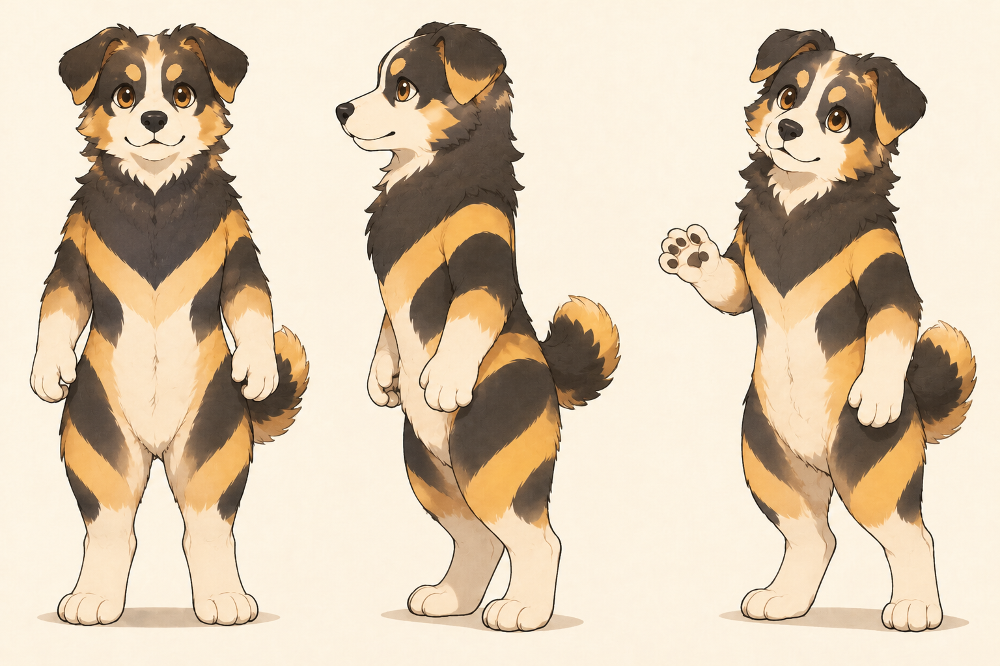
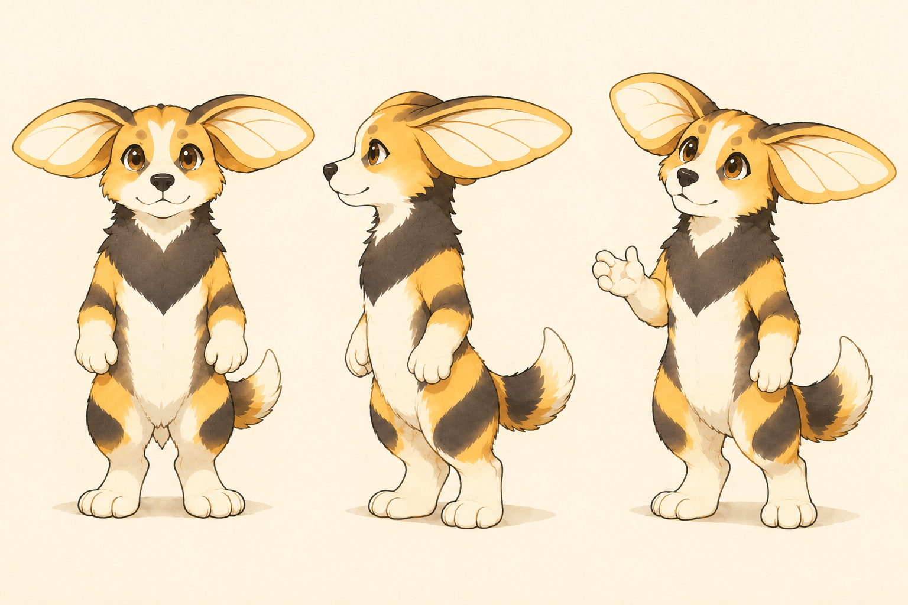
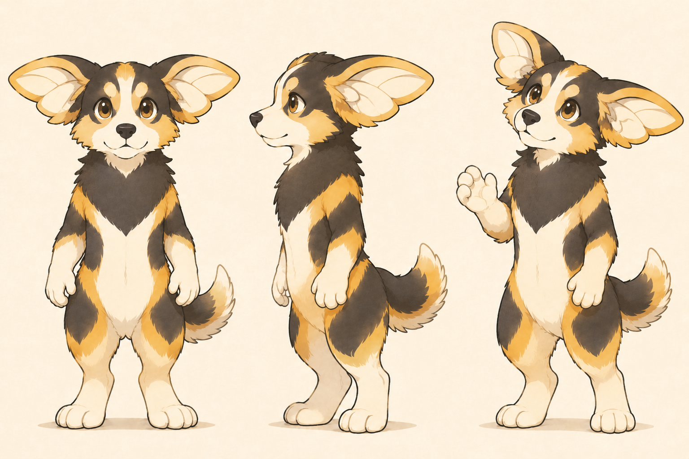

# 蜜蜂与小狗｜五方向双足拟人概念讨论稿 V03

## 2026-11-12｜本人反馈：优先发展 AC3

**本人原话：**“我目前更喜欢 AC3 的设定，有点像英雄联盟角色纳尔。”进一步询问吸引点后，本人回复“123”，即三项都认同：

1. 大耳、毛发和双足的整体造型。
2. 外表可爱但有力量感的反差。
3. 好奇、活泼、带一点野性的气质。

**当前状态：** AC3 成为后续重点探索方向；这不是角色定稿，也不意味着整张图的脸部、比例、毛发细节或色板已全部确认。其他方向保留为对照，B 继续不推进。下方“待本人审阅”记录五图交付时范围；本段补充此后真实反馈。

### 从偏好提炼设计目标

| 本人喜欢的部分 | 下一步工作建议 | 需要观察的结果 |
| --- | --- | --- |
| 大耳、毛发、双足 | 保留 AC3 双叶耳翼作为头部重点，把胸颈毛整理为少量大体块，继续双足表达 | 去掉毛发碎线后仍可辨认；耳翼在不同角度仍为同一结构 |
| 可爱但有力量感 | 比较更稳定的脚掌、重心和紧凑体块；用主动、准确的动作表现行动力 | 亲近感与行动力能共存，不只依赖放大眼睛或增加肌肉 |
| 好奇、活泼、略带野性 | 用探头观察、主动靠近、轻巧试探等非语言动作测试 | 有探索欲和主见，同时保留认真观察、细致操作的一面 |

以上方法仍为 AI 建议。此处“野性”只转译为主动探索与生命力，不把冲动、攻击性、暴躁或失控自动加入人格。本人过去对“哪些传播场景更活泼”保持待确认；本次确认角色气质中的活泼，不自动解除所有专业场景的克制表达。

### 关于“像纳尔”的理解与区分

“像纳尔”首先是本人给出的视觉与气质联想，并非正式相似度或原创性判断。此次已重新查看本项目 AC3 双足图；未完成纳尔各版本、皮肤与角色结构的逐图对照，不能据此断定哪些局部完全相同、是否足够独特或有无权利冲突。[英雄联盟官方纳尔角色入口](https://www.leagueoflegends.com/zh-cn/champions/gnar/)可供后续确认所指形态，不以未核实的细节指导制作。

下一轮围绕 AC3 自身耳翼的连接方式、犬类短吻与面部分色、蜂犬来源的毛色节奏和观察行为继续发展；纳尔用于帮助讨论偏好，不作为直接复刻脸部、耳形、比例、配饰或动作的目标。也不因提到“反差”就自动增加变身、战斗、武器或第二形态。

**本轮只整理反馈，无新生图任务。** 建议下一步先在 AC3 内比较身体体块与毛发简化，再测试一个“仔细观察”和一个“主动尝试”的动作；具体制作仍按本人后续要求执行。

---

日期：2026-11-12。状态：五张本轮交付概念图已生成并逐张查看，待本人审阅；角色、比例与名称未定稿。

## 本轮要求与设计处理

> “将a1、a3、c3、ac1、ac3拟人化，不再四脚站立，改为双足，修改为适合的头身比，生成概念图”

本轮只处理指定五个形象，各交付一张包含正面、侧面和四分之三手势的概念图。保留对应耳形、脸部与分色，不将本次入选当作角色定稿。B 继续不推进。

**拟人化的改动：** 躯干与骨盆改为直立承重，两条后肢作为腿和脚；前肢改为肩、肘与可表达的手。手不撑地，尾巴不支撑身体；通过站姿与简单手势比较，避免仅把四足犬转成抬前爪。

**头身比是本轮工作建议：** 以头顶至下巴、排除耳翼高度作为一个头长，初始目标约 3～3.5 头身，给头部识别与手势留空间。不是所有拟人角色都应采用此比例，也不表示 AI 已按精确尺寸作图。A/AC 组经过一次比例与手臂修正，C3 仍偏修长；不同角度的比例与重心有待校准。

沿用原图画风与候选色用于比较，保持毛发本体，不增加服装和道具；本轮不展开机械化。当前仍有写实犬类肌肉、毛发与膝踝结构的痕迹，不是已经完成简化的品牌角色规范。

全部使用 **`gpt-image-2.6-flare`**，通过已授权的 imagegen CLI/API 编辑。共五次初始请求及四次针对 A1、A3、AC1、AC3 的修正请求，交付五张修正后／选用图；四张初稿放在过程稿子目录。每张含三个角度，不等同于标准三视图。

[完整提示词、参考与生成记录](概念图/2026-11-12_双足拟人五方向/双足概念提示词与生成记录_V01.md)

## 五方向正面对照

预览只提取各张正面，完整原图在下方；保留完整 PNG，不以裁切预览代替原图检查。

## 五张完整概念图

### A1｜宽耳翼双足

**实际观察：** 宽耳翼与金白脸部保留，身体缩短、手臂自然下垂；抬手角度可作为后续非语言动作的起点。耳翼较宽，未来要检查头像裁切与摆臂时的视觉平衡。

### A3｜双叶耳翼双足

**实际观察：** 双叶缺口仍清晰，配合双足形成更活跃的上部轮廓；蝴蝶联想仍可能存在。与 A1 相比主要看耳翼形状，不预设哪个更符合本人。

### C3｜胸毛分色双足

**实际观察：** 保留垂耳、深色面部和下探胸毛，前肢已成为可表达的手臂；身体相对修长。原腹部条纹转译后更多分布在侧面、上臂与大腿，正面腹部仍为浅色，因此蜂类联想未必增强。

### AC1｜宽耳翼分色双足

**实际观察：** 保留宽耳翼、金白脸部与深色胸毛，直立后胸毛和两侧分色一起进入正面识别。仍要判断头部耳翼与胸毛谁主谁次，不能由元素更多推导更好。

### AC3｜双叶耳翼分色双足

**实际观察：** 保留双叶耳翼、深色脸部及胸毛分色；对比强、上部信息较多。直立后侧面分色与手脚交界仍需规范，未进行动作连续性验证。

## 下一步怎么反馈

先比较三个问题：哪张整体比例更像本人希望的角色；宽耳翼还是双叶耳翼更有辨识；是否保留深色面部和胸毛。可以跨方案保留局部，不必整套选择。

收到真实反馈后再做比例校准、手部与脚部简化、一个观察／发现动作和头像小尺寸测试。当前未完成单色识别、严格结构、动作序列、同类角色检索或商业应用验证。

[上轮四足九图](蜜蜂与小狗_AC方向迭代讨论稿_V02.md) · [视觉概念入口](README.md)
