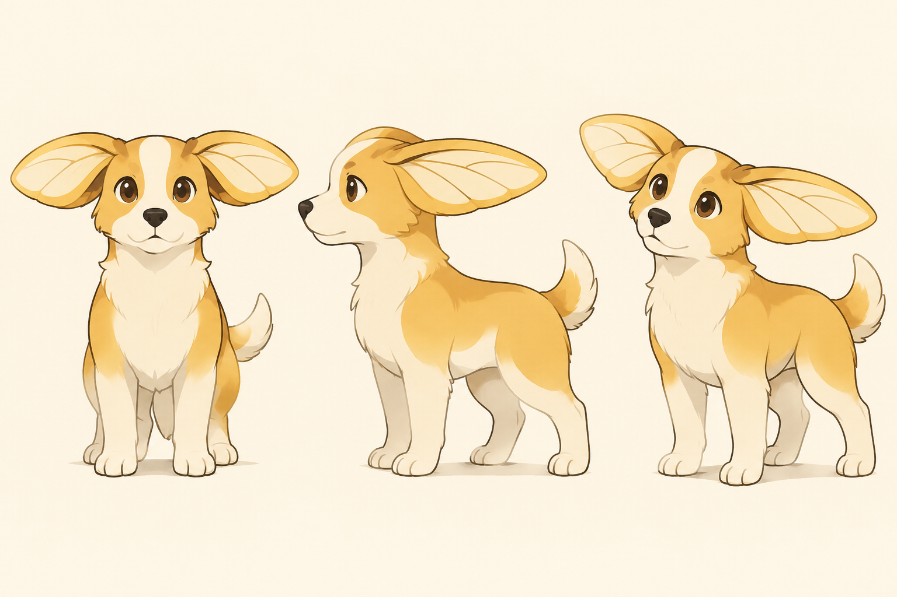
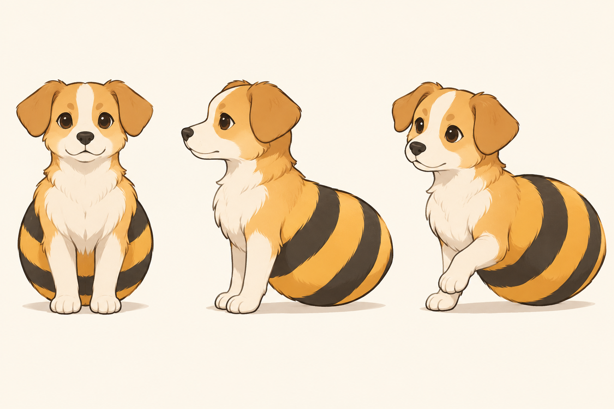
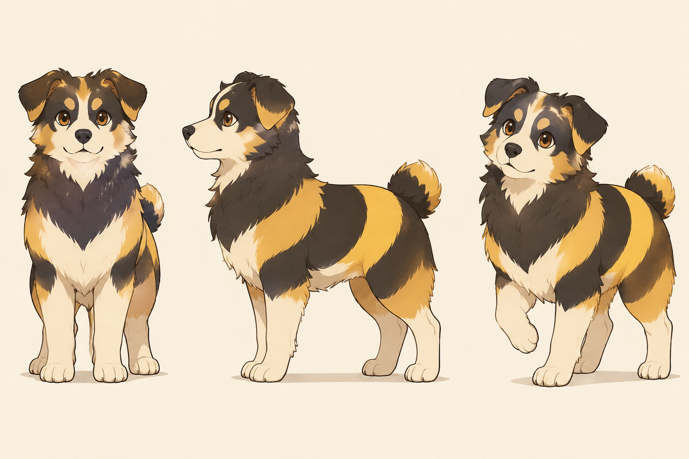
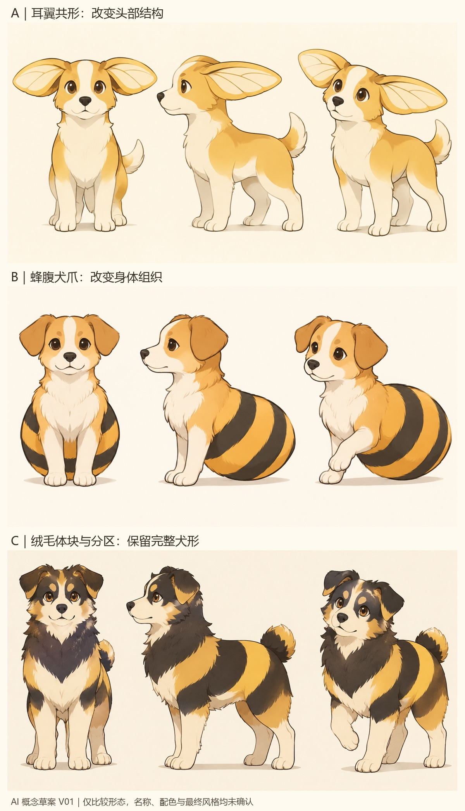

# 蜜蜂与小狗｜形态融合讨论稿 V01

**2026-11-12｜最新反馈与迭代：** 用户不喜欢 B，喜欢 A 的耳翼和 C 的毛色／纹路分区。本轮停止推进 B，完成 A、C、AC 各三张、共九张 `gpt-image-2.6-flare` 概念图，已逐张查看并嵌入[AC 方向迭代讨论稿 V02](蜜蜂与小狗_AC方向迭代讨论稿_V02.md)；旧图保留。喜欢局部特征不等于确认整体风格、名字或最终方案。下方关于 A／B 优先比较与未收集反馈的描述保留前轮语境，后续以本条与 V02 为准。

日期：2026-11-12。阶段：概念讨论。用户指定“先以蜜蜂和小狗为切入点”，希望研究两种生物怎样巧妙结合。下列为 AI 提出的造型假设与推荐比较方式；已按用户后续要求生成三张概念图并嵌入下文，仍无选定方案或正式名称。

**图像更新｜2026-11-12：** 用户要求为三种假设分别生成概念图、推送 GitHub 并嵌入本稿，随后明确授权 CLI/API 备用方式。三图请求模型标识均为 `gpt-image-2.5` 基础名，不是 flare 或 sunburst；它是当前 API 服务提供的调用标识，未据此核实底层模型来源。统一候选配色、插画表现与视角只服务于比较，不是本人已选品牌风格。[完整提示词、参数与生成记录](概念图/2026-11-12_蜂犬三方向/概念图提示词与生成记录_V01.md)。

## 1. 本轮输入与边界

- **用户已明确：** 本轮先研究蜜蜂与小狗的结合；此前希望尝试不同设计方向、角色未必叫 Beedog。
- **当前理解：** 这是本轮探索入口，不表示永久排除其他原型。角色正式名称继续开放，暂用方向编号。
- **延续输入：** Migo 是主品牌与专业判断主体；角色以动作和情绪表达为主。希望表达好奇、独立想法、认真细致，可以不可爱；机械化暂不重点强调。
- **个人联系：** 本人昵称与朋友对圆脸、蜜蜂小狗表情包的联想有关。这提供创作起点，不能直接证明某一种造型最适合本人；不描摹原照片。

## 2. 怎样理解“巧妙结合”

建议让两种来源参与同一个形态或行为关系。例如，一个耳部结构同时带有犬耳的根部关系和蜂翼的轮廓节奏，而不是每一种联想都新增一个器官。

“小狗穿蜜蜂服装”也是一种成立的设计路线，适合强调装扮与角色扮演。但如果希望像虚构物种一样拥有自身结构，就应优先研究耳、躯干和运动方式如何一体化。哪一种更好取决于希望表达什么，不能单凭融合复杂度判断。

本轮建议把“有主次、少量关键特征、同一套曲线关系、能支持动作”作为比较标准。它们是工作建议，不是生物学规律或原创性结论。

## 3. 三种不同的形态假设

### A｜犬耳与蜂翼共形

**实际图像观察：** 耳部翼片突出，犬形身体完整；较容易联想到其他昆虫，耳部展开／收拢的差异尚弱。此图用于判断融合机制，不视为“蜜蜂特征已被验证”。

**构想：** 保留能读成小狗的鼻口关系与头部。把耳朵发展成带有翼片感的扁平结构，让耳根、折叠处和轮廓共用一套形状；有兴趣时抬起、展开，平静时收拢。

**融合发生在哪里：** 耳部既承担犬类识别，也借用蜂翼的形态与展开联想。可以在精修阶段比较少量内部线条是否必要，先检查外轮廓，不预先加入复杂翅脉。

**怎样带出性格：** 面部仍平静，耳部先因发现新事物而展开，用局部动作表现内在好奇。非语言表达与本人既有倾向有联系。

**需要验证：** 耳形是否被误读为兔耳、蝴蝶结或其他昆虫；单靠耳形是否足以建立蜜蜂联想。若必须增加大量触角、翅膀和纹样才能解释，需重新考虑核心结构。

**特别说明：** “耳翼”是虚构结构。耳朵展开可作为情绪动作，不必立即承诺角色靠它飞行，更不是声称真实动物具有此结构。

### B｜蜂腹与犬爪组合

**实际图像观察：** 犬头与两前爪连接大体积条纹蜂腹，全身轮廓与 A、C 有明显区别；腹部与胸部的连接、转向和运动逻辑尚需精修，当前未验证它是否会被理解为服装。

**构想：** 上部保留犬类头部及一对前爪，后半身采用更集中、略有分节感的蜂腹体块。蜂腹成为角色身体的一部分，探索坐、倾身和悬浮等姿态，不预设全部姿态都要采用。

**融合发生在哪里：** 直接改变身体的组织方式。小狗的亲近感主要由头部与前爪承担，蜜蜂联想由腹部结构及后续运动方式参与建立。

**怎样带出性格：** 发现东西时头部先靠近、前爪轻触，身体跟着倾斜；可以比较投入探索与偶尔失衡的反差，注意不要把角色表现成持续不可靠。

**需要验证：** 是否更像小狗戴了条纹腰包，或被读成其他昆虫。仅用椭圆和条纹不能保证观者识别为蜜蜂；需要实际形态与参考对照。条纹先作为候选，单色时依然检查轮廓是否有自身特点。

### C｜犬毛与蜂身分区融合

**实际图像观察：** 完整犬形、胸颈绒毛和腹部色块分区清楚；蜂类联想主要由条纹和配色承担，可能仍被读作一只花纹特别的小狗。毛发细节较多，后续可比较进一步简化。

**构想：** 整体保留较完整的犬类身体，把胸颈绒毛的体量与腹部的分区节奏组织在同一轮廓里。变化首先体现在躯干宽窄、绒毛边缘与毛色分界，不要求大量新增器官。

**融合发生在哪里：** 用相近的体块和表面分区建立联系，形成更克制的蜂犬表达。圆脸可以比较，但不把脸颊肿胀或反复被蜇作为日常设定。

**怎样带出性格：** 外形较安静，靠嗅闻、侧头观察、仔细整理发现物等动作表达丰富想法。

**需要验证：** 蜜蜂联想可能最依赖配色与分区，去色后可能只剩普通小狗；也容易像穿着条纹衣服。它可作为较克制的对照，但不能预先宣布实现了强识别。

| 比较点 | A｜耳翼共形 | B｜蜂腹犬爪 | C｜体块与分区 |
| --- | --- | --- | --- |
| 主要改动 | 头部局部结构与展开动作 | 整体身体组织 | 躯干轮廓与表面关系 |
| 适合先观察的位置 | 头像、侧面、耳部动作 | 全身剪影、重心与姿态 | 单色轮廓、色块边界 |
| 主要风险 | 读成兔耳或其他昆虫 | 变成装扮、失去狗的识别 | 主要依赖黑黄，缺乏独立轮廓 |

**看图边界：** 三图的相同插画风格、配色、幼态程度不是最终选择；同图三个视角尚未做严格结构校准。未做单色、头像尺寸或陌生受众识别测试，不能从大图直接宣布通过。

**前轮推荐先比较 A 与 B（保留讨论）：** 它们一个从头部结构入手，一个改变全身组织，更容易检验不同结合机制。C 可作为克制表达的对照；不是要求三项全部制作，也不是已选 A 或 B。

## 4. 让结合进入行为，而不只停留在外形

可提出一个共同的角色行为概念：**发现、采集，再重新组合。**

以“小狗嗅闻”和“蜜蜂采集”的日常联想为出发点，将它们转译成角色观察与收集灵感的习惯；不是用动物行为证明本人性格，也不编造本人已有此类日常记录。

三个可试的非语言小情境：

1. 发现一个形状：先停下、靠近、侧头观察，再用前爪轻触。
2. 收集不同发现：比较大小与关系，再仔细摆放，表现认真而不是单纯囤积。
3. 尝试新组合：摆出一个意外结果，短暂停顿，然后继续调整；允许偶尔笨拙。

“灵感采集者”可作为内部叙事假设，不是正式角色名、对外口号或用户已确认的人设。是否增加采集物、道具与故事，等基础形象成立后决定。

## 5. 怎样控制元素与表达成本

先为每个草案确定犬类识别的主要依据，以及一个蜂类融合重点。耳、触角、翅、条纹、蜂巢和尾部不需要全部同时承担识别任务；若增加一个元素，应能说明它改善了什么。

黑黄可用于后续配色试验，当前未选色板。蜂巢可以进入品牌图形研究，但无需先铺满角色。尖刺、复杂翼纹或机械细节都应结合表达与使用检验，不因“蜜蜂”或此前灵感就自动加入。

亲切或认真不是靠减少笑容就能保证的。可以保持较克制的表情，通过目光、身体前倾、动作准确性和与对象的关系表现投入；这些效果需要实际草案与反馈验证。

## 6. 下一步最小比较

三方向概念表现已完成；以下更低精度、控制变量的结构测试及用户反馈仍未完成，不用已生成插画代替检验：

1. A、B 各画一个正面与一个侧面／四分之三角度的低精度形态，使用相近完成度。
2. 各增加一个“发现新事物”的动作，说明变化与保持不变的关系。
3. 先去掉名字与配色，观察能读出哪些生物特征、轮廓有何区别。观者的回答按原话记录，不要求必须猜中蜜蜂和小狗才算一切失败。
4. 再加入候选配色与 Migo 名称，比较小尺寸、名称阅读和整体气质。
5. 根据本人对“像不像我、哪里有意思、哪里不自然”的真实反馈决定继续方向，再讨论名字。

两种来源能否被逐一说出只是一个观察项，最终还要看角色是否有自身识别、能否表达与实际使用。当前不能从文字构想或生成图宣布独特、原创或商业有效；后续须补带来源的自然形态观察与同类角色对照。

## 7. 依据与状态

- 用户本轮指定蜜蜂与小狗为切入点，以及此前昵称由来、性格、表达倾向与角色命名开放的说明。
- [视觉概念任务书 V02](视觉概念任务书_V02.md)与[当前共同背景](../01_品牌策略/品牌设计简报_讨论稿.md)。
- 此前 [GitHub 案例](../../03_学习资料/案例分析/品牌设计案例/GitHub/01_角色标识与品牌分工.md)用于理解混合角色与识别分工，不复制 Octocat 的头身比例、触腕或具体构图，也不将上述方案说成 GitHub 官方方法。
- 本轮无新增自然照片、解剖资料或视觉参考板；“耳翼”“蜂腹犬爪”等是虚构造型，非生物结构的复原。已生成并实际查看三张概念图，未指定正式名字或批准方案；AI 协助范围、完整提示词与参数见上方生成记录。

[视觉概念入口](README.md) · [任务清单](../07_项目管理/品牌任务清单.md)
