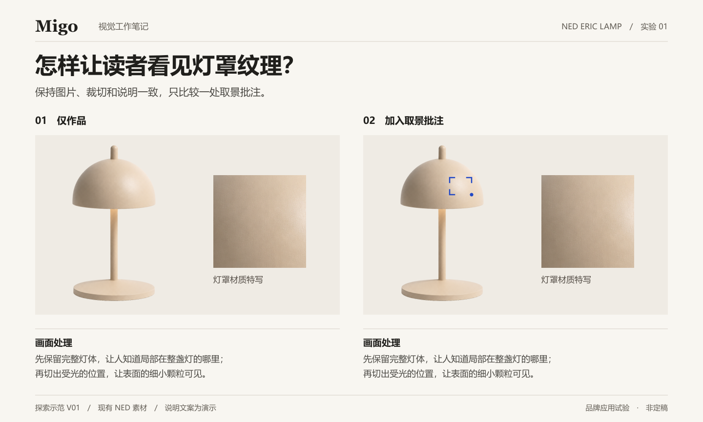
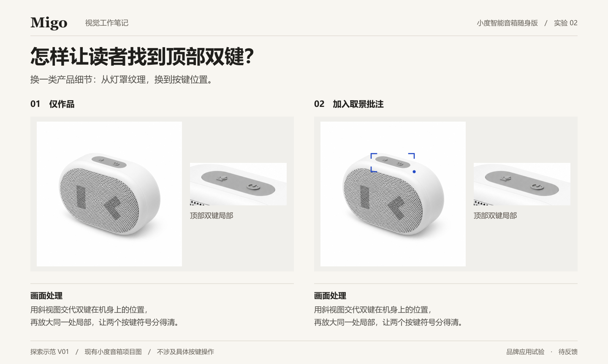

# Migo 品牌视觉语法测试板 V01

**日期：2026-11-24｜阶段：方向测试，不是品牌规范定稿**  
**工作假设：** 用「作品优先、标出值得看的细节、说明设计判断」形成 Migo 的视觉表达。此板测试的是一种可复用的呈现方法，不是在确认 Logo、字体、品牌色或角色。

> **核心表达（待验证）**：Migo 不只展示结果，也会指出一个让结果成立的关键细节。

## 视觉规则草案

| 规则 | 本轮处理 | 需要验证的风险 |
| --- | --- | --- |
| 作品优先 | 让项目图占主要视觉面积；标题和批注不盖住关键画面 | 页面是否仍然有清楚的阅读入口 |
| 信息分层 | 项目名／一句判断／作品图／局部批注，避免把说明写成大段宣言 | 读者能否快速区分项目事实与设计解释 |
| 细节标记 | 用缺角框加圆点提示位置；优先不加整圈描边 | 是否比不加标记更容易找到目标，是否显得像界面扫描框 |
| 信号色 | 钴蓝暂作批注色候选，项目图片保留自身颜色 | 蓝色是否抢眼；换到不同色调项目时是否仍合适 |
| 角色 | 本测试板不使用观察点角色 | 避免把角色效果与批注系统混为一谈 |

**色彩候选（未定）：** 纸白 `#F4F2ED` · 墨黑 `#20211F` · 批注蓝 `#315BEA`。本轮项目图中的标注仍沿用现有示范稿，色值并未通过屏幕校色或可访问性检查；不应据此视作最终色板。若蓝色在作品中显得突兀，优先尝试黑白标记，而不是给项目图片统一调色。

**文字候选：** 清晰的无衬线标题与正文、克制的小号索引和旁注。当前不指定具体字体，避免跨设备替换造成误差；后续需在实际作品集环境测试字号、行长和中英文混排。

## 跨项目试用

### NED｜灯罩材质细节

检验批注能否把视线带到与材质表达有关的局部，同时保留台灯整体氛围。

### 小度音箱｜顶部双键结构

检验同一类标记能否从材质细节迁移到产品结构，不改变项目图片与项目本身的视觉语气。

## 这轮要回答的问题

请让没参与制作的人先看对照图，不告诉他们“这是品牌视觉”，也不先指出标记所在位置：

1. 第一眼看到了什么？
2. 哪个细节更容易找到？能否在整体图上指出对应位置？
3. 你觉得标记表达了什么？它帮助理解，还是更像装饰／扫描框？
4. NED 和小度音箱是否像同一个人用相同方法讲述，但又保留了各自项目气质？
5. 看完后你记住的是作品、设计判断，还是蓝色框？

记录每位读者的原话、版本顺序和是否见过项目。不要把单个反馈当作结论；现有 NED 正向反馈是 Migo 转述的初步观察，人数和观看条件未记录。小度音箱样本的独立反馈仍待收集。

## V01 的暂定判断门槛

- **继续：** 两个项目都更容易定位重点；读者能说出相应的作品细节或设计判断；标记没有压过作品。
- **调整：** 只有一个项目有效，或读者只记住蓝色／框形。分别检查标记位置、粗细、色彩与说明文字，不急着扩展元素。
- **暂缓固化：** 读者无法理解标记为何存在，或统一版式让项目看起来失去自身风格。先保留项目各自呈现，不做全面品牌套版。

**边界：** 这是一张视觉语法测试板，不是完整品牌视觉系统；没有制作新角色图、Logo、网站样稿，也没有验证移动端、打印和色彩无障碍表现。观察点仍是可选角色概念，不因本板而定稿或淘汰。
