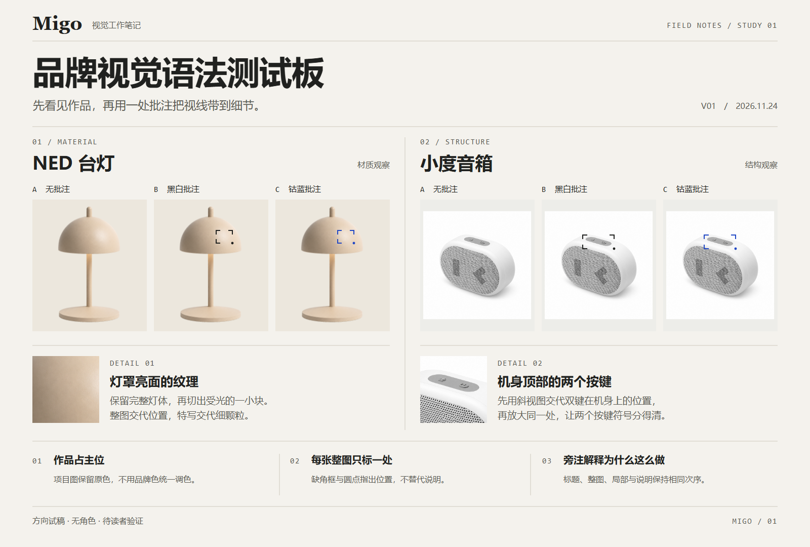

# Migo 品牌视觉语法测试板 V01

**日期：2026-11-24｜阶段：方向测试，不是品牌规范定稿**  
**工作假设：** 用「作品优先、标出值得看的细节、说明设计判断」形成 Migo 的视觉表达。此板测试的是一种可复用的呈现方法，不是在确认 Logo、字体、品牌色或角色。

> **核心表达（待验证）**：Migo 不只展示结果，也会指出一个让结果成立的关键细节。

[查看原尺寸 PNG](Migo品牌视觉语法测试板_V01.png) · [可编辑 SVG](Migo品牌视觉语法测试板_V01.svg)。尺寸 1600 × 1080；原有项目图片内嵌，文字和取景批注保留为独立对象。板上的 `Migo` 是试排署名，不是正式字标。

## 视觉规则草案

| 规则 | 本轮处理 | 需要验证的风险 |
| --- | --- | --- |
| 作品优先 | 让项目图占主要视觉面积；标题和批注不盖住关键画面 | 页面是否仍然有清楚的阅读入口 |
| 信息分层 | 项目名／一句判断／作品图／局部批注，避免把说明写成大段宣言 | 读者能否快速区分项目事实与设计解释 |
| 细节标记 | 用缺角框加圆点提示位置；优先不加整圈描边 | 是否比不加标记更容易找到目标，是否显得像界面扫描框 |
| 信号色 | 钴蓝暂作批注色候选，项目图片保留自身颜色 | 蓝色是否抢眼；换到不同色调项目时是否仍合适 |
| 角色 | 本测试板不使用观察点角色 | 避免把角色效果与批注系统混为一谈 |

**本板用色（未定）：** 纸白 `#F4F2ED` · 墨黑 `#20211F` · 批注蓝 `#2148C5`。黑白与钴蓝版只换批注颜色，位置和线宽相同。黑白指批注，不是把项目图灰度化。色值不作为最终色板。

**本板层级：** 大标题 → 项目名 → 整图 → 局部标题与旁注；小号索引只用于定位。中文优先使用系统无衬线，不定品牌字体。SVG 的字体会随环境替换；按本次排版审阅以 PNG 为准。

## 跨项目试用

### NED｜灯罩材质细节

检验批注能否把视线带到与材质表达有关的局部，同时保留台灯整体氛围。

[此前的 NED 两版对照](NED取景批注_对照示范_V01.png)，保留为前轮参照。

### 小度音箱｜顶部双键结构

检验同一类标记能否从材质细节迁移到产品结构，不改变项目图片与项目本身的视觉语气。

[此前的小度音箱两版对照](小度音箱取景批注_对照示范_V01.png)，保留为前轮参照。

## 这轮要回答的问题

测试板用于并排审稿，不直接当盲测材料。测试第一眼时只展示一个版本，遮去 A/B/C 标题、其他版本和板底规则；用同样的显示尺寸。之后再给相同的局部与说明，观察定位；最后才并排比较。若同一人看多版，轮换首看版本，避免把记住位置误判为标记有效。

1. 第一眼看到了什么？
2. 哪个细节更容易找到？能否在整体图上指出对应位置？
3. 看完你会怎么解释这张整图和局部为什么放在一起？
4. NED 和小度音箱是否像同一个人用相同方法讲述，但又保留了各自项目气质？
5. 并排看以后，哪个版本让你最容易把局部和整图对应起来？为什么？

记录每位读者的原话、版本顺序和是否见过项目。现有 NED 正向反馈是 Migo 转述的前轮观察，人数和观看条件未记录；本板仍没有新反馈。本板能比较批注有无与颜色差异，但两项目未做不同版式的对照，不能单独归因到字级、留白或其他排版规则。

## V01 的暂定判断门槛

- **继续：** 两个项目都更容易定位重点；读者能说出相应的作品细节或设计判断；标记没有压过作品。
- **调整：** 只有一个项目有效，或读者只记住蓝色／框形。分别检查标记位置、粗细、色彩与说明文字，不急着扩展元素。
- **暂缓固化：** 读者无法理解标记为何存在，或统一版式让项目看起来失去自身风格。先保留项目各自呈现，不做全面品牌套版。

**边界：** 这是一张视觉语法测试板，不是完整品牌视觉系统；没有制作新角色图、Logo、网站样稿，也没有验证移动端、打印和色彩无障碍表现。观察点仍是可选角色概念，不因本板而定稿或淘汰。
