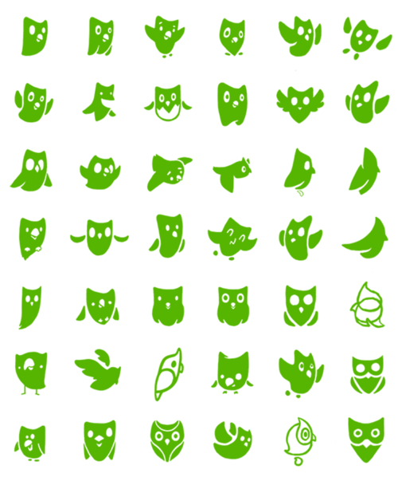

# Migo 个人品牌｜视觉概念任务书 V02

**2026-11-12｜本轮入口补充：** 用户随后指定“先以蜜蜂和小狗为切入点”。当前先按[形态融合讨论稿 V01](蜜蜂与小狗_形态融合讨论稿_V01.md)比较不同结合机制；这不取消命名开放，也不代表永久排除其他角色原型。耳翼共形、蜂腹犬爪等均为 AI 概念建议；用户后续已要求生成三方向概念图并嵌入讨论稿，实际完成见该稿，仍未选择方案。下方“没有制作”的表述记录任务书修订时的范围。下方开放范围保留为整体探索边界，本轮优先对象以本条为准。

修订日期：2026-11-12。状态：开放角色命名与不同设计方向；具体概念尚未选择。本轮交付为任务书修订，没有制作参考板、角色草图、字标、色板或应用方案。

**用户最新输入：**“我想尝试不同的设计方向，这个角色未必一定就叫 Beedog。”因此 Beedog（蜜狗）改为历史暂用名／候选名，不再作为所有方案的固定名称。昵称由来仍是真实背景，但不能据此要求所有角色必须是犬类、圆脸或蜂犬组合。非犬类与抽象角色是为开放探索提出的比较选项，不表示用户已经选定或放弃犬类。Migo 主品牌未提出更名。

**版本变化：** [V01](视觉概念任务书_V01.md)保留历史内容；本版取消固定 Beedog 名称及“必须保留犬类来源”的前提，将原三个表达切入点改为可跨方案使用的研究维度。

**继续有效的优先级：** 用户此前要求“现在编写视觉概念任务书，机械化暂不用重点强调。”因此本阶段优先探索个人联系、角色人格、识别与品牌表达；机械化不设为主线、必选造型或比较轴。此前机械相关联想保留为历史输入，不等于永久禁止，也不要求先确定机械程度才能开始。

## 1. 这份任务书要解决什么

把已完成的案例学习与候选设计原则，转化为可比较的原创视觉方向，帮助 Migo 判断：**哪种表达更像自己，怎样让想法丰富与认真细致同时被感知，品牌角色如何参与其中。**

这里的“视觉概念”指一套有理由的表达设想，包括核心想法、形态关系、文字与色彩倾向及应用逻辑；不是单张漂亮图片，也不是已经完成的品牌规范。

建议沿用内部方向：**用清楚的秩序承载丰富的想法，让好奇心通过角色行为与真实创作过程被看见。** 该方向来自[设计原则讨论稿](../01_品牌策略/Migo设计原则_讨论稿_V01.md)，仍是工作建议，不替换已有主张“好奇探索，认真设计”。

## 2. 固定输入与开放选择

| 项目 | 本阶段如何使用 | 状态与边界 |
| --- | --- | --- |
| 近期目标 | 支持深圳 AIGC／视觉设计求职，兼顾以后接单与个人表达 | 用户已明确；品牌完善与求职可并行 |
| 品牌关系 | Migo 是本人及主品牌，角色承担人格化与情绪表达；BD 不独立命名 | 主体与角色分工延续，不固定角色名字 |
| 角色名称与形态 | Beedog 为历史暂用名／候选名；以“方向 A／B／C”标记未命名方案 | 名称与形态开放比较，未选定替代名；犬类不被排除，也不是必选条件 |
| 个人联系 | 昵称来自朋友对本人圆脸与蜜蜂小狗表情包的联想 | 本人自述；不直接使用原照片或借此宣称原创性已验证 |
| 人格与期待 | 好奇、友好、想法丰富、独立、认真细致，允许偶尔笨拙 | 用户输入；转化成具体行为与形式，不编造内心信念 |
| 角色表达 | 通常通过动作、眼神与姿态表达；设计说明由 Migo 负责 | 用户已明确；特殊发声情境未定 |
| 可爱程度 | 可以亲和、有趣，也可以不可爱 | 不强制大眼、圆头、短肢、幼态比例或犬类；个人联系可以通过行为与设计逻辑建立 |
| 文字气质 | 愿意解释原因、亲切直接、克制简洁 | 少用网络热词但不绝对禁止；活泼场景仍待选择 |
| 机械化 | 暂不重点强调，不承担本轮核心概念 | 用户最新调整；不把“机器人狗”作为默认解法 |
| 黑黄、蜂巢 | 可选灵感，不作为所有方向的共同前提 | 此前兴趣仍保留；不因暂缓机械重点而推导为颜色或图形已被否定 |
| 字标、字体、色彩、媒介 | 通过概念比较逐步选择 | 不预设最终大小写、色值、二维／三维或独立图形 Logo |

## 3. 本轮探索要回答的三个问题

1. **为什么属于 Migo？** 从真实个人联系、观察或创作态度出发，说明核心想法；不以 INTP、AI 使用或科技外观代替个人内容。
2. **每个方向怎样建立自己的识别？** 不同方向可以是不同角色原型；在同一方向内部找到可持续保留的轮廓、比例或结构关系，让动作变化后仍有身份线索。不同方向之间不要求长得像同一个角色。
3. **如何与专业作品共处？** 让角色、名称、简介和项目成果各有职责，既能承载个性，也不遮挡作品与说明。

“丰富内心”不需要全部变成装饰。可以通过观察的对象、动作反应、概念推演和设计说明逐步展开；具体内容应由真实输入支撑。

## 4. 怎样形成真正不同的方向

先从要表达的个人内容出发，再比较角色原型与视觉组织。建议初轮保留三个有实质差别的方案，数量可随内容调整，不能只给同一只狗换颜色、材质或表情。

可考虑的原型范围包括：延续昵称线索的犬类角色、从本人观察或创作习惯出发的其他具象角色、由形状和行为形成的抽象角色。这只是扩大探索范围的建议，不预设每类必须各做一套，也不为未获得的个人故事补造依据。

**先用方向编号工作，再结合形象和概念讨论角色命名。** Beedog 可留在候选中，不要求立即另起名字；名称不是开始探索的门槛。

### 可跨方案使用的表达维度

以下“观察与留白／联想与组合／情绪与反差”延续 V01 的研究价值，但不再当作必须逐一执行的三个方案。任何角色原型都可组合使用，具体力度通过图像比较。

| 表达研究维度 | 要验证的想法 | 可研究的形态与系统关系 | 主要风险 |
| --- | --- | --- | --- |
| 观察与留白 | 不用夸张喧闹，也能让人感到好奇、敏感与认真 | 视线、头部倾向、局部轮廓特征；清楚的字标与克制的画面节奏 | 过于安静，变成缺乏个人记忆点的通用设计 |
| 联想与组合 | 丰富想法可以通过元素之间的关系被看见 | 有依据的形状组合、轻度形变或图形呼应；角色与字标、辅助图形之间形成联系 | 符号堆叠、事后强行解释，或把蜂巢当作差异化捷径 |
| 情绪与反差 | 外在神态和投入创作时的行为可以形成层次 | 平静与好奇、稍显迟钝与投入专注等候选关系；用重心与动作节奏表达 | 把笨拙误写成不可靠，或仅剩可爱而缺少想法 |

各方向围绕本人希望表达的好奇与认真发展，但不要求共享同一套外形。“联想与组合”不等于机械组装，“情绪与反差”不等于机械外壳与柔软内心。反差两端由方案与本人反馈确定。

方向之间至少应在核心表达、轮廓比例或视觉组织中有可说明的差异。只把同一角色分别做成金属、毛绒和塑料，不算三个完整概念。

## 5. 工作顺序与每个方向的最低信息

以下数量是控制工作量的建议，不是原有品牌规范或已经完成的成果。优先低成本比较想法，方向收敛后再提高精度。

### 第一步｜写概念，整理有针对性的参考

每个方向准备一段简短概念说明，回答“来自什么个人输入、希望传达什么、为什么采用这一角色原型、与其他方向有何区别”。个人依据可来自昵称、真实观察或创作态度，不要求全部解释为蜜蜂或小狗；没有本人输入支持的内容标为建议，不补造故事。

同时说明角色与 Migo 字标、图形和版式的关系，让比较覆盖整体品牌表达。名称暂用方向编号，避免先起名再为名字强行找造型。

再整理少量参考图片，建议每方向 4—6 张，标注原始来源及只学习什么，例如轮廓、动作、字体关系或色彩组织。参考板用于讨论气质和方法，不整套照搬一个品牌；暂不大量追加机械、装甲与零件参考。

参考直接嵌入 GitHub Markdown，配看图说明，避免只给一串网址。未实际看到图片就不写视觉结论。已有[六案图解](../../03_学习资料/案例分析/品牌设计案例/六案例横向归纳.md)用于方法对照，不直接充当各方向已选参考板。

### 第二步｜用基础形态比较，避免材质掩盖结构

建议每方向先有两个轮廓或比例草案，再选一个继续表达。先用平面、剪影或简化色块看形态，不要求写实渲染或完整三维。平面优先是节省比较成本的建议，不是最终媒介选择。

每个方向继续给出：一个基础姿态、一个观察状态和一个投入思考／尝试状态，说明哪些特征不变。三种状态用于检查表达范围，不代表标准动作库已定。

**看图提示：** 图中同样保持绿色与猫头鹰联想，轮廓、眼睛和翅膀关系仍有差异。这里只学习在一个方向内部比较变量的方法，不要求 Migo 各方向沿用同一物种，也不复制形象。这是[官方历史文章](https://blog.duolingo.com/reshaping-duo/)的归档截图，观察日期 2026-11-10；[完整范围](../../03_学习资料/案例分析/品牌设计案例/Duolingo/01_角色识别与系统化表达.md)。

### 第三步｜把角色放回 Migo 的整体身份

每方向配一个暂定的 Migo 字标表达或排字示意、一组候选色彩与角色／文字／强调色的分工，以及一条必要的辅助图形思路。没有实际用途可以暂不增加辅助图案；字体示意必须标注为候选，正式采用前核对中文覆盖与使用条件。

字标负责名称特定形式，正文负责阅读。字体与角色可以有共同节奏，但不要求把狗、蜜蜂、圆脸和所有故事都塞入字母。

色彩可在单色结构成立后介入。黑黄可以参与其中一个方向的试验，但不因昵称来自“蜜狗”就要求全套用黄色；也不预定各方向必须采用不同颜色。

### 第四步｜用相同内容与用途作对照

各方向使用同一批文字与同一件已有作品，以相近的精度展示。避免一个方向有精致样机，另一个只有草图，导致比较主要受完成度影响。

| 统一检验用途 | 要看什么 | 最小示意内容 |
| --- | --- | --- |
| 头像与个人介绍 | 头像裁切与缩小后是否可辨，名称与角色能否建立关系 | 各方向角色头像、Migo 名称、同一段设计方向介绍 |
| 已有作品的案例开篇 | 项目仍是焦点，角色和品牌署名不覆盖关键成果 | 相同作品图、项目标题、自主项目属性及真实职责摘要 |
| 一则创作过程分享 | 动作能否辅助表达观察或思考，说明仍由本人承担 | 同一段真实设计取舍、一个相应角色动作 |

这些是静态概念检验，不扩大为网站 UI 开发、实际账号发布或全套模板交付。具体平台规格在选定真实触点后核对，不在本任务书编造数值。

**看图提示：** 脸部变化较少，坐、卧、捧杯和泡茶仍能组织不同情境。品牌角色可学习“行为＋情境”的方法，不需要同样体型、杯子或可爱程度。来源：[Studio Moara](https://studiomoara.com/work/big-tea-branding-and-mascot-design)，观察日期 2026-11-11；[完整讲解](<../../03_学习资料/案例分析/品牌设计案例/Big Tea/01_角色与商业视觉应用.md>)。

## 6. 概念阶段的交付清单

| 交付 | 用途与完成边界 |
| --- | --- |
| 方向说明与参考板 | 显示个人依据、学习点与差异，来源图片和说明就近配对 |
| 轮廓比较及选用理由 | 看得到形态备选和取舍，不把后补示意假装成原始过程 |
| 基础形象与少量行为状态 | 检查角色识别及非语言表达；不是最终三视图和动作规范 |
| 字标、色彩与必要图形的概念示意 | 检查整体气质与分工；不是最终标识、字体授权结论或色彩规范 |
| 三个统一用途的静态示意 | 比较头像、案例开篇和过程分享，不以样机装饰代替阅读检查 |
| 横向比较与本人反馈 | 记录保留、调整、舍弃和理由；各元素是否采用分别记录 |
| 版本与创作记录 | 保留可修改文件、AI 协助范围、本人提出及调整的内容、素材来源 |

后续普通文件使用中文名，以方向和版本区分；任务书、比较说明、参考与源稿集中在本视觉概念目录管理。参考品牌图片与原创候选稿分开存放并写明归属，不将外部图片标为原创资产。

## 7. 怎样比较与进入下一步

按设计原则逐项写“观察到什么、存在什么问题、下一步怎样改”，不急于用总分替代理由。

| 判断项 | 应提供的依据 |
| --- | --- |
| 个人契合 | 本人能指出像自己和不像自己的具体地方，概念可联系到真实输入 |
| 识别 | 在各方向内部检查识别是否稳定，不把不同方向长得不同当作漂移；不只靠材质、颜色和道具 |
| 情绪表达 | 去掉台词和情绪标签，记录实际看出了什么，以及歧义 |
| 信息与专业表达 | 名称可读、作品突出、职责清楚，视觉趣味未打断说明 |
| 系统关系 | 角色、文字、色彩与图形有联系，换场景后仍可维护 |
| 制作与迭代成本 | 能说明哪些细节增加工作、如何复用、哪些可以延后 |

先解决身份误读、名称难辨、作品被遮挡、角色大幅漂移等问题，再比较细节偏好。头像按实际显示大小查看，同时对照深浅背景、单色和裁切；不从大图直接宣布通过。

需要外部理解反馈时，记录具体人数、情境与原话；少量反馈用于发现问题，不推算普遍识别率或求职效果。

**阶段收敛的结果：** 本人选择一个主方向，或指出具体需要继续发展的部分；记录保留与舍弃的理由，形成下一版任务。角色名字可随概念收敛再讨论，没有选择结果就不宣布正式命名。不要将不同方案最喜欢的装饰全部拼在一起，若组合就重新检查概念和造型是否一致。

本阶段无需完成最终标准形象、完整三视图、表情全集、三维绑定、周边与品牌手册。未来进入角色和识别精修时，再据选定方向明确规格。任务书已写成不等于上述制作已执行，也不代表七条原则已获整体确认。

## 8. 当前明确不必提前解决的问题

角色正式名称不是本轮阻塞项；犬类、非犬类或抽象原型都可作为候选研究。机械化程度也不是阻塞项；黑黄、蜂巢、具体色值与字体可以在概念中比较。复杂角色世界观、全套商业化路径、全部历史案例缺口与完整网站不作为启动概念探索的前置条件。

真正需要本人参与的是对“像不像我、哪种想法值得继续、哪些反差自然”的判断。可以在看到具体概念后逐步回答，不要求本人在看到方案前先独自确定所有形式和参数。

## 9. 依据与后续维护

- 用户 2026-11-12 明确希望尝试不同设计方向，角色未必叫 Beedog；本版据此开放命名，不再由历史名字推导必须犬类。用户没有选定替代名或新物种。
- 此前机械化暂不重点强调的要求继续有效。
- [共同背景](../01_品牌策略/品牌设计简报_讨论稿.md)、[品牌架构](../01_品牌策略/品牌架构.md)与[设计原则](../01_品牌策略/Migo设计原则_讨论稿_V01.md)提供本人输入与候选判断标准。
- [六案例横向归纳及图解](../../03_学习资料/案例分析/品牌设计案例/六案例横向归纳.md)提供方法依据，各案观察范围不同，不据此宣布商业成效。
- [大黄蜂历史联想](../01_品牌策略/个人品牌探索/2026-11-10_大黄蜂灵感与品牌系统映射_讨论稿.md)继续保留，由更新说明标明当前优先级，不删除个人探索记录。

后续参考收集、草案制作和选择结果按真实产出补充。采用、修改与未采用均记录理由，重要调整写入[决策日志](../07_项目管理/品牌决策日志.md)。

[视觉概念入口](README.md) · [品牌项目入口](../README.md) · [任务清单](../07_项目管理/品牌任务清单.md)
