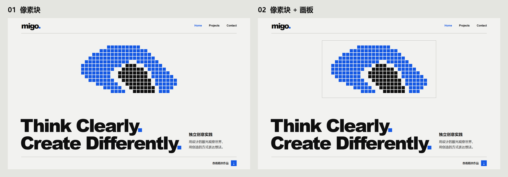

# Migo A 版 Hero｜视觉母题对照 V01

2026-11-27 · 桌面静态概念图 · 待审阅

用 [A 版首屏](../Sommerseth分析驱动首页_V01/README.md)试验画板与像素块的分工。延续 `migo.` 字标、Home / Projects / Contact 导航、两行英文标语、中文「独立创意实践」和「查看精选作品」入口。把品牌主张补在右下。配色沿用 A 版灰白 `#F2F2F0`、墨黑 `#0E0E0E`、钴蓝 `#1458E4`，以本机 Arial 和微软雅黑做静态排版。

参考 Migo 提供的 Sommerseth Hero 截图里上方图形与下方主张的阅读顺序，保留右侧短说明和底部入口。主视觉由原创折叠形和方格单元构成。首屏只展示品牌信息和作品入口，作品内容从下一屏开始进入。[Sommerseth 归档分析](https://github.com/Migo1203/migo-portfolio/blob/main/UI设计/案例拆解/Sommerseth%20Design首页分析/设计元素与案例分析.md)

| 概念图 | 对照变量 | 审阅问题 |
| --- | --- | --- |
| [01 像素块，1440 × 900](01_像素块.png) | 原创块面在留白中独立呈现。 | 图形脱离画板后是否仍完整、好认？标语是否清楚？ |
| [02 像素块加画板，1440 × 900](02_像素块与画板.png) | 在相同位置加入 1 px 画板边界。 | 边界是否让主图形更好读，或让人更容易联想到创作中的画板？ |

**初步设计观察。** 像素块在两稿都能形成清楚的轮廓。01 的上半屏更开阔，02 的画板提示更明确。由于边框与标语之间留有明显间距，两张图的主要阅读顺序接近。这是静态图观察，访客能否辨认「画板」仍待审阅。

两张图均在 Edge 以 1440 × 900 导出。已逐像素确认差异只出现在画板边缘。可在[绘图源稿](绘图源稿.html)用 `?variant=framed` 查看带框构图，默认显示无框构图。本轮交付用于桌面静态对照。

[返回六张母题线索研究](../../视觉母题线索概念图_V01/README.md)
