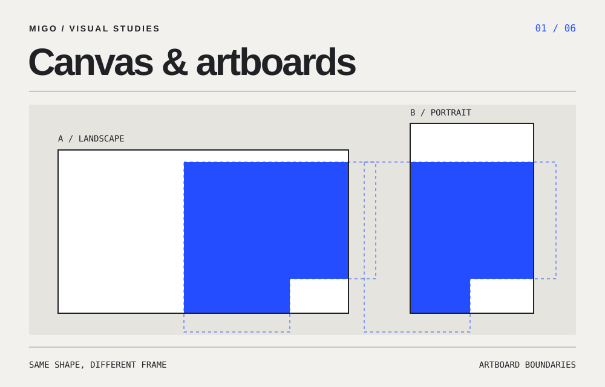
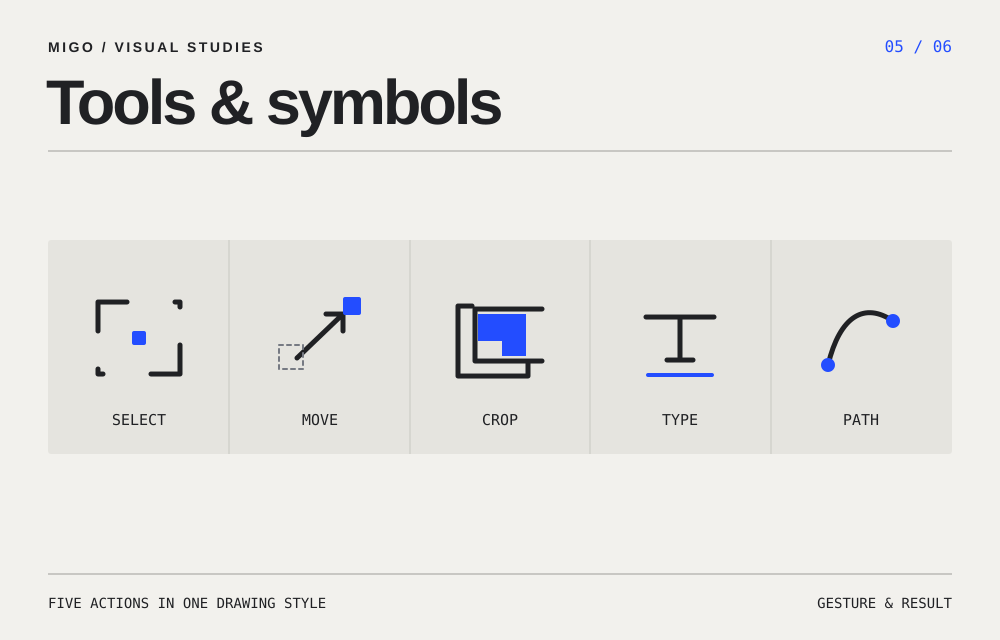
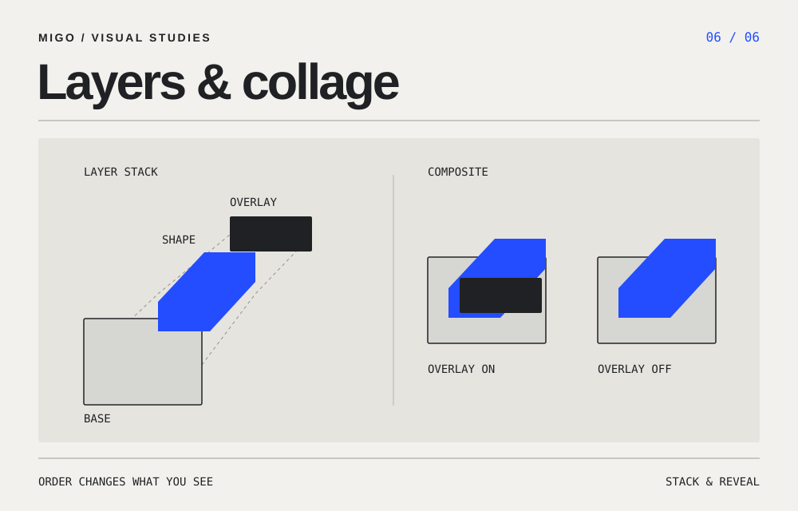

# Migo 视觉母题研究｜六张线索概念图 V01

2026-11-27 · 第一轮单项研究 · 待 Migo 审阅

把[视觉母题研究讨论稿 V01](../视觉母题研究讨论稿_V01.md)的六类候选各画一张。六张原图均为 1000 × 640 的可编辑 SVG，统一用灰白、墨黑和钴蓝做对照。这些是本轮试色，字样仅用于识别图纸。点击任意图进入单张文件。

| 01 画布与画板 | 02 网格与像素 |
| --- | --- |
|  |  |
| 同一个图形进入横竖两张画板，虚线提示画板外的边缘。检验边界能否组织作品和浏览视线。 | 像素单元从分散到相连，最后形成带缺口的块面。检验去掉网格底纹后，轮廓是否仍成立。 |

| 03 选区、节点与点标记 | 04 坐标、编号与计数 |
| --- | --- |
|  |  |
| 左边选出一段曲线，右边通过拖动控制点改变曲率。检验点和线能否引导注意或解释一次具体修改。 | 给三个示意图形编号，对 02 号标出原点、位置与实际示意尺寸。检验读数能否帮助理解画面或档案结构。 |

| 05 工具图标与符号 | 06 图层与拼贴关系 |
| --- | --- |
|  |  |
| 用统一笔画和蓝色标记表达选择、移动、裁切、文字与路径。检验符号能否在小尺寸下被理解。 | 将底形、主形和遮挡面拆开，再并排展示遮挡打开和关闭后的结果。检验少量叠放能否带来层次，同时保留内容完整度。 |

## 案例线索如何转成画面

| 图 | 参考线索 | Migo 试画方式 |
| --- | --- | --- |
| 01 | Allie Orth 的框线组织 | 将边界转成两种画板比例，观察同一图形如何被裁切。 |
| 02 | Good Form 的像素生成逻辑、Sommerseth 的像素与块面线索 | 用三组等尺度网格展现聚合过程，块面和缺口为本轮原创。 |
| 03 | Sabato Studio 的点状反馈、HAOQI.DESIGN 的单元承担视觉动作这一思路 | 把点的作用落实到选区与曲线调节上，用前后轨迹表现一次变化。 |
| 04 | Adobe Illustrator 的原点、标尺和定位逻辑 | 用示意坐标解释图中真实几何关系。坐标使用局部图形单位，与 SVG 的整体像素尺寸分开。 |
| 05 | 选择、移动、裁切、文字与描路径这些通用操作 | 用开口、偏移、边缘、基线与曲线画出动作，沿用同样的线宽和配色。 |
| 06 | A 版已有的层叠构图 | 用三个原创形状抽出层叠关系，通过两张合成小图比较遮挡面显隐。 |

案例依据来自[相关案例归档](../../../03_学习资料/案例分析/品牌设计案例/个人品牌视觉母题与作品集/01_设计案例与Migo启发.md)、[讨论稿的 Sommerseth 分析入口](../视觉母题研究讨论稿_V01.md#参考资料入口)和 [A 版样稿说明](../样稿/Sommerseth分析驱动首页_V01/README.md)。参考范围沿用原归档记录，六张图中的几何、构图与图标为本轮绘制。

[返回品牌识别入口](../README.md)
