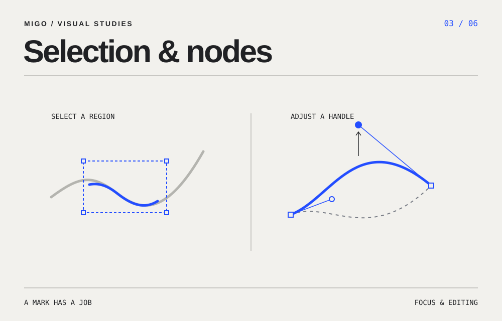
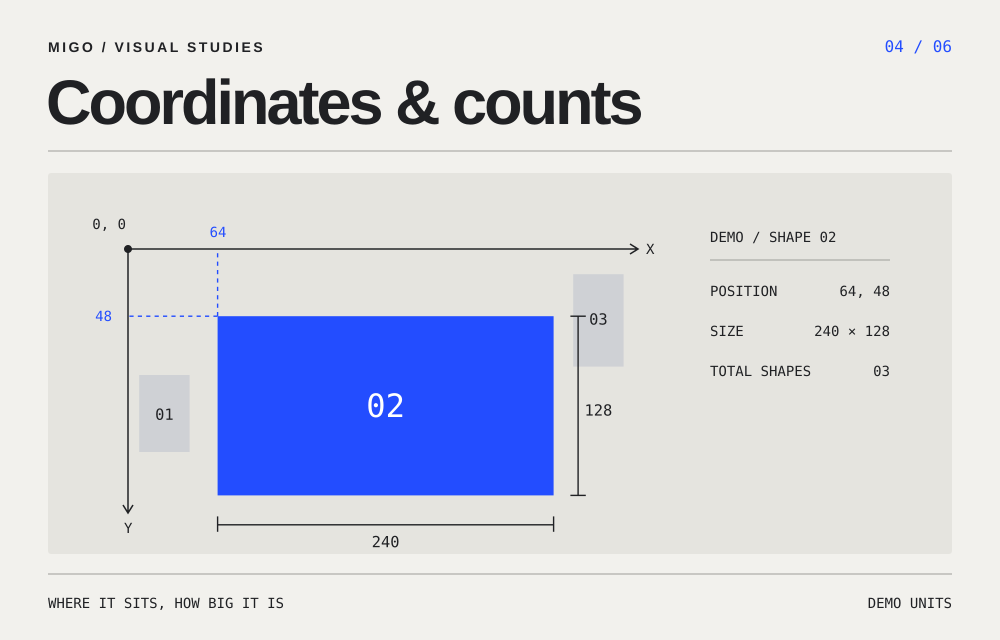

# Migo 视觉母题研究｜六张线索概念图 V01

2026-11-27 · 第一轮单项研究 · 待 Migo 审阅

把[视觉母题研究讨论稿 V01](../视觉母题研究讨论稿_V01.md)的六类候选各画一张。六张原图均为 1000 × 640 的可编辑 SVG，统一用灰白、墨黑和钴蓝做对照。这些是本轮试色，字样仅用于识别图纸。点击任意图进入单张文件。

| 01 画布与画板 | 02 网格与像素 |
| --- | --- |
|  |  |
| 同一个图形进入横竖两张画板，虚线提示画板外的边缘。检验边界能否组织作品和浏览视线。 | 像素单元从分散到相连，最后形成带缺口的块面。检验去掉网格底纹后，轮廓是否仍成立。 |

| 03 选区、节点与点标记 | 04 坐标、编号与计数 |
| --- | --- |
|  |  |
| 左边选出一段曲线，右边通过拖动控制点改变曲率。检验点和线能否引导注意或解释一次具体修改。 | 给三个示意图形编号，对 02 号标出原点、位置与实际示意尺寸。检验读数能否帮助理解画面或档案结构。 |

| 05 工具图标与符号 | 06 图层与拼贴关系 |
| --- | --- |
|  |  |
| 用统一笔画和蓝色标记表达选择、移动、裁切、文字与路径。检验符号能否在小尺寸下被理解。 | 将底形、主形和遮挡面拆开，再并排展示遮挡打开和关闭后的结果。检验少量叠放能否带来层次，同时保留内容完整度。 |

## 按讨论稿第四节逐项回答

[讨论稿第四节](../视觉母题研究讨论稿_V01.md#四研究时需要区分的三层)要求追溯来源，解释 Migo 如何转译，再说明它在页面上为谁解决什么问题。以下记录实际来源、当前试画和待验证的页面用途。若一个元素无法承担明确的阅读或操作任务，先留在研究稿中。

### 01 画布与画板

- **来源线索。** Illustrator 用不同尺寸的画板界定创作和输出范围。Allie Orth 的作者案例在「A cohesive grid system」一节解释了如何用带框线的网格容纳不同项目的图形。[Illustrator 画板](https://helpx.adobe.com/illustrator/using/tool-techniques/artboard-tool.html) · [Allie Orth 作者案例与线框图](https://calebraney.webflow.io/projects/allie-orth)
- **Migo 的品牌转译。** 用细边框区分工作区和横竖两种画板。两张画板内放同一原创图形，用蓝色显示板内部分，外沿虚线让裁切位置可见。边界与比例可以变化，图形本身保持一致。
- **页面用途。** 首页 Hero 可通过原创画板图形，让初次来访的人感受到「构图」在 Migo 创作中的位置，标语保持第一阅读层级。项目页如需比较同一张画面的横竖版本，可用画板并置，并保留查看原图的入口。

### 02 网格与像素

- **来源线索。** Good Form 的作者说明展示了用像素网格生成形状及框景的规则。Sommerseth 的参考范围是已归档的 Hero 截图，截图可见像素网格与中央块面。[Good Form 作者案例及网格图](https://martaryczko.com/project/goodform) · [Sommerseth 归档分析第 2 节](https://github.com/Migo1203/migo-portfolio/blob/main/UI设计/案例拆解/Sommerseth%20Design首页分析/设计元素与案例分析.md#2-首页-hero构图与视觉层级)
- **Migo 的品牌转译。** 保持方格单位一致，通过分散、相连、成形三个静态阶段生成原创缺口轮廓。蓝色突出承担构形的单元。缩小后可撤去辅助网格，检查轮廓是否依旧成立。
- **页面用途。** 首页 Hero 可由聚合块面给访客留下可记忆的原创图形，并呼应标语中的创造。若用作入口动效，聚合应揭示一个实际标题或入口，静态状态也要完整可读。

### 03 选区、节点与点标记

- **来源线索。** Illustrator 的节点与方向手柄用于调整路径。Sabato Studio 的设计者访谈描述了指针产生点状反馈。HAOQI.DESIGN 以点阵单元承担揭示动作的思路来自现有归档，查看范围以归档记录为准。[Illustrator 手柄说明](https://helpx.adobe.com/illustrator/desktop/draw-shapes-and-paths/learn-drawing-basics/set-direction-lines-and-points-appearance.html) · [Sabato Studio 设计者访谈](https://www.commarts.com/webpicks/sabato-studio) · [HAOQI.DESIGN 案例归档](../../../03_学习资料/案例分析/品牌设计案例/个人品牌视觉母题与作品集/01_设计案例与Migo启发.md)
- **Migo 的品牌转译。** 选框只圈需要看的局部，蓝点落在发生变化的位置。原轨迹用虚线、结果用实线，读者可以从前后关系理解标记的意义。
- **页面用途。** 案例确有一处值得解释的修改时，读者可从带短注释的对比图定位变化，例如一条轮廓怎么调整。若尝试点亮反馈，让它对应读者主动打开的注释。以成品呈现为主的页面可直接展示全案。

### 04 坐标、编号与计数

- **来源线索。** Illustrator 的标尺与原点用于测量和定位。Sommerseth 的归档截图可见底部坐标与计数，Migo 在这一试稿中要求标注对应真实对象。[Illustrator 标尺](https://helpx.adobe.com/illustrator/desktop/measure-and-align/grids-and-guides/about-rulers.html) · [Sommerseth 归档分析第 2 节](https://github.com/Migo1203/migo-portfolio/blob/main/UI设计/案例拆解/Sommerseth%20Design首页分析/设计元素与案例分析.md#2-首页-hero构图与视觉层级)
- **Migo 的品牌转译。** 把数字放到图形旁边，使用等宽字区分位置、尺寸和总量。图内示例的 02 号形状位置为 `(64, 48)`、尺寸为 `240 × 128`，全图共三个形状。数值对应局部示意单位。
- **页面用途。** Projects 档案中的真实顺序或数量可以让访客知道当前看的是哪项、还有多少项。坐标或尺寸用于需要说明规格或对齐的项目过程。数值只随内容或浏览状态更新。若数字删去后浏览和理解均无变化，该位置可以省略标注。

### 05 工具图标与符号

- **来源线索。** 从设计工具中的选择、移动、裁切、文字和路径操作提取动作。[Illustrator 工具参考](https://helpx.adobe.com/illustrator/desktop/get-started/learn-the-basics/illustrator-tools-reference.html)
- **Migo 的品牌转译。** 以统一笔画绘制开口框、移位、截断、基线和曲线路径，蓝色落在动作发生或结果出现的位置。五图保留各自的动作差异，缩小后可用文字标签补足语义。
- **页面用途。** 在过程图或实验笔记里，用图标配短标签帮助读者扫读修改类型。实际提供对应动作时，可试作控件并用状态变化反馈操作。现阶段归为候选辅助图形，独立辨识度仍待验证。

### 06 图层与拼贴关系

- **来源线索。** Illustrator 通过独立图层组织对象和控制显隐。Migo A 版样稿说明记录了已有的错位块形与层叠构图。[Illustrator 图层说明及面板示意](https://helpx.adobe.com/illustrator/desktop/manage-layers/create-and-organize-layers/layers-overview.html) · [A 版样稿说明](../样稿/Sommerseth分析驱动首页_V01/README.md)
- **Migo 的品牌转译。** 用底形、蓝色主形和前景三层抽出叠放关系。两张合成只改变前景显隐，便于看清这层对结果造成什么影响。
- **页面用途。** 在需要解释素材如何变成成品的案例里，先让访客看完整成品，再提供可选的拆层对照。首页可测试只在原创主视觉内叠放，维持标语与入口的阅读顺序。若使用显隐动效，变化跟随访客触发。

其他案例出处与查看范围见[相关案例归档](../../../03_学习资料/案例分析/品牌设计案例/个人品牌视觉母题与作品集/01_设计案例与Migo启发.md)。六个方向仍分别审阅，页面用途与动效留待实际原型验证。

[查看 A 版 Hero 画板与像素块对照](../样稿/A版首屏母题对照_V01/README.md)。两张静态稿用同一构图检验画板边界的作用。

[返回品牌识别入口](../README.md)
