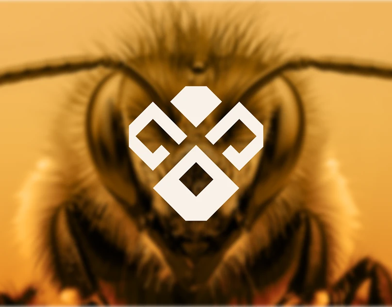

# Apis Orient｜封面解析与研究记录

日期：2026-11-10。用户提供案例并要求“分析并记录这个案例”。按既有授权归档至 AIGC；不写入仅维护个人资料的 Migo 仓库。

**当前完成范围：项目资料核对＋一张公开封面的实际视觉分析。完整品牌系统分析待补充。** Behance 正文返回 403；公开嵌入页可以读取，封面图片可在浏览器中实际查看。作者官网本轮返回 406。以下不将封面扩大为整套品牌规范，也不依据标题猜测业务或作者意图。

## 来源与观察范围

| 来源 | 本轮实际取得的内容 | 用途与限制 |
| --- | --- | --- |
| [用户指定的 Behance 项目](https://www.behance.net/gallery/257928893/Apis-Orient-Identity-for-Clear-Direction) | 正文访问受限，HTTP 403 | 保留原始案例入口；没有读到项目说明或内部展示图 |
| [Behance 公开嵌入页](https://www.behance.net/embed/project/257928893?ilo0=1) | 标题、署名、封面地址等公开项目元数据 | 可核对资料，不等于已读完整项目 |
| [公开封面原出处](https://mir-s3-cdn-cf.behance.net/projects/max_808_webp/e5e66b257928893.Y3JvcCwxMzgwLDEwODAsMjcwLDA.png) | 浏览器实际打开 808 × 632 像素封面；本篇唯一实际观察的案例画面 | 可分析画面中的形态、色彩关系和层级；没有确切字体、色值或规范依据 |
| [Visual Nexa 的 Behance 主页](https://www.behance.net/visualnexa) | 作者主页列出该项目，并链接官网 | 可确认官网来源；[官网](https://www.visualnexa.com/)本轮返回 406，未读取站内案例 |

公开嵌入页项目标题为 **Apis Orient | Identity for Clear Direction**；列出的联合署名为 **Visual Nexa、Stefan Savanovic、Stefan Prentovic**。个人主页分别为 [Stefan Savanovic](https://www.behance.net/savanovicstefan)、[Stefan Prentovic](https://www.behance.net/stefanprentovic)。署名不等于已核实各人的工作分工。

图 01：来自上述公开封面地址的浏览器截图，裁去浏览器自动生成的外围黑色留白。截图是学习观察记录，不是本项目设计资产或可复用素材。

以下“观察”指图中实际可见内容；“分析”是 AI 对作用的解释；“建议”仅用于 Migo 后续讨论。

## 01｜项目背景

**已核实：** 项目名称及联合署名如上。封面可见正面蜜蜂近景与几何符号。

**待验证：** 品牌所属行业、产品或服务、客户、项目时间、是否实际商业委托，以及设计任务。不能因为出现蜜蜂，就认定品牌销售蜂蜜；也不能从英文标题认定其提供导航或咨询服务。

## 02｜定位与信息传达

标题中的 “Identity for Clear Direction” 可以作为后续核对“清晰方向”概念的线索，尚不能当作已证实的定位策略。

**观察：** 封面突出中央符号与蜜蜂图像，未见品牌名称、业务描述或说明文字。

**分析：** 这是一张以视觉吸引和形象联想为重点的封面。陌生人可以注意到它，却无法仅凭这一张图准确说出品牌叫什么、具体做什么。

**学习点：** “引起注意”“记住符号”“理解业务”是不同任务。品牌可以让不同触点分别承担任务，但需要核对它们能否衔接。作品集封面之外，项目标题与简介能否及时补足信息，需要看到完整页面后再判断。

## 03｜品牌架构

现有资料不足以确定品牌主体、子品牌或产品线关系。不能把蜜蜂照片、符号和项目标题自动解释成三个品牌层级。

对 Migo 的比较前提仍是：Migo 是个人与主品牌，Beedog 是原创角色；本案例不改变这项已确认关系。

## 04｜角色与符号的区别

**观察：** 背景是有毛发、复眼和触角细节的蜜蜂影像；前景是扁平几何符号。封面没有展示角色动作、情绪系列或人格设定。

**分析：** 自然形象提供具体联想，几何符号提供可辨认的简化轮廓，二者承担不同的视觉任务。不能由此认定品牌有一个蜜蜂吉祥物，更不能将照片当成已设计完成的角色系统。

**学习点：** 品牌主题、标识、吉祥物并非同一个概念。使用“蜜蜂”主题，不必要求每个元素都画成蜜蜂；是否需要角色，要看传播目标与维护能力。

## 05｜标识形态与字体

**观察：** 中央浅色符号由分离的角形构件组成，整体近似左右对称；上方为实心多边形，两侧是开口的折角形，下方为内部留有菱形空隙的较大构件。多个斜边呈现相近的角度关系。未见字标和文字排版。

**分析：** 对称、重复的斜向边和一致的块面感，让不同构件形成同一套造型语言。中间的间隙与下方的孔洞共同参与轮廓识别，这就是“负形”：未被实色占据、但仍承担设计作用的空间。

蜜蜂影像与符号叠置，可能引导观者把符号读成昆虫形象；这是观看联想，**不是已取得的作者构形说明**。暂不将构件解释为特定字母、指南针、机械零件或蜂巢。

**待验证：** 正式 Logo 的名称、构形逻辑、是否有不同版本、最小尺寸、留白规范及字体。缩略图中能看清，不等于小尺寸、刺绣、印刷或反白测试已通过。

## 06｜色彩与对比

**观察：** 画面以暖金黄及深褐暗部为主，符号接近暖白。浅色符号与较暗的蜜蜂头部叠置，形成明度差。未提取或确认品牌色值。

**分析：** 暖色调把照片统一在相近的氛围中，浅色前景则帮助符号从复杂纹理里分离。这里能学习的是“如何分配对比”，而不只是记录“用了黄色”。

**边界：** 这张封面的颜色不等于品牌标准色板；深部也不应直接记为标准黑。暖金黄可以让人联想到蜜蜂、蜂蜜或温度，但这些联想没有证明该品牌的业务。

## 07｜辅助图形与影像语言

**观察：** 自然纹理丰富的影像与边缘清晰的几何块面同框。背景较软，符号边缘较硬；照片细节多，符号细节少。画面中未见可确认的蜂巢网格。

**分析：** 这是通过“纹理与平面、复杂与简洁”的关系组织视觉层级。背景提供情境，符号提供视觉焦点。对 Migo 而言，这比将蜂巢、机械线、黑黄条纹全部叠加更值得先研究：每个元素应有明确作用。

**待验证：** 是否存在统一图案、网格、摄影规则，以及其他页面能否延续这套关系。单张画面成立，不等于系统已被证明。

## 08｜应用与系统检验

本轮只看到项目封面，没有看到名片、包装、网站、社交模板、导视或其他应用。因此不能判断系统的跨场景一致性，也没有真实投放、商业成效或用户反馈证据。

完整资料取得后，应优先观察同一符号在白底、小尺寸、纯文字版式及没有蜜蜂照片的情况下是否仍然成立；再区分展示用效果图与已落地的应用。

## 09｜可迁移的方法

1. **先分配任务，再组合元素。** 符号负责识别，影像负责情境，名称与简介负责解释；检查信息是否缺席或相互争抢。
2. **以几何规则建立一致性。** 可以比较角度、比例、开口和间隙是否协调；规则的价值是让形态有秩序，不是绘制一张复杂构形图。
3. **让背景服务前景。** 有细节的背景需要通过明暗、清晰度或位置安排，保住关键符号的可见性。
4. **由单张效果追问系统能力。** 从封面出发提出验证问题，不能由封面直接宣布整套品牌成功。

以上是从可见画面提炼的学习方法，不代表作者明确使用的策略或制作过程。

## 10｜不宜照搬的内容

- 不描摹该符号的具体构件、组合比例或照片；学习构形思路后，Migo 仍需发展自己的识别特征。
- 不因为同样涉及“蜜蜂”联想，就认为双方定位相同或必须采用相近风格。
- 不将封面金黄直接定为 Migo 品牌色；也不把几何、折角直接等同于科技、机械或创新。
- 不从一张封面推导作者的品牌故事、设计成效和商业能力。

## 11｜对 Migo 的启发与下一步

**已确认的本人输入：** 喜欢真人电影大黄蜂带来的蜂巢、黑黄、机械科技感、机械结构及性格反差联想；品牌希望年轻、独立、有想法，也细致认真。上述偏好仍不是已选视觉方案。

**本轮建议：** 后续可以研究“几何秩序如何表达细致”和“有情境的影像如何辅助简洁标识”。这张封面提供了这种组合关系的可见例子，但它没有证明机械造型适合 Beedog，也没有提供性格反差的角色证据。

Migo 需要特别保留专业信息入口：若头像或封面以符号／Beedog 为主，旁边应能找到 Migo 名称、真实的设计方向与作品。求职阶段，招聘者理解你做过什么，不能完全依赖对角色的联想。

后续取得案例长图、截图或导出 PDF 后，在本目录新增完整视觉分析，保留本篇的当时范围。优先补核：作者设计说明、字标与字体、完整配色、辅助图形、应用与规范。用户尚未说明喜欢此案例的哪一处，不代写其偏好或学习反馈。

相关讨论：[大黄蜂灵感与品牌系统映射](../../../../01_品牌设计项目/01_品牌策略/个人品牌探索/2026-11-10_大黄蜂灵感与品牌系统映射_讨论稿.md)。

[返回案例目录](../README.md) · [品牌案例研究库](../../../../01_品牌设计项目/02_研究参考/品牌案例研究.md)
