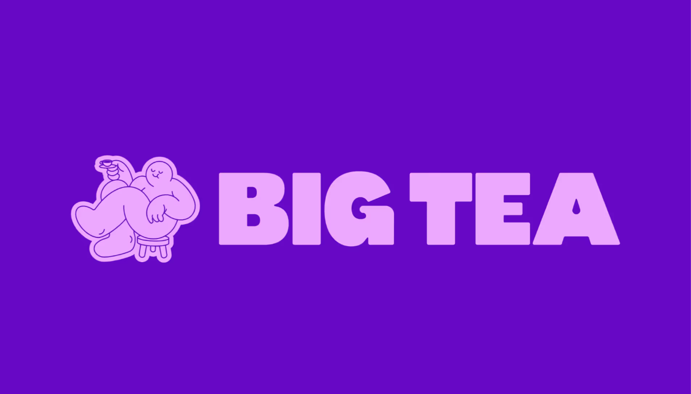
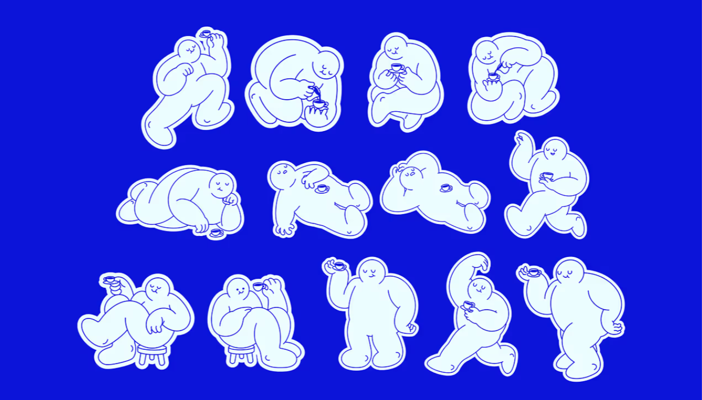
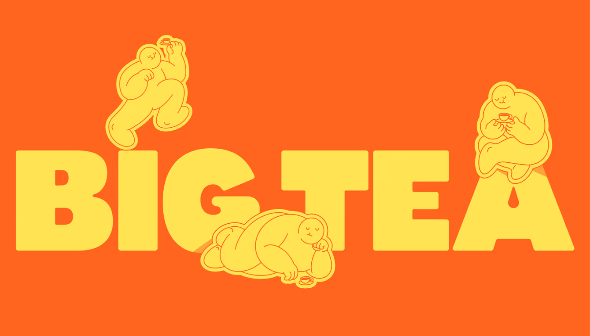
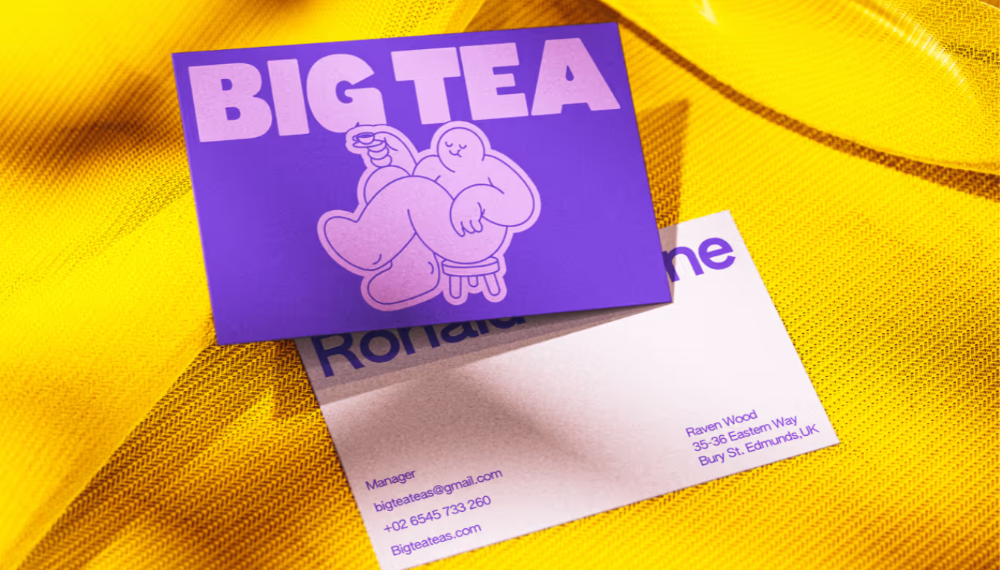
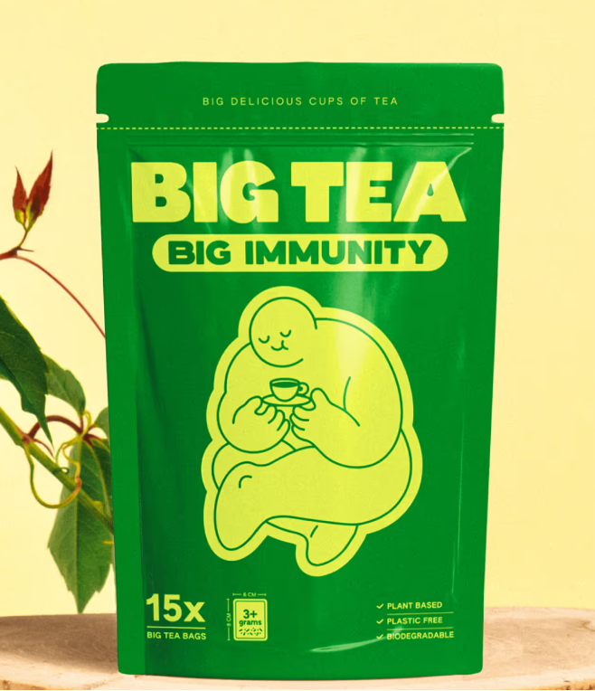
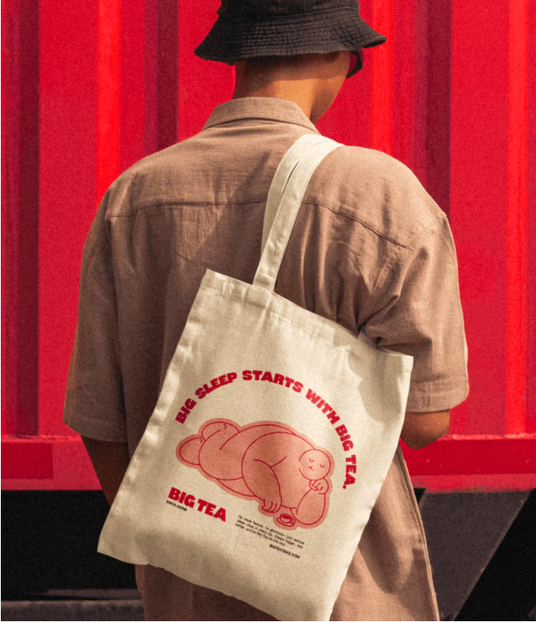

# Big Tea｜角色与商业视觉应用

研究与讲解日期：2026-11-11。状态：本轮图文观察完成，用户反馈待补充；不代表完整品牌规范研究或 Migo 方案确认。

这一案重点学习：**品牌名称、字标、角色与应用如何互相支持；角色如何通过动作参与传播。** 以下分别标注作者说明、画面观察与研究分析，不将视觉推断当作作者原意。

## 资料与实际查看范围

- 主要来源：[Studio Moara 作者官网案例](https://studiomoara.com/work/big-tea-branding-and-mascot-design)，标题为 Big Tea - Branding and Mascot Design。已阅读项目介绍并实际查看六张案例画面。
- 核对署名：[Studio Moara Behance 主页](https://www.behance.net/studiomoara)关联同一工作室官网；[Behance 公开嵌入页](https://www.behance.net/embed/project/224573461?ilo0=1)显示同名项目和 Studio Moara 署名，实际查看的公开封面与官网名片场景相符。
- [Behance 原项目](https://www.behance.net/gallery/224573461/Big-Tea-Branding-and-Mascot-Design)正文仍返回 403。身份核对不等于两站全部内容相同，本讲依据作者官网。
- 图 01—06 对应官网页面图片索引 5—10，分别是字标组合、角色与文字互动、动作集合、名片、包装袋、帆布袋。索引是本次页面提取编号，不是作者图号。
- 随文截图来自实际浏览器观察，仅裁去白边和相邻图片窄条，未改动设计。图像归原作者／相应权利人所有，保存用于来源可追溯的案例学习，不作 Migo 可复用资产。
- 未取得：正式品牌手册、字体名称和授权、标准色值、固定组合与留白规则、客户委托和量产证明、传播数据。作者展示的应用场景可能包含样机，不据此认定实际投产。

## 1. 品牌背景

**作者说明：** 这是结合品牌设计与吉祥物设计的茶品牌项目。介绍强调大胆风味、鲜明活力、街头文化与俏皮幽默，希望角色连接情感、建立识别，并从包装延续到数字触点。

页面另有创始人故事及睡眠、能量等产品叙述，属于作者发布的品牌文案。本轮没有独立核验相关经历或功效，不据此作健康结论。

**学习点：** 看品牌案例，应先找“希望传达什么”，再看画面是否支持它。颜色鲜艳、角色有趣本身，不能证明品牌策略成立或销售有效。

## 2. 品牌定位

**作者说明：** 希望打破茶无聊、寡淡的印象，呈现更大胆、有性格的饮茶体验。

**研究分析：** 粗重字标、高饱和配色和轻松的人物姿态，与上述自述方向有呼应。但“年轻人一定喜欢”“高端定位”“销量提升”均没有证据；本轮也没有明确的受众年龄、价格带与竞争研究。

**概念解释：** 定位回答“对谁、提供什么价值、为什么选择你”；视觉调性回答“它看起来和感受起来怎样”。两者相关，但不能从配色反推出完整定位。

## 3. 品牌架构

**画面观察：** BIG TEA 是持续出现的品牌名称；包装上 BIG IMMUNITY 是另一层产品信息。角色与品牌名搭配，但没有看到角色的独立名称或另一套品牌署名。

**研究分析：** 可将本轮画面理解为“品牌名称负责明确身份，产品文字区分内容，角色负责情绪与记忆”。这不是已取得的官方架构图，也不足以推定完整产品线。

这对你之前关于“角色让人知道品牌做什么”的理解有一个补充：茶杯能提示饮茶场景，但**首次接触时，只看这个人物，仍未必能说出 Big Tea 的名字。** 识别通常来自名称与形象反复关联，并非图标天然包含完整品牌信息。

## 4. 角色设计特点

**画面观察｜图 01：** 人物头部小、身体和四肢饱满，坐在小凳上，举着很小的茶杯；五官简化，动作舒展。角色体量与杯子尺寸形成明显反差。

**研究分析：** 这种反差可以带来轻松与幽默，也让“大”不只停留在品牌名称里。这是观察者对形式关系的解释，作者没有公布具体比例或构形逻辑。

**画面观察｜图 03：** 角色在泡茶、捧杯、举杯、坐着或侧卧等动作中保持相似的头身关系、圆润轮廓、简化五官与描线。表情变化较小，身体姿态、手与杯子的关系承担了很多表达；这张集合中没有对话气泡。

**学习点：** 角色系统不仅是“画一排不同的脸”。还可以用“动作＋道具＋情境”表达状态。对通常不说话的 Beedog，这比先写很多台词更值得研究。

## 5. Logo 与字体关系

**画面观察｜图 01：** BIG TEA 使用粗重的大写字形，边角有所软化；A 的内部负形呈水滴状。负形就是形体内部或周围被留出来的空白。

**研究分析：** 文字的厚实体量与角色的饱满身体有共同特征；水滴形负形也可以让人联想到液体，但不能说已核实为作者的设计意图。字体名称、是否全套定制均未知。

**画面观察｜图 02：** 字标放大，角色分别站在文字上方、坐在 A 上、侧卧在文字前方。文字成为构图的支点，角色与它发生空间关系。

**学习点：** 这体现了宣传画面的组合弹性，但不能推导出“标准 Logo 可以任意遮挡”。固定标识组合与活动版面应分别管理；本轮未取得作者正式规则。

## 6. 色彩系统

**画面观察：** 图 01 为紫与浅粉紫；图 02 为橙与黄；图 03 为蓝与浅色；图 05 包装为绿与亮黄绿；图 06 帆布袋为浅色底与红色图文。

**研究分析：** 这些画面虽然换色，仍保留厚重字标、相似角色造型和相对简洁的前景／背景关系。因此，一致性可以由多种稳定特征共同承担，不能只理解为每个物料都用同一种颜色。

**边界：** 没有标准色表，不列猜测色值；名片背景的黄色织物属于场景陈设，不能直接认定为品牌标准色。只有一款包装图，也不能断言建立了按口味区分颜色的 SKU 系统。对小规模个人品牌，多色系统还会增加维护和配色测试成本。

## 7. 图形与插画系统

**画面观察｜图 01—06：** 持续出现的视觉语言是圆润体块、简化面部、清晰描线与茶杯。角色动作可以变化，基本造型仍保持相似。

**研究分析：** 本轮没有看到独立、完整的辅助图案规范。角色插画本身已承担不少图形表达，不需要为了凑齐品牌交付清单，就假设一定还有图案库。

**学习点：** 先区分“必须稳定的识别特征”和“可以变化的内容”。稳定部分让人认出同一角色，变化部分使它能应对不同传播任务。后续制作仍要检验小尺寸下描线与道具是否清楚。

## 8. 应用场景与信息层级

以下均为作者发布的应用展示，实际制作、材质和商业成效未核实。

**名片｜图 04：** 一面以大字标和角色建立印象，另一面安排较小的姓名及联系信息。可以学习“建立记忆”与“提供查询信息”的分工；图中联系资料是否真实未核验。

**包装｜图 05：** 上方大字标、中上部产品名称、中央角色、下方数量和其他说明，形成不同信息组。视觉层级指通过字号、位置、色块与留白，给信息安排相对重要性；它不是对每个人实际视线路径的测量。

包装角色很大，但没有替代品牌和产品信息。图上的 BIG IMMUNITY 及环保等文案仅作为可见文字记录，未核验功效、材料或标签合规性。

**帆布袋｜图 06：** 浅色袋面采用红色图文；侧卧角色配合弧形文案 “BIG SLEEP STARTS WITH BIG TEA.”，下方保留品牌署名。动作与这一次的主题相配，并非只把图 01 原样贴到袋上。睡眠文案的存在不证明实际助眠效果，也不能据此确认袋子已量产。

**学习点：** 同一个角色在不同触点可以有不同任务：名片帮助记住身份，包装配合产品信息，袋面表达某个主题。统一设计不等于每次使用完全相同的构图。

## 9. 值得借鉴的方法

| 方法 | 本案可见依据 | 可迁移的判断 |
| --- | --- | --- |
| 让不同元素支持同一气质 | 粗重文字、饱满角色、大小对比 | 名称、字体、形体之间是否有可解释的联系？不必都画成同一物件 |
| 用动作组织角色内容 | 泡茶、捧杯、坐卧等情境 | 从实际内容需要出发列动作，避免先做大量用不到的表情 |
| 稳定特征与变化内容分开 | 相似轮廓与描线，不同姿态与颜色 | 先定义哪些变化仍能认出同一角色，再测试不同应用 |
| 按触点安排主次 | 名片、包装、袋面各有信息重点 | 每张物料先明确要让读者知道什么，再安排角色大小和位置 |

以上是基于画面的学习方法，不是对品牌增长原因的实证结论。

## 10. 不适合直接照搬的部分

- 不复制人物轮廓、字形、水滴细节或具体动作构图；参考方法与使用他人设计素材是两回事。
- 茶品牌可以让角色在包装上占很大面积；Migo 的求职作品仍须清楚呈现项目成果、职责与设计判断，不能从本案推导为每张作品都加大号 Beedog。
- 不把高饱和多色、圆润可爱、粗重字体当成 Migo 必选风格。用户希望细致、独立、有内核，并明确可以不可爱。
- 不因角色动作多，就先制作完整周边系列。每增加动作、配色和媒介，都会增加一致性检查、源文件管理与适配成本。

## 11. 对 Migo 的启发｜建议，待讨论

**第一，先把人格变成可观察的行为。** “好奇”可测试为观察细节、探身查看；“认真”可测试为比较方案、检查局部；“偶尔笨拙”可测试为尝试失败后的短暂停顿。它们是动作候选，不是已确认设定。Migo 仍负责解释专业判断，Beedog 通过姿态回应。

**第二，探索机械感时也检验动作。** 你喜欢大黄蜂的机械结构与性格反差，可以后续比较简化关节能否支持低头、伸手、停顿等姿态。若细节让动作僵硬、缩小后混乱，就需要调整。并非因为喜欢机械元素，就已经选定机器人狗。

**第三，按实际需求做最小测试。** 可先比较作品封面、过程分享与个人介绍三种场景：作品封面优先看作品；过程分享可让角色辅助表示观察或疑惑；个人介绍再测试 Migo 与 Beedog 的共同识别。具体露出强度、活泼程度、颜色与字体仍待用户讨论。

## 本轮结论与后续

- **有来源支持：** 作者希望角色参与品牌触点；六张画面确实展示了字标、多个动作和三类应用。
- **研究分析：** 文字体量、角色体量与动作情境相互支持；不同应用通过部分稳定特征维持关联。
- **仍未知：** 官方字体色值、完整规范、项目商业性质、实际量产与成效。用户尚未反馈对本案的取舍。
- **下一步建议：** 原六个优先案例均已有首轮讲解和一定视觉观察，但研究深度不同，并非六套完整全案都已分析完。可先横向归纳，再形成 Migo 的候选设计原则；Apis Orient 仍只看过封面，完整分析按用户要求暂缓。

### 截图来源对照

全部来自上文作者官网同一案例页，查看日期均为 2026-11-11。以下保留原图直链，便于核对；随文使用的是浏览器截图裁边版。

| 本文图号 | 页面图片索引 | 原图 |
| --- | --- | --- |
| 01 字标与坐姿角色 | 5 | [作者图](https://cdn.prod.website-files.com/69a3202e85be85fb32f85a2f/69dddaa908fd63e640b06e9d_big-tea-3.avif) |
| 02 角色与字标互动 | 6 | [作者图](https://cdn.prod.website-files.com/69a3202e85be85fb32f85a2f/69dde14f33250103d7d37840_big-tea-4%20(1).avif) |
| 03 动作与饮茶情境 | 7 | [作者图](https://cdn.prod.website-files.com/69a3202e85be85fb32f85a2f/69ddde54622509f0c5c1a6b3_big-tea-5.avif) |
| 04 名片应用 | 8 | [作者图](https://cdn.prod.website-files.com/69a3202e85be85fb32f85a2f/69dddb0c19b3491cd99ef5de_big-tea-6.avif) |
| 05 包装信息层级 | 9 | [作者图](https://cdn.prod.website-files.com/69a3202e85be85fb32f85a2f/69dddae15a62a9f81843948a_big-tea-7.avif) |
| 06 帆布袋主题表达 | 10 | [作者图](https://cdn.prod.website-files.com/69a3202e85be85fb32f85a2f/69dddae4fcc5e39c56046875_big-tea-8.avif) |

[案例学习索引](../README.md) · [品牌研究库](../../../../01_品牌设计项目/02_研究参考/品牌案例研究.md)
