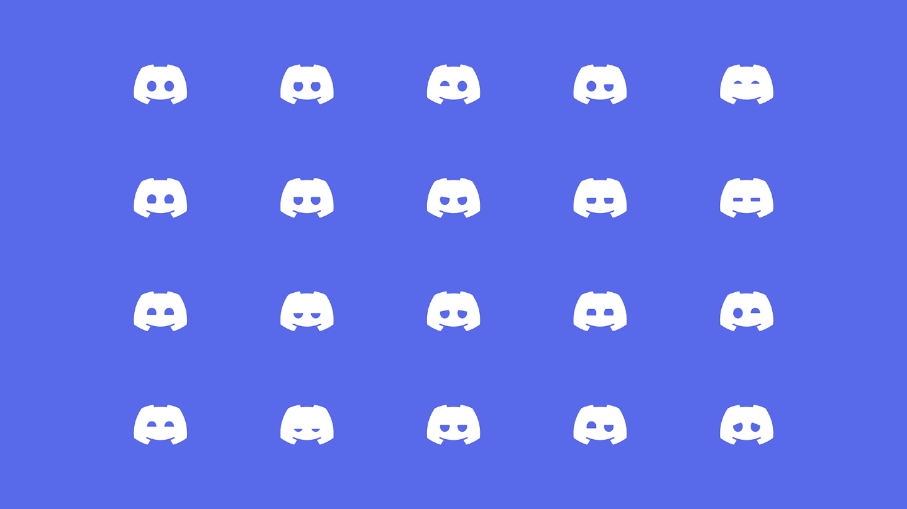
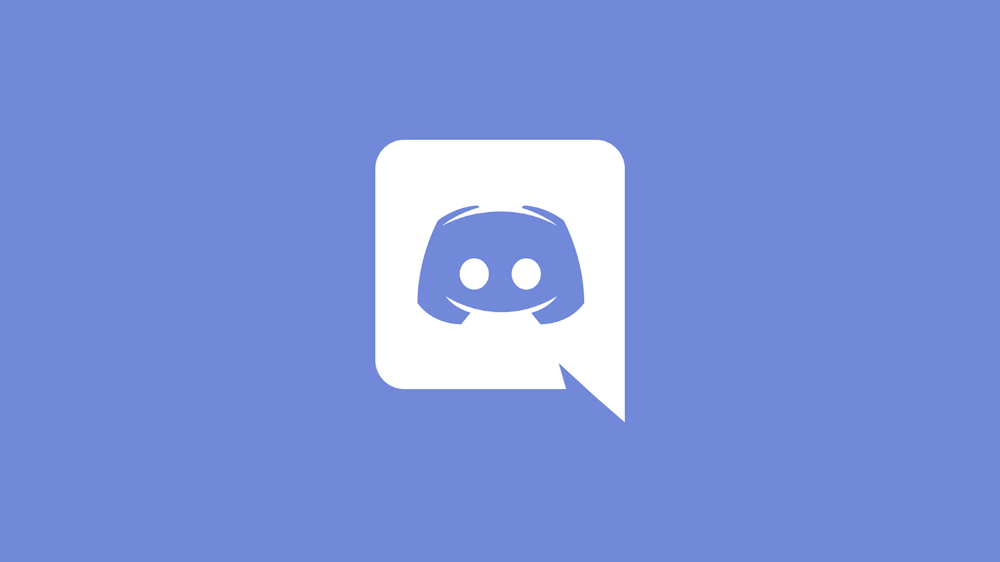
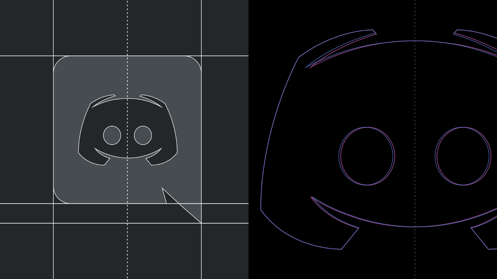
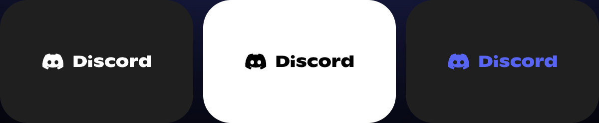
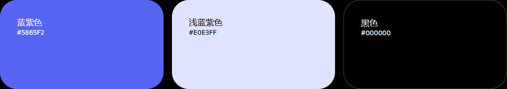
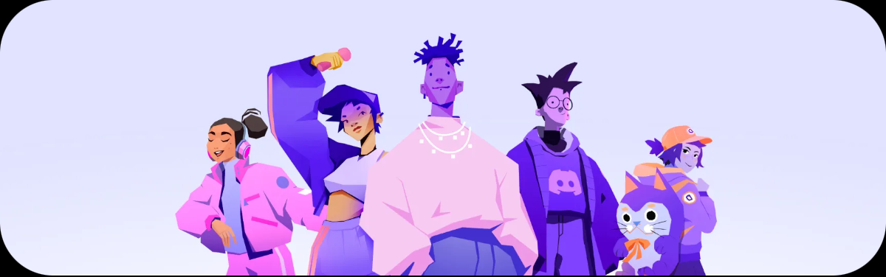
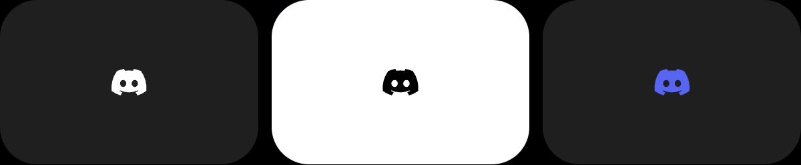
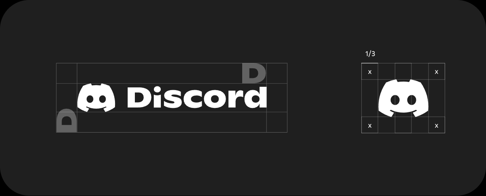
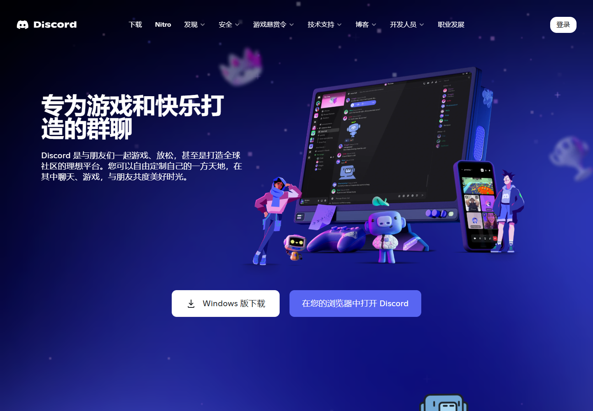

# Discord｜符号识别与情绪表达

日期：2026-11-11。用户要求进入下一案例，本轮按既定清单研究 Discord，重点看 Clyde 如何兼顾识别、表情变化和媒介应用。按持续授权归档推送；分析与建议不等于 Migo 已选风格。

## 资料与实际查看范围

| 来源 | 本轮实际读取与查看 | 范围限制 |
| --- | --- | --- |
| S1：[当前官方品牌页](https://discord.com/branding) | 读取说明；实际查看图文组合、独立符号、留白图、三色色板与横幅 | 未展开完整外部 Brand Kit，不声称完成全套规范研究 |
| S2：[六周年品牌更新文章](https://support.discord.com/hc/en-us/articles/1500009438682-A-Fresh-New-Look-to-Celebrate-Our-6th-Birthday) | 普通网页返回 403；通过[官方公开文章接口](https://support.discord.com/api/v2/help_center/en-us/articles/1500009438682.json)读取正文；浏览器实际查看其中四张原始配图 | 属于 2021 年六周年更新的历史说明，不等于现行完整规范；接口创建时间为 2021-05-05，不将其当作已核实的公开发布日期 |
| S3：[当前官网首页](https://discord.com/) | 读取介绍；实际查看桌面首屏及自定义聊天功能模块 | 页面是官方营销展示，未登录实测聊天、表情、贴纸或产品动画 |

观察日期均为 2026-11-11。网页在载入后自动切换为中文，归档截图为稳定后的中文画面；初始英文正文也已读取。S2 的另两个博客候选入口均跳至博客目录，没有取得对应文章，故不作为正文证据。

本篇配图为浏览器实际呈现内容截图；部分裁去页面外侧或无关区域，未改动案例设计。素材属于 Discord，学习记录不构成可改编、商用或作为 Migo 品牌素材使用的授权。未查看的动态、完整手册和真实投放效果均不补写。

## 01｜品牌背景：交流体验如何支持视觉表达

**官方说明（S3）：** 首页将产品介绍为与朋友游戏、放松、聊天和建设社区的空间，并介绍语音、视频、文字聊天及个性化功能。

**分析：** 对强调互动的产品，情绪和个性表达有具体用途。品牌中的趣味与产品情境有关，但不能据此认定所有社交品牌都必须采用同一画风，也不把首页营销介绍当作效果证明。

## 02｜定位与目标：历史变化与当前信息分开

**官方说明（S2）：** 六周年更新希望视觉更有亲和力，回应不同兴趣的人来到 Discord 的情境；同时需要让原有用户继续认出品牌。

**官方说明（S3）：** 本次访问的首页突出游戏、朋友和群聊。

**分析：** 历史更新主张与当前首页侧重点不能混成一个永久不变的定位。此讲主要学习设计如何回应目标，不独立推导完整品牌战略或用户增长原因。

## 03｜品牌架构：名称、符号与插画各有任务

| 对象 | 本轮证据支持的关系 | 教学解释 |
| --- | --- | --- |
| Discord | 品牌名称，当前品牌页有规定好的字标与图文组合 | 帮助读出品牌是谁 |
| Clyde | 历史文章称 Logo 中的笑脸图形为 Clyde；当前品牌页也以“Clyde”Logo 指称其商标 | 作为有名称的识别符号，也存在历史表情探索 |
| 横幅／首页中的人物与立体形象 | 本轮实际看到的传播画面组成 | 支持情境与气氛，不将每个形象自动当作 Clyde 或独立子品牌 |

**重要边界：** 不能因为图形有名字和表情，就推断任何表情版都可替代标准 Logo。也不把它与所有同名产品或功能混为一谈。

## 04｜角色与情绪：稳定轮廓内可以变化什么

原图：[官方文章附件](https://support.discord.com/hc/article_attachments/1500015317882)。本轮实际查看，为静态表情矩阵，不是动态演示。

**观察：** 多个图形保留相近的外轮廓与下方弧线，主要通过圆形、半圆、横向压缩、倾斜及不对称的眼部变化形成不同神态。

**官方说明（S2）：** 更新允许 Clyde 表现开心、难过、困倦等情绪。

**分析：** 这是一种控制变化范围的方法：稳定部分帮助辨认，变化部分承担表达。细小的眼部改动也能改变观看感受，但没有文字标签时，具体情绪可能有歧义；不能替每个图形编造官方名称。

**对 Beedog 的关联：** 用户希望角色通常不说话，可先研究视线、眼睑、头部和姿态如何传递情绪。无需为了丰富表达，每次重新生成完全不同的脸型、耳朵或比例。具体稳定特征仍待造型探索后决定。

## 05｜标识与字标：轮廓调整回应实际限制

原图：[官方附件](https://support.discord.com/hc/article_attachments/1500015317842)。这是历史形象，不是本轮当前标准资产。

原图：[官方附件](https://support.discord.com/hc/article_attachments/1500015317862)。图中有轴线与叠合轮廓；不是已核实的新旧标识对照，不能给左右两侧擅自标上“旧版／新版”。

**官方说明（S2）：** 旧图形的气泡容器与横向不对称带来应用限制；原先较尖的顶部细节，在不同材料及徽章等小表面印制时表现不佳。因此更新调整轮廓，并让 Clyde 脱离固定气泡。

**分析：** 这些修改涉及尺寸、材料与组合自由，而不只是视觉喜好。对 Migo，机械线、蜂巢小格和尖细连接如果进入角色或标识，需要检查缩小和单色后的表现。本轮未实际打样，不保证任何细节已通过印制测试。

**观察：** 当前页面展示白、黑、蓝紫三种版本，图形在左、Discord 字标在右，保持一致的组合关系。

**官方说明（S2）：** 当年字标基于 Ginto 定制，并调整字形与大小写，以改善可读性。这是历史字标说明，不能推导现行所有标题和正文都用同一字体，更不能直接键入 Ginto 就当作标准字标。

## 06｜色彩：主色、辅助色与背景相互配合

**官方标注（S1）：** Blurple `#5865F2`、Light Blurple `#E0E3FF`、Black `#000000`。数值来自网页文字，并非截图采色。页面也展示白色 Logo 版本；三块色板不等于所有媒介完整色彩规范。

**观察与分析：** 同一个图形和字标在深浅背景下更换明暗版本，帮助保持辨认。色彩一致性需要结合对比与使用位置理解，不能只记录一个色号。

**历史说明（S2）：** 当年品牌调整了 Blurple 的饱和度与其他配色；文中也指出产品内颜色为适应深浅主题，可能不与营销配色完全一致。因此不能将同一色值强制用于所有界面。

## 07｜图形与插画：形式可以多样，联系需要维持

**观察：** 多个人物具有不同发型、服饰、动作，画面用紫、粉、蓝等颜色及块面形成联系；其中服饰可见品牌符号。当前首页另有立体角色、设备与产品界面同框（图 09）。

**分析：** 品牌可以有简洁标识，也有信息和情绪更丰富的插画。两者服务不同任务，不必强迫所有插画只剩 Logo 的形状。本轮未取得完整插画构形规范，不凭一张横幅编写官方造型规则。

## 08｜应用：先区分身份识别与内容表达

**官方说明（S1 初始英文正文）：** 独立符号用于品牌已经清晰可见或在其他位置充分建立的情境。这与前面 GitHub 的认知前提类似，不意味着陌生人只看图形就能准确说出名称与业务。

**观察：** 图文组合与独立符号各有外侧空间示意。

**分析：** 留白帮助标识与周围内容分离。这里应学习建立规则的思路，不直接把图中的单位与比例搬给 Migo。当前品牌页明确要求不编辑、歪曲、改色或重新配置 Logo；历史表情图不应被理解为外部使用者可以自行修改标准资产的许可。

**观察：** 导航以图文组合识别品牌；正文区域同时有清楚的标题、说明、操作按钮，以及产品界面和角色画面。趣味并未代替功能解释。

**官方说明（S3）：** 用户可通过自定义表情、贴纸、头像与状态等表达个性。**本轮仅查看官网介绍与展示，未登录验证具体操作，也未实测 Clyde 表情包的当前产品用法。** 不把“支持自定义表情”解释为“必须使用品牌角色”。

## 09｜可以借鉴的方法

1. **先分稳定与可变。** 稳定轮廓、比例等帮助识别；在适当内容中变化眼部和姿态，丰富情绪。
2. **从媒介限制反推细节。** 先知道头像、封面、印制等用途，再判断尖细结构与密集纹理是否值得保留。
3. **角色扩展与标识规范分别管理。** 为内容设计的表情图，不自动替代标准 Logo；每种资产要写明用途。
4. **保留名称与解释入口。** 有趣的形象之外，陌生受众需要快速读到主体、方向与具体成果。
5. **区分历史策略与当前规则。** 品牌会演进，旧案例可以学方法，实际使用依据当前可核实的规范。

以上为研究者提炼，不是传播成效结论。

## 10｜不宜照搬的内容与成本

- 不复制 Clyde 的轮廓、字标、配色组合或人物素材；品牌页有明确资产权利说明。
- 不把游戏群聊的活泼程度直接套入求职作品集。Migo 的目标是展示创意、认真与专业判断，受众和内容任务不同。
- 不因表情矩阵看起来易扩展，就一次制作大量动作。数量增加会带来情绪歧义、比例漂移、版本和文件维护工作。
- 不把“对称”当作所有角色必须遵守的规则；Discord 针对自身标识的调整，并不能否定其他设计中有意义的不对称。
- 不把历史作者解释等同于独立测量结果；本轮没有量化识别测试、印制测试或商业效果数据。

## 11｜对 Migo 的启发与后续

**建议，待讨论：** Beedog 造型有基础后，可以用少量明确情境测试：认真观察、疑惑、尝试新想法、完成后的满足。保留标准比例，比较眼神、头部和身体倾向是否足以表达；测试中允许反馈修正，不提前认定某表情有效。

关于机械结构，先区分“保持身份所需的特征”和“只在大画面成立的细节”。头像可采用何种简化方式，需与完整形象一起实际比较；尚未决定新增独立图形 Logo，也未确定黑黄、蜂巢、机械化程度或活泼场景。

与既有案例的关系：Duolingo 帮助理解共同造型规则，GitHub 帮助理解资产职责，Discord 补充表情变化与媒介限制。三者都是比较方法，不是待拼接的现成风格。

用户尚未提供本案例反馈，不代写偏好。按原清单仅剩 Big Tea 尚未开展讲解，其候选资料仍需核实；Apis Orient 完整分析继续暂缓。

[返回案例目录](../README.md) · [品牌案例研究库](../../../../01_品牌设计项目/02_研究参考/品牌案例研究.md)
