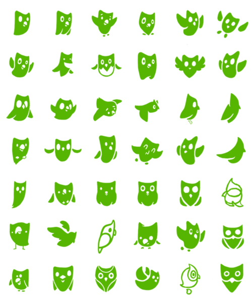
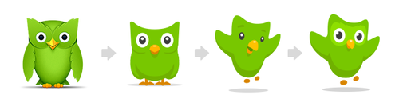
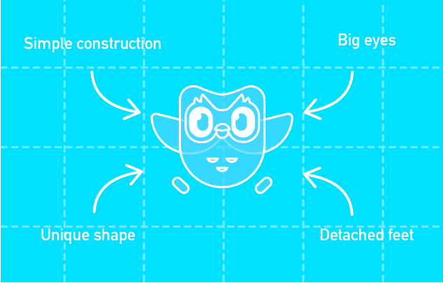
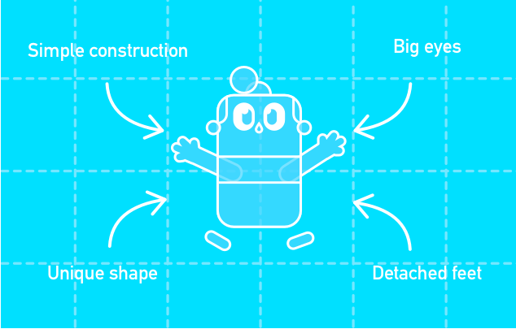
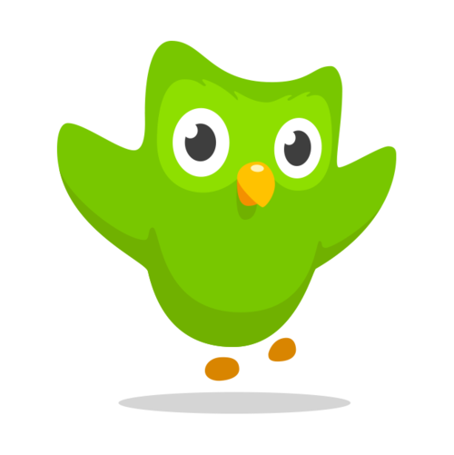
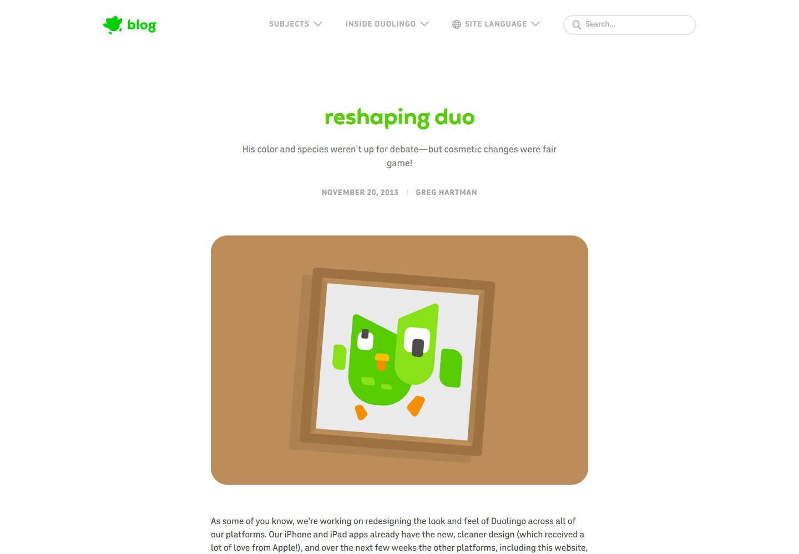
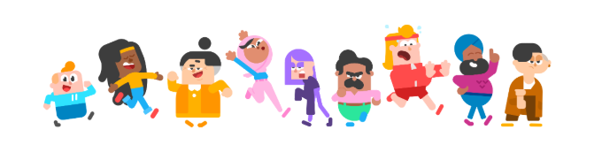
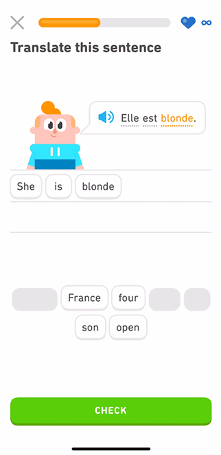

# Duolingo｜角色识别与系统化表达

日期：2026-11-10。用户要求暂时跳过 Apis Orient 的完整分析，进入下一案例。本轮按既有参考清单选择 Duolingo（多邻国），并按持续授权归档推送。

**本讲重点：角色的哪些特征保持稳定，哪些可以变化，以及角色如何参与实际内容。** 不以多邻国的社交热梗代替品牌研究，也不要求 Beedog 采用同样的可爱程度、语气或造型。

## 资料与实际查看范围

| 编号 | 官方资料 | 作者与页面显示日期 | 本轮范围 |
| --- | --- | --- | --- |
| S1 | [Reshaping Duo｜Duo 的造型调整](https://blog.duolingo.com/reshaping-duo/) | Greg Hartman；2013-11-20 | 已读正文，实际查看轮廓探索、转面草图、历史造型演变和单独角色图；保留截图 |
| S2 | [Building character｜角色群如何帮助语言学习](https://blog.duolingo.com/building-character/) | Greg Hartman；2020-11-10 | 已读正文，实际查看角色群、探索稿、构形动图的不同帧及练习示意动图的三个阶段；保留相关截图 |
| S3 | [原品牌规范入口](https://design.duolingo.com/) | 本轮未取得独立规范版本 | 实际访问跳转至 [Design 文章目录](https://blog.duolingo.com/tag/design/)，不是完整品牌手册 |

以上是**历史设计过程文章在本次访问时展示的正文与画面**。不将其中的历史角色图认定为 2026 年当前标准形象；文章配图可能被维护更新，页面日期也不等于每个图片文件的制作日期。本轮未操作真实学习账户、未核对全部现行产品、社交账号或完整视觉规范。文章中的产品动图是官方发布的示例，不是本轮实测应用。

图像均为浏览器从官方页面实际呈现内容截取，用于来源明确的学习观察；不作为 Migo 可复用的素材或授权资产。以下区分“官方说明”“画面观察”“分析”和“对 Migo 的建议”。

## 01｜品牌背景：角色为什么存在

**官方说明（S2）：** 学习语言需要持续投入，团队希望通过一组让学习者愿意相处的角色，帮助他们在产品中停留和学习。这组角色需要有趣、多元，并与既有绿色猫头鹰 Duo 相容。

**分析：** 角色在这里承担了产品任务：陪伴学习者，让重复练习中出现熟悉的情绪反馈。它有明确的使用场景，不能仅用“可爱、容易传播”解释。

对品牌设计初学者，更有用的提问是：**用户在什么时候遇到角色，角色帮助他理解或感受到什么？** 先回答这个问题，才知道要制作哪些动作和表情。

## 02｜定位：功能与情绪如何并存

**官方说明（S2）：** 团队希望内容既能反映语言的实际使用，又有出其不意的趣味。他们曾考虑维京人、外星人等方向，最终选择有鲜明个性的现代人类角色，以靠近语言学习的现实场景，并考虑文化代表性。

**分析：** 角色题材并非越奇特越适合品牌。形式要回应任务：学习者需要进入能理解的情境，人物个性再增加趣味。本文不据此编写多邻国的完整定位或宣称角色已提高学习效果；文章说明的是团队目标与设计选择，未提供因果验证数据。

## 03｜品牌架构：品牌主体与角色群

**官方说明（S2）：** Duo 是既有吉祥物，也是该文所述品牌的重要视觉基础；新增人物需要与它处于同一个视觉世界。

| 层次 | 本轮资料支持的关系 | 不应扩大为 |
| --- | --- | --- |
| Duolingo | 提供学习产品和内容的品牌 | 仅由一个吉祥物构成的品牌 |
| Duo | 品牌既有的绿色猫头鹰吉祥物 | 所有角色的共同名字 |
| 新增人物 | 服务内容与练习体验的一组角色 | 每个人物都是独立子品牌 |

本轮没有研究全产品线架构。Migo 与 Beedog 的既有关系仍是“个人主品牌＋品牌角色”，无需发展同等规模的角色群。

## 04｜角色设计：先稳定识别，再变化表达

### 4.1 轮廓决定第一层辨认

**官方说明（S1）：** 2013 年调整先固定绿色与猫头鹰物种，再探索轮廓。文章强调：整体形状若不成立，内部细节很难补救。团队经历草图、反馈与矢量稿的反复迭代。

**观察：** 在相近的绿色和猫头鹰联想下，身体的高矮、宽窄、翅膀、眼睛与整体姿态有明显变化。

**分析：** 这展示的是同一问题的不同解法。固定部分条件，有助于比较轮廓差异；如果每版同时更改题材、颜色、比例和材质，就难以判断到底是哪项改变起作用。

**观察：** 左侧有较多羽毛与体积细节，右侧逐步转为更简化的色块、较明显的眼睛和翅膀轮廓。此图只说明文章所展示的历史变化，不覆盖之后所有版本。

**分析：** 简化的重点是保留什么、舍去什么。对 Migo 而言，增加机械细节不自动等于更专业；需要同时检查那些细节是否有助于识别、动作和小尺寸使用。

### 4.2 稳定特征是一套关系

**官方说明（S2）：** 作者概括了四项构形特征：简单构造、大眼睛、独特身体形状、与身体分离的脚，并将它们应用到人类角色。

| 图 03：Duo 构形帧 | 图 04：Junior 构形帧 |
| --- | --- |
|  |  |

**观察：** 两帧标出同样四项特征。猫头鹰与人物虽然题材不同，但有相似的简洁块面、突出的眼睛和分离的脚部。

**分析：** 这就是“造型语言”：一组可重复的形态规则。系统一致性可以来自比例、简化方式和部件关系，并不要求所有对象长得一样。

Beedog 未来也可以先定义自己的稳定特征，再制作情绪与动作。例如脸颊与头部的比例、眼睛的关系、轮廓中的特定转折都可以成为研究对象。**这些只是候选维度，尚未替用户选定具体造型。**

### 4.3 动作表达也需要结构支持

**观察：** 大眼睛、张开的翅膀、离开身体的脚和地面阴影，共同组织了一个向上、展开的姿态。

**分析：** 情绪不只靠嘴角。视线、身体倾向、四肢展开程度与重心都能参与表达。这与用户希望 Beedog 通常不说话、以动作和情绪表达的要求相符；但用户品牌可以不可爱，不需要照搬大眼睛或这一姿态。

## 05｜Logo 与字体：角色研究不等于全套识别规范

**观察：** S1 当前博客页的导航中有绿色小图形和“blog”文字；标题、作者日期和正文呈现不同层级。页面截图如下，仅记录本轮看到的网页应用。

**未知：** 本轮未取得完整 Duolingo 字标规范、字体名称、授权、组合尺寸和留白规则。不能从博客标题推导出正式品牌字体或把导航中的“blog”当作 Duolingo 标准字标。

**学习点：** 角色回答“我认出了谁”，字标与说明帮助回答“它属于哪个品牌、这里是什么内容”。是否能只用角色，需要结合知名度和触点测试；Migo 求职阶段仍需清楚的姓名／品牌名与设计方向。

## 06｜色彩系统：一致性不要求全部同色

**官方说明（S1）：** 该次改造固定 Duo 的绿色。

**观察：** 角色群使用多种服装和头发色彩，各人物具有不同轮廓，但整体仍有简化块面和相近的表现方式。

**分析：** 色彩可以承担区别人物的任务，形态规则承担统一世界的任务。若每项识别都强迫使用同一颜色，反而可能失去必要区分。

**未知：** 本轮未核实现行完整色板、色彩比例和各媒介标准，不记录旧图上的色值为现行标准色，也不从截图采色后冒充官方规范。

## 07｜图形与插画系统：统一规则容纳差异

**官方说明（S2）：** 团队让人类角色继承 Duo 的设计语言，并通过反复探索建立角色群。

**观察：** 图 03、04 的构形示意给出明确的共同规则；图 07 展示不同发型、服装、体型和动作仍能同框。

**分析：** 系统的作用是明确哪些保持一致、哪些允许变化。它既能帮助后续创作，也能减少多人或多工具协作时的漂移。对 AI 辅助角色设计尤其值得注意：提示词中写“保持一致”很笼统，需要用选定的轮廓、比例、色彩与参考图落实，生成后仍要核对。

本轮未研究插画的全部构图、阴影、图标或动画规范，不能由两篇文章推出完整视觉系统。

## 08｜应用：角色在什么时候出现

**官方说明（S2）：** 角色进入练习，为待翻译的句子提供人物；答对后播放各自的动作，连续答对时还会出现课中动画。

**实际观察：** 动图的三个截图阶段分别展示题目、开始组合答案和形成答案；人物位于句子旁边。本篇保留形成答案的一帧，未将采集到的帧描述成已看到庆祝动作。答对动画与课中动画的存在依据上述作者正文，而非本轮实测。

**分析：** 角色与使用行为发生关系，能让它从固定装饰变成反馈的一部分。对 Migo，可讨论让 Beedog 对应“发现问题、尝试、遇到困难、完成”这些创作节点；这是内容候选，不是要求在作品中到处加角色，更不是用户已确认的活泼场景。

## 09｜可以借鉴的方法

1. **先定义职责。** 先问角色在什么情境下发挥作用，再确定动作、表情与制作量。
2. **先比较轮廓。** 固定部分变量，用不同剪影和比例寻找区别；避免一开始只调整装饰细节。
3. **写出稳定与可变项。** 将已选定的识别特征与可改变的姿态、视线、情绪分开记录，并用实图核对。
4. **用应用检验系统。** 角色图好看之后，还要看头像、项目封面、过程讲解里能否保持识别和信息层级。

以上是结合官方过程提炼的学习方法。团队目标、个人视觉判断和效果证据不同，不宣称照做即可提高传播或求职成功率。

## 10｜不适合照搬的部分与成本

- 不复制 Duo、人物、比例组合、标识或素材；共享造型规则的思考方式可以学习，具体形象仍属参考品牌。
- 不把绿色、大眼睛、分离的脚或搞怪表达当作 Migo 的默认答案。
- 大型学习产品有反复使用与动画团队支持；Migo 当前需要支持求职作品和个人内容，使用频率、受众与维护资源不同。
- 多视角、多动作、复杂机械连接和动画会增加一致性检查与修改工作；AI 生成节省部分绘制时间，但不会免除筛选、修正和文件管理成本。
- 本轮没有研究其社交账号策略，不能把印象中的热梗或“催学”人格写成已核实的本讲结论，也不因此改变 Migo 克制简洁的表达倾向。

## 11｜对 Migo 的下一步建议与学习问题

**建议，待讨论：** 进入概念探索时，先用一个标准姿态检验识别，再用少量不同情绪的姿态检验延展。围绕“细致认真”和“好奇探索”选择具体行为，让专业信息仍由 Migo 解释。暂不扩展庞大角色群或完整动画系统。

可先思考：

- 哪些特征能让你在 Beedog 换动作后仍认出它？此刻无需定型，先理解“稳定特征”这个概念。
- Beedog 认真观察、产生疑惑和尝试新想法时，能否只用眼神、头部和身体倾向表达？
- 如果加入机械结构，哪些结构帮助动作与识别，哪些只是增加复杂度？

用户关于活泼场景、机械程度、角色外形和具体视觉方向的选择均保持待确认；不代写其学习反馈。

下一案例可依原清单进入 GitHub，比较同样有角色的品牌如何处理完整角色、简化标识和品牌名称之间的关系。

[返回案例目录](../README.md) · [品牌案例研究库](../../../../01_品牌设计项目/02_研究参考/品牌案例研究.md)
