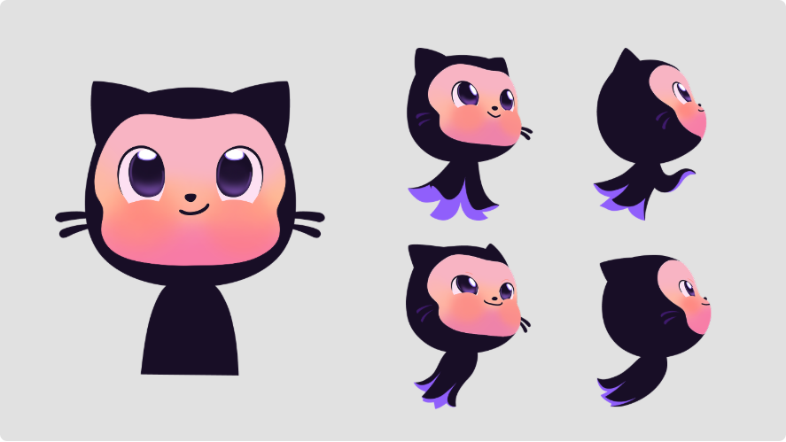
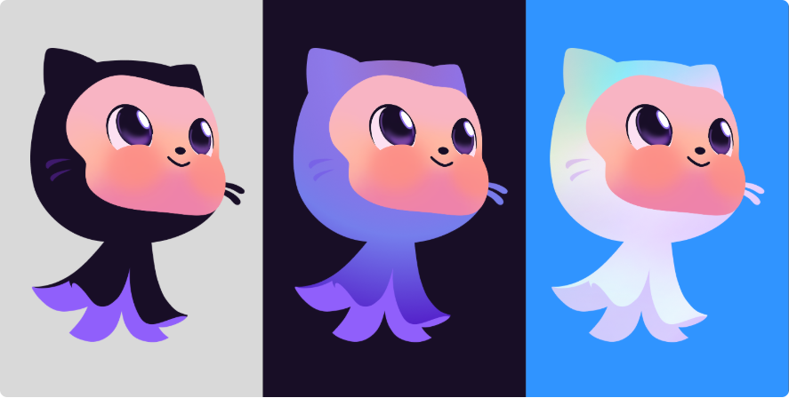
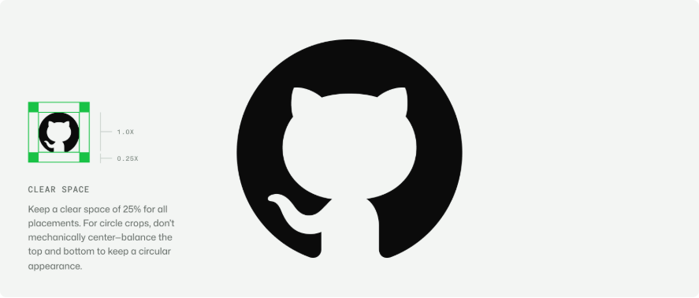
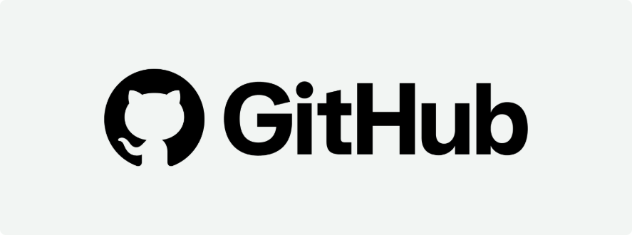
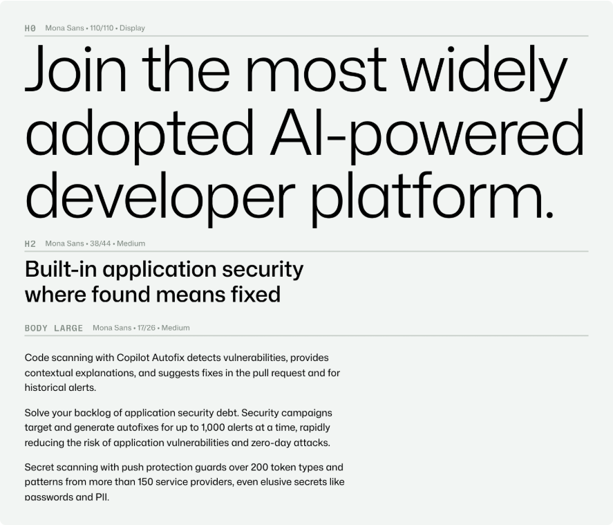
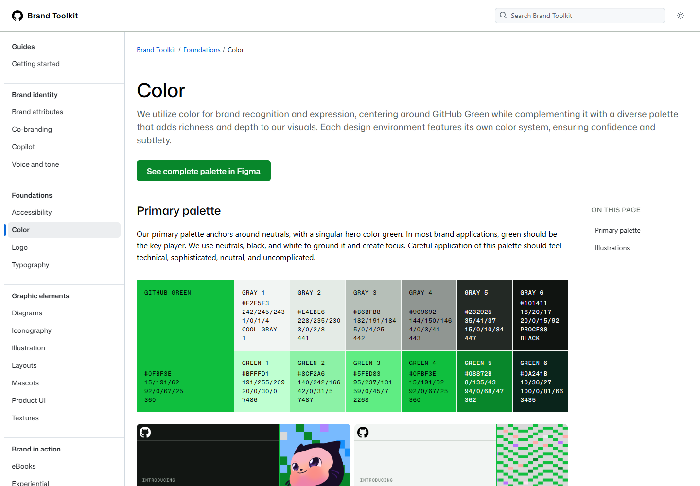
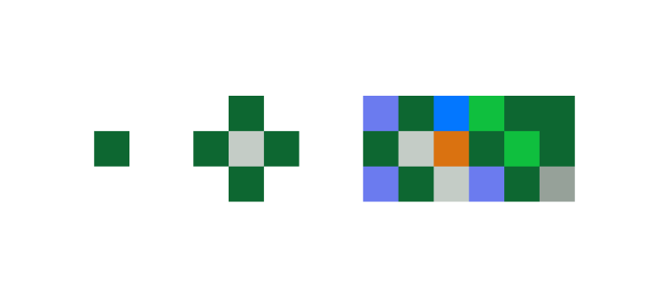
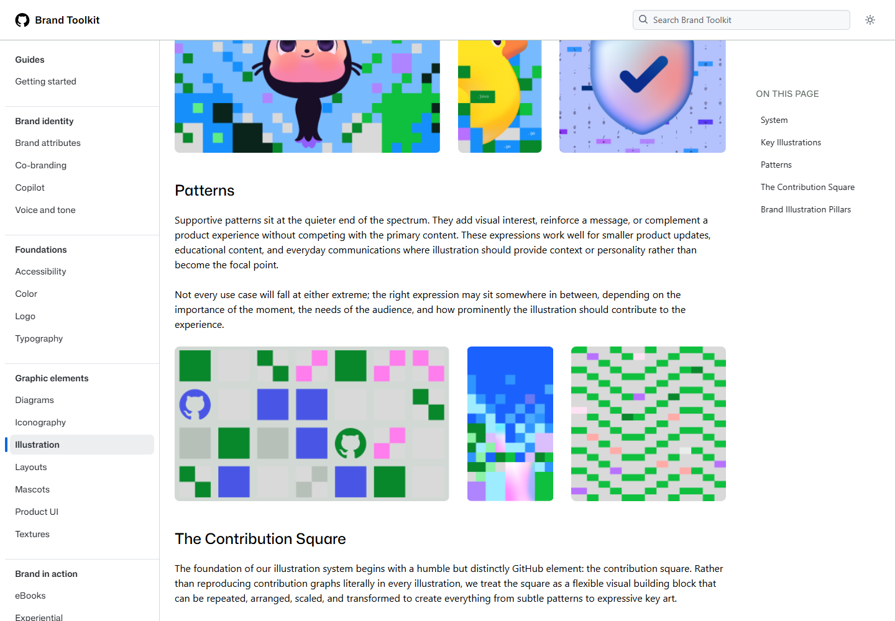
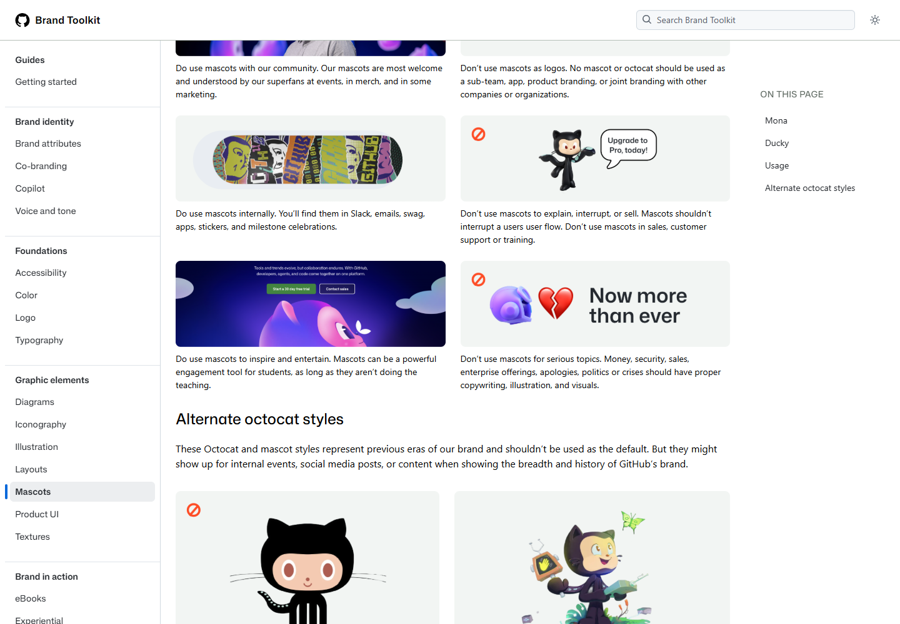
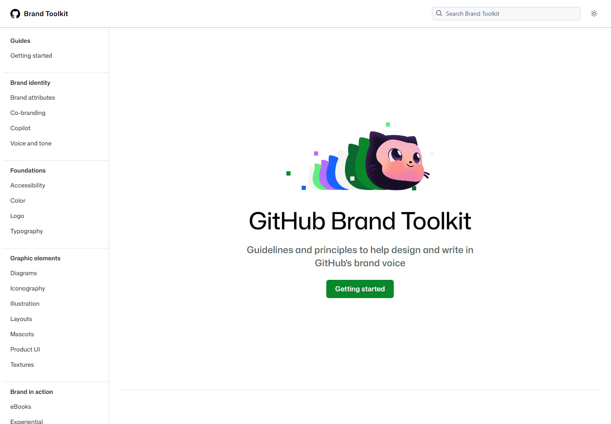

# GitHub｜角色、标识与品牌名称如何分工

日期：2026-11-11。用户要求“下一个案例”，本轮接续既定清单进入 GitHub。重点学习品牌角色、图形标识、字标与辅助图形的职责，按持续授权归档推送。对 Migo 的应用均为建议，不视为已选方案。

## 资料与实际查看范围

| 来源 | 本轮实际阅读和查看范围 | 对应截图 |
| --- | --- | --- |
| [官方 Logo 规范](https://brand.github.com/foundations/logo) | 已读正文；实际查看 Invertocat 留白图、字标组合、颜色及产品组合示例 | 图 01、03 |
| [官方 Mascots 规范](https://brand.github.com/graphic-elements/mascots) | 已读正文；实际查看 Mona 多视角、三种配色、使用正误示例 | 图 02、04、05 |
| [官方 Typography 规范](https://brand.github.com/foundations/typography) | 已读正文；实际查看 Mona Sans 字符及文字层级示例 | 图 06 |
| [官方 Color 规范](https://brand.github.com/foundations/color) | 已读正文；实际查看主色与中性色板、页面首屏应用示例 | 图 07 |
| [官方 Illustration 规范](https://brand.github.com/graphic-elements/illustration) | 已读正文；实际查看主要插画、辅助图案、贡献方块构形及部分主题示例 | 图 08、09 |
| [GitHub Brand Toolkit 首页](https://brand.github.com/) | 已读导航与介绍，实际查看首屏角色、标题和入口 | 图 10 |

以上为 **2026-11-11 本轮访问时的网页内容**；页面未提供本轮可确认的统一版本发布日期，不据素材文件名推导发布时间。本轮没有追溯全部更新历史，也没有实测所有产品、活动、实体物料或传播成效。最初尝试的 `/graphic-elements/octocat` 返回 404，随后通过官方导航取得上述 Mascots 正确入口，不将错误地址列作资料链接。

图片是实际浏览器截图，用于案例观察与说明；不是 Migo 品牌资产。页面和图片属于原权利人，不将学习引用解释为获得改编、商用或品牌素材复用授权。

## 01｜品牌背景：专业工具也可以拥有角色

**官方说明：** Logo 页列出产品、活动、邮件、帮助文档等识别场景；Mascots 页将 Mona、Ducky 与开发者体验联系起来，并强调社区使用情境。

**分析：** 技术品牌拥有角色，与其提供严肃、专业的服务可以并存。关键在于场景分配：角色帮助情感连接，清晰的文字与产品信息承担业务解释。本轮聚焦识别系统，没有研究完整公司历史或业务定位。

## 02｜定位与沟通：先判断受众处于什么情境

**官方说明（Logo）：** 单独 Invertocat 可用于 GitHub 自有环境，或品牌身份已经明确的情境；多数场景使用图形与字标组合。

**分析：** 能否省略名称，取决于观者已经知道多少。一个图形在人们反复见过以后可以成为识别捷径，但不保证陌生人首次见到就知道名称或业务。

这也补充 Migo 先前希望角色成为认知锚点的想法：识别需要积累关联。近期求职材料仍要让人直接找到 Migo、设计方向和作品证据。

## 03｜品牌架构：四个概念分开理解

| 名称 | 官方资料支持的含义 | 主要任务 |
| --- | --- | --- |
| GitHub | 品牌名称；规范要求 G、H 大写，写成一个词 | 指明品牌主体 |
| Wordmark | GitHub 名称的视觉字标 | 以规定形式呈现名称 |
| Invertocat | 官方称为代表 Octocat 的 logo pictogram，即图形标识，也是主要 Logo | 在不同触点稳定识别品牌 |
| Mona | 具有猫与章鱼特征的具体吉祥物；官方称其为 Octocat 物种的一员 | 表情、姿态、叙事与社区情感表达 |

官方还列出 Ducky；Mona 与 Ducky 并非独立子品牌。本轮不将这张表扩大为 GitHub 全部产品与子品牌架构。

**学习点：** 角色可以与标识有亲缘关系，但二者的使用规则不必相同。“角色名称”“品牌名称”“标识名称”也不需要混成一个概念。

## 04｜角色设计：细节服务表达

**实际观察：** 猫耳、较大的头部与眼睛、深色外轮廓、粉色面部、触腕形身体，在不同视角中建立连续关系。眼睛高光、面部渐变和身体转向提供了较丰富的表情与体积信息。

**分析：** 这类细节适合角色表达，但在缩得很小或单色输出时未必都能保留。这是为不同用途准备不同资产的理由，不能把彩色角色简单缩小就当作识别系统已完成。

**官方说明：** 默认使用原始配色；较亮紫色变体用于深色模式；珍珠材质版本专供 AI／Agents 主题。

**分析：** 变化有明确的场景条件，能减少随意改色造成的漂移。这不表示 Migo 也需要三种材质。当前可以学习“每个变体都应说明何时使用”。

## 05｜图形标识、字标与字体

**实际观察：** 圆形实色区域与内部浅色轮廓共同形成猫耳、头部、躯干和弯曲的尾状形态，没有角色图中的五官与材质细节。浅色部分也参与造型，这就是负形。图中还展示外侧留白规则。

**分析：** 标识把识别集中在较少的轮廓关系上。它与 Mona 有视觉联系，但不能把这组对照当成已核实的设计历史，声称 Logo 必然由本轮 Mona 图直接简化而来。

留白是标识周围预留的空间，能帮助它与邻近内容分开。GitHub 图示中的具体比例是它自己的规范，不直接搬给 Migo。

**官方说明：** 该组合用于多数场景；Logo 不应随意重排、变形、添加效果或被角色替代。

**学习点：** Lockup 可以理解为规定好的组合关系：图形、文字的相对位置与比例共同形成一个稳定单位，并非每次临时排版。

**官方说明（Typography）：** 字体方法围绕 Mona Sans 与 Mona Sans Mono 展开；标题、次级标题与正文形成不同层级，字号与行高可依媒介调整。

**分析：** 字标和正文所用字体是不同层面，不能据名称相同或视觉相似就认定标准字标可用普通键入替代。图 06 通过字号、字重、行长与间距帮助阅读顺序；字体系统的任务也包括解释信息。本轮没有检查字体许可证或中文覆盖，不建议 Migo 直接采用而跳过核验。

## 06｜色彩：品牌色与角色色可以分工

**官方说明（Color）：** 主色体系围绕中性色与 GitHub Green 展开，后者明确标为 `#0FBF3E`；黑、白与中性色帮助建立焦点，扩展色谱主要支持插画。该数值来自网页标注，不是截图采色。

**实际观察：** 规范中的绿色与中性色，和 Mona 的深紫、粉色面部并不相同；两者仍能出现在一套画面中。

**分析：** “品牌主色”不要求角色全身同色。颜色可以分别承担识别、角色表达与信息组织。用户喜欢黑黄仍是探索输入，不因 GitHub 的配色例子变成已选 Migo 色板。

## 07｜辅助图形：让图形与品牌经历有关

**官方说明（Illustration）：** 系统从贡献图中的方块出发，通过重复、排列、缩放和变化，形成从辅助图案到主要插画的表达，不要求每次原样复制贡献图。

**分析：** 一个简单形状与品牌建立关系，靠的是具体来源和反复使用。正方形本身并不专属于 GitHub；其产品关联与组合方式提供了更明确的解释。

对 Migo 的提示：蜂巢可以是候选辅助图形，但仅凭“蜜蜂”关联不足以证明差异化。后续还要比较它与个人故事、机械结构、作品展示的关系，以及怎样通过比例、连接、节奏和使用规则形成自己的表达。

## 08｜应用：规定角色何时出现、何时退场

**官方规则（Mascots）：** 适合社区、部分活动与内部庆祝等场景；避免当作填空装饰，不应替代 Logo、打断用户流程、推销或承担严肃话题。页面也写明公开使用需经其品牌与营销设计团队批准——这是 GitHub 自身流程，不是 Migo 项目的审批要求。

**分析：** 这些规定说明角色被喜欢，不代表它适合每条信息。对于报价、服务承诺、危机回应等信息，应先判断清晰度和情境是否合适。

与 Duolingo 对照：多邻国历史文章展示角色进入练习，并为题目和反馈服务；GitHub 规范则限制吉祥物用于教学、支持和销售。**这是不同品牌的职责分配，不能总结为所有角色都应讲解、或所有角色都不能讲解。**

**实际观察：** 首页正文区域的角色与大标题建立视觉焦点，顶部导航用小图形和“Brand Toolkit”标示当前站点。不同层级各有任务。本轮观察的是规范网站与其示例，没有实测活动和商品的实际投放效果。

## 09｜可借鉴的方法

1. **区分资产职责。** 角色、标识、字标、辅助图形分别解决什么问题，先说清楚，再制作。
2. **依据认知背景决定信息量。** 陌生触点需要名称与业务说明，熟悉环境才可能只用图形。
3. **为变体定义条件。** 深浅背景、单色、主题变体应有使用原因，避免每次即兴改造。
4. **为表达定义强弱。** 重要品牌发布可以更突出；日常说明、作品展示可以更克制。强弱不只有“角色出现／不出现”，还涉及面积、色彩、细节与位置。
5. **辅助图形来自真实关联。** 从个人经历、工作方式和作品内容寻找线索，再研究形态，而不是只追逐一种科技装饰。

以上是基于规范的分析，不代表已证明的传播成效或 Migo 已采用的原则。

## 10｜不宜照搬与成本

- 不复制 Invertocat、Mona、字标或贡献方块的具体组合；开源平台不等于品牌商标和角色可随意改编。Logo 页明确列有权利及允许／禁止使用说明，本轮只作来源明确的案例讲解。
- GitHub 有长期认知积累，不能据其单图形应用断言陌生人也能只凭 Beedog 了解 Migo。
- 不要求个人项目建立相同规模的角色群、字体、素材工具和主题分支；版本越多，一致性核对和维护工作越多。
- 不将 GitHub 的场景规则变成 Migo 的硬性禁令；其经验用于讨论，用户原有“Beedog 通常不说话、项目说明由 Migo 负责”继续有效。
- 不将界面、海报或规范示意当作商业效果证明；本轮未研究知名度、转化或使用反馈。

## 11｜对 Migo 的启发与下一步

**建议，待讨论：** 后续可以比较两种组织方式：Migo 字标配 Beedog 角色；或 Migo 字标配专门的图形标识，Beedog 在合适内容中表达情绪。研究 GitHub 不等于必须新增一个图形 Logo，也不等于角色一定不能成为头像。

先用求职作品集、头像与过程分享三个触点测试：名称是否清楚、角色是否可辨、作品是否仍是焦点、缩小后是否可用。再决定需要几种资产，减少为了“系统完整”而过早扩展的工作量。

“哪些场景更活泼”仍为待确认。创作实验或阶段庆祝可以作为候选，具体由本人后续反馈确定。Beedog 的机械程度、黑黄、蜂巢与具体外形仍未选定。

学习问题：当 Beedog 从一张完整角色图缩为头像，再出现在项目封面上时，哪些信息必须留下，哪些可以交给 Migo 名称与说明文字？用户尚未回答，本篇不代写反馈。

后续依原清单可进入 Discord，继续比较图形识别、表情和社交应用。

[返回案例目录](../README.md) · [品牌案例研究库](../../../../01_品牌设计项目/02_研究参考/品牌案例研究.md)
