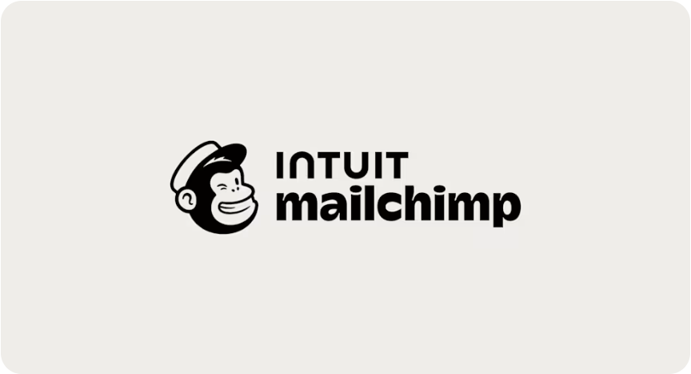
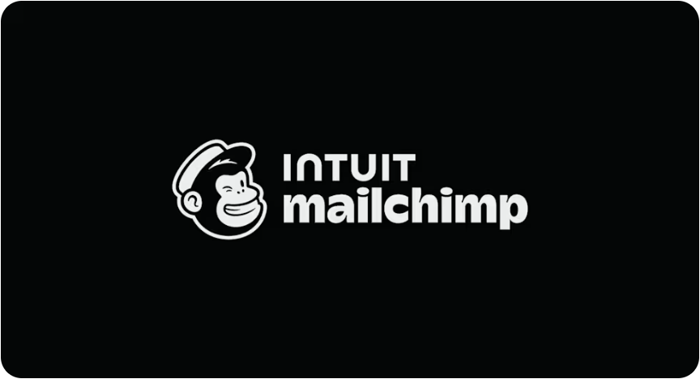
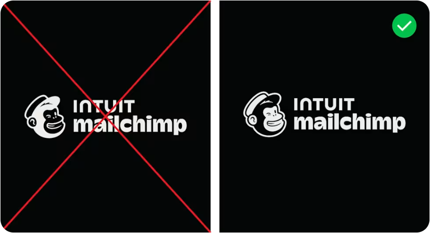
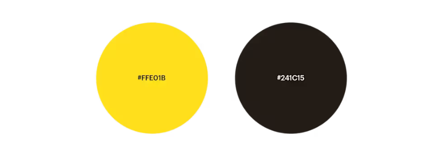
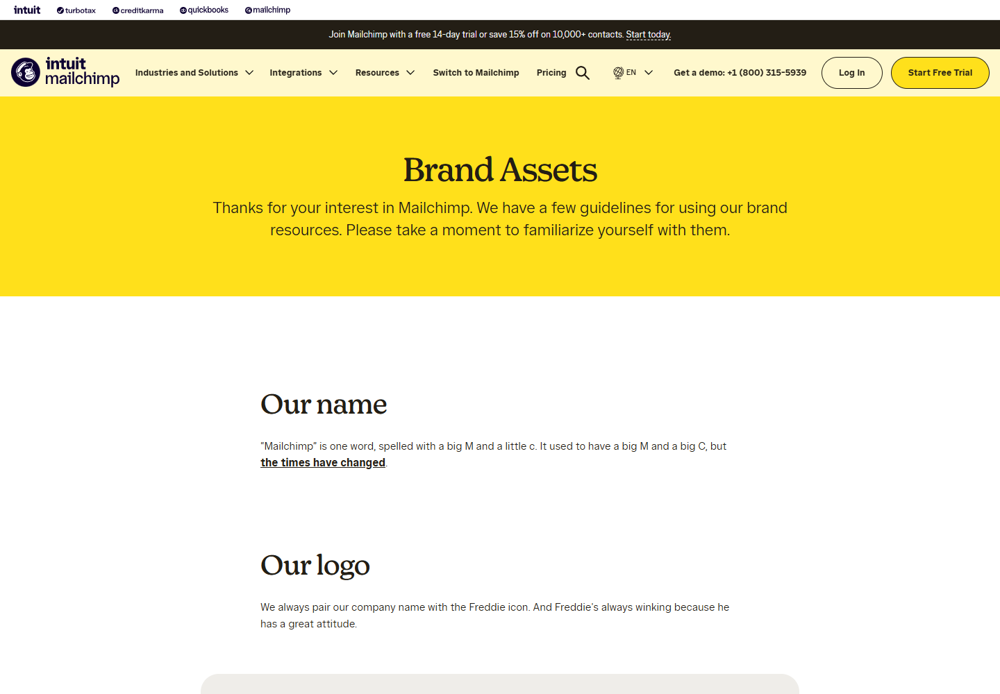

# Mailchimp 03｜视觉解析：标识、色彩与网页应用

查看与整理日期：2026-11-10。接续文字规范与学习反馈，本次已用浏览器实际查看官网 Brand Assets 页的四张规范图片、页面首屏与排版，以及官网首页首屏。截图视口为 1440 × 1000，图像截图另按网页中的显示尺寸截取。下面区分实际观察、设计解释及对 Migo 的建议。

这次完成的是上述范围的视觉解析；未覆盖完整品牌历史、全部营销物料、动态内容、移动端和用户识别测试。不把局部观察扩大为整个品牌的统一规则或商业成效。

## 1. 先看组合：角色与名字如何组成一个标识

**实际观察｜Brand Assets → Our logo 第一张图片：** Freddie 头像在左，文字在右；右侧上行为 INTUIT，下行为 mailchimp。头像与两行文字一起形成横向组合，mailchimp 一行更宽，字形厚实。整体位于浅灰暖色矩形中央，四周空间充足。

这也补充了上一讲的简化说明：当前页面展示的组合包含 **INTUIT**，不能只写成一只猴子加 Mailchimp。官网文字要求名称通常写作 Mailchimp，而图片中的字标呈现为小写 mailchimp；正文名称与专门设计的字标可以有不同写法。

**设计解释：** 左边的图形提供可辨认的形象，右边明确名称，组合让两者建立关系。横向布局适合横向空间，但不能据此推导所有触点都应采用同一种比例。INTUIT 的出现提醒我们，标识还可以反映品牌之间的关系；本轮没有研究其完整架构和历史。

**知识点：组合标识（lockup）。** 它是图形与文字按固定关系形成的版本，不是每次使用都随意摆放。固定的是采用版本中的结构，具体可用版本仍由各品牌规范决定。

**对 Migo 的建议：** 未来可分别验证 Migo 名称、Beedog 头像及二者组合。学习图文之间建立关联的方法，不照搬这里的两行文字，也不为 Migo 添加不存在的上级品牌。

## 2. Freddie 的趣味来自具体形态，而不需要台词

**实际观察｜同上图：** 头像侧向一边，帽子倾斜；能看到耳朵、突出的口鼻、宽笑嘴和不对称的眼部表情。黑色块构成主要头部形态，浅色区域保留脸部与帽子的细节，没有用毛发纹理和渐变去塑造写实感。

**设计解释 [视觉判断]：** 倾斜与不对称让它显得有动作感，笑嘴和眨眼可以被读为亲切、轻松、有一点俏皮。这是我的解读，不能假设所有观者感受相同。页面文字明确说明其眨眼设定，但没有在此处解释每一笔的设计动机。

**知识点：角色人格可以由姿态、轮廓和表情承载。** “友好”是抽象词，眼睛怎样变化、嘴角怎样展开、头部怎样倾斜，才是能被画出来和比较的内容。Freddie 在这里仅用头像参与识别，没有出现完整故事，也能表现情绪。

它的标识化也不等于细节越少越好：帽子、耳朵和口鼻等特征仍被保留；要判断哪些细节能缩小，必须查看实际尺寸，不能仅凭大图认定识别成功。

**对 Beedog 的建议：** 后续把“好奇、认真、偶尔笨拙”转成可比较的动作和表情，例如停下来观察、前倾研究、尝试后犹豫。这些只是候选行为，尚未选为规则。通常不说话的角色，更需要可读的肢体与表情关系。

## 3. 深色版本为什么不能直接反色

**实际观察｜Our logo 第二、三张图片：** 深色背景上的正确版本，文字变浅，头像增加浅色外轮廓；脸部依旧保持浅色、头部主要区域保持深色。对照图左侧被红叉标出的版本，脸部变成深色、外围头部区域变浅，面部关系与正确版本明显不同。

**设计解释：** 只把深浅全部交换，虽可能让边界显现，却会改变脸部结构的读法。官网的专用反白版本保留了关键面部关系，同时让外围在深背景上可见。这里讨论的是官网展示的差异，不是所有 Logo 的反白版本都必须采用同一方法。

**知识点：正负形与背景适配。** 图形的实色部分以及其中的空隙、浅色区域共同构成形状。背景变化会影响边界和面部的辨读，因此“做一个反白版”也是设计任务。

**对 Migo 的建议：** Beedog 进入实际设计后，要在浅底、深底与缩小尺寸中检查眼睛、脸颊、嘴及外轮廓。不能默认一键反色就完成版本交付。这里没有测量 Mailchimp 的最小尺寸，也不替 Beedog 预定数值。

## 4. 黄色为什么有识别作用：颜色还需要位置和职责

**实际观察｜Our colors：** 色板图片明确写出黄色 **#FFE01B**、深色 **#241C15**。与页面文字结合，可对应 Cavendish Yellow 和 Peppercorn。这两个值来自图片文字读取，不是截图吸管猜测；不据此断言官网所有深色像素都使用 #241C15。

**设计解释：** 一个高明度、鲜明的黄色与一个很深的暖色形成差别，便于分配醒目部分与信息部分。颜色带来的情绪存在语境和个体差异，不能简单断言“黄色必然等于快乐或年轻”。

在本次实际查看的 Brand Assets 页面里，黄色铺在开篇区域，正文主要处于白底；首页则把黄色用于重点文字、主要按钮等局部。**同一主色可以在不同页面改变面积，而保留明确的使用角色。**

色板中两个圆相近大小只是色板展示方式，不是 1:1 使用比例。视觉规范中的示例不自动等于精确的面积要求。

**对 Migo 的建议：** 未来同时讨论“什么颜色”与“在哪里用”：品牌区、正文、强调、按钮和作品展示分别有什么需要。“蜜狗”这个名字不自动要求黄色，也无需让每个页面都大面积用主色。

## 5. 排版如何让趣味与秩序共存

**实际观察：** 首屏标题居中，下面是简短说明；进入正文后，各章节标题与说明左对齐，沿着一致的内容区域排列。章节之间间隔明显，图片比说明文字区域更宽。标题有可见的衬线和笔画粗细变化，正文为无衬线，角色没有反复出现在每段文字旁边。

**字体核对边界：** 浏览器计算样式中，标题的字体族声明以 Means Web 开头，正文以 Tally、Graphik Web 等组成回退链。该信息是页面 CSS 声明，不等于已逐字核实实际渲染字体，也不能据此识别 Logo 字体或推导字体授权范围。

**设计解释：** 标题、正文、图像各有明显层级，帮助读者区分章节、规则和示例。富有表情的角色可以与有秩序的版面共存；整体气质来自这些要素的协作，不只来自角色是否可爱。

**知识点：字体层级与留白。** 不同字形、字号、位置和间距帮助读者判断先看什么。留白也不只是空着，它划分内容关系、减少相互干扰。此页能看到充足留白，但未据此测出正式安全区倍数。

**对 Migo 的建议：** 已确认的“克制简洁”可以通过文字长度、层级和间距表达，不需要把所有图形都做得严肃。认真细致仍要由准确内容与完成质量证明，不能仅从整洁排版推定职业能力。

## 6. 到真实网页上看：角色没有占据所有主画面

**实际观察｜2026-11-10 官网首页首屏：** 导航左上方保留带 Freddie 的品牌组合；主画面以工作场景图像、服务标题和按钮为主，没有将 Freddie 放大为主视觉。标题主体为白色，局部词语用黄色斜体突出；主要试用按钮也是黄色。背景较暗，使前景文字能够分离出来。

**设计解释：** 这个首屏优先说明平台提供什么、用户接下来可做什么，角色承担持续识别的角色。它说明这次应用允许品牌符号与业务信息各有权重，不能据此概括官网所有页面都不以角色为主。

**知识点：视觉主导权与行动入口。** 主视觉、标题和主要按钮围绕页面目标安排。常说的 CTA（call to action）就是希望用户采取的行动入口。显眼不等于已证明点击率更高；本轮未验证首页展示的评分、评论数量或营销成效。

**对 Migo 的建议：** 作品页可以让作品与设计说明成为主角，Beedog 留在署名、导航或适合的位置；角色实验页可以增加其表现。这是候选的视觉职责分配，不替用户确定哪些内容要用更活泼的语言。活泼场景与程度仍为[待确认]。

## 7. 本次可迁移的原则与边界

| 已观察到的做法 | 可学习的方法 | Migo 尚需自己决定或验证 |
| --- | --- | --- |
| 图形与名称按固定关系组合 | 让角色与品牌建立清楚关联 | 名称大小写、组合方向与比例 |
| 眨眼、笑嘴、倾斜产生表情 | 把人格词转成具体造型和动作 | Beedog 的轮廓、神态与行为 |
| 深底使用专门版本 | 在背景变化时维护关键形态 | 浅深版本、最小尺寸与辨读情况 |
| 主色在不同页面改变面积 | 用职责组织颜色，而不只有色值 | 配色及各触点的实际用法 |
| 角色与层级清楚的正文共存 | 通过信息秩序支持专业表达 | 字体、间距与作品展示规范 |
| 首页主画面聚焦服务信息 | 按触点目标分配视觉主导权 | 具体角色露出与活泼场景，尚未定稿 |

无需为进入下一案例先选择 Migo 的颜色、字体或风格。此轮补上具体画面的学习依据；完整六案例研究及视觉方案仍是后续工作。

## 8. 来源、截图与实际范围

- [Mailchimp Brand Assets](https://mailchimp.com/about/brand-assets/)：查看首屏、正文排版、Our logo 的三张图片、Our colors 色板及相关文字。截图 01—05 均来自该页。
- [Mailchimp 官网首页](https://mailchimp.com/)：关闭个性化问卷提示后，查看桌面首屏；未提交问卷或操作注册。截图 06 来自该页，动态或个性化页面后续可能变化。
- 查看日期：2026-11-10。截图来自本次真实浏览器渲染，不是重绘或 AI 生图；按图像元素截取的截图没有重新排版或改造 Logo。原品牌图形权利属于其权利人，截图用于有来源的案例讲解，不作为 Migo 资产交付。
- 上两讲当时“未实际看到图片”的记录保持其历史含义；当前可查看范围以本篇为准。未新增对用户学习心得的假定，不将分析当作用户已确认的设计决策。

[案例目录](../README.md) · [品牌基础讲解](01_品牌基础与角色职责.md) · [学习反馈](02_学习反馈与品牌表达.md)
