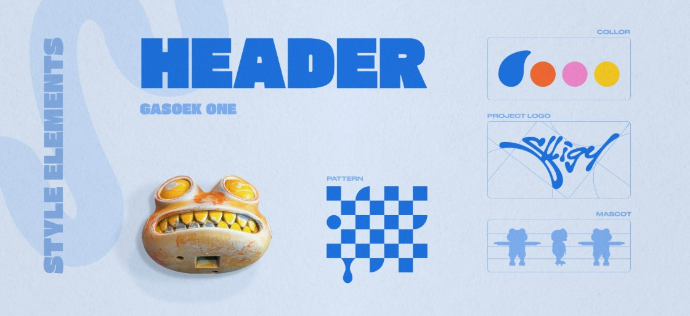
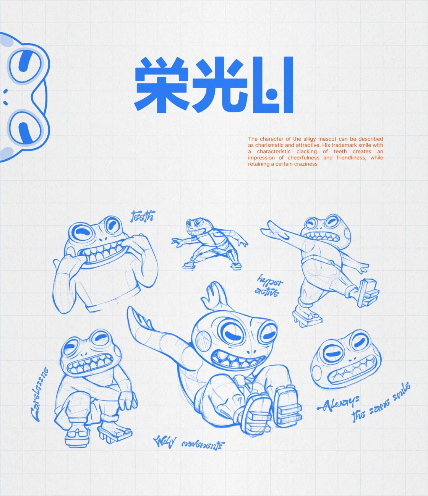
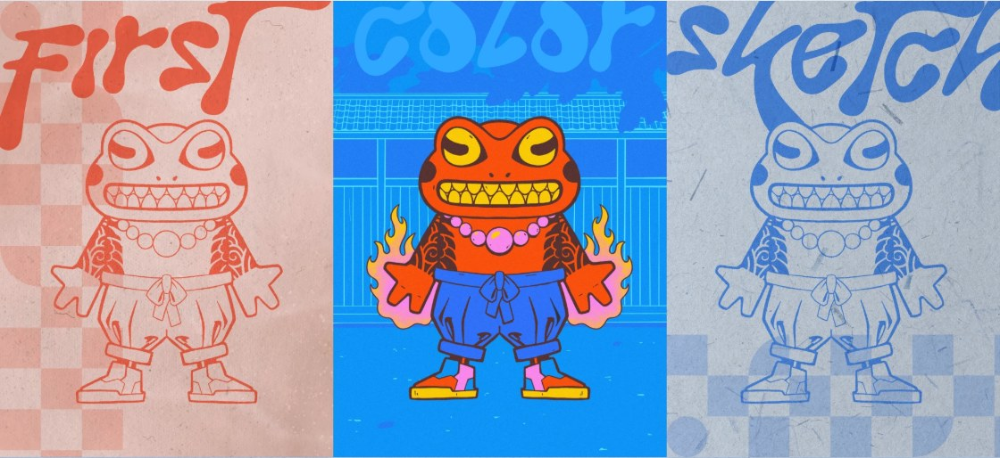
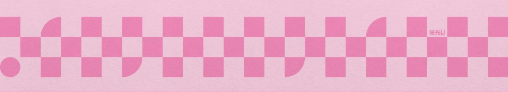
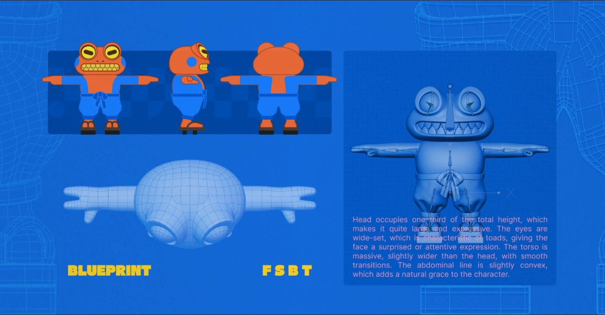
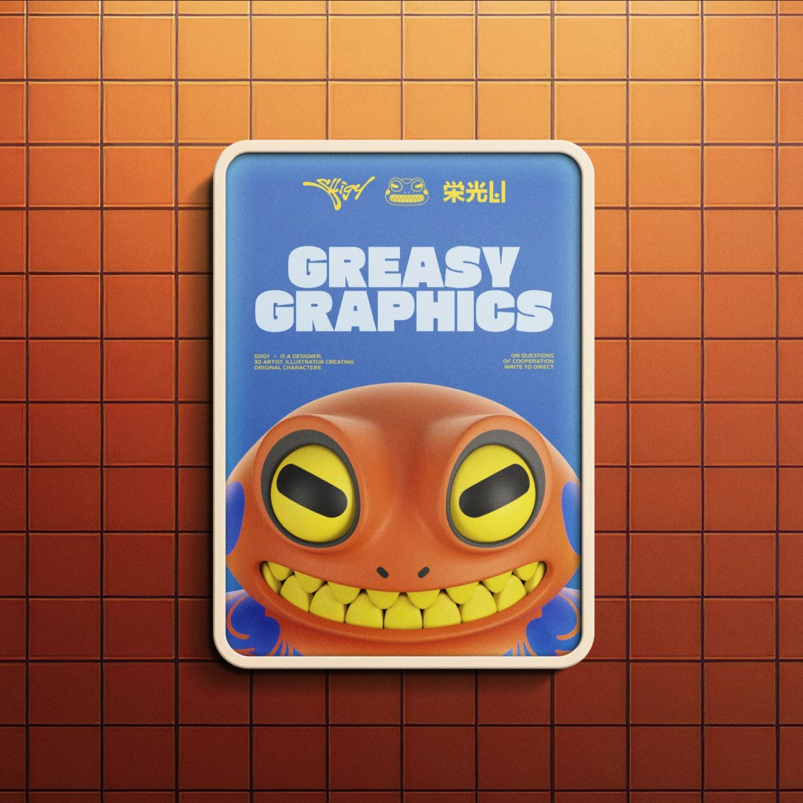
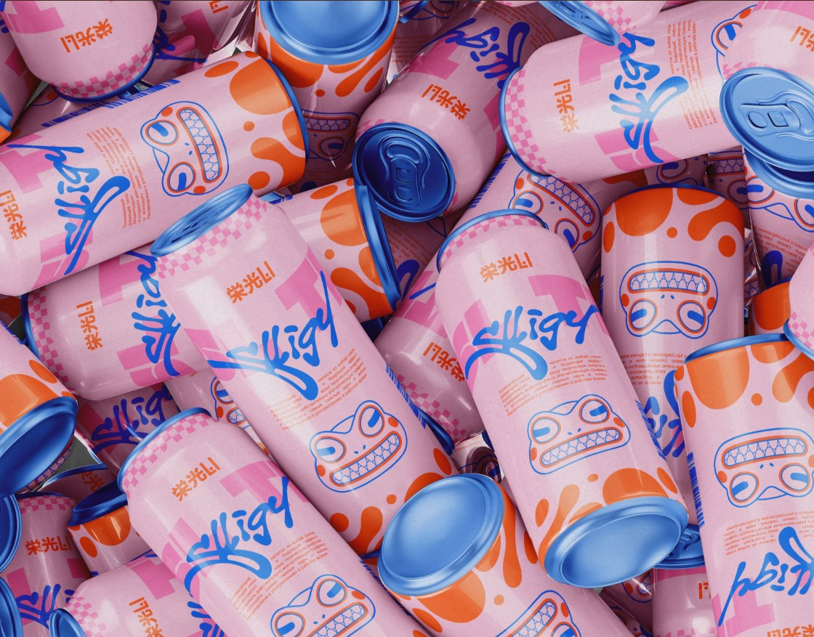
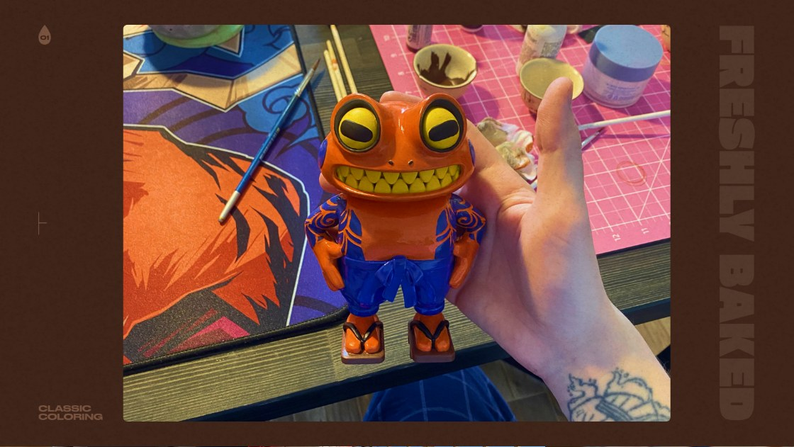

# Slligy 02｜视觉解析：角色与个人品牌系统

查看与整理日期：2026-11-10。本篇按项目[案例研究模板](../../../../01_品牌设计项目/02_研究参考/案例研究模板.md)的 11 项组织，结合画面讲解知识点。原始来源为 [Dprofile 项目页](https://dprofile.ru/case/137493/slligy-personal-brand-identity-and-character-mascot)，作者署名 Vyacheslav Lipin。网页介绍以俄文为主，作品图中另有英文说明。

实际范围：已查看项目介绍及角色、字标、色彩、草图、模型和应用相关画面；本篇重点记录源页面图片编号 2、5、6、9、10、11、14、16，并附八张截图。图号按页面图片替代文本中的编号，便于定位。前篇“未查看图片”是 2026-11-09 的历史范围，当前以本篇为准。未核实源设计文件、动态图完整过程、工时、授权细则或商业结果。

## 1. 品牌背景：个人品牌可以同时成为创作项目

**来源事实：** 项目页将 Slligy 介绍为个人品牌识别及同名吉祥物项目，希望角色引导观者进入 Vyacheslav Lipin 的创作世界。这是作者对项目的说明；它不是访谈或效果调查。页面署名及前轮读取的作者主页均显示其 3D/CG 创作方向。

**讲解：** 个人品牌可以通过作品向人介绍作者的创作兴趣和表现能力。本项目的角色、插画与立体表现也成为可供观看的作品内容。但不能只凭丰富画面推导已形成稳定业务、客户来源或收入。

与 Migo 的联系是：你希望个人品牌 IP 成为代表作，因此可以研究“设计身份”与“展示能力”如何通过同一个项目共同表达。

## 2. 品牌定位：先读作者意图，再看画面如何回应

**作者说明：** 页面介绍强调呈现创作者的潜力与理念，支持个人品牌与内容表达。作品的 Objective 文案也提出建立用于展示作品和与受众沟通的视觉语言。

**视觉判断：** 从粗重标题、自由曲线字标、鲜明配色、夸张角色和立体材质，可读出较强的表现欲、玩趣与动感。这是我的解读，不替作者定义完整的目标客户，也不声称这些形式必然带来相同感受。

**知识点：定位与风格不是一回事。** 定位涉及为谁表达、提供什么价值；风格是视觉形式的选择。我们可以描述此处的视觉形式，但精确受众、业务范围和市场差异仍[待验证]。

## 3. 品牌架构：名字、角色和作者之间的关系

**来源事实：** 作者将个人品牌与角色描述为同名。图 2 的系统概览又把 PROJECT LOGO、MASCOT、PATTERN 和色彩分区列出，说明它们在展示中各自承担不同部分。

**讲解：** 角色、字标和辅助图案可以在同一个品牌下协作；它们无需每次都以同一套组合出现。不过，本次没有取得完整的组合规范，不能把作品里的示例概括为所有场景的固定用法。

Migo 与 Beedog 使用不同名称，已经明确主品牌和角色的关系，因此无需模仿这里的同名方式。可比较的是：形象与名称怎样反复建立联系，作者身份又怎样被说明。

## 4. 角色设计：哪些特征保持，哪些表达可以改变

**实际观察：** 角色头部两侧有突出的眼部形状，眼睛间隔较宽，嘴横向展开并露出两排尖状牙齿。草图中有蹲坐、张开手臂、抬腿等姿态，头部与露齿笑容反复出现。画面英文说明将它描述为有魅力、友好且保留一定疯狂感；手写注记提到活跃的动作与保持笑容。

**讲解：角色一致性。** 同一个角色改变姿势、角度和媒介时，需要保留一些可辨认的特征。本例可以观察到突出的眼部、宽嘴与牙齿持续出现。它不要求每个动作都重新发明面部，也说明情绪可以由姿态与情境补充。

**实际观察：** 对照图里，线稿与彩色版本保留相近的角色结构；彩色版本增加橙色身体、蓝色裤装、黄色眼部与牙齿、粉色饰物等。换成单色线稿后仍能看到主要结构，但本次没有进行用户辨认测试。

**对 Beedog 的建议：** 将来可以讨论哪些部位值得作为稳定识别线索，动作与情境又允许怎样改变。稳定特征不必现在预设为圆脸、尖耳或某种表情；先通过概念探索比较。你已明确通常不说话，可重点检验动作是否能表达好奇、专注与犹豫。

## 5. Logo 与字体：不同文字可以分工

**实际观察｜图 2：** HEADER 示例呈现粗重、块面感强的字形，下方标注 GASOEK ONE；PROJECT LOGO 区域则是连续、流动、近似手写的曲线字标。图 11 的海报中，GREASY GRAPHICS 采用粗重的大标题，较小的标志位于上方。

**讲解：字标与标题字体不必相同。** 字标提供名称的特定视觉形式，标题字体组织内容重点，正文承担更长的信息。它们通过各自分工形成关系。

图中的字标曲线有鲜明形式，但部分字母需要仔细辨读。它的识读效果值得实际测试，不能仅凭有个性就认定适合所有尺寸和受众。GASOEK ONE 是图中标注，本篇未独立核实所用字体文件、版本和许可；其他文字的确切字体未知。

**对 Migo 的建议：** 可以比较“有表现力的字标＋易读的说明文字”如何合作。你希望亲切直接、克制简洁，复杂字标是否适合自己，应结合名称辨读与场景判断，不从参考案例直接选择。

## 6. 色彩系统：用位置与重复建立联系

**实际观察｜图 2、6、11、14：** 概览图呈现蓝、橙、粉、黄四类色彩；角色常以橙色身体、蓝色裤装与纹样、黄色眼睛和牙齿出现。海报大面积使用蓝色承托橙色角色；罐装应用图用粉色底、蓝色字标及橙色元素重新组合这些颜色。

**讲解：色彩系统允许不同应用重新分配面积。** 颜色的持续出现，以及它与角色部位或图形的关系，共同提供关联。蓝与橙形成明显冷暖差别，黄色和粉色在细节与局部画面中参与变化。

本次未见可核实的标准色值或使用比例，不从压缩截图猜测 HEX、Pantone 或面积规则。鲜明颜色不自动证明记忆效果、可读性或商业适配。

**对 Migo 的建议：** 颜色数量应结合真实应用与维护能力决定。可以先验证哪些颜色承担品牌识别、哪些服务情绪与内容，再考虑是否扩充。此处没有选择 Migo 的配色。

## 7. 图形与插画：让角色之外也有识别线索

**实际观察：** 棋盘式方格、圆与弧形组合成横向图案；图 2 概览中也有相似图形。角色笑嘴中的重复牙齿在另一个横向展示图中被放大，形成与角色关联的图形表达。

**讲解：辅助图形。** 它可以在角色不适合完整出现的地方组织边界、底纹或视觉节奏。与角色共享某些形式，有助于形成整体关联，但并非每个图形都必须从角色五官推导。

这里可观察到元素之间的形式呼应，尚无作者完整推导过程，不能断言全部图形都由牙齿或某个比例计算而来。项目中出现的网格与圆形构造线也是展示证据，不能单凭它们证明设计最初由几何公式生成。

**对 Migo 的建议：** 若后续需要封面、栏目或背景，可以研究少量可复用图形。无需为了“有品牌系统”预先制作大量图案，避免增加维护负担和遮挡作品。

## 8. 应用：样机、模型与实物画面各说明什么

**实际观察：** 角色以正、侧、背视图以及模型线框、骨架等方式展示。图中说明称头部占总高约三分之一，这是作者图内描述，本次没有重新测量。

**讲解：三视图与制作信息。** 正侧背等视图有助于交代体积、结构和转向关系，供不同角度或媒介使用。展示骨架能看到模型组织的一部分，但不能据此断言其绑定、动画或全部动作已经验证。

**实际观察：** 海报画面把角色、粗标题和标志放入有边框的展示场景；罐装图重复使用角色脸部、字标、图案和色彩。它们可作为跨载体表达的案例。另有户外广告牌画面，本轮未核实真实投放。

**知识点：样机（mockup）。** 将设计放入某个载体或场景中，帮助检查尺寸、材质、曲面和观看距离带来的变化。本篇将上述海报与包装归为应用展示，其实体制作、销售或投放状态[待验证]。

图 16 呈现手持角色模型、周围有画笔与颜料的照片式画面，项目另有工作台上的模型图。它们提供了与前面应用场景不同的观察线索；制作材料、照片真实性和完整工艺未独立核实，不推导生产数量或商业化状态。

## 9. 值得借鉴的方法

| 从画面中学到的方法 | 具体依据 | 实际使用前还要检查 |
| --- | --- | --- |
| 先找能持续保留的角色特征 | 草图、线稿、彩色与模型中的眼部、嘴与牙齿 | 改角度、缩小后能否辨认 |
| 把人格翻译成动作 | 图 5 的姿态与作者注记 | 观者读到的情绪是否接近意图 |
| 让字标、标题和角色各有职责 | 图 2、11 的不同文字形式与布局 | 名称是否易读、说明是否被遮挡 |
| 让少量元素跨载体重复使用 | 图 10、11、14 的图案、色彩与字标 | 是否有真实使用需求，是否过度装饰 |
| 展示作品的结构与转化过程 | 图 5、6、9 的草图、平面与模型 | 是否真实对应自己的设计过程与贡献 |

这些是研究方法，不是对作者实际制作顺序的重建。项目展示顺序未必等于设计发生顺序。

## 10. 不适合直接照搬的部分

- **具体形象与形式：** 突出眼球、露齿笑容、字标笔画和现有图案属于这个案例的具体表达，不能当作 Beedog 的现成外形。
- **命名结构：** Slligy 的同名品牌与角色，与 Migo／Beedog 的既定架构不同。
- **气质：** 夸张露齿、活跃姿态和道具带来强烈表达，是否接近你的好奇、认真、独立，需要比较。个人差异不由夸张程度自动产生。
- **制作规模：** 立体建模、材质、动作、实物和大量应用会增加制作及维护成本。没有工时数据，不能估计作者花费，也无需把全套规模作为 Migo 求职或品牌启动的前置条件。
- **画面与验证：** 色彩鲜明、细节丰富的场景展示，不能代替小尺寸测试、真实投递反馈或实际交付验证。

## 11. 对 Migo 的启发 [建议，待讨论]

可把后续探索分成几个可检查的问题，先在少量应用中验证，再决定扩展范围：

1. **身份：** Migo 的名称和 Beedog 如何建立关联，专业说明如何由本人承担？
2. **稳定特征：** 哪些形态属于 Beedog，换角度与表达方式后仍值得保留？
3. **非语言表达：** 好奇、专注、犹豫如何通过动作呈现？不必照搬本例持续露齿的笑容。
4. **表现形式：** 平面、线稿或立体中，哪些真正服务概念与当前能力，哪些留待迭代？
5. **实际应用：** 头像、作品封面、案例开篇等需要哪些元素，哪些位置让作品本身主导？

你已确认的语言倾向仍是愿意解释原因、亲切直接、克制简洁；用语随受众调整，哪些场景更活泼仍待确认。本篇不从角色动作活跃推导所有品牌文案都应活泼，也不为 Migo 选定风格、配色或角色造型。

## 本轮结论与来源索引

**有画面支持的结论：** 本案例展示了字标、角色、色彩、图案、草图、立体模型与应用之间的协作。**研究者判断：** 其可迁移价值在于保留角色线索、分配元素职责及跨形式组织，而实际辨识与传播效果仍需验证。

| 本文截图 | Dprofile 源图号 | 实际查看与讲解内容 |
| --- | --- | --- |
| 01 | 2 | 系统概览、字体标注、色彩、字标、图案与角色 |
| 02 | 5 | 角色人格文字、动作草图 |
| 03 | 6 | 线稿与彩色版本 |
| 04 | 10 | 棋盘与圆弧图案 |
| 05 | 9 | 三视图、模型与图内比例说明 |
| 06 | 11 | 海报场景展示与信息层级 |
| 07 | 14 | 罐装应用展示 |
| 08 | 16 | 手持模型的照片式画面 |

- [原始项目页](https://dprofile.ru/case/137493/slligy-personal-brand-identity-and-character-mascot)，本轮实际打开并查看，日期 2026-11-10；[作者主页](https://dprofile.ru/slligy)沿用上一轮已核对的信息。
- 截图由浏览器在 1440 像素宽视口中截取作品图像元素；隐藏了可能遮挡作品的站点固定导航，没有重绘作品或调整其版式。JPG 截图有压缩，不作色值或精密尺寸测量依据。
- 截图用于有来源的学习讲解，原作品权利属于其权利人，不作为 Migo 的品牌资产。Behance 的前次 403 状态保留，未通过它补造资料；未核实作者的全部原始素材、奖项及商业成效。
- 用户对本篇的感受与是否采用尚未记录，不代写心得；新建议不视为用户已确认的设计决定。

[案例目录](../README.md) · [资料与阅读导引](01_资料与阅读导引.md) · [Mailchimp 视觉解析](../Mailchimp/03_视觉解析_标识色彩与网页应用.md)
