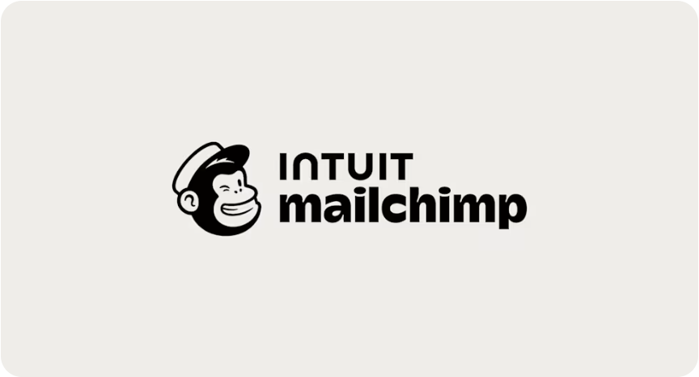
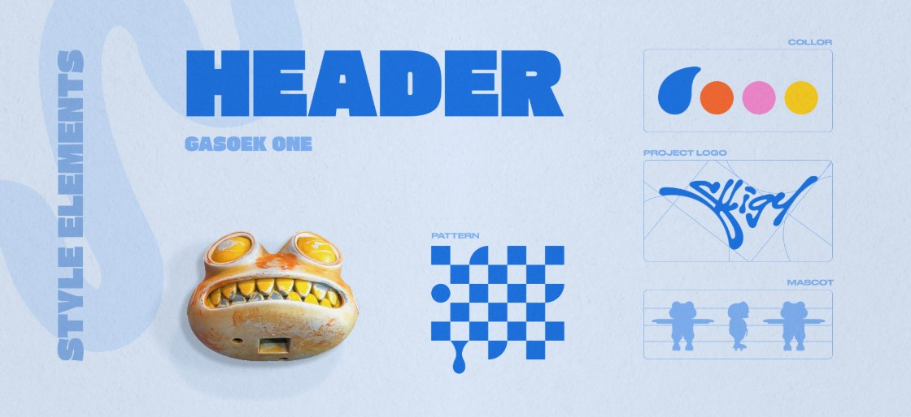
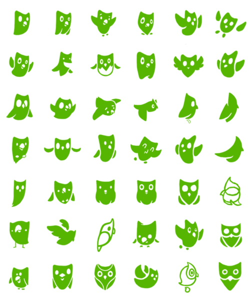
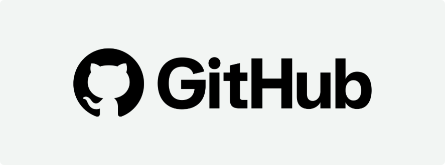
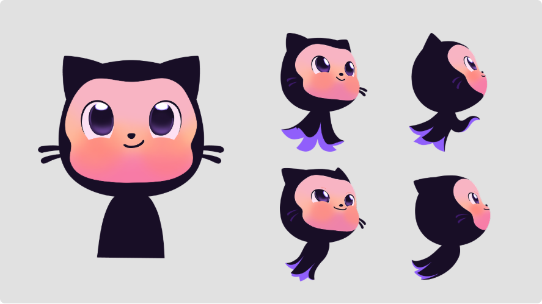
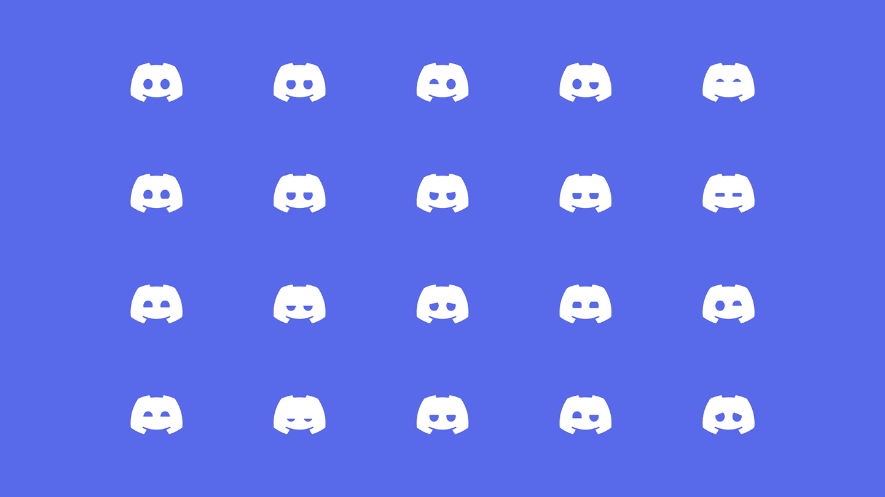

# 六案例横向归纳｜从案例做法到 Migo 的判断依据

整理日期：2026-11-11。依据为 2026-11-09—11 已归档的六案讲解、来源与截图，以及用户已给出的学习反馈。本轮重新阅读这些记录进行比较，没有新增网页、图片观察或成效调查。本文是研究者归纳，用户是否采用见后续反馈。

**配图更新｜2026-11-11：** 按用户要求补入八张仓库内已有的案例观察截图，逐图说明“看哪里、理解什么、怎样联系 Migo”。本次复看归档图片，未新增外部来源或改造原设计；图片原始出处与首次观察日期见各案讲解。点击图片可查看大图，文末保留原始网站入口。案例图片用于来源明确的学习，不作为 Migo 设计素材。

**当前可提炼的方向：用清楚的秩序承载丰富的想法，让好奇心通过角色行为与真实创作过程被看见。** 这是对 Migo 的建议，不是已确认的品牌主张，也不是指定视觉风格。

## 1. 先把案例放在同一颗粒度上

六案不是同一种业务，也不是六套同样完整的资料。本表比较已研究部分的“角色任务、识别线索、变化方式和应用”，不比较谁更成功。

| 案例与学习记录 | 已研究部分的角色任务 | 可重复的识别线索 | 可变化的表达或应用 | 对 Migo 可迁移的方法 |
| --- | --- | --- | --- | --- |
| [Mailchimp](Mailchimp/03_视觉解析_标识色彩与网页应用.md) | Freddie 参与识别与情绪；官方写作规则不以它的视角发声 | 头像与名称的规定组合、关键面部关系 | 深浅背景用专门版本；首页主画面可优先服务信息 | 专业说明与角色趣味分工，反白版本也需设计 |
| [Slligy](Slligy/02_视觉解析_角色与个人品牌系统.md) | 角色进入作者创作世界，个人身份项目也展示创作能力 | 突出的眼部、宽嘴与牙齿；字标、图案反复出现 | 草图、平面、立体与应用展示 | 品牌项目可以成为作品；过程和形式应对应真实能力 |
| [Duolingo](Duolingo/01_角色识别与系统化表达.md) | 历史文章中角色服务学习情境与反馈 | 官方文章总结共同构形语言；先比较整体轮廓 | 姿态、角色题材与内容情境 | 先定义稳定特征，再扩展动作；动作来自使用任务 |
| [GitHub](GitHub/01_角色标识与品牌分工.md) | Invertocat 负责标识，Mona 负责角色表达；角色有场景限制 | 图形、字标及其组合；角色有自己的形态关系 | 深色／主题角色变体；不同强度插画 | 分清资产用途，为每个变体说明使用条件 |
| [Discord](Discord/01_符号识别与情绪表达.md) | Clyde 是识别符号；历史资料展示表情扩展 | 相近外轮廓、规定字标及组合 | 历史表情主要变化眼部；当前页面有不同传播画面 | 在稳定结构内表达情绪，从小尺寸与材料限制反推细节 |
| [Big Tea](<Big Tea/01_角色与商业视觉应用.md>) | 角色参与饮茶情境和品牌应用 | 厚重字标、饱满身体、描线与茶杯 | 动作、色彩组合和名片／包装／袋面构图 | 名称、形体和动作互相支持，按触点分配信息主次 |

表中部分“识别线索”是基于画面的分析，并非全部来自官方构形规范。Duolingo 与 Discord 的历史资料不代表完整现行规则；Slligy 与 Big Tea 的应用展示也不能自动证明量产或商业结果。

### 图解 A｜Mailchimp：图形与名称建立联系，业务信息仍有主次

**看哪里：** 左侧 Freddie 头像与右侧两行名称形成明确组合，头像有笑嘴、帽子和表情，文字直接告诉你品牌是谁。

**理解什么：** 图形提供形象线索，名称提供可读身份。角色有趣，不妨碍组合保持清楚；这张图也不要求 Migo 模仿两行名称或增加上级品牌。

**再比较应用：** 导航里保留识别组合，主画面则突出服务标题、说明和按钮，没有把角色放大到所有位置。对 Migo 的启发是作品页先让成果与说明被看见，个人介绍再测试角色与名称如何共同建立记忆。图上营销评分与效果数字未经本项目核验。

来源：[官方品牌资产](https://mailchimp.com/about/brand-assets/)及[官网](https://mailchimp.com/)，截图日期 2026-11-10；[完整讲解与观察范围](Mailchimp/03_视觉解析_标识色彩与网页应用.md)。

### 图解 B｜Slligy：系统由不同职责的元素协作

**看哪里：** 上方粗重标题、右侧流动字标、中间几何图案、角色头部与剪影、右上色彩分别展示。

**理解什么：** 字标、标题、角色和辅助图形是不同层面的工具，不需要全部长成同一种形状，也不需要每次同时出现。对 Migo 的启发是先明确要解决什么问题，再决定制作哪些资产；无需照着概览表凑齐同等数量。

来源：[作者 Dprofile 项目](https://dprofile.ru/case/137493/slligy-personal-brand-identity-and-character-mascot)，源图 2，截图日期 2026-11-10；[完整讲解](Slligy/02_视觉解析_角色与个人品牌系统.md)。

### 图解 C｜Duolingo：概念比较要有结构差异

**看哪里：** 同样保持绿色与猫头鹰联想，各版的身体宽窄、重心、眼睛及翅膀轮廓仍有明显差异。

**理解什么：** 这是一组历史探索稿，并非现在可随意替换的角色版本。固定部分条件，能更清楚地比较形态；对 Beedog，未来的概念方向也应在轮廓或结构上有区别，而不仅是同一只狗换颜色和材质。

来源：[官方历史文章 Reshaping Duo](https://blog.duolingo.com/reshaping-duo/)，截图日期 2026-11-10；[完整讲解与历史范围](Duolingo/01_角色识别与系统化表达.md)。

### 图解 D｜GitHub：标识与完整角色，服务不同任务

**看哪里：** 上图以少量黑白轮廓加名称承担识别；下图的眼神、面部颜色、转向与体积细节提供更丰富的角色表达。

**理解什么：** 它们有视觉联系，但用途和规则不同；不能把对照当作已证实的设计演变过程。对 Migo，先检验 Beedog 头像与完整形象各自需要什么，不必立即新增一套独立图形 Logo。

来源：[官方 Logo](https://brand.github.com/foundations/logo)与[Mascots](https://brand.github.com/graphic-elements/mascots)，截图日期 2026-11-11；[完整分工讲解](GitHub/01_角色标识与品牌分工.md)。

### 图解 E｜Discord：小范围变化也可以表达情绪

**看哪里：** 多个图形保留相近的外轮廓和下方弧线，眼睛通过开合、倾斜与不对称改变神态。

**理解什么：** 变化不一定需要重画全部结构；但没有情境或标签时，具体情绪也可能有歧义。对 Beedog，可研究眼神、头部和姿态的变化，后续用实际反馈验证。这是历史表情探索，不是改动当前标准 Logo 的许可。

来源：[官方六周年文章附件](https://support.discord.com/hc/article_attachments/1500015317882)，截图日期 2026-11-11；[完整讲解及当前／历史区分](Discord/01_符号识别与情绪表达.md)。

### 图解 F｜Big Tea：人格可以通过动作与情境表达

**看哪里：** 角色的体形、简化五官和描线相似，姿态与手中茶杯的关系不断变化。

**理解什么：** 这里的情绪与状态主要靠“身体＋道具＋情境”表达。对通常不说话的 Beedog，可以先写观察、试验、停顿等行为，再考虑动作造型，不必先写大量台词，也不必采用同样圆润可爱的风格。

来源：[Studio Moara 作者案例](https://studiomoara.com/work/big-tea-branding-and-mascot-design)，截图日期 2026-11-11；[完整讲解与应用观察](<Big Tea/01_角色与商业视觉应用.md>)。

## 2. 品牌架构不同，不能拼成一套通用模板

Mailchimp 的 Freddie 图标参与组合标识，GitHub 则明确区分图形标识与 Mona 角色。Discord 有具名图形和表情探索；Slligy 的品牌与角色同名，Migo 与 Beedog 已采用不同名称。这些是不同组织方法。

**对 Migo 的推导：** 保留“本人／主品牌 Migo → 品牌角色 Beedog”的既定关系。先测试字标与角色怎样共同使用，再判断是否需要另一个独立图形 Logo。案例中有某种资产，不构成新增同类资产的理由。

品牌名称、字标、角色和简介的任务也不同：名称回答是谁，字标提供名称的视觉形式，角色提供辨识与情绪线索，简介和作品说明职业方向与实际能力。陌生人首次看到一只狗，不一定知道名字或 AIGC 设计方向；初期需要主动建立关联。

## 3. 一致性来自规则，变化围绕任务发生

Duolingo 的构形说明、Discord 的历史表情和 Big Tea 的动作图，共同提示了“稳定与变化”的区分；Mailchimp 的深底专用版本又说明，维持形态关系有时需要调整具体画法。

可以理解为：**稳定的是身份线索，可变的是为情境服务的表达。** 这不意味着所有品牌都必须对称、简单、平面化或完全同色。

| 维度 | Migo 后续应明确什么 | 当前没有选定什么 |
| --- | --- | --- |
| 轮廓与比例 | 换动作、转向、缩小后，哪些关系仍标明这是 Beedog | 脸型、耳朵、头身比例、机械化程度 |
| 表情与动作 | 哪些变化表达观察、疑惑、专注或满足 | 标准动作数量、具体神态、反差两端 |
| 字标与排版 | 名称辨读与正文阅读分别由什么规则保证 | 最终大小写、字形、字体与间距数值 |
| 色彩 | 哪些颜色用于识别、文字、强调与角色 | 黑黄是否采用、色值、比例及多色变体 |
| 辅助图形 | 用什么关系组织内容，何时出现和退场 | 蜂巢是否采用、图案形态与密度 |

因此，不能把“每一页都有同一只狗、同一种黄”当成系统完整的唯一标准。也不能让 AI 每次生成一张新脸，再仅靠同一名称宣布角色一致。

## 4. 动作可以承载人格，专业性仍要有证据

Big Tea 用泡茶与坐卧表现情境；Discord 用眼部变化扩展神态；Duolingo 在文章所述产品任务中安排角色反馈。它们为非语言表达提供不同方法。

你已明确 Beedog 通常不说话，项目说明由 Migo 负责，因此可以优先研究视线、重心、手部与身体倾向。角色可以笨拙或困惑；这些情绪不等于 Migo 在专业判断上不可靠。

“认真”可通过持续观察、尝试与修正来叙事；**实际的认真细致则由内容准确、排版质量、结构一致和真实修订证明。** 深色、金属、技术线条或严肃表情都不是职业能力的证明。

“独立内核”也不能只靠一句标签解决。当前可以从昵称的真实由来、本人主动提出的联想、具体取舍与创作过程积累内容；不替用户编造信念、经历或角色世界观。

## 5. 应用主次有共性，具体场景规则有差异

Mailchimp 本轮首页主画面聚焦服务信息；Big Tea 在包装上放大角色但保留产品层级；GitHub 对角色用途有明确限制。共性是围绕任务分配注意力。

需要保留的差异是：Duolingo 历史文章允许角色参与练习，GitHub 规范却限制吉祥物用于部分教学与支持。不能由此得出角色都应讲解或都不应讲解。

**对 Migo 的推导：** 求职作品重点是成果、个人职责和判断；个人介绍需要建立名字与角色的联系；过程分享可以尝试让角色回应情绪。具体露出和活泼程度仍为候选，不能因为看完案例就自动视为用户确认。

文字的亲切、直接、克制可以相对稳定。视觉表现更丰富时，也不必同步增加网络热词或强行开玩笑。表现强度应拆开看：角色大小、色彩面积、动作幅度、排版密度与语言语气可以分别调整。

## 6. 设计系统的规模要符合当前资源

| 案例提示的能力或工作量 | Migo 当前可优先做什么 | 可按需求延后什么 |
| --- | --- | --- |
| Slligy 跨平面、模型与应用展示 | 清楚说明概念与转化过程，选能持续维护的表现方式 | 全套三维、复杂绑定、实体模型 |
| Duolingo 角色群与动作反馈 | 先验证 Beedog 一个基础形象和少量关键状态 | 庞大角色群、完整动画库 |
| GitHub／Discord 多用途资产与规则 | 为实际使用的版本写明用途并检查辨读 | 大量主题材质、无使用场景的变体 |
| Big Tea 跨物料应用 | 用求职与个人内容的少量真实触点测试 | 角色周边、产品包装和商业授权体系 |

这是对个人项目资源的建议，不是估计参考作者的工时。AI 可以辅助制作，但筛选、结构修正、中文排版、跨图一致性和版本管理仍需投入。SOP 的价值应通过真实复用记录检验，不能从文档存在推定效率已经提升。

## 7. 本次比较的偏差与边界

- **选样偏差：** 六案均以角色相关问题选入，不能由此证明个人设计师必须拥有角色；Migo 做角色的理由来自本人目标。
- **规模差异：** 成熟平台有长期认知和团队资源，不能把独立符号的使用直接套给尚在建立认知的个人品牌。
- **展示偏差：** 作者会筛选最好的展示画面；样机和漂亮画面不能替代真实阅读、辨认、投递反馈或商业结果。
- **资料不齐：** 各案深度不同；本轮没有统一测试、字体授权全检或成效数据，不给成功排名和量化优劣。
- **个人反馈不足：** 除 Mailchimp 学习反馈和大黄蜂联想外，其他案例尚无完整取舍记录；“看过”不等于“喜欢”或“采用”。

Apis Orient 只有封面观察，按用户要求暂缓完整分析，不加入完整系统比较。

## 8. 原始来源与转化入口

下列链接沿用各讲已经核实的来源，本轮未重新验证站点是否更新。具体截图、图号和观察日期见上表各案例记录。

| 案例 | 主要原始资料 |
| --- | --- |
| Mailchimp | [Brand Assets](https://mailchimp.com/about/brand-assets/)；[Voice and Tone](https://styleguide.mailchimp.com/voice-and-tone/) |
| Slligy | [Dprofile 项目](https://dprofile.ru/case/137493/slligy-personal-brand-identity-and-character-mascot) |
| Duolingo | [Reshaping Duo](https://blog.duolingo.com/reshaping-duo/)；[Building character](https://blog.duolingo.com/building-character/) |
| GitHub | [Logo](https://brand.github.com/foundations/logo)；[Mascots](https://brand.github.com/graphic-elements/mascots)；[Illustration](https://brand.github.com/graphic-elements/illustration) |
| Discord | [当前品牌页](https://discord.com/branding)；[六周年历史文章](https://support.discord.com/hc/en-us/articles/1500009438682-A-Fresh-New-Look-to-Celebrate-Our-6th-Birthday) |
| Big Tea | [Studio Moara 作者案例](https://studiomoara.com/work/big-tea-branding-and-mascot-design) |

归纳转化为 [Migo 设计原则·讨论稿 V01](../../../01_品牌设计项目/01_品牌策略/Migo设计原则_讨论稿_V01.md)。后者维护本项目的候选判断标准，本篇维护跨案例学习依据，两者不分别复制为两套策略。

[案例学习索引](README.md) · [品牌研究库](../../../01_品牌设计项目/02_研究参考/品牌案例研究.md)
