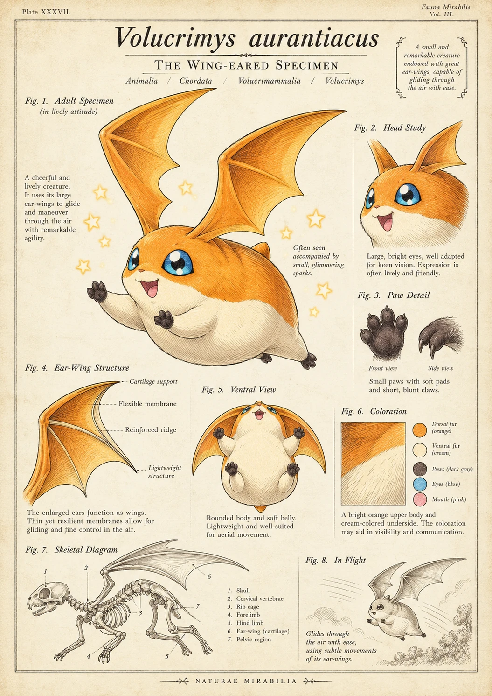

# 用户提供翼耳生物图鉴｜设计分析

日期：2026-11-14。状态：已完成画面分析，按本人要求归档；借鉴方向尚未选定。

## 来源与实际查看范围

本人在巴达兽讨论后提供了一张带有“Volucrimys aurantiacus”“The Wing-eared Specimen”标题的图片。本次已实际查看整张图，包括主形象、头部、爪部、耳翼、腹面、配色、骨架及飞行示意。

来源为本人聊天附件，原文件名 `codex-clipboard-ad21c50b-50da-4bc6-bb17-e92327f3d3c6.png`。未提供原作者、发布网站或制作过程，不能仅凭画面判断作者、是否由AI生成，或认定为数码宝贝官方设定图。其形象与巴达兽具有明显联想关系，但不能由此确定制作来源。

图像仅作用户提供的研究参考归档，不列为 Migo 自有角色或原创资产。图中的拉丁式命名、分类及解剖标注属于画面内容，本次未核实其科学依据，不能作为真实物种或官方设定的证明。参考官方巴达兽时，应回到[官方形象与设定分析](01_耳翼与角色功能设计分析.md)。

## 1. 耳翼结构：怎样让观者理解它能活动

**画面观察：** 图中的耳翼具有较厚的边缘、从耳根向外延伸的支撑线，以及相对薄的翼面。长尖外形、内侧缺口和支撑关系，使它接近翼膜的视觉语言；主形象的毛绒身体与薄翼面形成质感对比。

**设计解释：** 这套表达把“一个大耳朵轮廓”拆成连接、支撑和可弯曲表面，让器官在视觉上更容易理解。它传达的是结构感，不能因此断言结构在真实生物学或空气动力上成立。

**对 AC3 的建议：** 可研究耳根、支撑线、翼面和柔软边缘的层次，保留自己的宽圆双叶外形。不要直接把尖角、缺口或整片蝙蝠翼轮廓移植到 AC3，也不必为了说明结构铺满细线。小尺寸下应先看清耳形，再考虑内部细节。

## 2. 多视图：每张图回答一个问题

| 图中模块 | 实际展示 | 对 AC3 的可用方法 |
| --- | --- | --- |
| Fig.1 主形象 | 大耳翼、圆润身体、举爪与张嘴表情 | 先说明整体比例、轮廓与性格印象 |
| Fig.2 头部研究 | 五官、头部毛发与缩小的耳翼姿态 | 检查犬类鼻嘴、耳根、头盔和镜片之间的关系 |
| Fig.3 爪部细节 | 肉垫、脚趾及侧向爪形 | 在确有需求时说明手脚结构；不因参考有此栏目就自动制作 |
| Fig.4 耳翼结构 | 支撑、膜面、边缘等标签 | 用局部图解释耳根连接与折叠方式 |
| Fig.5 腹面视图 | 腹部、四肢和耳翼在另一角度的关系 | 校准换角度后的色块、连接与体积 |
| Fig.6 配色 | 毛色、脚端、眼睛和嘴部的色样 | 建立色块分工；不把这张图的颜色自动定为 AC3 标准色 |
| Fig.7 骨架 | 头骨、躯干、四肢与耳翼的结构示意 | 提醒结构要能互相对上；目前不建议把骨架研究当作 AC3 前置任务 |
| Fig.8 飞行 | 一张离地姿态与运动线 | 表达能力情境；不能替代连续动作和拍动结构验证 |

这里值得学习的是让各模块解决具体疑问。栏目多、标签多不等于设定更严谨；同一器官也需要在不同视图中保持可理解的连接和比例。本图不是标准三视图，不能直接当作制作模型所需的正交结构图。

## 3. 需要保留的疑点：滑翔不等于主动扇耳飞行

图中文字多次使用 *glide*／*gliding*，意思是滑翔；*maneuver* 指机动或调整方向。本人为 AC3 提出的设定是扇动耳翼飞行，不是仅靠展开翼面滑翔。

静态图可以表达空中状态，但本图没有说明完整的主动拍动周期，也没有充分交代动力、起飞、耳翼回收或头颈如何配合。骨架示意中，耳翼根部与头颈的具体连接不够清楚，尚不足以解释主形象的活动方式。这属于本次看图得到的结构疑问，不是已完成专业解剖鉴定。

因此这张图适合启发“怎样呈现结构”，暂不能作为已经解决飞行机制的依据。虚构角色未必需要严格复现现实生物，但不同视图和动作仍应尽量自洽，避免把几条运动线视为验证结果。

## 4. 哪些值得迁移，哪些要分开选择

| 项目 | 值得研究 | 本人尚未确认的部分 |
| --- | --- | --- |
| 耳翼结构 | 连接、支撑与柔软翼面的层次 | 是否采用膜面、具体支撑线及折叠规则 |
| 设定图方法 | 主形象、局部和动作分别回答问题 | 是否制作整张类似图鉴，以及具体模块 |
| 身体与脸部 | 轮廓主次、表情可读性 | 不据此改变现有双足与犬类鼻嘴方向 |
| 配色与质感 | 用色块组织形体、对比毛发与薄翼 | 不照搬橙白配色、蓝眼或圆球四足身体 |
| 画面风格 | 复古纸张、雕版式线条与博物学编排 | 画风和版式是独立选择，不随结构参考自动采用 |

当前 AC3 的犬类脸部、双足身体、宽圆双叶耳与自身分色，应继续作为比较基础；这些也仍需后续校准，不是全部定稿。头盔仍保留[①复古皮革与③ HGU-55/P 两方向](../../../../01_品牌设计项目/04_角色设计/飞行头盔参考_两方向待选_V01.md)。

## 5. 下一步建议与待确认

如果继续深化，优先解释 AC3 耳根如何活动，以及头盔、固定带、抬镜路径怎样避让耳翼；再用展开、拍下、收拢等关键姿态检查结构。具体动作与张数仍待讨论，不由本次归档自动转成制作任务。

上轮向本人提出的问题继续保留：**更想借鉴耳翼结构，还是整张角色设定图的呈现方式？** 本人本轮仅要求先推送设计分析，没有回答该取舍，因此不能写成已选定膜翼、复古图鉴画风或整套设定图。

[官方巴达兽分析](01_耳翼与角色功能设计分析.md) · [案例目录](../README.md) · [当前 AC3 概念](../../../../01_品牌设计项目/03_视觉概念/AC3飞行护目镜与耳翼飞行_概念讨论稿_V09.md)
