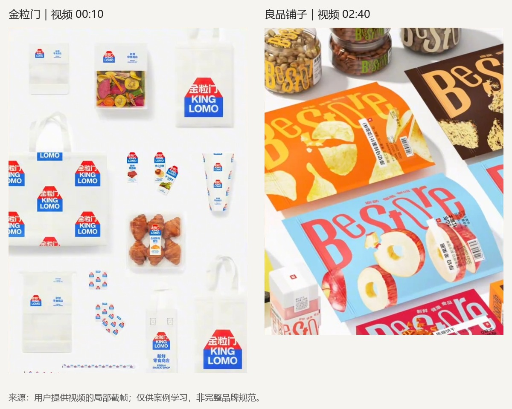
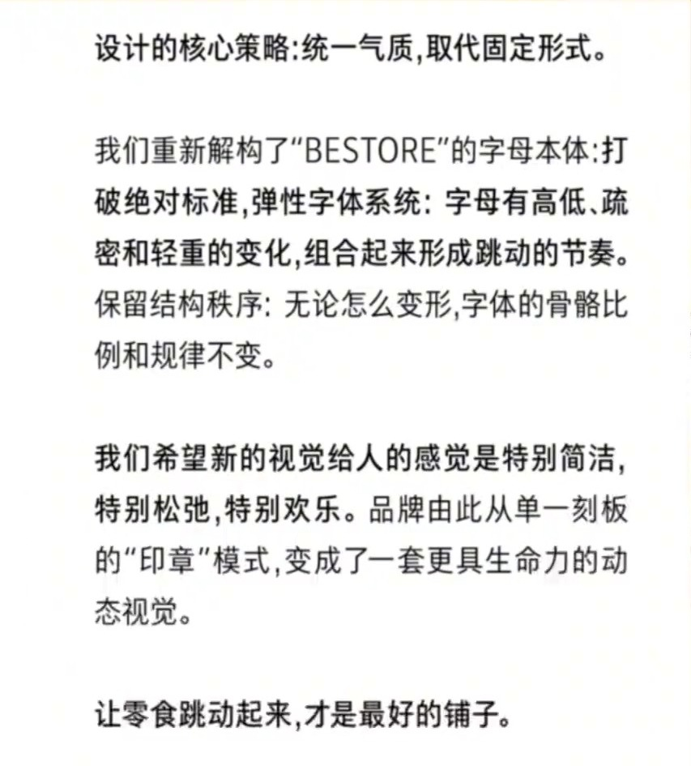

# 从“潘虎 vs ABCD”视频学习品牌识别与设计判断

记录日期：2026-11-11。类型：第三方设计评论视频分析，不是两家设计机构的完整案例研究。

**核心判断：** 视频值得学习的部分，是品牌识别如何兼顾统一与变化，以及设计方案为何需要结合目标判断。但“固定规范已经失效”“两案都带来商业成功”“品牌设计永远不会被 AI 取代”不能仅凭本片成立。

## 1. 来源与实际查看范围

- 用户提供文件：`潘虎vsABCD.mp4`，时长约 4 分 36 秒，1080 × 1920。原始发布网页、评论者账号及原视频是否经过剪辑未独立核实。
- 本轮按每 2 秒截帧覆盖全片，并查看重点大图；03:52—04:08 另按每 0.5 秒查看字幕。分析依据为实际画面、烧录字幕及片中展示的文章摘录，未逐句听辨音轨，不是完整转写。
- 视频将金粒门案例归于 ABCD / A Black Cover Design，将良品铺子案例归于潘虎。上述署名、项目范围、收费及市场成效本轮未向原始来源独立核验。
- 00:32 左右可见《良品铺子＋潘虎｜这届零食 开始不装了》文章截图，显示“潘虎设计实验室”。本轮只查看视频里的摘录，没有取得原文链接或完整文章。
- 下方图片是用户视频的局部截帧，时间点注明；裁切减少人物与字幕遮挡，未重绘案例。用于学习评论，相关作品归原权利人，不属于 Migo 原创资产。不上传整段视频或原始 OCR。

## 2. 视频的论述路线

时间为近似定位，不是逐字稿。

| 时间 | 画面与字幕主要内容 | 阅读时注意 |
| --- | --- | --- |
| 00:00—00:24 | 引入 ABCD、金粒门及收费话题，再引出潘虎与良品铺子 | 收费与设计师名气不证明设计有效 |
| 00:24—01:16 | 展示文章中对传统 VI、固定字形的描述，评论者联想到其他零食设计 | “在影射谁”属于评论者解读，不能证明设计师实际交锋 |
| 01:16—02:18 | 讨论网格、整洁、理性的新鲜零食表达，穿插其他品牌和苹果门店类比 | 案例与类比不构成对整个网格方法的验证 |
| 02:18—02:36 | 展示 BESTORE 弹性字体说明，强调高低、疏密、轻重与跳动节奏 | 同一说明也明确保留结构秩序 |
| 02:36—03:00 | 展示包装，邀请观众选择偏好 | 投票反映该情境下的偏好，不能替代商业效果研究 |
| 03:00—03:52 | 主张品牌设计不只有一个正确答案，客户也需要审美判断 | 多解不代表所有解法同样适用 |
| 03:52—04:24 | 由没有唯一标准答案推论品牌设计不会被 AI 取代 | 存在逻辑跳跃，见第 6 节 |
| 04:24—04:36 | 评论者评价两案成功，再次邀请投票 | 片中未展示支撑商业成功的指标 |

文件名里的“vs”可以表示对照，本片并未提供足够证据证明双方存在争执。

## 3. 两组画面到底有什么不同

来源：用户提供视频，左侧 00:10、右侧 02:40。这里比较实际可见的视觉组织，不代表已掌握两案完整规范、所有包装或线下表现。

### 金粒门：依靠重复的标识与信息组织建立家族关系

**可见观察：** 多件应用使用红蓝配色、房屋状轮廓和“金粒门 / KING LOMO”文字组合，较大面积白底；部分包装透明，能看到食品。相同标识可作为主体，也会重复为图案，部分应用调整色彩或组合方式。

**分析：** 共同轮廓、颜色和相似的信息组织，使不同形态包装之间容易建立关联；透明区域也让产品本身参与画面。“整洁、直接、有秩序”是对这些片段的感受，不是已经验证的消费者认知。

这里并非每一张画面都完全相同。**固定标识也能搭配变化的版式、比例和辅助图形。** 不宜仅凭评论者的概括，把金粒门整个系统定义为僵硬或没有变化。

### 良品铺子：让文字本身承担更多情绪表达

**可见观察：** BESTORE 字母在画面里具有高低、宽窄和轻重的差异，应用面积较大；包装出现橙黄、蓝红等多种组合，与食品图片或透明区域共同构图。商品名称、条码等信息仍有相对集中的标签区域。

**分析：** 不齐的字形节奏带来活跃感，字母既承担名称识别，也参与图形表现；较集中的商品标签提供另一层阅读秩序。这说明表达活泼与信息有序可以同时存在。

小图上有趣，不等于货架、手机缩略图或不熟悉英文的受众一定容易辨认。需要进一步测试名称阅读、品类查找、不同包装之间的关联，以及实际印刷表现。

| 学习维度 | 金粒门画面中较突出的做法 | 良品铺子画面中较突出的做法 |
| --- | --- | --- |
| 共同识别线索 | 重复的标识轮廓、红蓝关系和名称组合 | BESTORE 字母风格及节奏 |
| 变化出现的位置 | 标识大小、排列、载体与产品展示 | 字母表现、配色与产品构图 |
| 画面气质的解读 | 清楚、整洁、直接 | 活跃、轻松、富有节奏 |
| 需要额外核验 | 是否辨识清晰、能否区分不同产品 | 变形后名称是否可读、同品牌关联是否稳定 |

两案不是只改变一个变量的实验：品牌原有认知、客群、渠道、预算和品类结构可能不同。不能据此推导某种风格普遍更好。

## 4. 关键知识：统一不等于完全一样

**VI（视觉识别系统）**是让品牌在不同触点保持可辨认关系的一组视觉规则，涉及标识、文字、色彩、图形及应用方式。规则既能规定固定形式，也能规定允许变化的范围。

**网格**是帮助对齐、分配空间和组织信息的工具，不等于画面必须方正冷淡。活泼的设计也可以在背后使用网格。

**弹性识别系统**允许部分元素按规则变化，同时保留足够的共同特征。“动态视觉”在这段材料里也可以指静态应用中的不同表现，不能自动理解为已经制作动画。

来源：用户视频约 02:20 展示的文章摘录。关键两句是：

> “统一气质，取代固定形式。”
>
> “保留结构秩序：无论怎么变形，字体的骨骼比例和规律不变。”

第二句很重要：这套方案不是没有规则，而是把规则从“每次形状完全相同”转为“允许某些变化，但保留结构关系”。仅凭摘录还不能还原具体比例、变形边界或完整字体规范。

**一致性是让人判断它们属于同一品牌；完全一样只是实现一致性的一种方式。** 哪些要固定、哪些能变化，要结合触点与识别需求决定。已有品牌规范仍需遵守，不能把这里的讨论理解为可随意修改任何品牌的标准 Logo。

## 5. 哪些观点可以接受，哪些要保留判断

| 视频中的说法或倾向 | 本轮判断与理由 |
| --- | --- |
| 品牌设计不只有一个正确答案 | 可以作为学习启发；同一目标可能有多种可行方案，但要满足信息、识别、制作等约束 |
| 轻松的文字可以表达零食情绪 | 属于合理的设计假设；仍需观察目标受众是否如此理解 |
| 零食本质是松弛快乐，因此静态符号已经失效 | 是片中文章的设计论述，不能当作所有零食品牌的通则；不同场景也可能重视健康、可信、效率等 |
| 某段文章在针对另一位设计师 | 属于评论者推测；当前材料不足以认定意图或争执 |
| 找不同设计师都可以达到赚钱目的、两个设计都很成功 | 视频缺少销售、利润、识别测试或其他相应证据；视觉展示不能单独证明经营效果 |
| 大师、收费高，所以方案值得信任 | 名气与价格可作为背景信息，不能替代对目标、成果与实施条件的检查；片中费用也未独立核验 |

视频用“vs”、强烈的文章表述和偏好投票组织讨论，容易让观众先选边。学习时可以先问“它解决什么问题、靠什么成立”，再表达个人审美偏好。

## 6. 关于 AI：作者的推论不充分

约 03:56—04:06 的字幕表达了：品牌设计“永远不会被 AI 所取代”，因为没有唯一正确的标准答案；“AI 擅长做的是做标准答案”，而审美与判断需要人。

**我不同意把这个论证当作职业预测的依据。** 没有唯一答案，并不意味着 AI 不能参与：生成文案、图片和多个候选方向本身就是开放任务。即使认同现阶段人的判断很重要，也不能由此证明“永远不会被取代”。AI 能力和未来岗位分工需要实际证据与持续观察，两个包装案例无法解决这个问题。

更适合 Migo 当前实践的表述是：**AI 可以辅助探索和制作；本人需要说明目标、提供个人输入、比较方案、处理细节，并对采用结果负责。** 这也不表示人每次都会判断正确，可以借助受众反馈与实际应用修正。

在作品集中，比“AI 没有审美”更有说服力的是可检查的记录：

1. 我发现了什么问题，提出了什么具体想法？
2. AI 帮助生成或完成了哪些部分？
3. 我为什么选择这一版，为什么淘汰其他版本？
4. 我在 Photoshop / Illustrator 中调整了什么，改善了什么？
5. 实际观看或反馈暴露了什么问题，我怎样修正？

这些记录可以支持对本人贡献的判断，不预先保证求职或商业结果。

## 7. 对 Migo 的启发：固定什么，允许什么变化

以下是待验证建议，不是用户已经确认的新规则，也不改写当前视觉概念任务书。

| 层面 | 建议先保持清楚或相对稳定 | 可以探索的变化 |
| --- | --- | --- |
| 身份 | Migo 是本人和主品牌，Beedog 是品牌角色 | 依触点调整角色露出程度 |
| 名称与字标 | 先让名称可读，并形成可复用的基础版本；最终形式未选 | 是否需要字形变化，等基础识别和真实用途明确后再判断 |
| 角色 | 概念选定后建立可辨认的轮廓、比例与面部关系 | 动作、视线、姿态和情绪；通常不靠台词解释 |
| 信息 | 作品标题、本人职责与设计说明可读，作品本身有足够空间 | 栏目节奏、构图与局部强调 |
| 表达 | 愿意解释原因、亲切直接、克制简洁 | 活泼场景仍待讨论，不因本视频自动确认 |

这与既有“稳定识别＋可变表达”原则相容。Beedog 在动作与情绪上探索，完全可以与专业作品的清楚排版共存；不必为了创新同时改变所有元素。

**维护成本也要考虑：** 对个人而言，变体越多，越需要管理源稿、适用场景与检查规则。先做好一个可用的基础版本及少量有用途的变化，通常更便于检验；不是要求第一版建立复杂字体系统。

现阶段仍按[视觉概念任务书](../../../../01_品牌设计项目/03_视觉概念/视觉概念任务书_V01.md)开展探索，机械化暂不重点强调。此视频不会自动成为 Migo 应采用跳动字形、活泼配色或某种风格的依据。

## 8. 一个后续可做的小练习

概念草案出现后，用相同角色与同一段项目内容分别做两种表达：一版较稳定地组织名称与信息，另一版只让某一类元素变化。记录哪些内容仍被认出、哪里更难读、变化是否帮助表达，而不是只投“更喜欢哪一版”。

这是后续验证建议，本轮尚未制作或测试，也未代写用户学习心得。

**尚待补充的证据：** 原视频公开链接与上下文、两案原始发布和完整规范、实际使用环境及效果资料。没有这些资料时，本记录保持为视频片段分析，不扩大成完整案例结论。

[返回品牌设计案例](../README.md) · [已有六案横向归纳](../六案例横向归纳.md)
