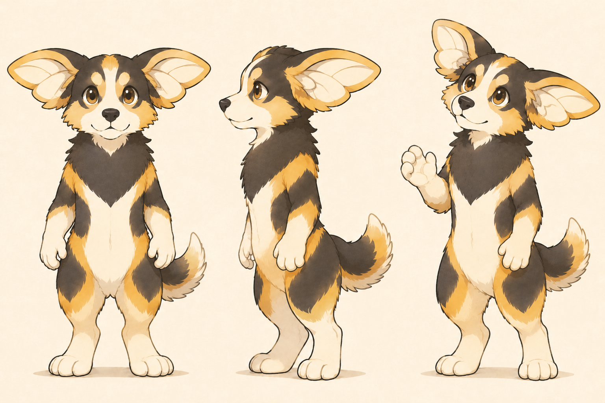

# 纳尔原皮｜视觉与 AC3 的比较

日期：2026-11-12。用途：理解本人喜欢的造型与人格反差，服务 Migo 的 AC3 概念收敛。本页是有限范围的角色参考分析，不是品牌全案或完整原创性检索。

## 已取得的资料与查看范围

- [Riot《英雄联盟》纳尔官方角色页](https://www.leagueoflegends.com/en-us/champions/gnar/)：成功读取角色简介、技能文字和图片／演示地址。
- [官方原皮插画](https://ddragon.leagueoflegends.com/cdn/img/champion/splash/Gnar_0.jpg)：从角色页取得地址，实际查看 1215×717 的完整图。图像属于 Riot Games，供参考分析；本仓库以原始地址引用，未当作 Migo 资产或上传为生图输入。
- [官方 Q 技能演示](https://lol.dyn.riotcdn.net/x/videos/champion-abilities/0150/ability_0150_Q1.mp4)：已成功取得视频文件，但本轮未完成播放或逐帧查看；不据此描述动作与身体结构。
- [AC3 双足概念图](../../../../01_品牌设计项目/03_视觉概念/概念图/2026-11-12_双足拟人五方向/AC3_双叶耳翼分色双足_概念图_V02.png)：实际重新查看完整三角度图。
- 本人已确认：“先以原皮为参照，后续可能会参考其他皮肤版本。”本轮没有查看其他皮肤，也不预设其风格。

## 对照图片

原皮插画中可见的是俯身靠近发光目标的小纳尔，不是正侧背结构图；不能通过此图测量其直立头身比或证明站姿结构。

## 官方设定与本人偏好分开理解

**官方文字事实：** 纳尔是远古约德尔人；简介写到好奇、顽皮以及突然发怒并变成巨兽。被动技能 Rage Gene 的文字说明将战斗积累怒气与 Mega Gnar 变身连接；Q 技能说明涉及回旋镖／巨石。以上来自官方页面，不等于 Migo 角色应沿用的设定。

**本人已确认：** 喜欢 AC3；喜欢大耳、毛发、双足，外表可爱与力量感反差，以及好奇、活泼、略带野性的气质。双足偏好由本人及 AC3 当前图确认，不从这张俯身的纳尔插画推导。

**设计判断：** 纳尔提供的是一种容易理解的参照：亲近、顽皮的外观中有主动性与兽类力量。对 Migo，可以把这种反差落在安静观察与主动尝试、柔软外形与稳固行动上；不必增加愤怒、失控或变身。此转译仍为建议，未获完整人格设定确认。

## 实际画面中的联系与差别

| 观察项 | 纳尔原皮插画实际可见 | AC3 当前实际可见 | 可供下一步使用的判断 |
| --- | --- | --- | --- |
| 耳部轮廓 | 大耳占据显著头部面积，耳尖较尖，耳缘与毛发相接 | 每侧上下双叶相连、边缘较圆，浅色耳内有翼面分区线 | 两者都靠大耳建立轮廓；AC3 应继续明确双叶连接与翼面，避免只剩泛用大耳兽类 |
| 脸部 | 暖橙与浅色脸部，深色眼部，俯身露齿的表情较顽皮 | 深色头部及眼侧、蜜黄色眉点、白色中线与口鼻，犬类黑鼻和短吻，微笑更温和 | 保留 AC3 犬类与毛色秩序；暂不加入纳尔的露齿、头饰或同款表情 |
| 毛发与色彩 | 暖橙、浅色毛发和较深耳缘，背部有较明显毛束；光照影响实际读色 | 炭黑、蜜黄、暖白，胸毛成下探形，侧身和腿部有分色 | AC3 的深浅组织是区别之一，但色彩相异不足以独立证明原创性 |
| 肢体与气质 | 身体俯低，前肢靠近发光目标，爪与露齿带来兽类感 | 双足站立、手臂放松或示意，姿态较规整友好 | 可借鉴“动作与对象发生关系”的表达方法，为 AC3 测试观察、试探和尝试 |
| 辅助识别 | 图中有骨质头饰、骨质器物及环境叙事 | 当前无服装、头饰、武器或其他道具 | AC3 可以优先让形态与动作承担识别；此阶段不因参考纳尔就增加器物 |

**当前结论：** “有点像纳尔”是有画面依据的联想，主要在大耳、毛发、暖色兽类形象与探索神态。两图并非同姿势或同视角，因此尚不能可靠比较直立头身比例、全身剪影或动作连续性；不能宣布两者完全不同、独特性已经成立或存在具体权利冲突。

## 现在仍缺什么

| 资料／判断 | 状态 | 是否阻塞下一轮 AC3 概念 |
| --- | --- | --- |
| 本人指的是原皮还是皮肤 | 已明确以原皮为先；其他皮肤以后按需追加 | 不缺 |
| 角色方向与喜欢的核心部分 | 已明确 AC3，以及造型、反差、气质三项 | 不缺 |
| 纳尔原皮直立正侧背与动作资料 | 未完成官方演示播放、未取得可信结构图 | 只影响精确结构对照，不阻塞 AC3 自身迭代 |
| AC3 双叶耳翼根部、侧背衔接、手脚及毛色分区标准 | 现有生图存在视角漂移，需下一轮画清楚并校准 | 属于待制作的设计结果，不是让本人提供的资料 |
| AC3 自然原型与同类角色对照 | 蜜蜂翼面、犬耳与犬类重心的带来源观察，以及更多相近角色检索尚未完成 | 可以随迭代补充；目前不宣称原创性验证完成 |
| 本人更喜欢的体态和简化程度 | 尚未做有控制的比较，如更紧凑有力／更轻巧敏捷、毛发较多／较少 | 用下一轮少量对照稿取得反馈，不必先填写一套抽象参数 |
| B-dog 名称与 B 的核心解释 | 仍为前轮讨论候选，未确定正式替换、未做名称核查 | 不阻塞角色形态；不自动把纳尔联想转为命名决定 |

**执行建议：** 现有资料足够开始 AC3 的体块与毛发简化探索。下一轮可保持脸部、耳翼和分色的大方向，比较紧凑有力与轻巧敏捷两种体态；再用相同的观察／尝试动作比较。该数量与方式是工作建议，本轮只补研究记录，没有发出新生图请求。

为保留本人认真、细致的一面，力量感可由脚掌、重心和动作确定性承担，好奇由视线和靠近动作承担；“野性”不直接等于攻击性。角色可以活泼，专业内容的活泼范围仍按实际场景另行决定。
