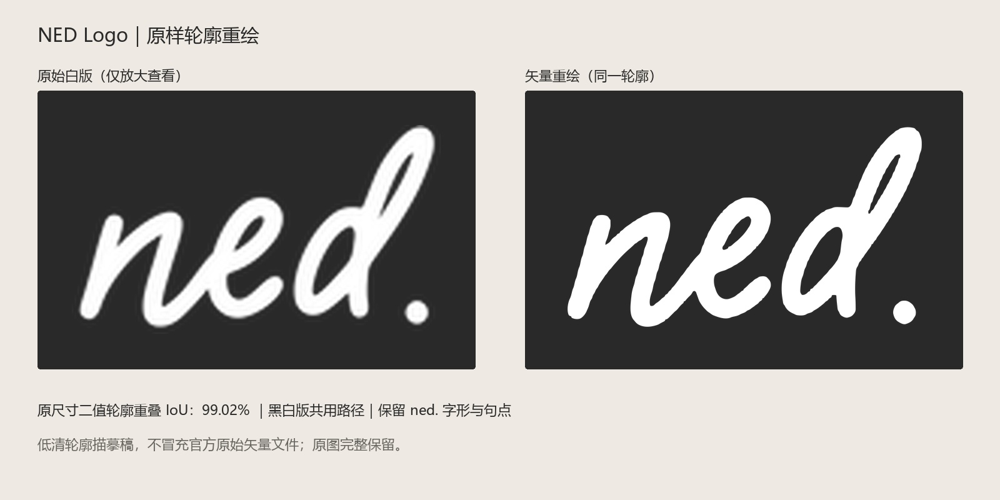

# NED Logo｜按现有轮廓高清重绘

日期：2026-11-05。依据用户“不要变更形状和元素，保留原样”的要求制作。保留 ned. 连笔字形、字间关系、内部空洞、笔画倾斜与独立句点；未替换字体、增加图形或重新设计标志。

## 交付

- `NED_原样重绘_黑_原画布.svg` / `NED_原样重绘_白_原画布.svg`：保留原始 250×74 画布比例及透明边距；全部文字均为路径，不依赖字体。
- `NED_原样重绘_黑_紧边.svg` / `NED_原样重绘_白_紧边.svg`：同一套路径，只将画布收至有效字形边界，不修改字形。
- 同名 `4000w.png`：4000 像素宽透明 PNG。原画布版为 4000×1184；紧边版约为 4000×2262，以文件实际尺寸为准。
- [轮廓核对记录](轮廓核对记录.json)：源画布、边界、原尺寸二值轮廓重叠率和连通分量。
- [轮廓叠图检查](轮廓叠图检查.png)：深灰为重叠轮廓，红色为原图独有像素，青色为重绘独有像素；按原尺寸二值网格放大显示。
- [原始文件](原始文件/)：原始黑白 PNG 完整保留。

## 方法与精度

来源为用户提供的白版 PNG（250×74），其有效字形区域约 122×69 像素；白版比黑版保留了更多可见轮廓，故以白版为描摹基准，黑白输出共用同一套路径。黑版颜色采用深黑 #1D1D1B，白版为 #FFFFFF。

从原始透明度提取轮廓，经 8 倍采样与样条曲线描摹形成 SVG。按同一 250×74 画布回栅格，以透明度 128 为二值阈值，原图与重绘轮廓交并比（IoU）为 99.02%；两者均为 3 个前景连通分量、4 个二值封闭空洞。另附同尺度放大对照。该数字只检查低清原图轮廓的接近程度，不代表品牌官方确认或无限精度。

这是低分辨率原图的忠实轮廓重建，不能恢复源图中未记录的细节，也不是找回的官方原始矢量文件。未把简单放大 PNG 冒充矢量重绘。原始图片未覆盖。

## 在 Banner 中的使用

页头品牌栏与广告品牌字段使用独立 Logo；REC 自定义场景图片不烘焙 Logo。V02 附带 1200×1200 与 1200×400 的组件试排 PNG，仅作为准备文件，未实际通过平台后台审核。
