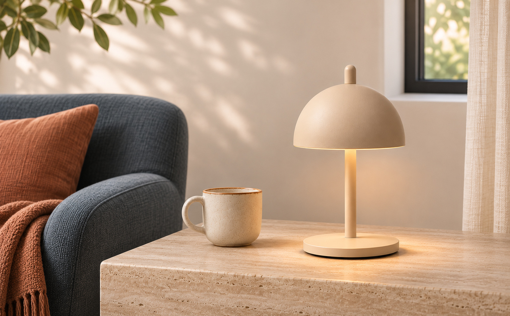
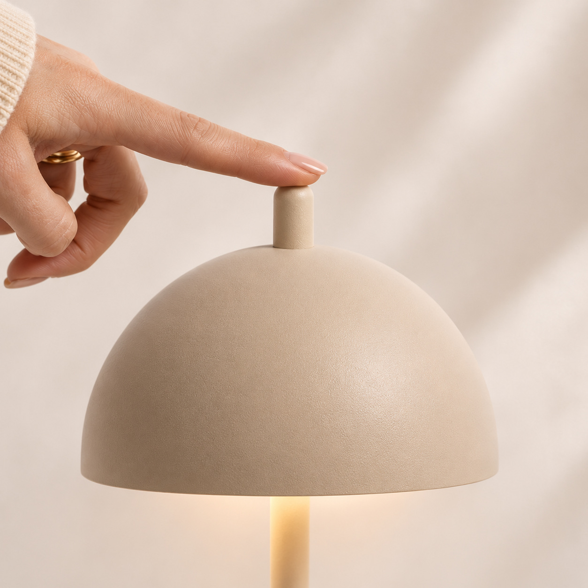
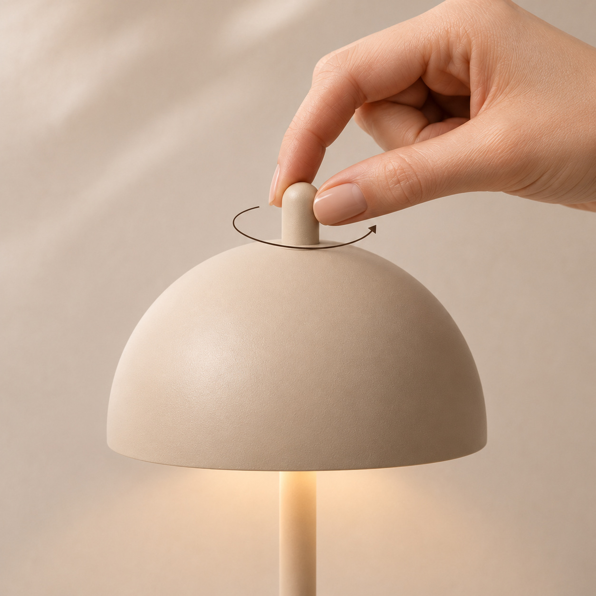
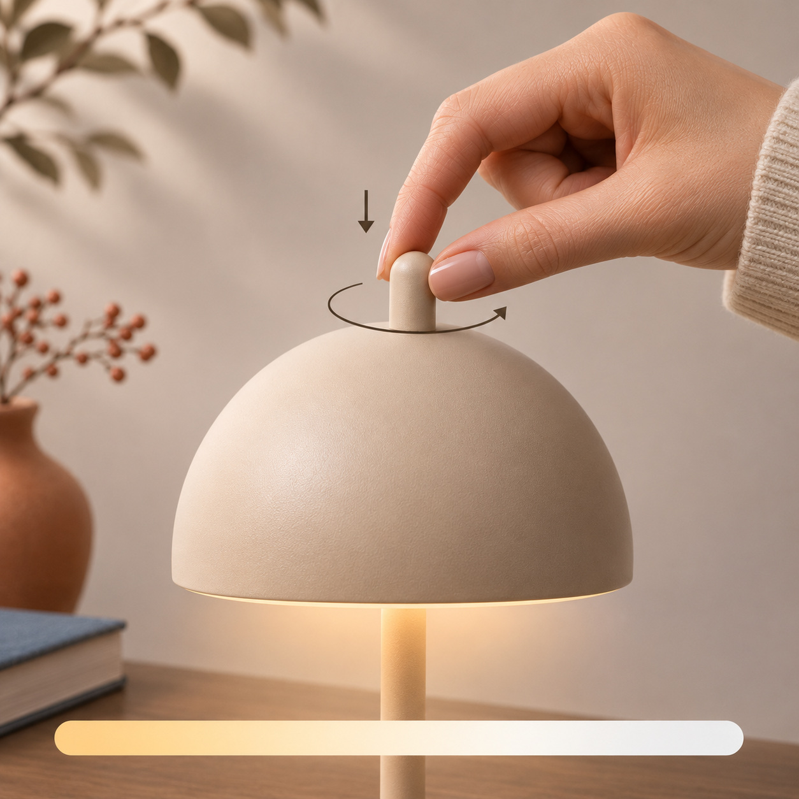
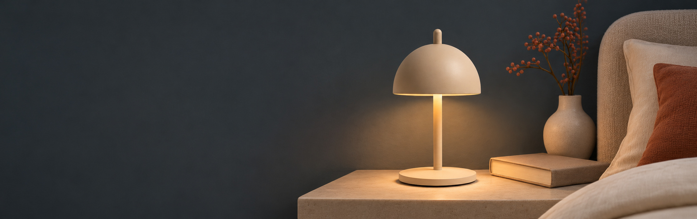
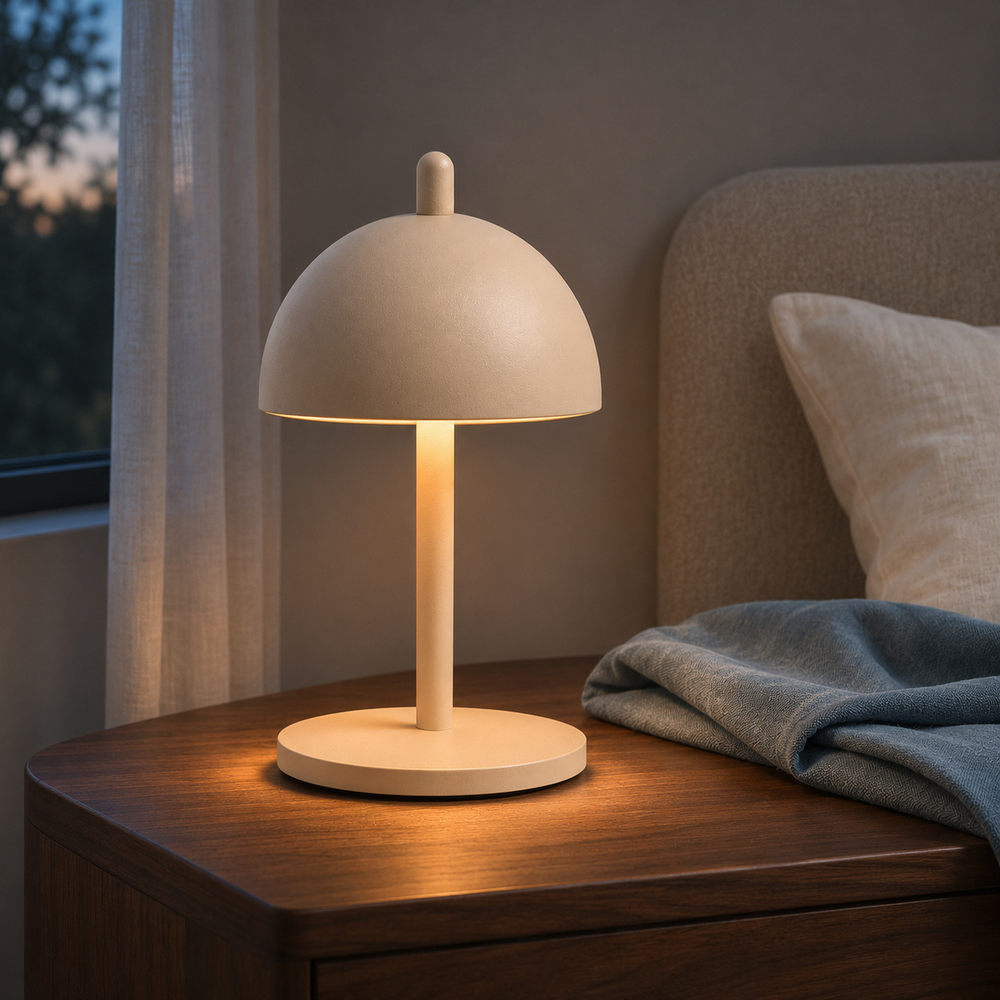
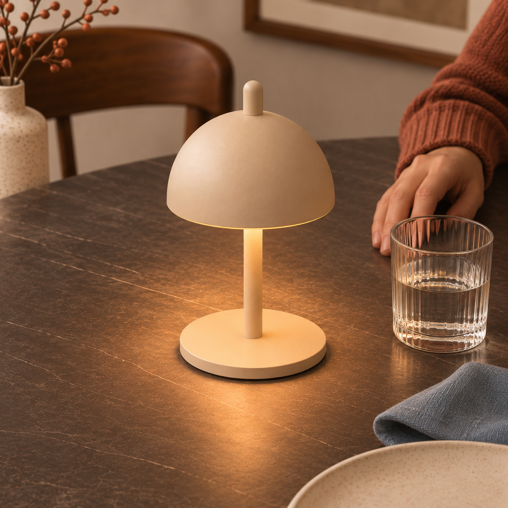
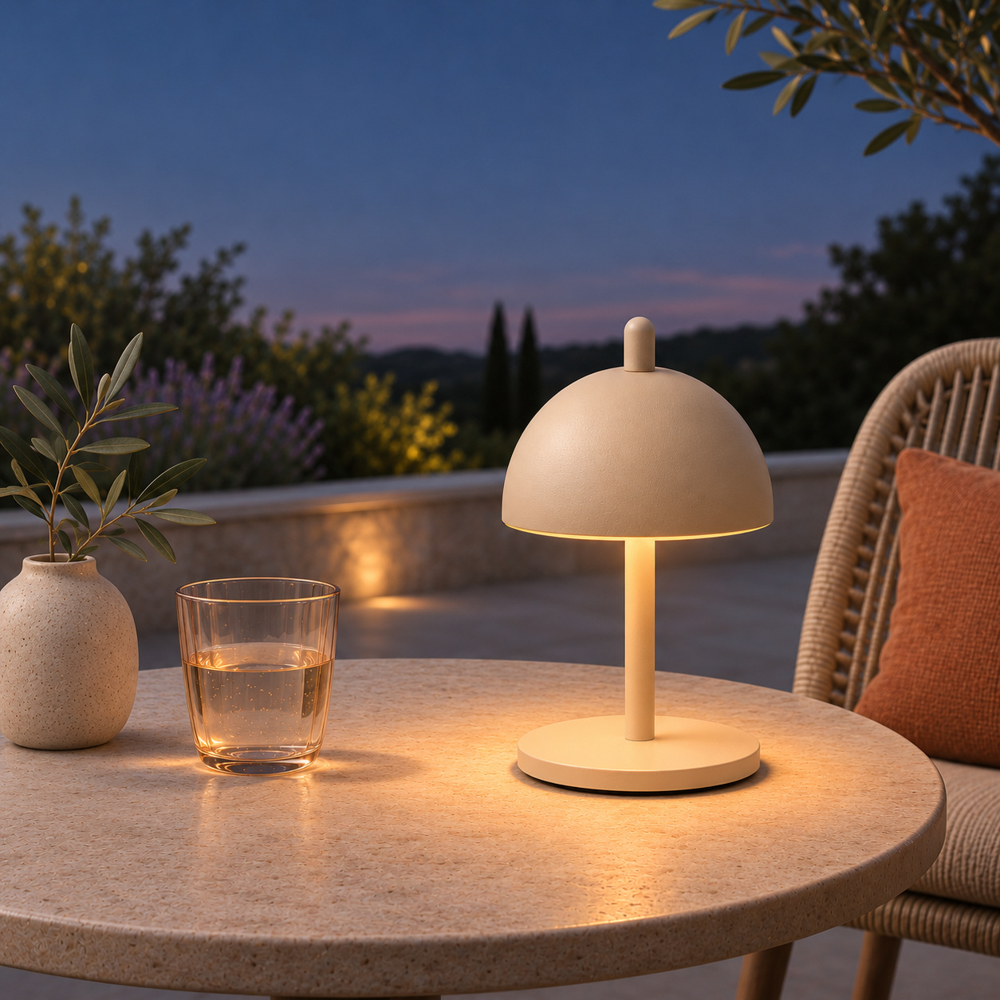
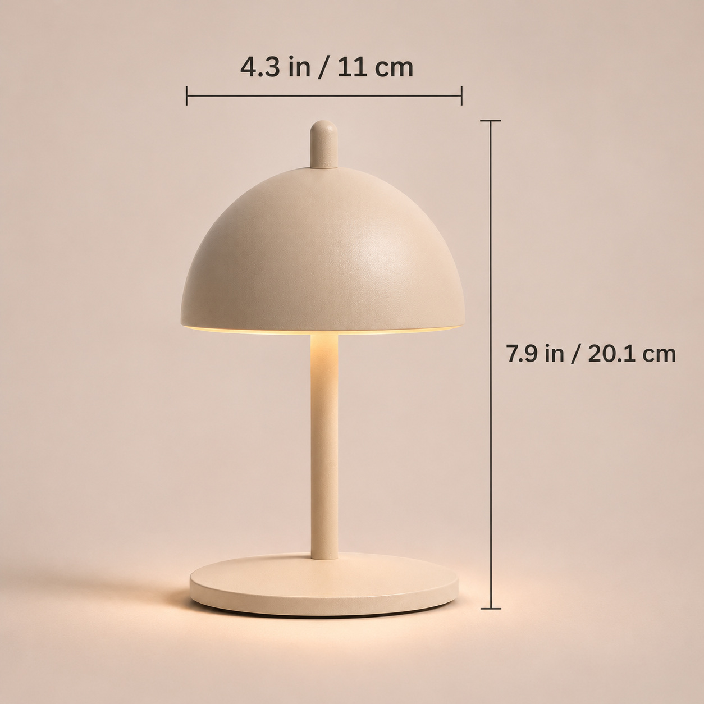

# NED Eric Lamp｜基础 A+_V01

根据[基础 A+ 内容制作方案](../../../项目规划/基础A+内容制作方案-v0.1.md)生成，包含 **5 个模块、9 张图片素材**。本页将图片和拟填入平台的英文文字组合展示，方便审阅整体节奏；这是作品集模拟，实际电脑端、手机端的排列与文字覆盖位置以亚马逊 A+ 编辑器预览为准。

图片和标题、正文分别保存：下方图片链接指向体积较小的 JPG，便于后续按模块导入；[素材原图](素材原图/)保留生成的 PNG。除了 A05 尺寸数字及 A02B / A02C 的示意图形，文案没有压入图片，可按平台字段调整。

## A01｜产品与日常空间

### A Small Light for Everyday Moments

A compact, cordless lamp that brings adjustable ambient light to your favorite spaces.

[查看 A01 图片](上传用JPG/A01_产品与空间.jpg)

## A02｜旋钮与光线调节

### Light, Just How You Like It

| Press | Turn | Press & Turn |
| :---: | :---: | :---: |
|  |  |  |
| Press the top knob to switch the lamp on or off. | Turn the knob to dim the light from 5% to 100%. | Press and turn to adjust the color temperature from 2,700K to 4,000K. |
| [查看图片](上传用JPG/A02A_按压开关.jpg) | [查看图片](上传用JPG/A02B_旋转调光.jpg) | [查看图片](上传用JPG/A02C_按压旋转调色.jpg) |

## A03｜无线使用与夜间续航

### Light Where You Need It

On a full charge, enjoy up to 8 hours of cordless light. Runtime varies with brightness.

[查看 A03 图片](上传用JPG/A03_夜间无线续航.jpg)

该模块计划使用 Amazon 的图片文字覆盖字段；本预览将文字单独列在图片下方，实际覆盖位置和手机端显示需要在编辑器中调整。

## A04｜一盏灯，多处使用

### One Lamp, More Places

| Bedside | Dining Table | Outdoor Table |
| :---: | :---: | :---: |
|  |  |  |
| A soft glow for your bedside table. | Bring a little ambiance to the table. | IP65 water-rated. Bring indoors after outdoor use. |
| [查看图片](上传用JPG/A04A_床头.jpg) | [查看图片](上传用JPG/A04B_餐桌.jpg) | [查看图片](上传用JPG/A04C_户外.jpg) |

三张图展示同款单灯在不同场景中的使用，不表示商品包含三只灯。

## A05｜尺寸、材质与造型

| 产品尺寸图 | 平台文字草案 |
| :---: | :--- |
|  | **Small Lamp, Thoughtful Form**  Approx. 7.9 in high × 4.3 in diameter (20.1 × 11 cm). Powder-coated aluminum in Sand Cashmere. |

[查看 A05 图片](上传用JPG/A05_尺寸材质.jpg)

## 文件规格与本版说明

| 模块素材 | 实际图片尺寸 | 模块最低尺寸参考 | 文件 |
| --- | --- | --- | --- |
| A01 日间横图 | 1594 × 987 px | 970 × 600 px | JPG / PNG |
| A02 三张操作图 | 各 1254 × 1254 px | 300 × 300 px / 张 | JPG / PNG |
| A03 夜间横幅 | 2237 × 703 px | 970 × 300 px | JPG / PNG |
| A04 三张场景图 | 各 1254 × 1254 px | 300 × 300 px / 张 | JPG / PNG |
| A05 尺寸图 | 1254 × 1254 px | 300 × 300 px | JPG / PNG |

- JPG 为原始图片的压缩格式导出，保留原始画面尺寸；9 张均为 RGB，单张小于 2 MB。PNG 原图保留在[素材原图](素材原图/)；部分 PNG 大于 2 MB。
- A01 和 A03 的实际比例接近对应横幅，但不完全等于 970:600 和 970:300。若编辑器要求固定比例，须检查并微调裁切，避免切到灯具或文字区域；尚未做亚马逊后台上传或手机实机预览。
- 按用户要求，A02 的旋转 / 按压旋转手势与 A05 的尺寸线端点参考[辅图 V02](../../亚马逊主图组/V02/README.md)。A05 高度从底座底部示意至旋钮顶部，直径横跨灯罩；这些是 V02 参考关系，未经过实物测量。
- 产品图和人物手势为基于参考图的 AI 生成示意。尺寸、光色、续航、IP65 及使用条件为官网或用户确认同款经销商的资料标称，不代表本项目实测。[产品事实](../../../产品资料/产品事实与素材检查-v0.1.md)
- 本版为产品基础 A+，不包含独立的 Brand Story 品牌故事；充电功能图、包装清单和接口图保持不绘制。
