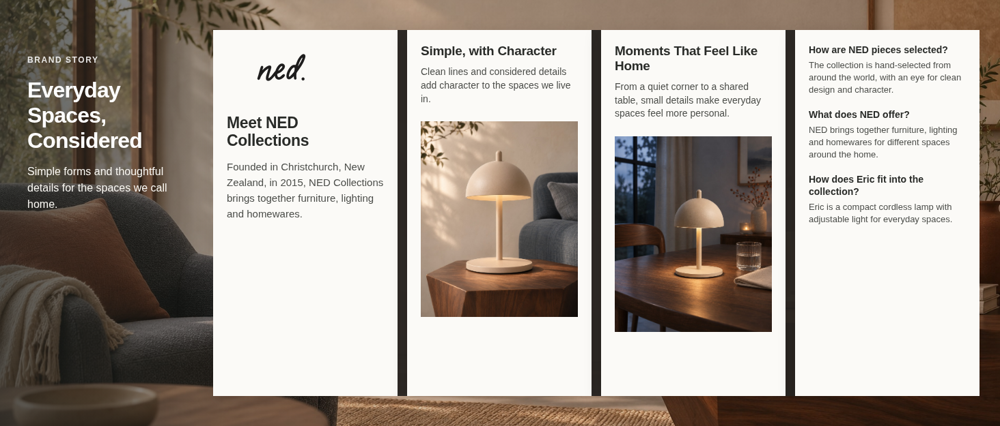
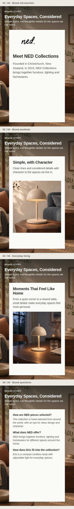
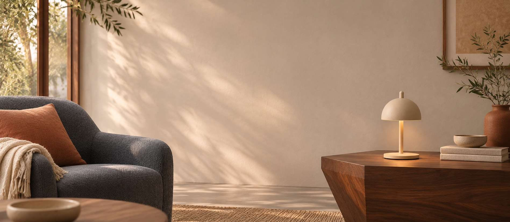
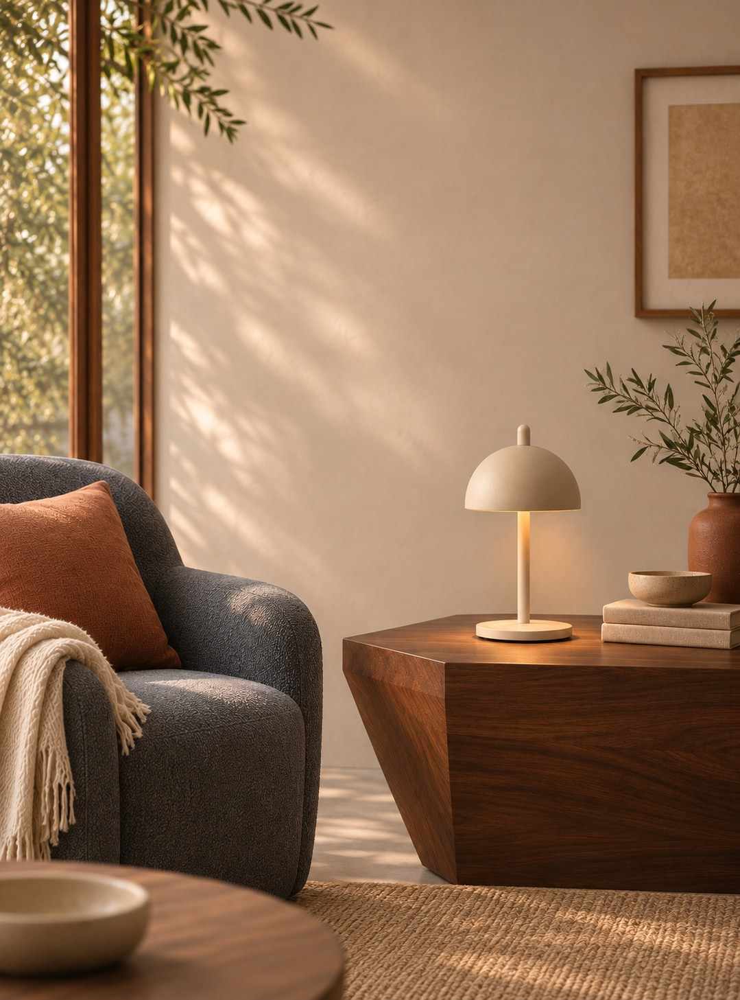
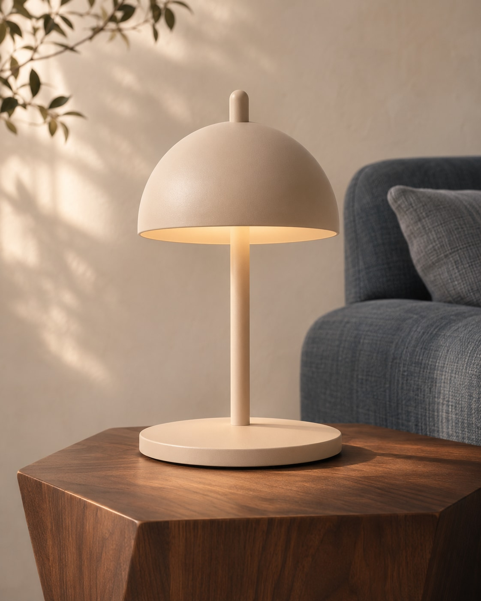
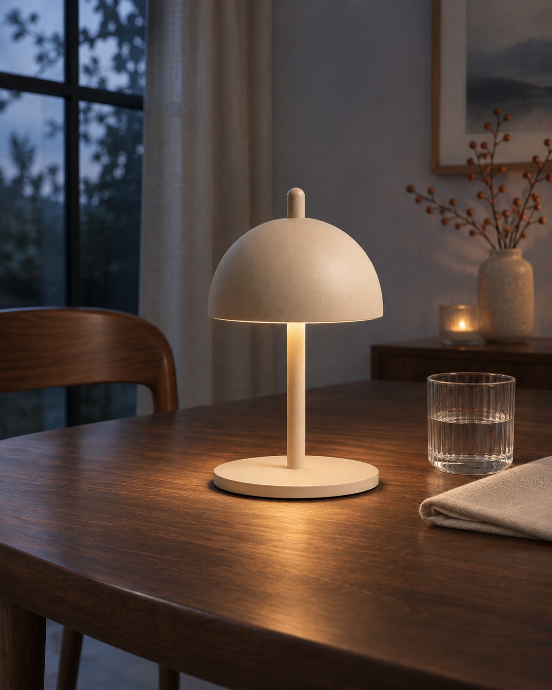

# NED Eric Lamp｜品牌故事 Brand Story V01

> 2026-11-08 作品集展示进度：[03品牌故事展示V04](../../作品集展示/成果展示/V04/03_品牌故事/README.md)已按[展示规划V01](../../../项目规划/作品集03_品牌故事_展示规划_V01_20261108/README.md)制作并归档，含桌面完整卡组及手机四个状态。英文为原生文字、Logo为独立路径；展示稿待审阅，原素材V01未因此自动终审。

根据[品牌故事内容架构与制作方案](../../../项目规划/品牌故事内容架构与制作方案-v0.1.md)制作，包含一组电脑 / 手机背景和四张故事卡：品牌介绍、审美与造型、日常生活、品牌问答。本项目为亚马逊美国站作品集模拟，不代表 NED 官方委托或实际发布。

## 电脑端图文整体预览

[查看电脑端大图](排版预览/电脑端图文预览.png) ｜ [查看手机端四屏预览](排版预览/手机端四屏图文预览.png)

## 手机端四屏图文预览

电脑图与手机四屏图是供审阅的模拟排版，不是亚马逊后台截图。手机预览将四张卡片的不同滑动状态纵向排列，便于一次看全；实际品牌故事为横向轮播，具体卡片位置、背景遮挡和字段显示须以后台及设备预览为准。两张长预览不作为单张 A+ 素材上传。

为了同时方便查看和后续搭建：**上面的预览包含 Logo 与英文文案；下面的单张 JPG 是图片素材，文字单独列出，拟填写到平台对应字段。** 用户提供的黑色 Logo 用于预览，没有让 AI 重画品牌标识。

## B00｜品牌背景

**标题：** Everyday Spaces, Considered  
**说明：** Simple forms and thoughtful details for the spaces we call home.

| 电脑背景 | 手机背景 |
| --- | --- |
|  |  |
| [查看电脑素材](图片素材/B00_电脑背景.jpg) | [查看手机素材](图片素材/B00_手机背景.jpg) |

## B01｜品牌介绍

**标题：** Meet NED Collections  
**正文：** Founded in Christchurch, New Zealand, in 2015, NED Collections brings together furniture, lighting and homewares.

Logo 使用[用户上传的黑色透明 PNG](../../../产品资料/品牌Logo/NED品牌logo黑.png)；同时保留[白色版](../../../产品资料/品牌Logo/NED品牌logo白%20.png)。黑色原图为 150 × 44 px，白色原图为 250 × 74 px，均小于 Amazon About Logo 栏位 315 × 145 px 的最低图片尺寸示例。当前用于作品集预览；后续如有高清或矢量版本，可提升清晰度。补大画布不会增加原有细节。

## B02｜审美与造型

**标题：** Simple, with Character  
**说明：** Clean lines and considered details add character to the spaces we live in.

[查看 B02 图片素材](图片素材/B02_审美与造型.jpg)

## B03｜日常生活

**标题：** Moments That Feel Like Home  
**说明：** From a quiet corner to a shared table, small details make everyday spaces feel more personal.

[查看 B03 图片素材](图片素材/B03_夜间生活.jpg)

## B04｜品牌问答

**How are NED pieces selected?**  
The collection is hand-selected from around the world, with an eye for clean design and character.

**What does NED offer?**  
NED brings together furniture, lighting and homewares for different spaces around the home.

**How does Eric fit into the collection?**  
Eric is a compact cordless lamp with adjustable light for everyday spaces.

英文为本项目文案草案，不是品牌官方文案；品牌背景依据 [NED 官网](https://nedcollections.co.nz/pages/about-us-1)，产品依据见[产品事实表](../../../产品资料/产品事实与素材检查-v0.1.md)。

## 文件与检查说明

| 文件 | 实际尺寸 | 文件大小 | 对应模块最低图片尺寸示例 |
| --- | --- | --- | --- |
| B00 电脑背景 JPG | 1897 × 829 px | 约 240 KB | 1464 × 625 px |
| B00 手机背景 JPG | 1079 × 1457 px | 约 262 KB | 463 × 625 px |
| B02 审美与造型 JPG | 1122 × 1402 px | 约 152 KB | 362 × 453 px |
| B03 日常生活 JPG | 1122 × 1402 px | 约 174 KB | 362 × 453 px |

4 张 JPG 均为 RGB，保留生成图原尺寸，单张小于 2 MB；[素材原图](素材原图/)保存 AI 生成 PNG。B00 电脑背景比例接近但不完全等于模块建议比例，上传时需检查裁切。具体要求以 [Amazon 品牌故事模块](https://developer-docs.amazon/sp-api/docs/a-plus-brand-story-modules)和实际后台为准。

- 电脑和手机背景为同一室内风格的独立构图；B02 / B03 使用不同时间和景别，避免四张素材只是同一机位。
- 灯具图像根据已有产品参考由 AI 生成，属于模拟画面；顶部旋钮、灯罩、细杆和底座做了目视对照，不替代实物核验。
- 项目未在 Amazon A+ Content Manager 中提交或实机测试；品牌 Logo 来源及公开作品集使用许可仍待确认。
