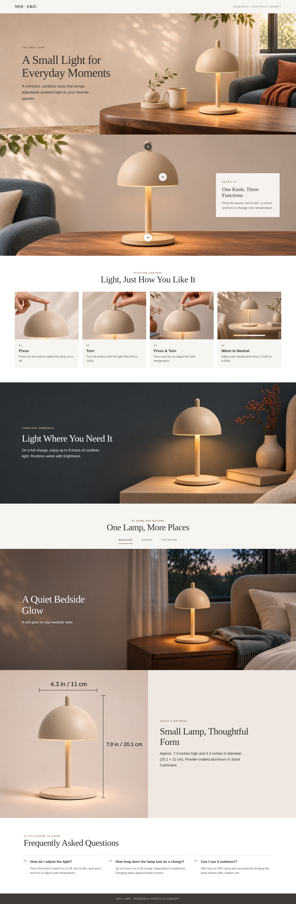
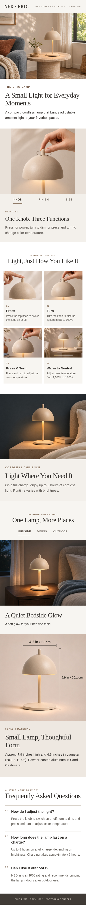
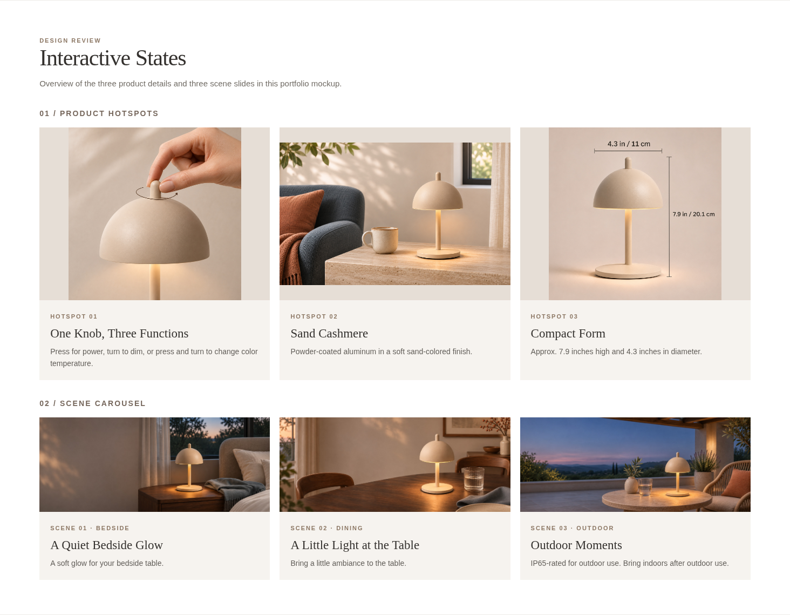

# NED Eric Lamp｜高级 A+_V01

基于[高级 A+ 制作方案](../../../项目规划/高级A+内容制作方案-v0.1.md)制作的美国站作品集模拟。按七个模块组织产品介绍、热点细节、操作方式、夜间续航、场景轮播、尺寸材质和常见问题。

**以下为图文组合预览：** 图片与英文文案已经合在模拟页面里；实际平台会按模块分别填写图片和文字，不上传这一整张长图。

## 电脑端整体预览

## 手机端整体预览

## 热点与场景的全部状态

整体截图默认展示第一个热点与床头场景；下图展示三个热点和床头、餐桌、户外三个场景。

## 文件入口

- [模块文案与 19 个图片栏位表](模块文案与素材表.md)：英文内容、中文理解、素材来源、像素和替代文字草案。
- [图片素材](图片素材/)：19 个图片栏位的 JPG；部分栏位复用基础版图片。
- [素材原图](素材原图/)：本次新生成图片的 PNG 原图。
- [电脑端大图](排版预览/电脑端图文预览.png) · [手机端大图](排版预览/手机端图文预览.png) · [互动状态大图](排版预览/互动状态总览.png)。
- [本地图文交互预览 HTML](排版预览/高级A+图文交互预览.html)：下载整个“高级A+_V01”文件夹并保留目录关系，在浏览器打开 HTML，可点击热点和场景标签。GitHub 文件页通常显示 HTML 源码；上方图片可直接查看。

## 制作与检查说明

1. 新增了电脑宽屏与手机场景图，操作手势和尺寸图沿用基础 A+_V01，并按用户指定延续辅图 V02 的参考关系。所有新场景均为 AI 生成示意，不是品牌实拍。
2. 19 个栏位的图片均达到规划中对应模块的**最低宽高**；部分复用图比例不同，后台若强制裁切，需重新适配并检查文字、手势、箭头及尺寸线。
3. 文案中的续航、色温、IP65 与尺寸为资料标称；尺寸线的具体测量端点未通过实物核验。品牌故事独立于本版七个产品模块。
4. 本页是作品集中的视觉与互动模拟，不代表真实亚马逊页面、后台预览或已取得高级 A+ 使用资格。正式上架前须检查后台模块、资格、裁切、品牌素材使用许可及美国版规格。
