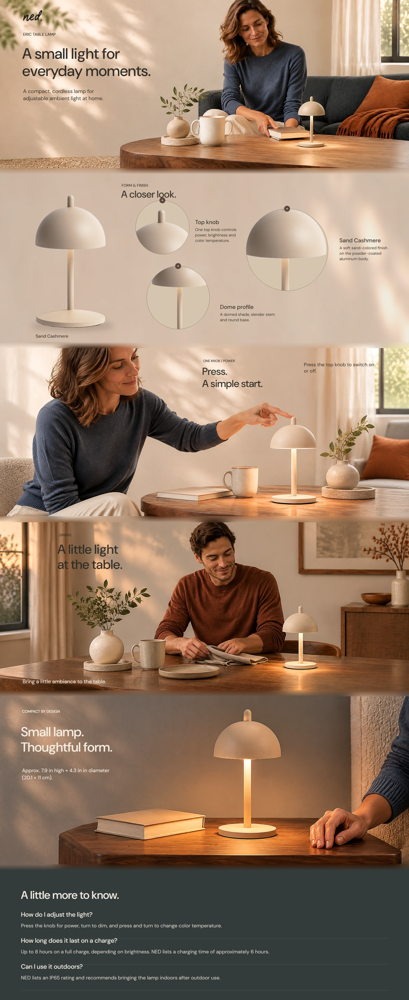

# NED Eric Lamp｜高级 A+ V02 审阅包

2026-11-07，按已归档规划制作，状态：**已制作，待用户审阅**。不是用户定稿，不代表已上传 Amazon 或已获平台审核。

- [打开交互预览](打开交互预览.html)：本地浏览器打开，可切换三种操作、餐桌/床头/露台场景、三处产品细节与 FAQ。
- [连续长页 1600w](NED_高级A+_V02_连续长页_1600w.jpg) · [全部状态总览](全部状态总览.jpg) · [手机长页 390w](手机端连续长页_390w.png)。静态长页默认操作为 Press、场景为 Dining、手机细节为 Top knob；其余状态在交互页和逐图文件中。
- [连续长页可编辑 SVG](可编辑源稿/NED_高级A+_V02_连续长页_可编辑.svg)；[逐图源稿](可编辑源稿)、[逐图图文预览](图文预览)、[纯图片素材](图片素材)、[采用原始生成图](素材原图)。
- [平台模块与原生字段对照](平台模块与原生字段对照.html) · [字段映射记录](平台字段映射_非提交载荷.json) · [平台规格来源摘录](平台规格核验.md)。

## 本轮制作

5 个视觉模块加精简 FAQ：居家开场 → 真实产品细节 → 旋钮操作轮播 → 三种使用场景 → 尺度收束 → 常见问题。以暖米色、木色与光影延续品牌气氛，减少顶栏和白卡；人物使用关系承担场景代入，功能与条件文字承担商业表达。连续长页模块之间使用独立的 24px 环境连接带，不对产品轮廓、手势、桌面接触阴影加白雾。

Apophis API（用户指定 https://www.apophis.uk/v1）通过本机 imagegen 自带 CLI 制作，供应商报告模型名为 gpt-image-2；未独立核实其后台模型实现。19 次成功图片生成请求，采用 16 张生活方式图片；另外 3 张是为开场/床头的尺度及收束页构图做的局部重生成，未采用初稿保留在本地原始工作目录。实际收费金额未由 CLI 返回，未估算为账单。凭据未包含在交付包中。

桌面 9 个图片状态（1952×800），手机 11 个图片状态：8 张独立构图的生活方式图（1440×1080；API 原图 1440×1088，上下各裁 4px）和 3 张真实细节裁切（600×450）。FAQ 为文字；共 22 个逐图 SVG/预览。

P02 的桌面细节合成与 3 张手机裁切来自现有产品照片，不以 AI 编造微观表面、接口、底部或内部结构。源产品像素复用，色度蒙版和底座边界为派生处理；桌面局部窗口有重采样，不增加真实细节分辨率。见 [细节制作记录](P02_真实细节制作记录.json) 和 [真实原始参考](制作素材/真实产品_原始参考.jpg)。生成场景中的产品是概念重现，不能当作精确实拍或材质检验证据。

## 平台落地范围

沉浸式长页和交互页是作品集展示概念，不是真实 Amazon 后台截图。平台对照采用未排字 JPG 加原生字段，按 Full Background Image、Hotspot、Image Carousel、Navigation Carousel、FAQ 对应；后台原生字体、位置、浅/深背景选择会约束最终效果，不承诺任意悬浮文字、品牌色或渐变可配置。对照页将轮播各状态依次展开以便核对字段，不模拟真实轮播版式。

规格根据 2026-11-07 读取的 Amazon 官方模块文档整理；图片达到所列槽位最小尺寸。没有接入卖家后台，账号 Premium 资格、实际站点模块和最终上传审核仍待核验。字段 JSON 是工作映射，不是可直接提交的 API 请求。没有虚构 ASIN、价格、评论或销售结果。

## 事实与可编辑范围

现有资料中的 Sand Cashmere、粉末涂层铝制灯体、旋钮开关/5–100% 调光/按住并旋转连续 2700–4000K、最高约 8 小时续航、约 6 小时充电、IP65 与室外使用后带回室内、20.1×11cm 已按限定表达。尺寸为厂家标称、非本次测量；续航随亮度而变；未把不同经销商充电条件合并。场景限定干燥有遮蔽露台。人物为 AI 虚构模特，不是买家证言。项目色系不是已验证的品牌官方 VI。

SVG 的标题、正文、标注、基础图形保留独立对象，现有 ned. Logo 作为独立矢量引用保留形状。摄影场景仍是位图，人物、产品和光影没有分成独立摄影图层；P02 照片窗口也保留为位图合成，不冒称分层 PSD。字体 DM Sans（附 OFL 许可），中文系统微软雅黑不打包。Chrome 已渲染；Illustrator/Inkscape 的导入兼容、Photoshop 图层保留未实测。

## 记录

[实际生成输入](实际生成输入) · [参考来源](参考来源.json) · [模块文案](模块内容.json) · [素材清单和哈希](素材清单.json) · [源稿版式检查](源稿版式检查.json) · [制作状态](制作状态.json)。未采用图不作为成品归档；用户尚未正式定稿。
