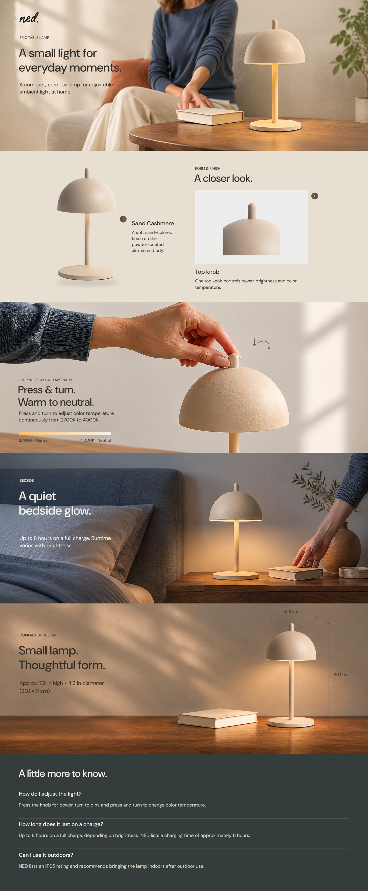

# NED Eric Lamp｜高级 A+ V03

制作日期：2026-11-07。归档日期：2026-11-08。**当前状态：2026-11-08 用户明确 V03 暂通过审稿；未正式定稿，未上架。**

- [使用说明与检查范围](使用说明.md)
- [桌面连续长页](01_成品与预览/NED_V03_连续长页_PC.jpg) · [手机连续长页](01_成品与预览/NED_V03_连续长页_Mobile.jpg)
- [全部21个图文状态](01_成品与预览/全部状态总览.jpg) · [逐图预览](01_成品与预览/图文预览/)
- [可切换审阅页](01_成品与预览/打开审阅V03.html)：下载本目录后在本地浏览器打开；GitHub页面不会直接运行该HTML。
- [可编辑SVG](02_可编辑SVG/) · [平台纯图素材](01_成品与预览/平台纯图素材/) · [平台字段候选](01_成品与预览/平台字段候选.md)
- [原始素材与修复派生图](03_原始素材/) · [制作记录、实际输入与检查](04_过程记录/制作记录.md)
- [V03制作规划](../../../项目规划/高级A+_V03_制作规划_20261107/README.md) · [项目首页](../../../README.md)

共19份图片素材（9份桌面、10份手机）：P02的3份来自真实产品照片，另外16份为生成/修订场景；另含两份FAQ，共21份逐图SVG和PNG，以及桌面/手机两个长页SVG。使用用户指定的Apophis接口与`gpt-image-2.5-sunburst`，模型标识不证明后台模型身份。

P01突出前景产品；P02改为全灯＋旋钮窗口及两个热点；P03采用统一操作近景，P03C加入用户选定的胶囊形2700–4000K色温渐变条；P04区分三个机位和生活行为；P05去掉人物并重构尺度画面。P02蒙版及P04/P05底座黑条已专项处理，保留合理接触阴影。[底部放大复核](04_过程记录/产品底部_放大复核.jpg)

制作自检已覆盖21个状态的渲染与文字边界、375/390px窄屏、图片引用和交互状态；用户已暂通过审稿，正式定稿仍待明确。AI摄影内容仍为位图，近景纹理不能当作真实微距工艺证据，平台后台与目标SVG编辑器导入尚待核验。完整范围与限制见使用说明。

2026-11-08：按用户要求制作[作品集02高级A+展示规划及示意图](../../../项目规划/作品集02_高级A+_展示规划_V01_20261108/README.md)，复用本版素材，展示布局待审阅。
