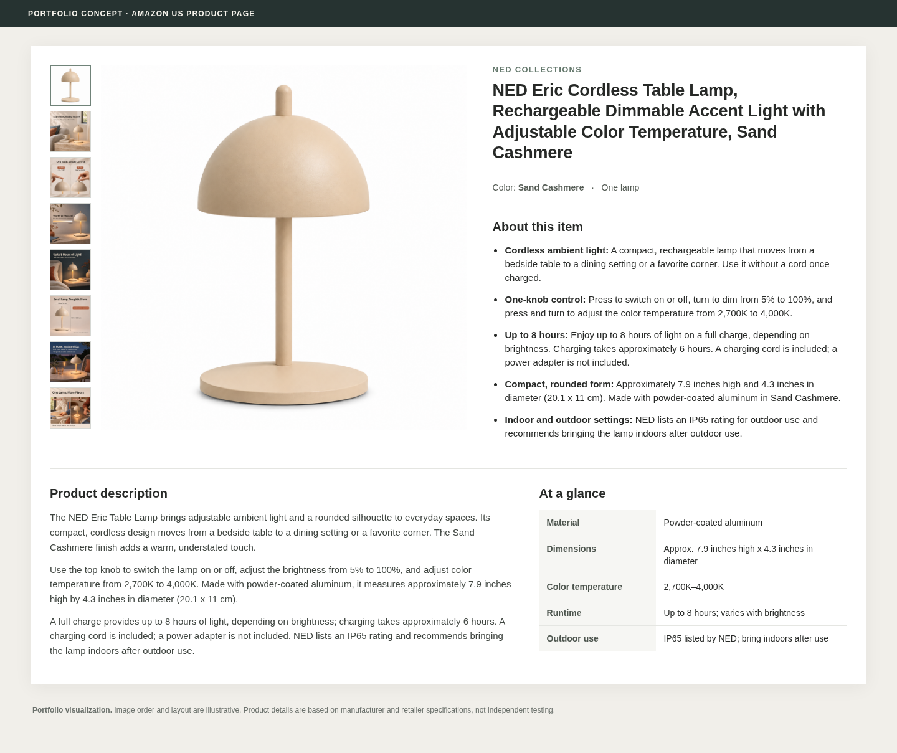

# NED Eric Lamp｜美国站 Listing V01

本版在[早期英文草稿](../../../项目规划/英文Listing与图内文案草案-v0.1.md)基础上，对照[产品事实](../../../产品资料/产品事实与素材检查-v0.1.md)、[辅图 V02](../../亚马逊主图组/V02/README.md)、[基础 A+](../../亚马逊A+内容/A+_V01/README.md)和[品牌故事](../../亚马逊A+内容/品牌故事_V01/README.md)整理。项目为作品集模拟；这不是已上架或已通过平台审核的商品页面。

## 商品页图文模拟

[查看电脑端大图](排版预览/电脑端预览.png) ｜ [查看手机端预览](排版预览/手机端预览.png) ｜ [英文文案复制版](英文Listing可复制.md) ｜ [检查与依据](文案审校与事实依据.md)

模拟页面用于直观看商品图、标题、五点和描述如何组合；价格、评价、库存及购买按钮未虚构。图集沿用 V01 近白底概念图和辅图 V02，没有改动原图。实际亚马逊页面排布、字段与类目规则以后台为准；候选后台搜索词不显示在买家页面。

## 商品标题

**英文：** NED Eric Cordless Table Lamp, Rechargeable Dimmable Accent Light with Adjustable Color Temperature, Sand Cashmere

**中文：** NED Eric 无线台灯，可充电调光氛围灯，色温可调，沙色

## 五点描述

### 01

**EN** Cordless ambient light: A compact, rechargeable lamp that moves from a bedside table to a dining setting or a favorite corner. Use it without a cord once charged.

**中文** 无线氛围光：小巧可充电，可从床头移到餐桌或喜欢的角落；充电后可无线使用。

### 02

**EN** One-knob control: Press to switch on or off, turn to dim from 5% to 100%, and press and turn to adjust the color temperature from 2,700K to 4,000K.

**中文** 一键旋钮控制：按压开关，旋转将亮度从 5% 调至 100%，按压并旋转可将色温从 2,700K 调至 4,000K。

### 03

**EN** Up to 8 hours: Enjoy up to 8 hours of light on a full charge, depending on brightness. Charging takes approximately 6 hours. A charging cord is included; a power adapter is not included.

**中文** 最长约 8 小时：充满电后最长可照明 8 小时，续航随亮度变化。充电约需 6 小时；附充电线，不含电源适配器。

### 04

**EN** Compact, rounded form: Approximately 7.9 inches high and 4.3 inches in diameter (20.1 x 11 cm). Made with powder-coated aluminum in Sand Cashmere.

**中文** 小巧圆润的造型：约 7.9 英寸高、直径 4.3 英寸（20.1 × 11 厘米），采用沙色粉末喷涂铝材质。

### 05

**EN** Indoor and outdoor settings: NED lists an IP65 rating for outdoor use and recommends bringing the lamp indoors after outdoor use.

**中文** 适用于室内及户外：NED 标示产品为 IP65 防护等级，并建议户外使用后将灯收回室内。

## 产品描述

**英文：**

The NED Eric Table Lamp brings adjustable ambient light and a rounded silhouette to everyday spaces. Its compact, cordless design moves from a bedside table to a dining setting or a favorite corner. The Sand Cashmere finish adds a warm, understated touch.

Use the top knob to switch the lamp on or off, adjust the brightness from 5% to 100%, and adjust color temperature from 2,700K to 4,000K. Made with powder-coated aluminum, it measures approximately 7.9 inches high by 4.3 inches in diameter (20.1 x 11 cm).

A full charge provides up to 8 hours of light, depending on brightness; charging takes approximately 6 hours. A charging cord is included; a power adapter is not included. NED lists an IP65 rating and recommends bringing the lamp indoors after outdoor use.

**中文对照：**

NED Eric 台灯以圆润造型与可调节的氛围光融入日常空间。小巧无线的设计适合从床头移动到餐桌或喜欢的角落，沙色饰面带来温暖、克制的视觉感受。

按压顶部旋钮可开关灯具；旋转调节 5%–100% 亮度，按压并旋转调节 2,700K–4,000K 色温。产品采用粉末喷涂铝材质，约 7.9 英寸高、直径 4.3 英寸（20.1 × 11 厘米）。

充满电后最长可照明 8 小时，续航随亮度变化；充电约需 6 小时。附充电线，不含电源适配器。NED 标示产品为 IP65 防护等级，并建议户外使用后收回室内。

## 候选后台搜索词

`portable mushroom bedside nightstand dining patio sideboard ambient`

该行只供后台关键词规划，不放在商品图片或买家可见描述中。它是候选词，不代表已取得搜索量、竞争度或收录表现数据；实际字段和字节限制应以对应类目后台为准。

## 与现有辅图 V02 的文案对应

以下是当前图片中已出现的主要英文，便于检查一致性；本次没有重新生成图片。

| 图 | 当前图内文案重点 | 对应 Listing 信息 |
| --- | --- | --- |
| 01 产品展示 | Light for Everyday Spaces；Compact · Cordless · Dimmable | 第 1 点，无线与日常空间 |
| 02 旋钮操作 | One Knob. Simple Control.；Press / Turn；Dim 5–100% | 第 2 点，开关与亮度 |
| 03 光色调节 | Warm to Neutral；Press & turn；2,700K–4,000K | 第 2 点，按旋调色 |
| 04 无线续航 | Up to 8 Hours of Light；Runtime varies with brightness | 第 3 点，最长续航与条件 |
| 05 尺寸材质 | 7.9 in / 20.1 cm；4.3 in / 11 cm；Powder-Coated Aluminum | 第 4 点，尺寸与材质 |
| 06 户外使用 | IP65；Bring indoors after outdoor use | 第 5 点，户外使用边界 |
| 07 多场景 | Reading Nook；Dining Table；Same lamp shown in two settings | 第 1 点，场景与单灯使用 |

## 本次审校结论

- 尺寸改为自然的 “4.3 inches in diameter”，避免原稿 “4.3 in in diameter” 的阅读歧义；英寸按官网厘米尺寸换算并取约数。
- 保留“最长 8 小时、随亮度变化”和“户外用后收回”的条件；开关、调光与按旋调色基于用户确认的同款经销商资料。
- V02 05 的尺寸线端点仅为示意，官网未明确测量端点；V02 07 的阅读角是场景表达，不能据此保证阅读照度。充电线与适配器配置沿用官网同款设定，真实美国版仍需确认。
- 现有首图为用户此前选用的近白底 AI 概念图，不能据此认定真实上架合规；本次未修改首图或辅图。完整检查、来源与未确认事项见[审校记录](文案审校与事实依据.md)。
