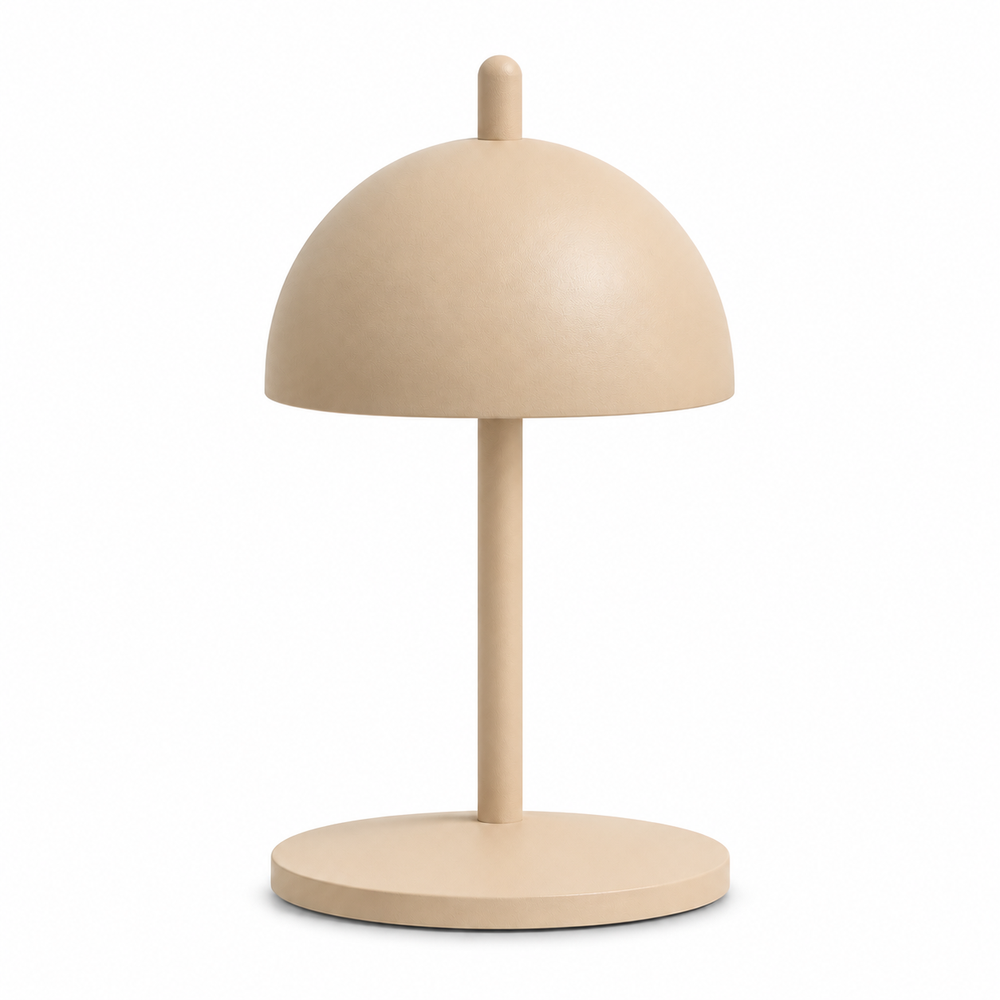
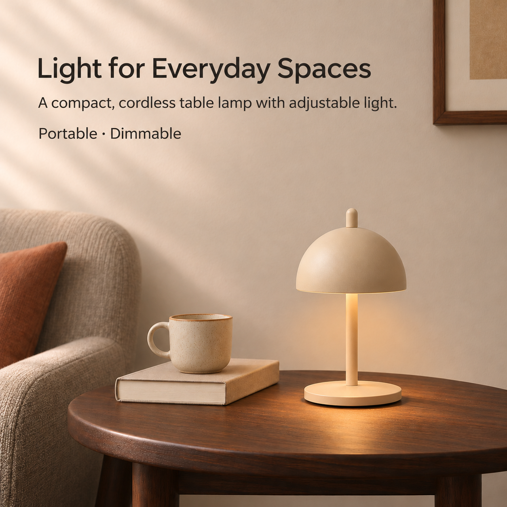
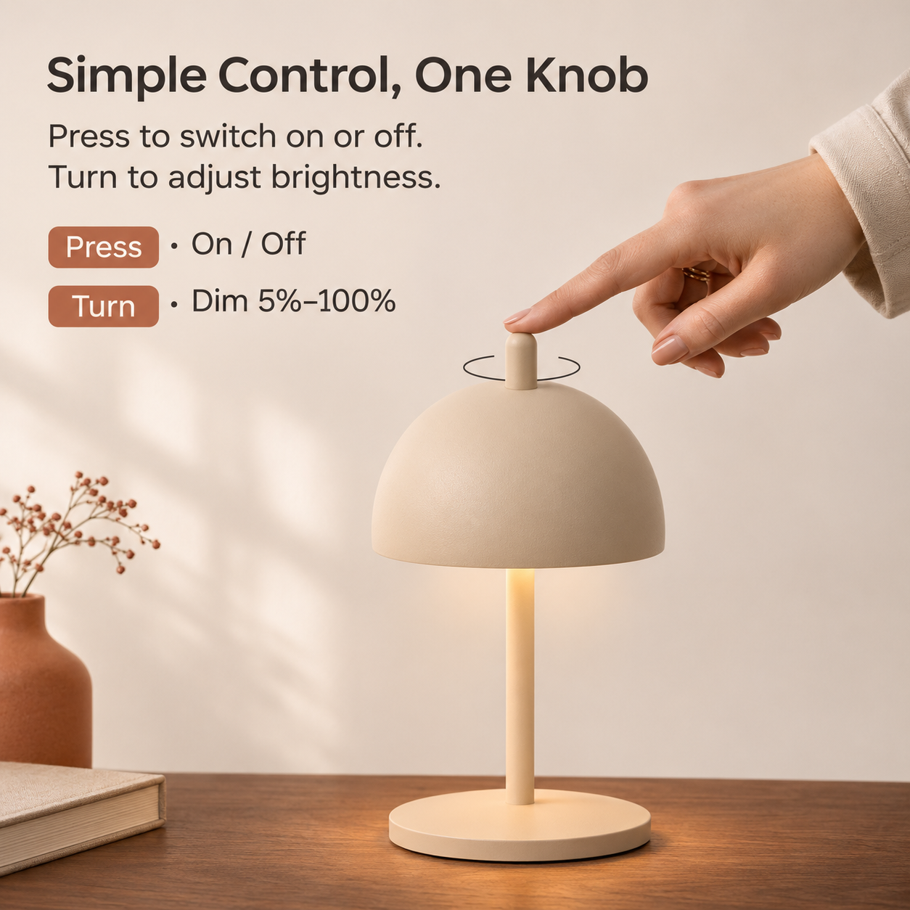
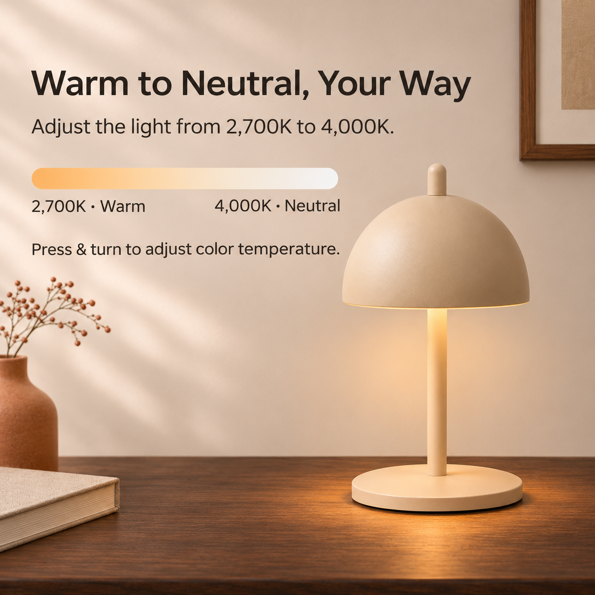
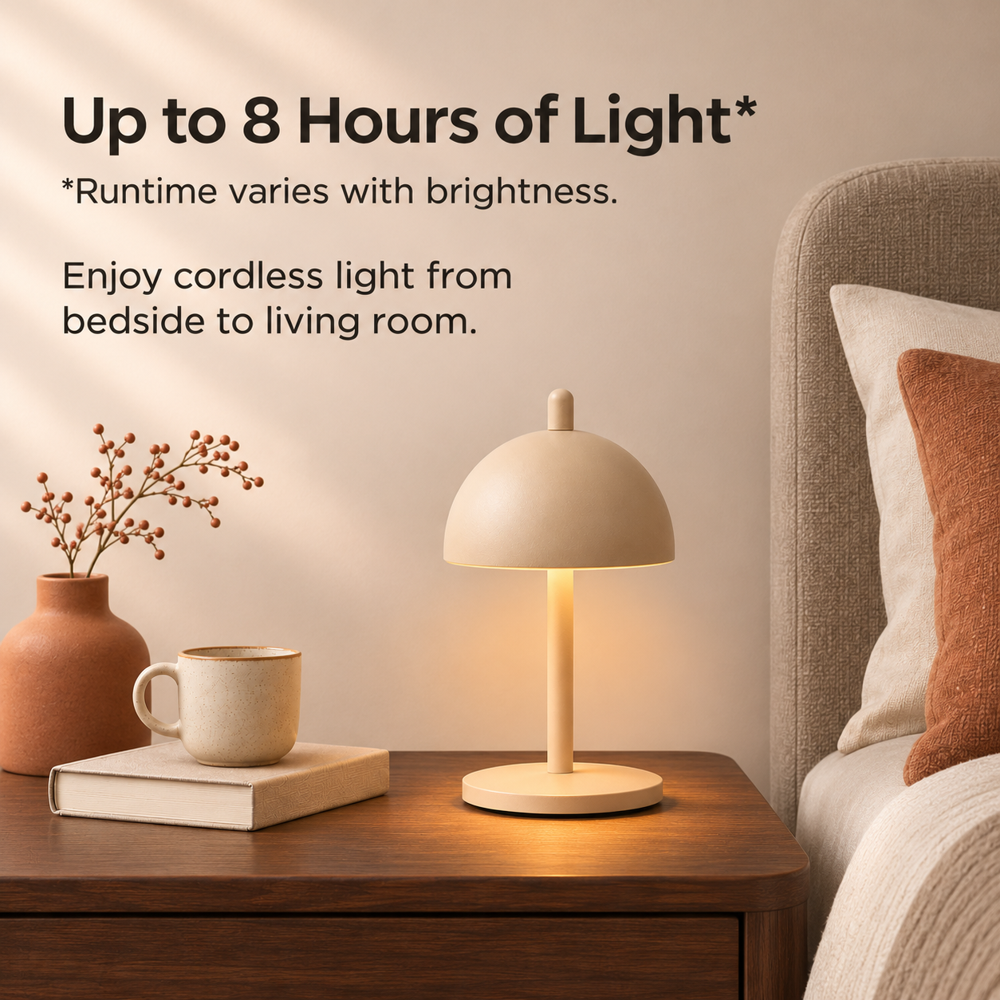
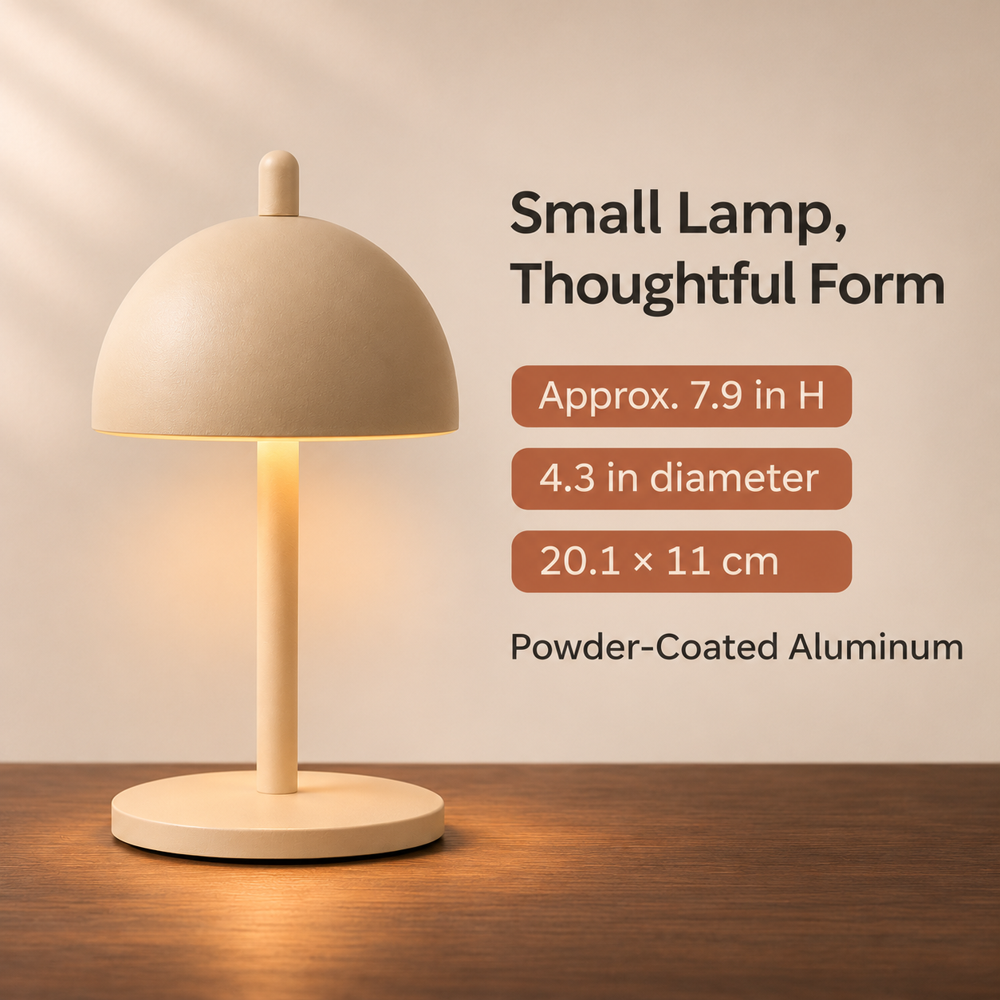
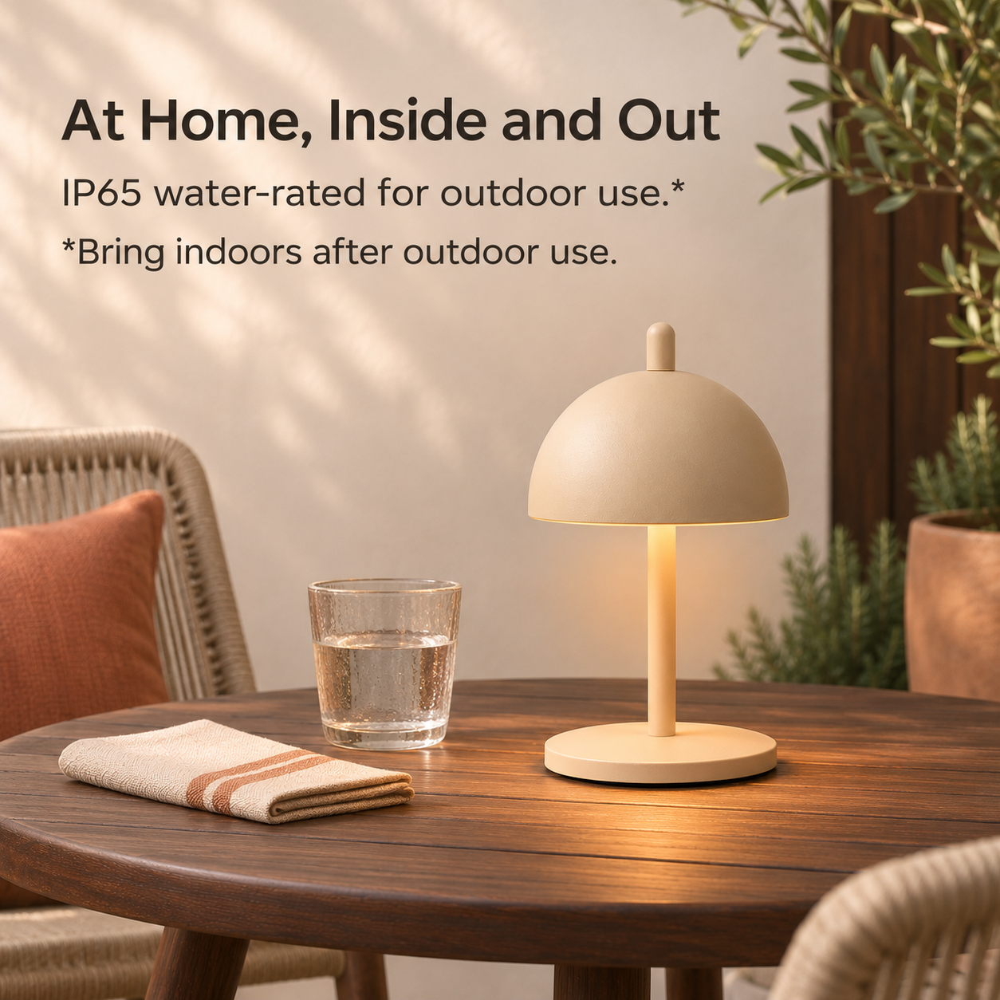
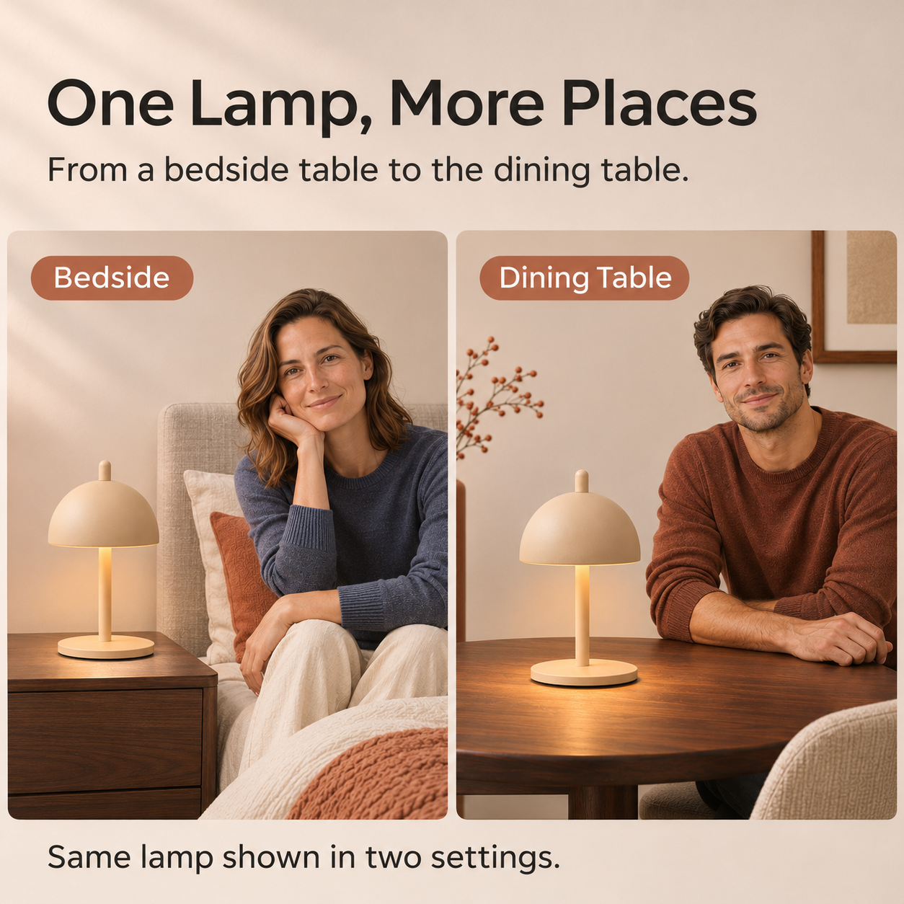

# NED Eric Lamp｜亚马逊主图组 V01

本组按[7 张辅图制作方案](../../../项目规划/7张辅图制作方案-v0.1.md)生成，包含 **1 张主图和 7 张辅图**。这是用于作品集模拟项目的 AI 生成 V01，供审阅和后续修改，不代表品牌委托或真实上架成品。

## 整组预览

| 00｜近白底主图 | 01｜产品展示 |
| :---: | :---: |
|  |  |
| [查看原图](00_主图_近白底_V01.png) | [查看原图](01_产品展示_V01.png) |

| 02｜旋钮操作 | 03｜光色调节 |
| :---: | :---: |
|  |  |
| [查看原图](02_旋钮操作_V01.png) | [查看原图](03_光色调节_V01.png) |

| 04｜无线续航 | 05｜尺寸材质 |
| :---: | :---: |
|  |  |
| [查看原图](04_无线续航_V01.png) | [查看原图](05_尺寸材质_V01.png) |

| 06｜户外使用 | 07｜多场景使用 |
| :---: | :---: |
|  |  |
| [查看原图](06_户外使用_V01.png) | [查看原图](07_多场景使用_V01.png) |

## 版本与核对说明

- **尺寸与格式：** 8 张均为 **1254 × 1254 px、RGB PNG**；低于原方案建议的 2000 × 2000 px 工作画布。文字已合入图片，本次未提供可编辑的文字或 PSD 分层。
- **主图背景：** 依用户最新要求，V01 保留自然近白背景，不再追求纯白像素。若未来用于真实亚马逊美国站上架，需按当时适用类目的主图要求另行复核。
- **产品与人物：** 图片以[用户上传的产品视角图](../../../产品资料/产品图/README.md)、已确认可参考的网站图片及前序视觉为依据进行 AI 生成，并非直接对原产品图做无损抠图合成；人物亦为 AI 形象。正式使用前须逐张对照产品外观、人物手势和场景比例。
- **产品依据：** 02 的按压开关及 5%–100% 调光、03 的按压并旋转调色来自用户确认同款的经销商标称；04 的最长约 8 小时和“续航随亮度变化”、05 的尺寸及材质、06 的 IP65 与户外用后收回建议来自 NED 官网标称，均非本项目实测。[产品事实与来源](../../../产品资料/产品事实与素材检查-v0.1.md)
- **仍需核实：** 02 的旋转手势与顶部细节、05 的尺寸测量位置、实际美国销售版本和素材公开使用范围。07 的两幅场景展示同一款灯，不表示双只装。
