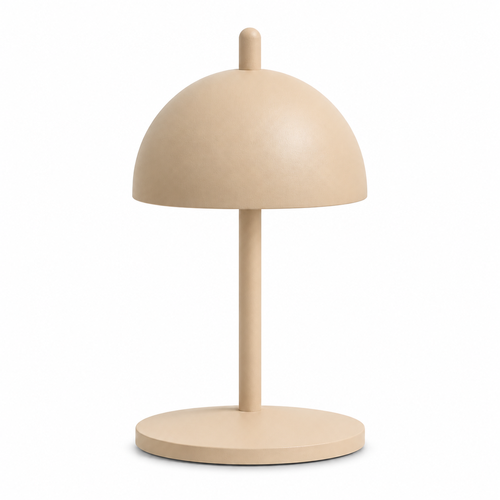
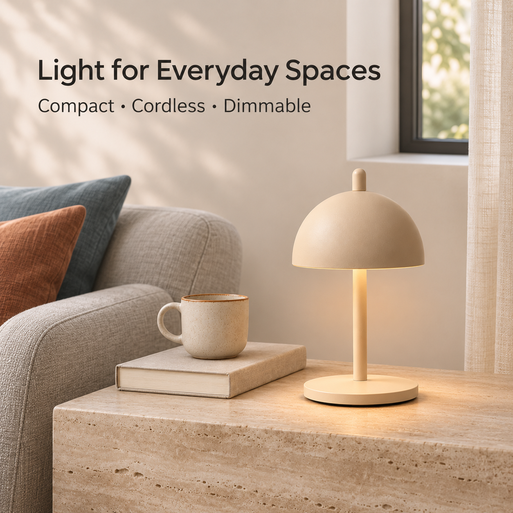
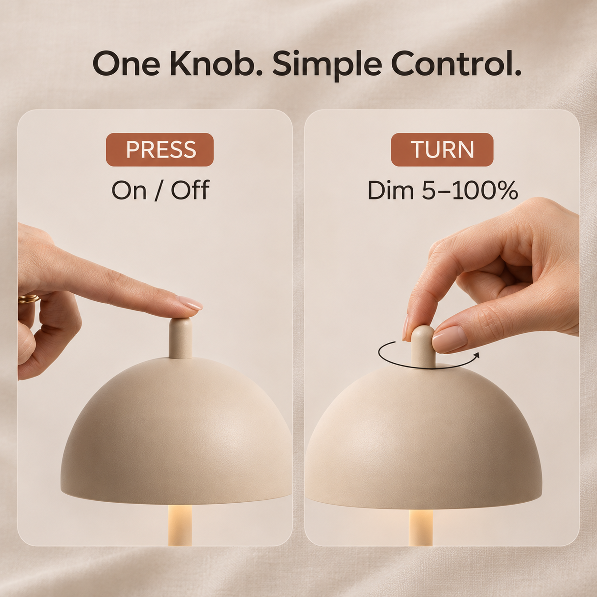
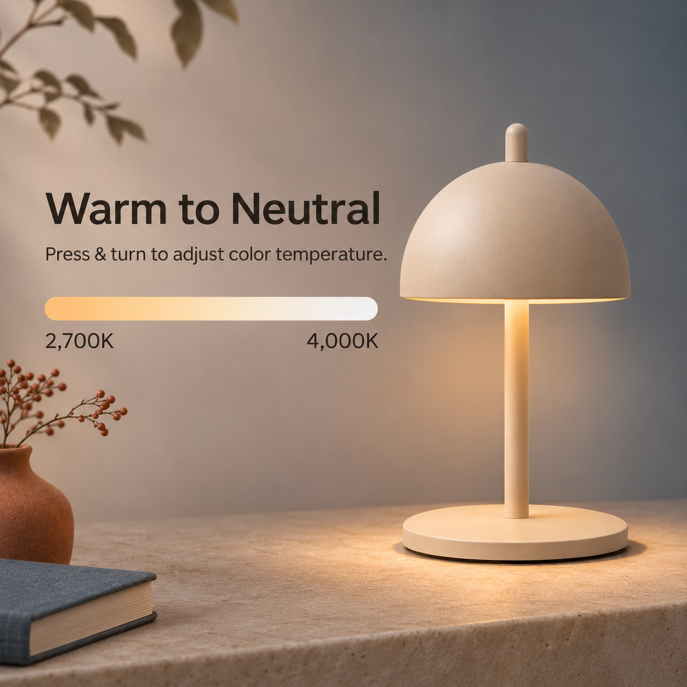
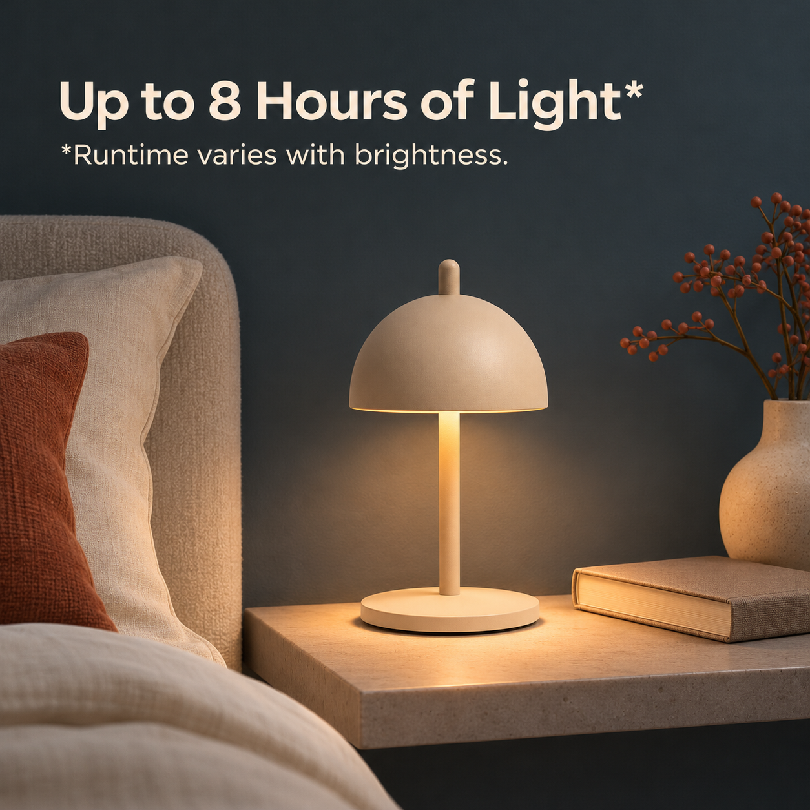
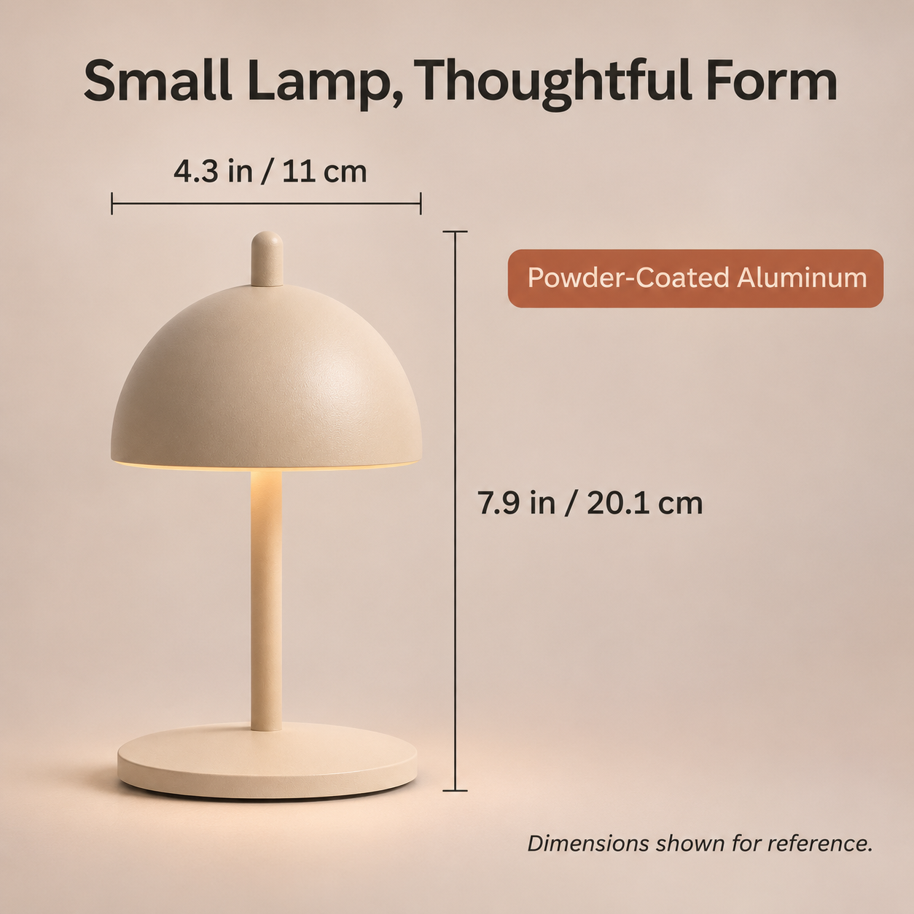
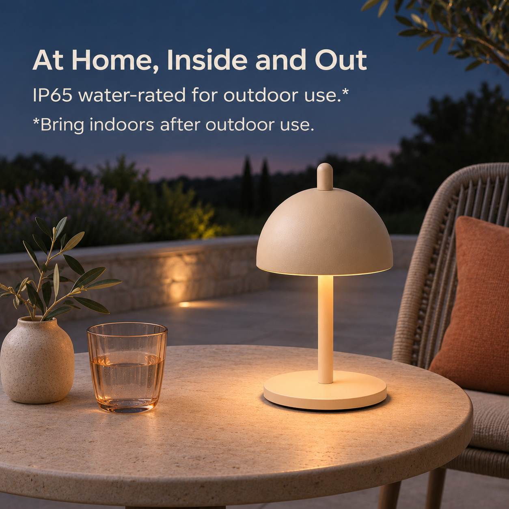
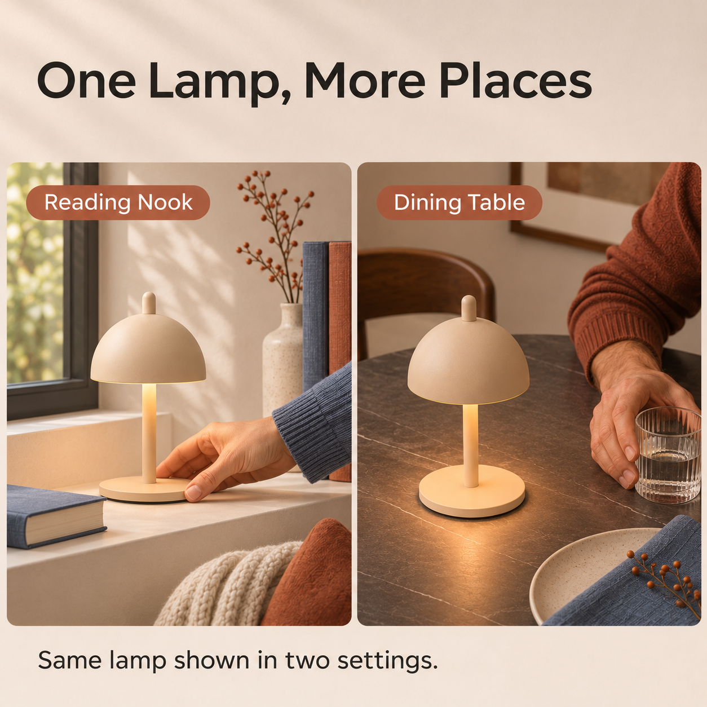

# NED Eric Lamp｜亚马逊辅图 V02

按用户对 [V01](../V01/README.md) 的反馈，以及[同类产品案例调研](../../../参考调研/美国站同类产品电商案例参考-v0.1.md)的启示，重新生成 **7 张辅图**。这是作品集模拟项目的 AI 生成版本，供审阅与后续调整；不代表真实上架或经过实物测试。

**白底主图沿用 V01，未重新生成。** 下方首图直接引用 V01 文件；V02 文件夹只存放此次新生成的辅图。

## 整组预览

| 00｜沿用 V01 主图 | 01｜产品展示 · 日间客厅 |
| :---: | :---: |
|  |  |
| [查看原图](../V01/00_主图_近白底_V01.png) | [查看原图](01_产品展示_V02.png) |

| 02｜旋钮操作 | 03｜光色调节 |
| :---: | :---: |
|  |  |
| [查看原图](02_旋钮操作_V02.png) | [查看原图](03_光色调节_V02.png) |

| 04｜夜间无线续航 | 05｜尺寸材质 |
| :---: | :---: |
|  |  |
| [查看原图](04_夜间无线续航_V02.png) | [查看原图](05_尺寸材质_V02.png) |

| 06｜户外使用 | 07｜多场景使用 |
| :---: | :---: |
|  |  |
| [查看原图](06_户外使用_V02.png) | [查看原图](07_多场景使用_V02.png) |

## 本次调整

- **场景变化：** 01 使用白天客厅和石材边桌，04 改为深色夜间床头，06 改为傍晚户外露台，07 展示阅读角与餐桌；延续沙色、暖光和克制家居氛围。
- **操作与产品主体：** 02 用两幅近景分别示意按压和旋转；07 用局部手部互动代替大面积人物，让灯保持主要视觉焦点。
- **尺寸线：** 05 增加高度与直径的线段示意，使用约 7.9 in／20.1 cm 高、4.3 in／11 cm 直径。**官网资料未明确测量端点，图中高度从底座底部示意至旋钮顶部、直径横跨灯罩，具体端点仍待实物或官方尺寸图核实。**

## 版本与核对说明

- **文件规格：** 7 张辅图均为 **1254 × 1254 px、RGB PNG**，文字已合入图片，未提供分层源文件；原方案的 2000 × 2000 px 是工作画布建议，本版未达到该尺寸。
- **产品与手势：** 以用户新增的产品视角图和获准参考的 Simple Form 商品图为依据进行 AI 生成；画面、手部和光效均为模拟，需对照产品复核，特别是顶部旋钮与旋转手势。
- **参数依据：** 02 的开关与无级调光、03 的调色操作来自用户确认同款的经销商标称；03 的色温范围、04 的最长续航及亮度条件、05 的尺寸材质、06 的 IP65 与户外用后收回建议来自官网标称，均未由本项目实测。详见[产品事实与素材检查](../../../产品资料/产品事实与素材检查-v0.1.md)。
- **仍需复核：** 尺寸测量端点、AI 灯体与实物外观、美国版具体配置，以及最终使用时的平台要求。07 展示同款灯在两个场景中的使用，不表示双只装。
