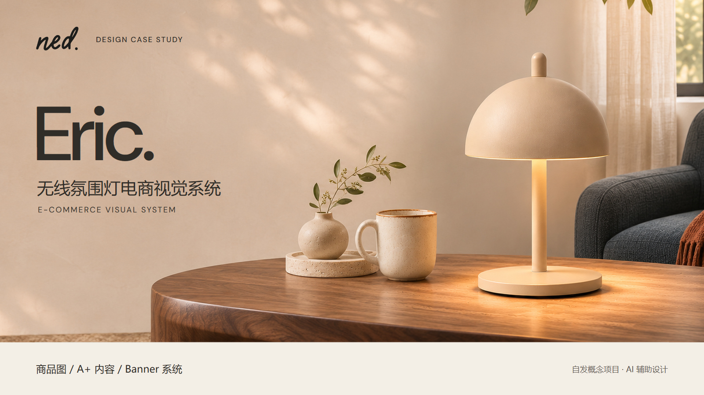

# NED Eric｜项目封面 V01

1600×900，16:9。作品集封面试排，待审阅。

- 使用已有日间场景重新裁切和排版，保留完整灯体及原产品比例；没有新增 AI 生图。
- 左侧项目名称，右侧产品场景，底部列交付范围和项目性质；未将超宽 Banner 直接裁作封面。
- 原始场景 1959×803，裁切 1420×692 后等比插值为 1600×780；输出尺寸不代表新增真实细节。
- Logo 使用既有字标的原样轮廓重绘，不代表原创 Logo 设计或官方品牌合作。
- PNG/JPEG 为审阅图；SVG 为文字可编辑源稿，摄影场景为嵌入位图，并非分层摄影 PSD。
- SVG 嵌入 DM Sans（附 OFL），中文使用本机 Microsoft YaHei；跨平台编辑若缺字体需安装或指定替代，已导出图片不受影响。
- 2026-11-06 按用户要求归档至 GitHub；版本状态仍为待审阅，没有覆盖先前版本。
- [PNG 原图](NED_Eric_项目封面_V01_1600x900.png) · [文字可编辑 SVG](可编辑源稿/NED_Eric_项目封面_V01_可编辑.svg) · [制作记录](制作记录.json)
- 制作与渲染脚本作为操作记录保留，其中本机目录、Python / Playwright / Chrome 路径需按使用环境调整。
