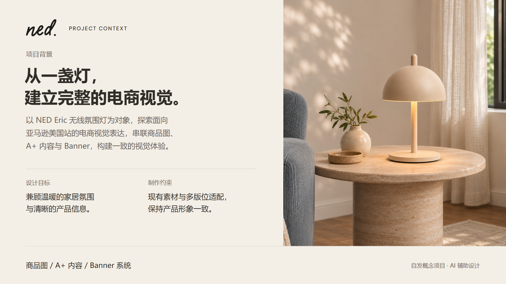

# NED Eric｜项目背景 V01

日期：2026-11-06。1600×900（16:9），作品集背景展示页，待审阅。

[PNG 原图](NED_Eric_项目背景_V01_1600x900.png) · [文字可编辑 SVG](可编辑源稿/NED_Eric_项目背景_V01_可编辑.svg) · [制作记录](制作记录.json)

## 内容与视觉

- 交代自发概念项目的对象、展示语境、设计目标与素材/版位约束，不虚构品牌委托或商业数据。
- 延续封面的暖米色底、深炭字、DM Sans / 微软雅黑、80 px 外边距及底部项目说明栏。
- 左文右图，右侧采用已有高级 A+ 日间家居场景，与封面同系列；保持完整灯体及原产品比例。
- 场景为已有 AI 视觉，不是新增摄影或新一轮 AI 生图；裁切后缩小到展示尺寸。
- 图片没有新增背景资料事实；“设计目标”是本项目意图，不代表经过投放验证的结果。

## 文件与编辑

- JPEG / PNG 为 RGB、sRGB 导出，SVG 保留文字，可修改标题和说明；摄影是嵌入位图，不是分层摄影 PSD。
- SVG 嵌入 DM Sans，附 OFL；中文引用本机 Microsoft YaHei，未分发系统字体。跨平台编辑缺少字体时需替换或安装；导出图片不受影响。
- 制作脚本和渲染脚本保留作为操作记录，本机运行路径需按实际环境调整。
- 归档按用户授权执行，待审阅状态不因归档改变。
