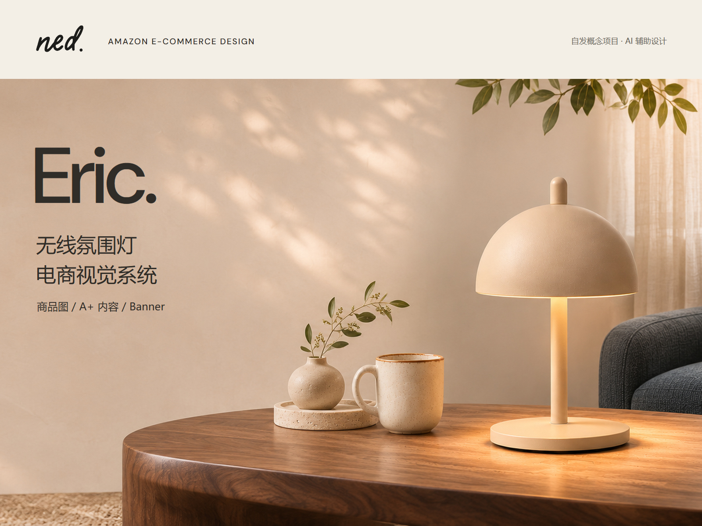
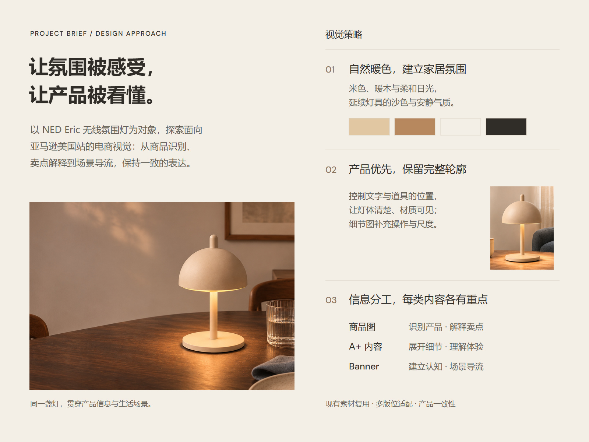

# NED Eric｜作品集开篇 V02 · 4:3

日期：2026-11-06。两张均为 **1600×1200（4:3）**，待审阅。既有 V01 保留。

## 01 项目封面

[PNG](01_NED_Eric_封面_V02_1600x1200.png) · [可编辑 SVG](可编辑源稿/01_NED_Eric_封面_V02_4x3_可编辑.svg)

## 02 简短背景与视觉策略

[PNG](02_NED_Eric_背景与视觉策略_V02_1600x1200.png) · [可编辑 SVG](可编辑源稿/02_NED_Eric_背景与视觉策略_V02_4x3_可编辑.svg)

## 结构与制作

- 按用户指定制作 4:3，不能称为所参考案例的 Behance 列表封面比例。
- 借鉴参考案例 1 的“产品开场 → 简短背景与策略”叙事。保留 NED 的暖米色、深炭字和自然家居场景，未复制其品牌元素或第三方图像。
- 策略页压缩背景，连接三项设计选择与具体视觉证据：自然暖色、完整产品识别、商品图/A+/Banner 的信息分工；这些是设计意图，不是转化测试结论。
- 复用既有 AI 场景，重新裁切和排版，没有新一轮 AI 生图。封面场景约 1.27 倍插值，不能当成新增高清细节。
- SVG 文字可编辑，照片为嵌入位图；非分层摄影 PSD。DM Sans 已嵌入并附 OFL，中文依赖本机微软雅黑；跨平台缺字体需替换，已导出图片不受影响。
- 源素材为高级 A+ 原场景 `P01_PC.png` 和 `P05_Dining_PC.png`，Logo 为此前原样描摹字标。[制作记录](制作记录.json)含裁切坐标。
- 源脚本保留操作记录，运行路径需要根据本机调整。
- 按用户既有授权归档本次两张产出；此前 Behance 案例分析仅留本地，没有随本次提交。
