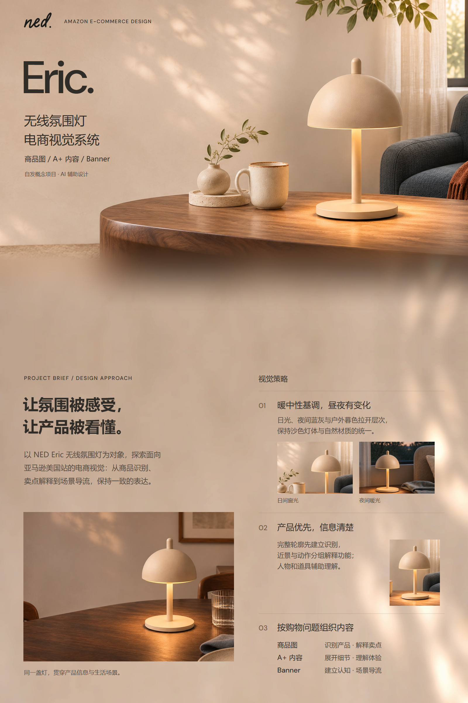
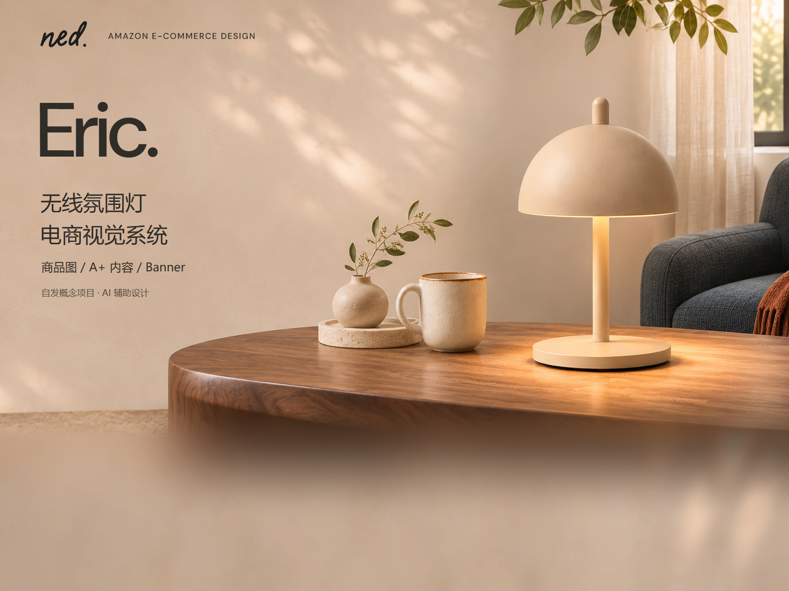
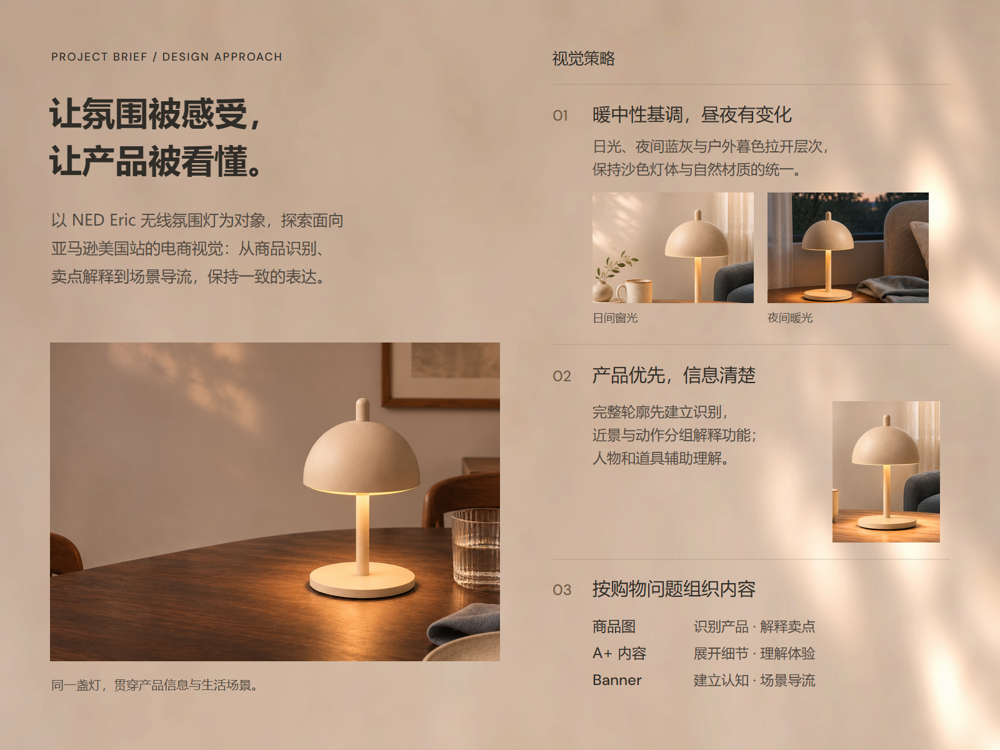

# NED Eric｜作品集开篇 V03：连续背景

2026-11-06。两张均为 1600×1200（4:3），新试排待审阅，V01/V02 保留。

## 连续阅读预览

## 封面

[PNG](01_NED_Eric_封面_V03_1600x1200.png) · [可编辑 SVG](可编辑源稿/01_NED_Eric_封面_V03_4x3_可编辑.svg)

## 简短背景与视觉策略

[PNG](02_NED_Eric_背景与视觉策略_V03_1600x1200.png) · [可编辑 SVG](可编辑源稿/02_NED_Eric_背景与视觉策略_V03_4x3_可编辑.svg)

## 变化与边界

- 封面移除原 180px 纯色顶部栏，品牌信息直接叠入墙面，收至顶部约 110px 内容区。
- 采用已有场景重新裁切，灯体及底座完整。下方在主体之外的桌面/环境区渐变至用户指定的连续墙面，避免硬切至策略页。
- 策略页采用既定背景 V02 的上半段，不重新调色或重复贴图；成果速览继续取下半段。另提供下一屏背景供后续排版。
- V03 策略改为“暖中性基调，昼夜有变化”“产品优先，信息清楚”“按购物问题组织内容”，与新版视觉规划一致，加入日夜证据图。
- 此为展示层的场景至背景过渡，不代表桌面实际变成墙面。仅环境进行渐变，产品及承托接触区不渐隐；底部环境有延展，不是新拍摄。
- 原场景约 1.12 倍插值，不增加真实细节；没有新一轮 AI 生图。
- SVG 文字可编辑、摄影为嵌入位图；附 DM Sans OFL，中文引用本机微软雅黑，跨平台缺字体需替换。
- 脚本保留操作记录，路径须按运行环境调整。

[制作记录](制作记录.json) · [连续背景 V02](../共享背景/V02/README.md) · [当前统一视觉规划 v0.2](../../../项目规划/统一主视觉与设计方向-v0.2.md)
