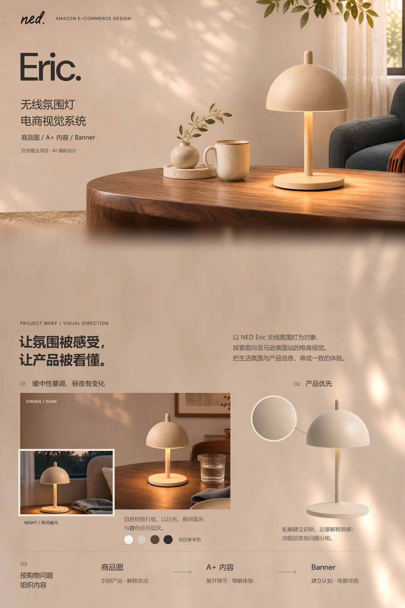
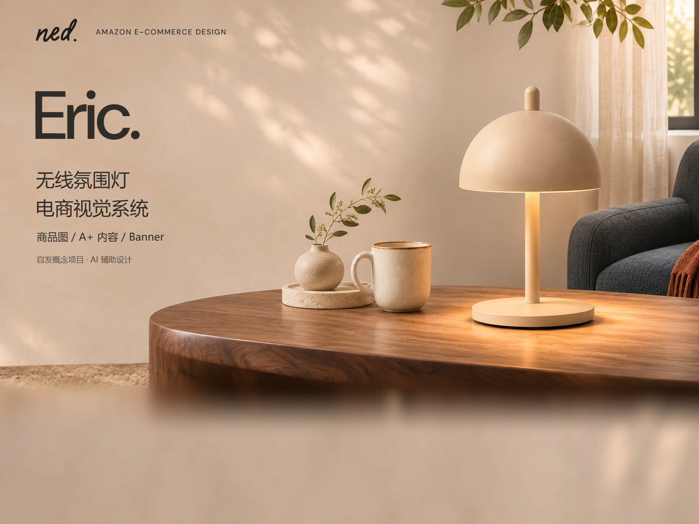
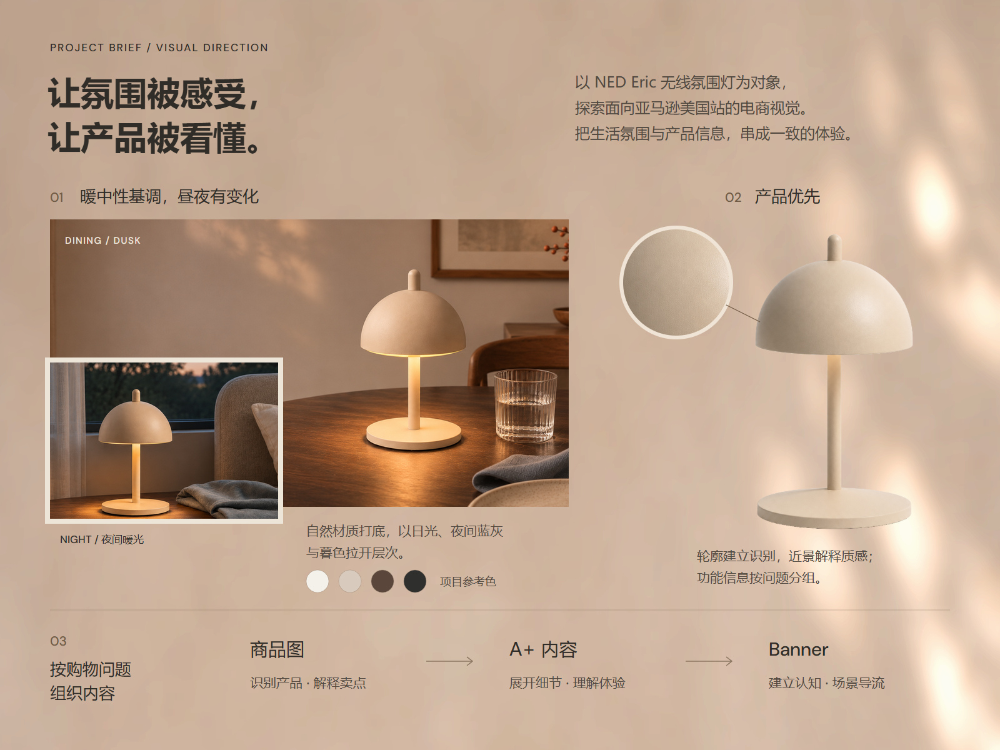

# NED Eric｜作品集开篇 V04

2026-11-06。封面与背景/策略两页均为 1600×1200（4:3），待审阅；旧版保留。

## 封面：减轻下缘虚化

[PNG](01_NED_Eric_封面_V04_1600x1200.png) · [可编辑 SVG](可编辑源稿/01_NED_Eric_封面_V04_4x3_可编辑.svg)

保留 V03 的紧凑顶部与产品构图。环境模糊半径从 48px 改为 12px，渐变区由 y=820–1060 缩至 y=880–1000；桌面清晰区延长。仅处理主体之外的下缘环境，前 850 行背景与原裁切一致；不声称虚化程度降低了某个感知百分比。底部环境有延展，非新拍摄。

## 背景与视觉策略：用画面说明策略

[PNG](02_NED_Eric_背景与视觉策略_V04_1600x1200.png) · [可编辑 SVG](可编辑源稿/02_NED_Eric_背景与视觉策略_V04_4x3_可编辑.svg)

- 简短背景置于顶部；餐桌暮色与夜间暖光错落叠放，呈现暖中性基调中的场景层次。
- 项目参考色靠近场景；单独的产品轮廓与灯罩局部呈现识别和质感焦点。色块不是品牌官方色号。
- 下方以三段内容路径呈现商品图、A+、Banner 的分工。箭头表示展示组织，不代表真实购物路径或转化数据。
- 三条策略保持当前统一规划：暖中性与昼夜变化、产品优先、按购物问题组织内容。
- 策略背景直接使用获准连续墙面 V02 的前 1200 行，下一屏仍接后 1200 行；未替换母版或重新调色。

## 布局参考

实际查看 Behance 页面图片后借鉴：[STEPHEN ALEJI 的情绪板](https://www.behance.net/gallery/242874515/Moodboard-Design-Presentation-Slides-Brand-Identity)中的大小错落、照片叠放及配色关联；[Anzhela Nefedova 的电商案例](https://www.behance.net/gallery/247462769/Amazon-Listing-Design-for-Kids-Supplement)中的简短策略与视觉依据配对。未使用其图片、品牌或文案。详细参考截图与研究留本地，不在本目录归档。

本项目为自发概念项目、AI 辅助设计，未实际上传亚马逊或投放广告，不含销售效果主张。此轮复用项目已有位图，并非新一轮 AI 生图。源稿中的文字可编辑，图片为嵌入位图；产品透明图采用中性背景色差蒙版，不增造结构。附 DM Sans OFL；中文字体引用本机微软雅黑，不分发系统字体。脚本路径需按运行环境调整。

[制作记录](制作记录.json) · [连续背景 V02](../共享背景/V02/README.md) · [当前统一视觉规划 v0.2](../../../项目规划/统一主视觉与设计方向-v0.2.md)
