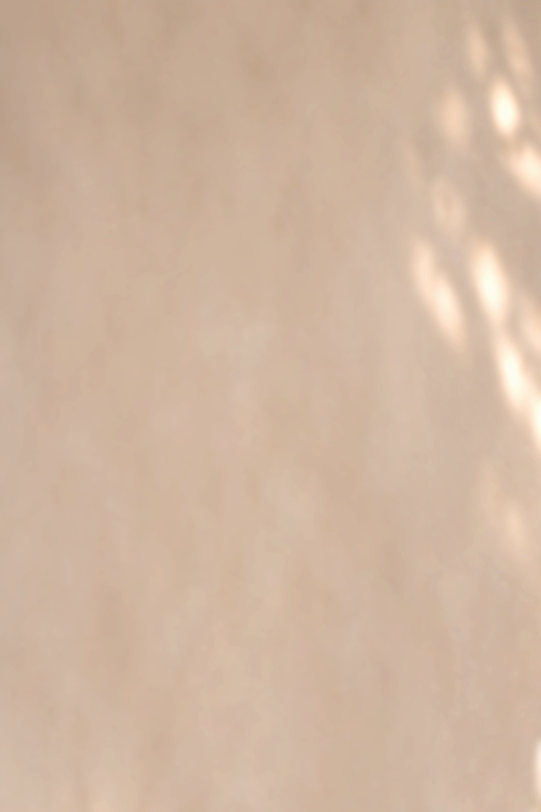

# NED｜作品集连续背景 V02

2026-11-06，用户指定的后续作品集背景蓝本，现按要求归档。1600×2400，RGB/sRGB。

[连续背景 PNG 母版](NED_连续墙面背景_V02_1600x2400.png) · [JPEG 母版](NED_连续墙面背景_V02_1600x2400.jpg)

按反馈增强既有墙面光影：柔焦半径由 18 px 减至 11 px，减少暖白覆盖，增强局部明暗。左侧正文区域增幅较弱，右侧光影增幅较强。没有新增 AI 生图，也没有覆盖 V01。

母版可连续切成两张 1600×1200 的 4:3 页面。V01/V02 对比图左旧右新；母版不是无缝循环纹理。

## 后续使用约定

用户已指定 V02 为后续作品集背景蓝本。背景/策略、成果速览等页面沿统一母版连续取图；该决定用于展示页面的外层背景，不要求将日间、夜间和暮色商品场景统一调成米色。超过现有两屏时延展同一背景母版，再按连续位置切片。现已同步[视觉规划 v0.2](../../../../项目规划/统一主视觉与设计方向-v0.2.md)与[开篇 V03](../../V03/README.md)。

制作脚本保留原本地参考阶段的操作记录，路径须按运行环境调整；本 README 和制作记录中的当前归档状态优先。
