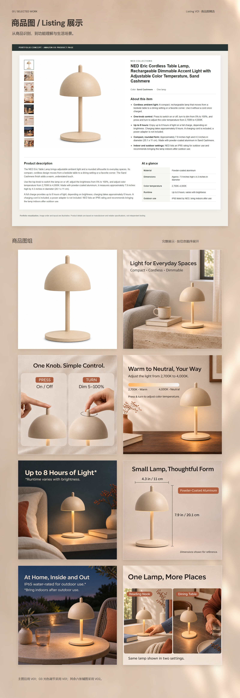

# NED 商品图展示 V04：亮背景、Listing V01与图组层次

[下一段：02高级A+展示](../02_高级A+/README.md) · [商品图→高级A+完整连续预览](../02_高级A+/01_成品与预览/商品图至高级A+_完整连续预览.jpg)

2026-11-06。已按用户指令归档；展示排版供审阅，保留旧版。本目录仅包含01商品图展示。

## 四项调整

1. 原长图延展只取末行颜色，原有模糊光影丢失。此次以获准暖墙V02的完整母版从y=1200继续，垂直镜向延展保留光影，15px柔焦；暖白覆盖从0渐至26%以提亮。首行仍与策略背景相邻行一致。获准母版本身未覆盖；修订背景为本地衍生V03，不再声称全篇背景像素等同旧母版。附背景前后对照。
2. 使用实际Listing V01的HTML及全部英文文案、页面布局，替换上一版占位信息区。唯一修改是本地图片路径，以及03缩略图改用本轮选择的V01。HTML除图片src外逐字一致，渲染后嵌入作品集；完整内容包含标题、五点、商品描述与规格。展示不是已上架截图。
3. 八张图组外层增加暖深色柔影（dy9px、std12px、opacity16%）与1px浅描边。图片本身未调色、裁切、变形或重绘；外部阴影不写进源图片。完整Listing区亦加轻投影。
4. 对照03的V01/V02与整组：V01与套图共有沙色灯体、暖中性背景、自然材质、黑色无衬线及暖至中性渐变条；V01有暖木桌和窗光，V02为石桌与蓝灰墙。现套图本已包含昼夜、木石变化，所以我判断不是风格迥异，直接采用V01更符合用户对其图文层级的偏好，未触发重新合成或AI生图。标题→色温范围→渐变条与标签→操作说明的顺序完整保留。该判断为视觉判断，不是品牌官方规范结论。附两版对照图。

## 当前选图

主图V01；辅图01、02、04、05、06、07采用V02；辅图03光色调节采用V01。原图均1254×1254，图组以660×660等比展示。上方Listing缩略图同步此组合。源图哈希已检查，不覆盖任何既有交付。

03的正式名称是“光色调节”；其参数与操作继续沿用项目资料标称，未变成独立测量结论。V01的木桌差异保留，之后若希望该张也严格使用石桌蓝灰背景，可另做布局与场景的结合版本，但当前整组并不需要强行同墙同桌。

## 高清长图预览

点击图片可打开原图查看细节。

## 文件

- `01_商品图展示_V04_1600x4640.png/.jpg`：高清长图，因完整展示Listing V01，高度由4200增至4640。
- `01_商品图展示_V04_缩略.jpg`：800px宽预览。
- `Listing_V01_展示局部.jpg`、`组图前两排_投影与描边.jpg`：局部。
- `03光色调节_V01与V02_风格对照.jpg`、`背景修订对照.jpg`：判断依据。
- `策略至商品图_连续预览.jpg`：检查前后衔接。
- `可编辑源稿/01_商品图展示_V04_可编辑.svg`：外层排版、独立图片、投影与描边；Listing为HTML渲染位图，其可编辑HTML同目录保留，HTML源图已改为相对路径，采用原图随目录附带。

不是新一轮AI生成。A+与Banner未修改，未选终稿；新的4640px商品图模块更长，后续填A+时需重新从统一背景坐标衔接，不直接接旧占位截图。

[项目入口](../../../../../README.md) · [统一视觉规划](../../../../../项目规划/统一主视觉与设计方向-v0.2.md)
