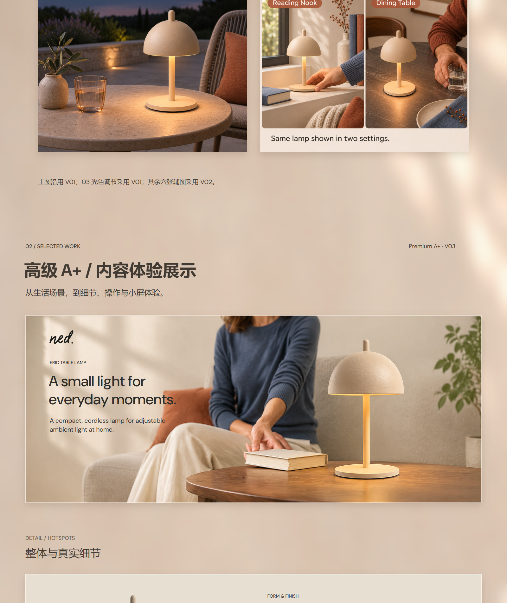

# 02_高级A+｜作品集展示 V04 · 修订V02

[下一段：03品牌故事展示](../03_品牌故事/README.md) · [商品图→高级A+→品牌故事完整连续预览](../03_品牌故事/01_成品与预览/商品图至品牌故事_完整连续预览.jpg)

2026-11-08。按单列长图规划 V02 制作；根据用户反馈补齐完整手机内容。**高级A+ V03素材暂通过审稿；本次作品集展示稿已制作，待用户审阅，尚未正式定稿。**

六段依次向下：居家开场 → 真实细节 → 三个操作 → 三种场景 → 尺度与FAQ → 手机适配。桌面与手机的三个操作、三个场景均完整展示；手机含开场、两种细节、三种操作、三种场景、尺寸与FAQ，共11个独立图文状态。

- [前一段：01商品图](../01_商品图/README.md) · [展示目录](../README.md) · [执行规划V02](../../../../../项目规划/作品集02_高级A+_展示规划_V02_单列长图_20261108/README.md) · [高级A+ V03原交付](../../../../亚马逊A+内容/高级A+_V03/README.md)

## 查看与编辑

- [高清展示长图 JPG（1600×17280）](01_成品与预览/02_高级A+展示_V04_修订V02_1600x17280.jpg) · [PNG](01_成品与预览/02_高级A+展示_V04_修订V02_1600x17280.png) · [缩略图](01_成品与预览/02_高级A+展示_V04_修订V02_缩略.jpg)
- [商品图→高级A+完整连续预览](01_成品与预览/商品图至高级A+_完整连续预览_修订V02.jpg) · [接缝局部](01_成品与预览/商品图至高级A+_衔接局部_修订V02.jpg)
- [整页可编辑SVG](02_可编辑SVG/02_高级A+展示_V04_修订V02_可编辑.svg) · [21份模块源稿](02_可编辑SVG/模块源稿/)
- [使用说明与检查范围](使用说明_修订V02.md) · [制作与检查记录](04_过程记录/制作与检查记录_修订V02.md)

## 展示长图

## 与商品图段衔接

