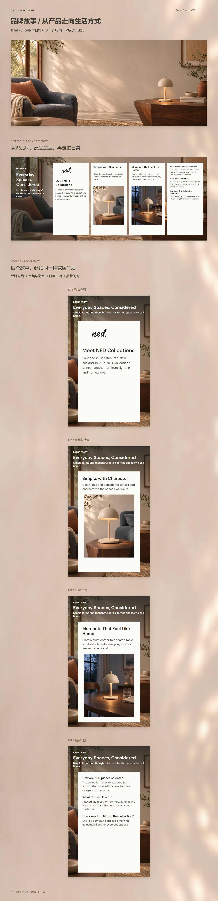
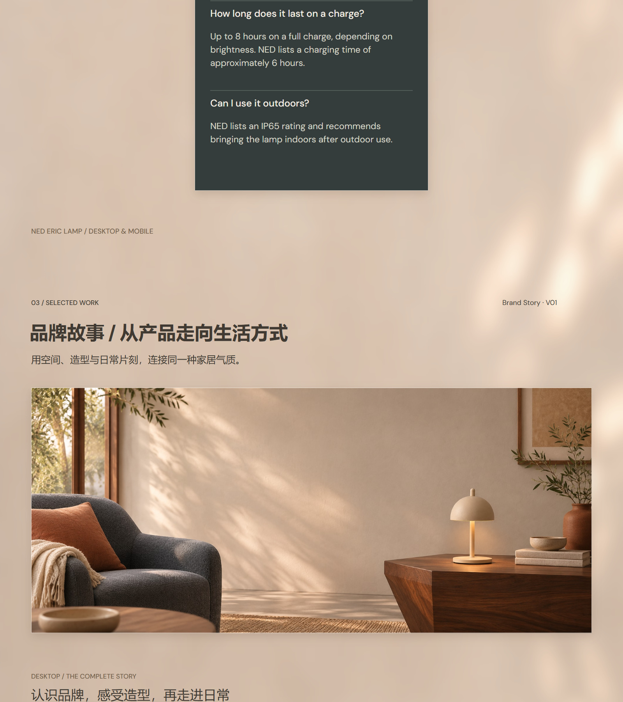

# 03_品牌故事｜作品集展示 V04

[下一段：04_Banner系统](../04_Banner系统/README.md) · [商品图→高级A+→品牌故事→Banner系统完整连续预览](../04_Banner系统/01_成品与预览/商品图至Banner系统_完整连续预览.jpg)

2026-11-08。已按展示规划V01制作，**本次作品集展示稿待用户审阅，未正式定稿。** 原品牌故事V01作为内容来源，其素材采用状态不因本次制作自动变为已终审。

阅读顺序：品牌氛围开场 → 桌面完整卡组 → 手机四个故事状态。品牌介绍、审美与造型、日常生活、品牌问答全部展示；最后一张保留完整三问三答。沿用作品集连续暖墙与外层V04样式。

- [前一段：02高级A+](../02_高级A+/README.md) · [成果展示目录](../README.md) · [执行规划V01](../../../../../项目规划/作品集03_品牌故事_展示规划_V01_20261108/README.md) · [品牌故事V01原交付](../../../../亚马逊A+内容/品牌故事_V01/README.md)

## 看图与编辑

- [高清长图JPG（1600×6600）](01_成品与预览/03_品牌故事展示_V04_1600x6600.jpg) · [PNG](01_成品与预览/03_品牌故事展示_V04_1600x6600.png) · [缩略](01_成品与预览/03_品牌故事展示_V04_缩略.jpg)
- [01商品图→02高级A+→03品牌故事完整连续预览（1600×28520）](01_成品与预览/商品图至品牌故事_完整连续预览.jpg) · [02→03衔接局部](01_成品与预览/高级A+至品牌故事_衔接局部.jpg)
- [整页可编辑SVG](02_可编辑SVG/03_品牌故事展示_V04_可编辑.svg) · [5份独立模块SVG](02_可编辑SVG/模块源稿/) · [逐模块PNG](01_成品与预览/逐模块预览/)
- [使用说明](使用说明.md) · [制作与检查记录](04_过程记录/制作与检查记录.md) · [完整英文字段](04_过程记录/英文字段与来源.md)

## 展示长图

## 与高级A+衔接

文字、背景遮罩、卡片、外框及Logo可独立调整；照片仍为位图，不宣称分层PSD。所有正式展示文字已重新排为原生SVG对象，未将规划截图作为成品模块嵌入。
