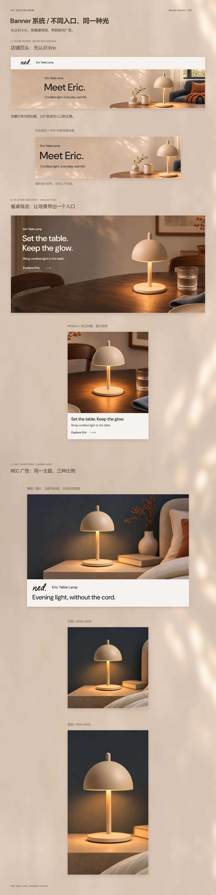
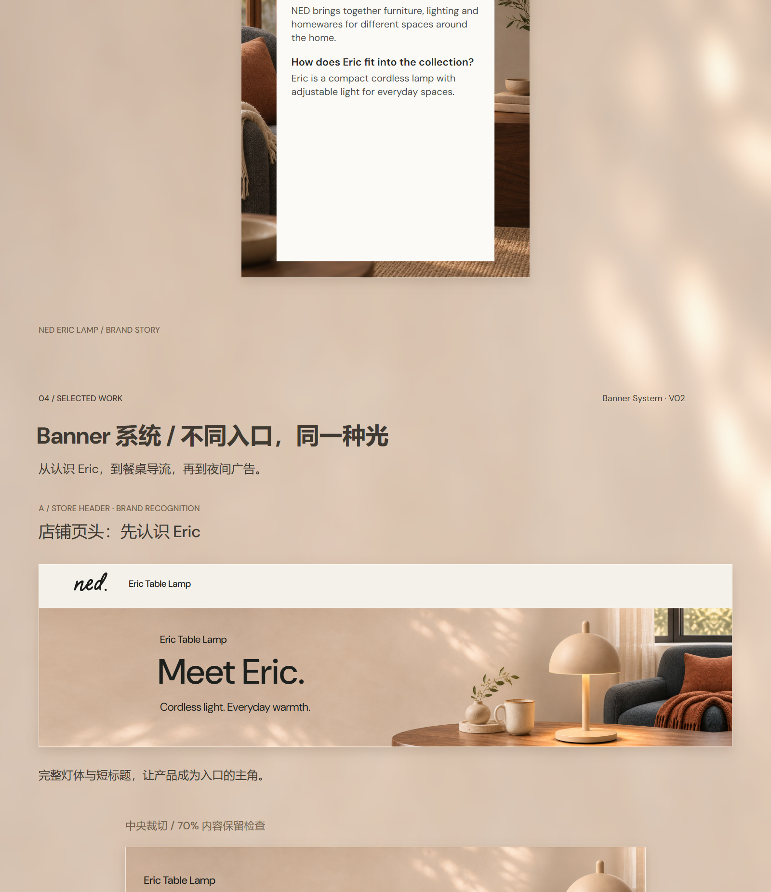

# 04_Banner系统｜作品集展示 V04

2026-11-08。已按展示规划V01制作，**当前为展示审阅稿，待用户审阅，未正式定稿。** 外层沿用作品集V04，内容来源为独立Banner V02；未修改原V02包，也未因此将原素材标记为已终审。

以“不同入口，同一种光”组织三个主题、六份图片适配，完整单列纵排：**店铺页头 → 餐桌电脑／手机 → REC横／方／竖广告**。中央70%裁切另作辅助检查，不计为独立手机素材。V01／V02完整对比留到后续迭代段。

[前一段：03品牌故事](../03_品牌故事/README.md) · [成果展示目录](../README.md) · [执行规划V01](../../../../../项目规划/作品集04_Banner系统_展示规划_V01_20261108/README.md) · [原Banner V02](../../../../独立Banner/V02/README.md)

## 看图与编辑

- [高清长图JPG（1600×6600）](01_成品与预览/04_Banner系统展示_V04_1600x6600.jpg) · [PNG](01_成品与预览/04_Banner系统展示_V04_1600x6600.png) · [缩略](01_成品与预览/04_Banner系统展示_V04_缩略.jpg)
- [商品图→高级A+→品牌故事→Banner系统完整连续预览（1600×35120）](01_成品与预览/商品图至Banner系统_完整连续预览.jpg) · [品牌故事→Banner衔接局部](01_成品与预览/品牌故事至Banner系统_衔接局部.jpg)
- [整页可编辑SVG](02_可编辑SVG/04_Banner系统展示_V04_可编辑.svg) · [七份模块SVG](02_可编辑SVG/模块源稿/) · [逐模块PNG／JPG](01_成品与预览/逐模块预览/)
- [使用说明](使用说明.md) · [制作与检查记录](04_过程记录/制作与检查记录.md) · [英文字段与来源](04_过程记录/英文字段与来源.md)

## 展示长图

## 与品牌故事衔接

整页保留35个原生文字对象，Logo为独立路径。餐桌电脑稿使用浅色文字与独立暖灰渐变层改善对比；原照片文件不变。照片、产品与画面内光影仍为位图，未交付分层PSD。本轮未调用生图API；展示稿与对应规划一并归档至本仓库。
