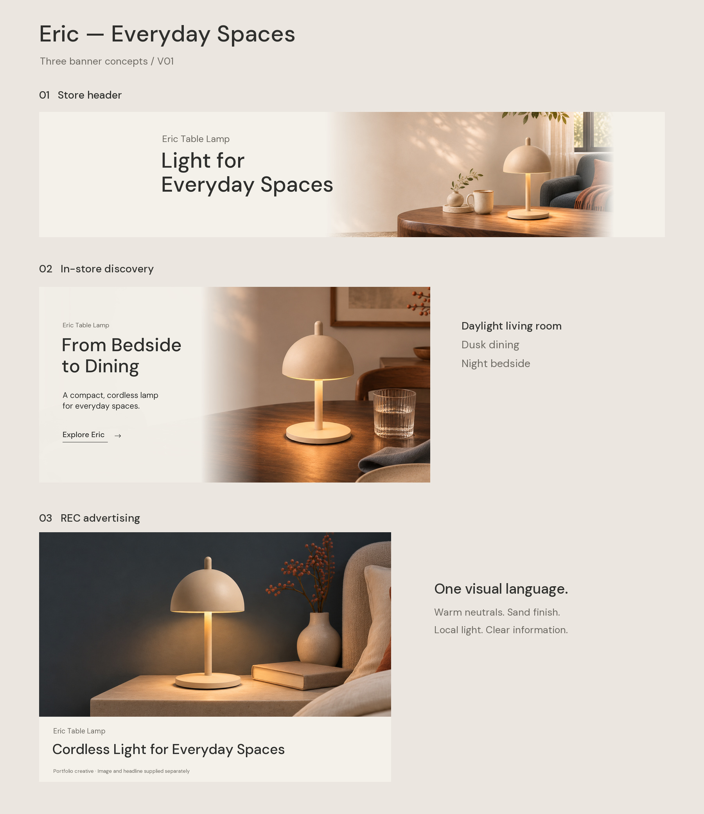

# NED Eric Lamp｜独立 Banner V01

日期：2026-11-05。状态：三款主画面及规划中的六份图片适配资产已制作，待用户审阅。作品集模拟，未实际上传亚马逊或投放广告。

下载目录后可打开[本地交互预览](打开查看三款Banner.html)，或查看[总览原图](三款Banner总览.jpg)。GitHub 文件页面不运行 HTML 预览。

## 文件入口

- [平台图片及尺寸适配](图片素材/)：6 份 JPEG；导流与广告图片不烘焙平台原生文字。
- [图文预览与裁切检查](图文预览/)：页头、导流、手机版及广告组件示意。
- [可编辑 SVG 源稿、字体及原始参考](可编辑源稿/)：3 份源稿，保留可编辑文字。
- [文案与制作设置](可编辑源稿/文案与制作设置.json)
- [文件与规格清单](文件与规格清单.json)

## 三款主画面

- BN01：店铺页头，3000 × 600。主题 Light for Everyday Spaces；辅助识别 Eric Table Lamp。左右各15%的裁切检查保留文字与完整灯体。
- BN02：店内场景导流，3000 × 1500。主题 From Bedside to Dining；正文和 Explore Eric 链接为模拟原生字段。图片素材另存无字版；手机另备1680 × 1680图片与图文示意。
- BN03：REC 广告，1200 × 628无字横图，另备1200 × 1200及900 × 1600适配。图文预览中的标题放在独立区域，不压进广告图片。

## 制作方法与来源

本次没有调用 image_gen 或 CLI 生图API。内置生图工具不可用，依据已提交规划的“优先复用现有合格无字素材”要求，使用已有A+ AI场景重新裁切、构图、图文分离与排版。灯具没有被替换或重画；局部外观仍以已有AI图像为准，不代表实物核验。

来源仓库：Migo1203/AIGC，源提交0546442e1d7d01f7a0393ea390a6b7fb524173d5。

| 交付 | 原始场景 | 本次处理 |
| --- | --- | --- |
| BN01 | 高级A+_V01/素材原图/P01_PC.png，1959 × 803 | 场景缩小后与暖骨白信息底融合，重新排版；不对灯体做拉伸。为保证完整产品与裁切安全，使用信息底与场景融合，而非强行全景铺满。 |
| BN02电脑 | 高级A+_V01/素材原图/P05_Dining_PC.png，1959 × 803 | 选取1606 × 803区域，等比插值至3000 × 1500，倍率约1.87；叠加渐变信息底，原生文字另存。插值不会增加真实细节。 |
| BN02手机 | 高级A+_V01/素材原图/P05_Dining_Mobile.png，1448 × 1086 | 方形裁切后插值至1680 × 1680，倍率约1.55；只是备选，不宣称编辑器一定支持独立上传。 |
| BN03横 | 基础A+_V01/素材原图/A03_夜间无线续航.png，2237 × 703 | 重新裁取宽画面并缩小，保留完整灯体及床头上下文。沿用原场景的暖石材桌面，与主视觉同属暖中性自然材质。 |
| BN03方/竖 | 高级A+_V01/素材原图/P04_Mobile.png，1448 × 1086 | 使用独立手机原构图裁切，非从横版硬截；方形约1.10倍插值、竖形约1.47倍插值。 |

原始场景副本与产品参考保存在“可编辑源稿/原始参考”，仅为可追溯与后续制作使用；不改变现有素材许可状态。

## 可编辑性

三个SVG源稿嵌入实际场景图片，并保留可编辑英文文字。可在支持SVG文字编辑的设计软件中继续调整；需安装附带的DM Sans字体。源稿中的场景为位图，并非分层场景或可编辑3D物体。没有提供PSD，不把SVG导入Photoshop后自动栅格化的文字称为Photoshop可编辑文字。

附“文案与制作设置.json”、原始场景与字体许可证。图文预览与平台图片分目录，避免上传错文件。

## 检查与待确认

- 六份图片均为RGB/sRGB JPEG，像素与规划相符，体积清单见“文件与规格清单.json”。
- 已目视核对三款主画面、完整灯体、标题拼写、页头中央裁切；未替代真实平台后台或手机实机验证。
- Logo仍为低清来源，因此此版没有加入重绘品牌Logo；后续有高清原件再在对应平台组件配置。
- BN02链接地址和REC商品落地页未编造，预览中不设置虚假购买链接；真实账户、ASIN、审核和素材公开许可仍待确认。
- 1254px产品参考用于外观核对，本次没有宣称重新取得高清实拍产品母版。导流大图与部分手机资产存在插值，应以最终显示尺寸审阅锐度。
- AI原图的真实产品尺度、材质及光效仍需核对；本版未作任何销量、转化、实测性能或平台通过宣称。

本目录为 V01 审阅交付，按用户要求归档至 GitHub；提交归档不代表用户已确认最终版本或已实际投放。
