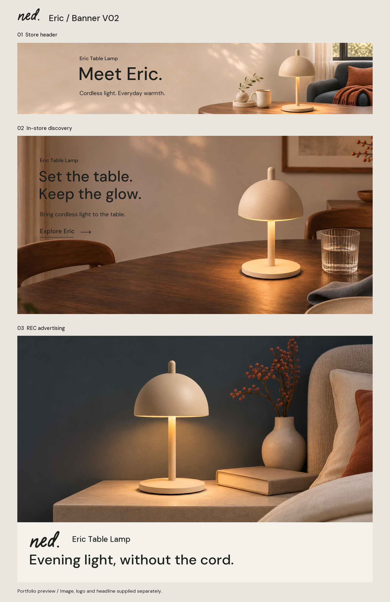

# NED Eric Lamp｜独立 Banner V02

> 2026-11-08 作品集展示进度：[04_Banner系统展示V04](../../作品集展示/成果展示/V04/04_Banner系统/README.md)已按[展示规划V01](../../../项目规划/作品集04_Banner系统_展示规划_V01_20261108/README.md)制作并归档，含六份适配及中央裁切辅助检查。展示长图1600×6600、原生文字与Logo路径；餐桌文字对比在展示源稿中调整，原V02图片未覆盖。展示稿及原素材均保持待用户审阅状态。

日期：2026-11-05。三类 Banner 主视觉、6 份图片适配资产和 3 份 SVG 源稿已制作，待用户审阅。作品集模拟，未上传亚马逊或实际投放；V01 保留。

## 文件入口

- [打开本地预览](打开查看三款Banner_V02.html)：下载后在浏览器打开，GitHub 文件页不执行 HTML。
- [V01 / V02 同尺寸对照](V01与V02同尺寸对照.jpg)
- [图片素材](图片素材/)：6 份尺寸适配 JPEG。
- [图文预览与裁切检查](图文预览/)：包括独立 Logo 栏、页头中央裁切和手机导流示意。
- [可编辑源稿](可编辑源稿/)：3 份 SVG，标题及正文可编辑，场景为嵌入位图；不是 PSD 或分层摄影文件。
- [品牌 Logo](可编辑源稿/品牌Logo/)：按现有字标轮廓重绘的黑白 SVG、独立组件试排 PNG。
- [完整 Logo 重绘记录](../../../产品资料/品牌Logo/原样重绘_2026-11-05/README.md) / [本次案例依据](../../../参考调研/Banner同类品案例分析-2026-11-05/README.md)
- [文案与制作设置](可编辑源稿/文案与制作设置.json) / [文件与规格清单](文件与规格清单.json)

## V02 变化与案例应用

| 主题 | V02 执行 | 相对 V01 的变化 |
| --- | --- | --- |
| BN01 店铺页头 | Eric Table Lamp / Meet Eric. / Cordless light. Everyday warmth. | 去除骨白信息面板和两端白色淡出；延展原墙面纹理，保留完整灯体和连续桌面。标题缩短，型号与无线利益点清楚；Logo 放在独立品牌栏。 |
| BN02 餐桌导流 | Set the table. Keep the glow. / Bring cordless light to the table. / Explore Eric | 移除大面积白色渐变，让自然墙面承载文字；收紧标题、正文和入口；由跨场景标题改为与单餐桌画面一致的表达。 |
| BN03 REC 广告 | Evening light, without the cord. | 保留有效的夜间明暗对比，横图轻微重构；独立品牌与标题组件加入重绘 Logo。方/竖版保留 V01 可用构图，无字图不增加 Logo、按钮、价格。 |

采用案例的方法：Flowerpot 的轮廓与自然背景分离；Carrie 的材质近景和购买信息独立呈现；Fatboy 的一模块一个利益点。没有将竞品图片、标志或文案用于成品，也没有引入销量、照度、续航等未经核验的性能宣称。

## 实际素材和处理

仍复用已有合格无字 AI 场景，使用确定性的摄影裁切、背景拼接与文字排版；没有调用新的生图工具或付费 API。当前内置生图工具不可用，本次没有切换到需要 API 密钥的 CLI。

源仓库：Migo1203/AIGC。原场景版本记录见 V01 和本目录清单。

| 资产 | 来源与实际处理 |
| --- | --- |
| 页头 3000×600 | 高级 A+ `P01_PC.png`（1959×803），等比缩放约 1.072 倍并裁切；左侧使用原墙面纹理镜像延展，右侧仅补 80 px 外缘。产品、杯子和主体家具未横向拉伸或生成重画。右侧外缘属于可裁切环境，墙面补景不等于新拍摄或真实增加细节。 |
| 导流电脑 3000×1500 | 高级 A+ `P05_Dining_PC.png` 取 1606×803 区域，约 1.87 倍插值，保持场景原有内容，无白色覆盖。 |
| 导流手机备选 1680×1680 | `P05_Dining_Mobile.png` 方形裁切，约 1.55 倍插值；沿用 V01 图片裁切，更新相邻文案。所选模块是否支持独立手机图仍以实际编辑器为准。 |
| REC 横图 1200×628 | 基础 A+ `A03_night.png` 取 1343×703 区域后缩小。 |
| REC 方 / 竖 | 高级 A+ `P04_Mobile.png`，沿用 V01 可用构图，分别约 1.10 / 1.47 倍插值。石材桌面与其他画面的胡桃木有材质差异，沿用暖中性自然材质体系；不声称三个位置是同一家具。 |

本次没有重新拍摄或生成更高清产品母版；插值不能增加真实细节。原始场景和用户产品参考在 V01 原始参考目录及既有 A+ 目录保留，未覆盖。

## 源稿、平台组件与验收边界

- 三份 SVG 嵌入实际位图场景并保留文字对象；附 DM Sans 字体及 OFL 许可证。Logo 字形为矢量路径。
- BN01 Hero 本体和品牌栏分开；中央 X=450–2550 的裁切检查另存。该检查不是实际手机后台截图。
- BN02 原生字段示意中使用 DM Sans 说明层级，实际平台字体、换行和间距依编辑器调整；不承诺可上传自定义字体。
- REC 三份图片无文字、Logo、价格或 CTA；预览中的 Logo、产品名与标题为相邻组件示意，不是可直接上传的广告截图。标题 32 个英文字符（含空格）。
- 商品目的地址与 ASIN 未编造，未模拟价格、星级、Prime 标志或购买状态。
- 六份平台图片为 RGB/sRGB JPEG；尺寸、体积见清单。场景复用、插值、产品外观与真实物品尺度的限制继续适用；未宣称平台审核通过或点击率提升。

## 审阅重点

先看实际显示大小下的产品识别与文字对比，再看桌面暖光和自然材质是否仍保留氛围。手机优先检查文字换行、灯体完整和可配置的原生入口；不以固定品牌/商业面积比例或未经验证的最佳产品占比代替判断。
