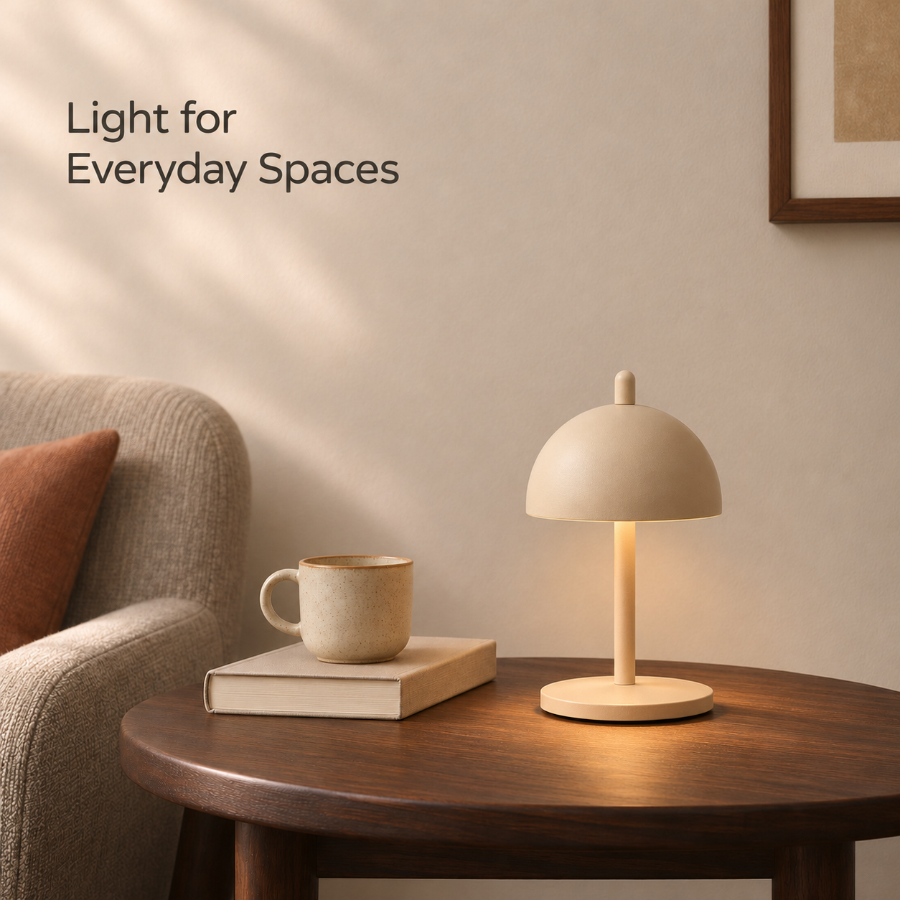

# NED Eric Lamp｜营销主视觉 V01

基于“窗边安静时刻”方向制作的方形电商营销主视觉，用于确定后续辅图、A+ 与 Banner 的场景、配色和氛围。项目为亚马逊美国站作品集模拟，不代表品牌委托或真实销售结果。

[打开营销主视觉 PNG](NED_Eric_营销主视觉_V01.png)

## 画面方向

- **场景：** 客厅边桌与织物座椅，使用书和杯子营造生活感。
- **配色：** 暖白、沙色、深胡桃棕和少量陶土色，延续[统一视觉方向](../../项目规划/统一主视觉与设计方向-v0.1.md)；不视作 NED 官方标准色。
- **光影：** 柔和窗光与灯下局部暖光，保持安静、自然的家居氛围。
- **构图与文案：** 产品在画面右侧，左上以 `Light for Everyday Spaces` 点明日常家居主题。

## 文件与使用说明

- 文件：`NED_Eric_营销主视觉_V01.png`，**1254 × 1254 px**、RGB，单层图像；图中文字已合入画面，本次未提供可编辑的文字或 PSD 分层。
- 制作：AI 生成视觉概念，参考用户上传的[正面近平视产品图](../../产品资料/产品图/12_单品正面近平视_用户上传.png)与[斜俯视产品图](../../产品资料/产品图/14_单品正面斜俯视_用户上传.png)。此图不是把原产品精修图直接抠图合成，生成的局部细节和产品尺度仍需在后续制作中对照产品资料核验。
- 用途：适合展示场景主视觉方向，后续可以围绕它制作场景辅图和 A+；亚马逊商品主图仍需按适用类目规则单独制作白底图。
- 当前画布低于项目先前规划的 2000 × 2000 px 工作尺寸；后续正式排版应根据输出用途准备足够清晰的产品母版和可编辑文字，不能把放大后的像素当作新增真实细节。
