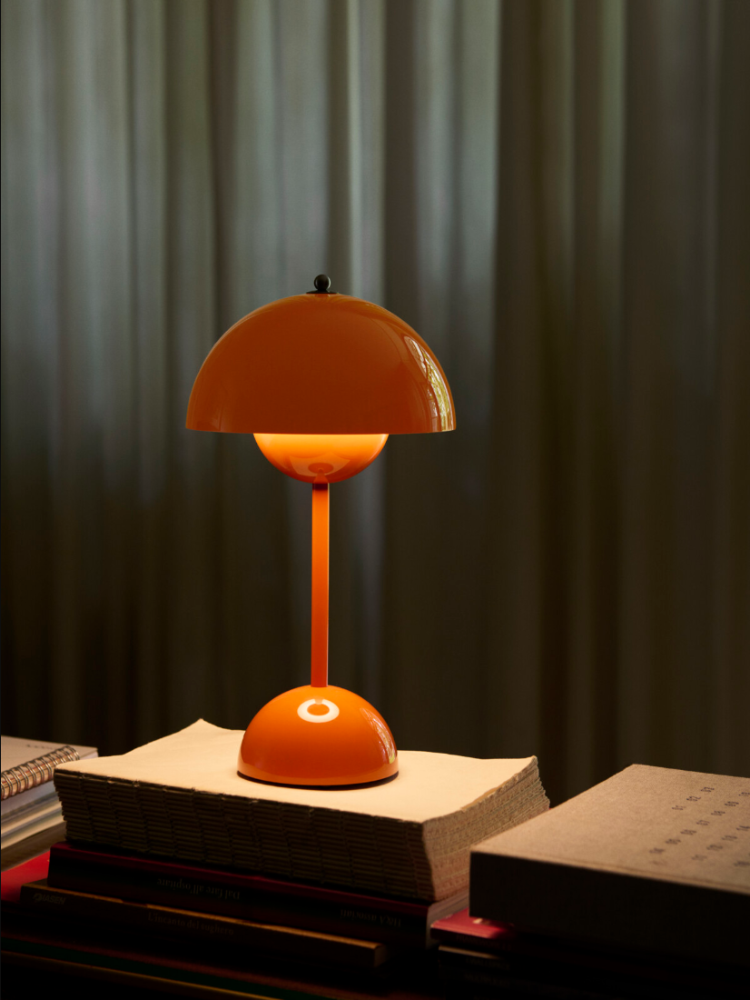
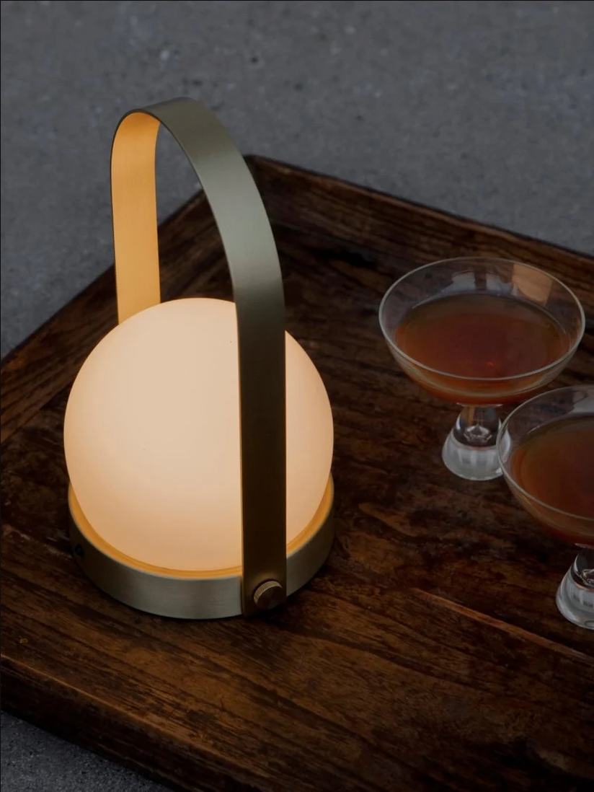
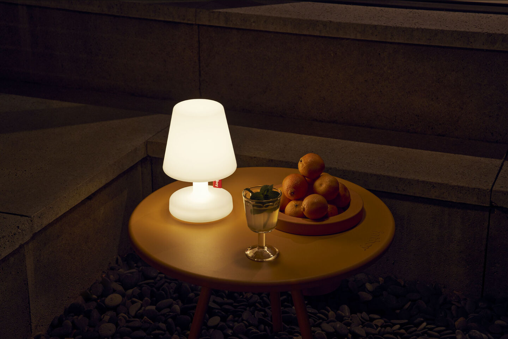

# NED Banner：品牌氛围与商业表达的三份参考

查阅日期：2026-11-05。通过实际浏览器打开官方页面并查看产品图与内容模块；附页面截图与页面记录。研究对象为品牌产品页及其场景模块，不是已核实的亚马逊 Banner 或在投广告。没有销售、点击率、转化率数据，以下视觉判断不能当作效果验证。

## 结论与适用范围

NED 适合以 Audo 的自然材质、局部暖光作为氛围参照，采用 Flowerpot 对产品轮廓与选款信息的清晰组织，再借鉴 Fatboy 一模块一个利益点的文案分工。学习信息组织和摄影方法，不照搬品牌配色、标志、产品外观或文案。

品牌氛围和商业表达不必换算成固定面积比例。更可操作的判断是：画面是否令人向往、产品是否容易认出、用途是否容易理解、下一步入口是否清楚。三者可以在同一画面中成立，也可以由相邻模块分担。

## 1. &Tradition — Flowerpot VP9

官方来源：https://www.andtradition.com/products/flowerpot-vp9

观察：橙色台灯放在书本上，后方是带褶皱的深色帘布。灯罩的高光、罩下发光球体及底座反射共同解释材质与亮灯状态；书脊与帘布提供尺度和生活线索。背景上部留空较多，但仍有明暗和纹理，并非大片纯色蒙版。橙色产品与低饱和背景形成分离，产品轮廓连续可读。

页面：左列为产品名、设计者、年份、颜色选项及系列；中间是产品图；右列是说明及可展开的产品信息。行动入口是 Find Dealer 和 Explore The Flowerpot Collection。它主要引导选款、了解与寻找经销商，不是强促销页面。

商业作用：清晰主图负责认款，颜色选择解决挑选，场景负责建立拥有后的想象，资料折叠减少首屏信息负担。品牌故事来自页面实际出现的设计信息，而非装饰性口号。

借鉴给 NED：增强沙色灯与背景的明暗分离；用真实墙面或帘布承载留白；保留能说明尺度的少量道具。页头先保证造型和型号识别，再让氛围延展。

不宜照搬：橙色是该选款的产品颜色，不应改成 NED 的主色。其竖幅场景无法直接裁成 5:1 页头；必须另行构图。不要借用其他品牌的设计史为 NED 背书。

## 2. Audo Copenhagen — Carrie Portable Lamp

官方来源：https://us.audocph.com/products/carrie-portable-led-lamp

观察：近景把发光球体、金属提手及底座放在画面左侧，木托盘斜线连接到右侧两只饮品杯。暗石材、木纹、金属与暖光形成统一气氛；提手轮廓与底座细节仍然清楚。少量道具直接建立夜间相聚的用途，不依赖完整客厅全景或大段抒情文案。

页面：大幅产品图与场景缩略图在左，右侧呈现产品名、设计者、颜色选择，购买区有 Add to Cart 与价格。下方滚动时仍可出现购买栏。暖浅底、较有表现力的产品标题字体和干净界面共同形成品牌调性。

商业作用：图片回答“放在生活里是什么感觉”，产品图回答“实物长什么样”，颜色及购买组件回答“选什么、怎么继续”。交易信息有自己的清晰位置，未直接压进场景图。

借鉴给 NED：店内导流用更近的场景距离展示灯罩质感和桌面局部暖光；道具控制为与用途相关的一两类；文字组收紧为型号、一个利益标题、一个原生入口。保持商品内容与平台原生功能的清楚分工。

不宜照搬：提手是 Carrie 自身的产品特征。其泳池等场景不能用来暗示 NED 具备相同户外能力。价格和购物栏属于独立站产品页，不应烘焙进 NED 的 REC 图片。该页面右侧也存在较大间距，并非所有留白都值得复制。

## 3. Fatboy — Edison the Petit

官方来源：https://www.fatboy.com/hr-en/edison-the-petit.html

观察：夜间桌面中，发光白灯与周围暗环境形成明确焦点；桌面、饮品和水果交代休闲情境。页面以图文左右交替的模块组织内容，粗黑标题和明确色彩的配件入口加强浏览节奏。

实际模块标题包括 THE WHITE TABLE LAMP THAT YOU’LL BRING EVERYWHERE、FROM BEDSIDE- TO OUTDOOR-TABLE LAMP；后续用 Residence 与 Cooper Cappie 模块引导配件浏览。标题直接表达带走、跨场景使用等利益，正文再解释产品功能。其语气偏轻松活泼。

商业作用：一模块解释一个理由，图像提供情境，标题说明价值；配件入口对应具体对象，不让所有区域都承担相同的“了解更多”。这是内容层面的购买理由组织，不意味着其页面所有间距都最优。

借鉴给 NED：三张 Banner 的信息要递进。页头负责识别 Eric；店内导流负责解释某一使用场景或移动价值；广告只抓一个利益点。让夜间光效成为实际视觉焦点，避免三个标题反复使用 everyday spaces。

不宜照搬：Fatboy 的亮红、粗黑全大写字与活泼语气不适合直接套入 NED 的安静家居定位。其功能参数和户外使用表述仅属于该产品。本次地区页面主要展示故事和配件模块，不能据此声称已核验完整主商品购买流程。顶部用户内容区本次未显示内容，其空白可能来自加载状态，不视为设计范本。

## 三份案例对照

| 参考 | 氛围主要来自 | 商业表达主要来自 | NED 最值得采用 |
| --- | --- | --- | --- |
| Flowerpot VP9 | 色彩、材质、光影与设计语境 | 产品轮廓、变体、资料、经销商入口 | 造型辨识与有纹理的留白 |
| Carrie | 近景材质、局部暖光与生活道具 | 主图、选色、独立购买组件 | 场景和购买信息的清楚分工 |
| Edison the Petit | 夜间使用情境及轻松语气 | 利益标题、模块递进、明确配件入口 | 一张图说明一个理由 |

## 应用到 NED V02

1. BN01 页头：优先修正场景两端淡出和中央过宽渐变；画面延伸到边缘，用自然低细节背景承载短标题。保持完整产品和实际裁切需求，先试现有素材能否支撑；若不能，再单独制作宽幅场景。
2. BN02 导流：保留现有合理的灯具大小，收紧标题、正文、入口关系，减少白色覆盖。单餐桌图优先配餐桌主题；若强调床头到餐桌，另做明确的跨场景画面，而非仅改标题。
3. BN03 广告：保留深色背景与产品暖光对比；以单一利益点组织标题，继续将平台标题与无字图分开，不强塞促销元素。
4. 总览：压缩外围说明区，使三张成品的真实比例和差异容易比较。

成本与检查：新宽幅场景比简单裁切更耗时，也会增加产品一致性核对；双场景会增加视觉复杂度；现有大图插值无法因重排而恢复真实细节。先做实际显示大小与手机裁切检查，再决定是否需要新素材。不要规定没有证据支持的“最佳产品占比”或品牌/商业固定比例。

研究截图及源图版权归原品牌或相关权利人，仅用于本次内部设计分析；不作为 NED 成品素材，不直接发布到作品集成品页。
