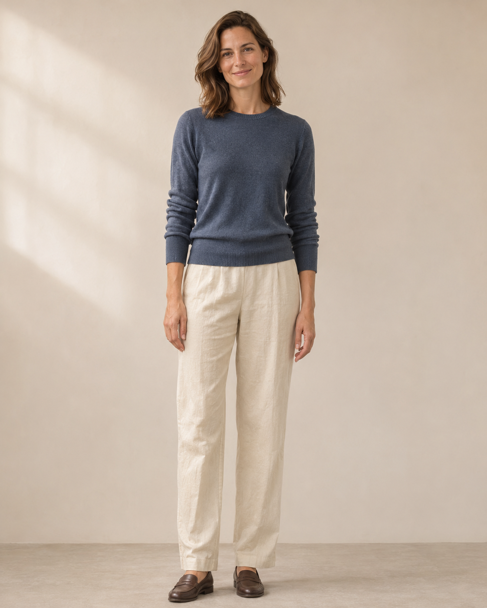
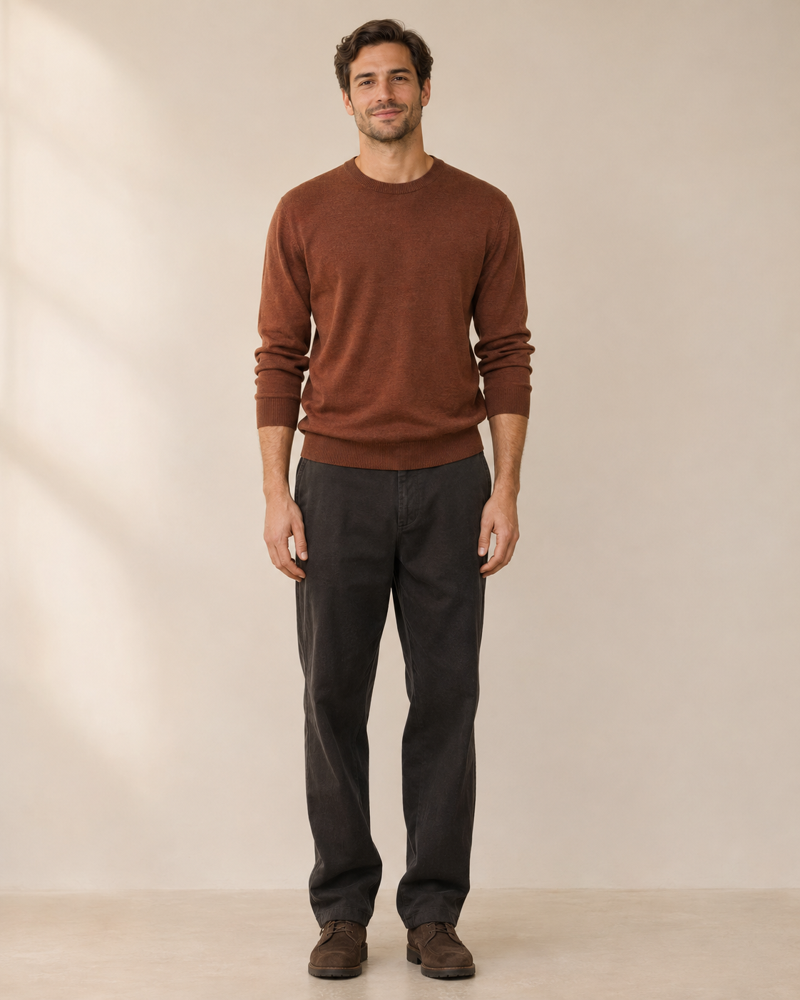

# NED Eric Lamp｜人物模特设计 V01

为美国站作品集模拟项目规划两位成年欧美外观模特：一女一男。两张图为 **AI 生成人物设定参考**，不是实际聘用的模特或真实用户访谈照片。人物年龄、外貌和服装是本项目的创意选择，不代表美国用户的真实人口统计。

| 女性模特 F01 | 男性模特 M01 |
| :---: | :---: |
|  |  |
| [单独查看女性参考图](女性模特_F01_V01.png) | [单独查看男性参考图](男性模特_M01_V01.png) |

人物参考图不含产品，仅用于确定形象和穿搭；后续场景中的灯以[用户上传的产品视角图](../../产品资料/产品图/README.md)和产品事实为准。

## 一、与项目的关系

现有[目标用户与场景分析](../产品资料缺口与目标用户场景分析-v0.1.md)关注的是希望将小灯融入床头、客厅或餐桌的人，以及他们对造型、尺寸和操作的疑问。因此模特以自然、放松的居家状态出现，帮助展示使用情境；不预设两人的职业、收入、关系或实际购买行为。

整体延续[营销主视觉 V01](../../制作交付/营销主视觉/README.md)的暖白、沙灰、深木与柔和窗光。服装加入蓝灰和陶土棕，与浅沙色台灯拉开明暗或色相差异；产品依然是画面的重点。

## 二、两位模特设定

| 项目 | 女性 F01 | 男性 M01 |
| --- | --- | --- |
| 形象 | 成年女性，欧美外观，视觉年龄约 30–40 岁；神情温和、自然 | 成年男性，欧美外观，视觉年龄约 30–40 岁；神情轻松、亲切 |
| 肤色 | 偏浅的中性暖肤色，保留真实皮肤纹理 | 浅至中等的暖橄榄肤色，保留真实皮肤纹理 |
| 头发 | 中棕色，及肩长度，轻微自然波浪，偏分 | 深棕色短发，略有自然纹理与侧分；保留少量整洁胡茬 |
| 上衣 | 低饱和蓝灰色圆领细针织衫，长袖、无图案 | 低饱和陶土棕色圆领细针织衫，长袖、无图案 |
| 下装与鞋 | 暖白色直筒休闲长裤、深棕色平底乐福鞋 | 深炭灰直筒休闲长裤、深棕色休闲鞋 |
| 妆容与配饰 | 日常淡妆，饰品从简，不遮挡手部动作 | 自然整理，配饰从简，不遮挡手部动作 |
| 参考状态 | 站姿参考，用于记录发型、衣着和体态；场景图可改为坐姿或局部入镜 | 站姿参考，用于记录发型、衣着和体态；场景图可改为坐姿或局部入镜 |

### 服装色彩

- **女性：** 蓝灰上衣参考 `#5C6E82`，暖白长裤参考 `#E6DED0`。蓝灰作为本项目人物服装的补充色，可与暖白墙和浅沙色灯形成区分。
- **男性：** 陶土棕上衣参考 `#9B6B56`，炭灰长裤参考 `#343632`。陶土棕呼应主视觉的少量暖色点缀。
- 色值是后续搭配的起始建议，并非照片的精确取样或 NED 官方色值。根据实际场景与光线调整明度，确保灯体、手部和衣服边界清楚。

## 三、场景与动作

| 场景 | 人物与动作建议 | 画面重点 |
| --- | --- | --- |
| 客厅边桌 | F01 坐在沙发一侧，轻触顶部旋钮；也可只露出上半身与手 | 先看清灯的完整形状和旋钮，再感受自然居家氛围。 |
| 室内餐桌 | M01 将同一盏灯放在桌面上，人物位于画面一侧 | 用人物、餐桌和灯的关系说明小巧、可移动。 |
| 床头或卧室边桌 | F01 或 M01 坐在床边或站在边桌旁，轻松调整灯光 | 表现局部氛围照明，不暗示护眼、助眠或保证阅读照度。 |
| 家庭聚餐或客厅 | 两人可单独出现，也可同框自然交流；不预设彼此关系 | 人物是生活情境，保持一盏灯清楚可见，不暗示多件装。 |

女性和男性可以互换这些场景，不必把某一种家务或生活角色固定给某一性别。手部触碰时只表现资料支持的顶部旋钮；不虚构开关、接口或包装。

## 四、后续画面统一规则

1. **人物一致：** F01 延续中棕及肩波浪发、浅暖肤色和蓝灰上衣；M01 延续深棕短发、暖橄榄肤色、少量胡茬和陶土棕上衣。场景需要时可改变姿势、视角或部分衣物，但保留这些识别特征。
2. **人物与产品比例：** Eric 官网标称高 20.1 cm、直径 11 cm。手、桌面和灯具应保持可信比例；手部动作清楚，产品不被人物或道具遮挡。
3. **画面主次：** 场景辅图可让人物位于画面边缘或中景，灯体保持清晰；不需要每张图都出现人物。A+ 可使用较完整的居室视角。亚马逊白底商品主图按产品类目要求单独制作，不放人物。
4. **光线：** 延续左上方柔和窗光与局部暖光，保持肤色自然；床头与客厅可以有合理明暗变化，灯体颜色和形态不要随场景大幅改变。
5. **生成与检查：** 后续生成时分别使用本文件中的 F01 或 M01 图作为人物参考，搭配已确认的产品参考图。AI 可能改变五官、手指或灯体结构，成图需逐张核对，不能把参考图当成精确复刻保证。
6. **当前限制：** 暂不绘制充电功能、包装清单或接口；不添加未核实的认证、性能或场景承诺。

## 五、后续生成时的人物描述

英文描述仅供制作时辅助，优先搭配上方对应人物参考图和实际产品参考，不作为最终商品文案。

- **F01：** `Adult European-looking woman, fair to light neutral-warm skin, shoulder-length medium-brown softly wavy hair with a side part, understated makeup, muted slate-blue fine-knit crewneck sweater, warm-ivory relaxed straight-leg trousers, natural and approachable.`
- **M01：** `Adult European-looking man, light-to-medium warm olive skin, short textured dark-brown hair with a natural side part, neat subtle stubble, muted terracotta-brown fine-knit crewneck sweater, charcoal relaxed straight-leg trousers, natural and approachable.`

两张参考图均为 **1122 × 1402 px PNG**；图中人物为 AI 生成，姿势与服装仅作为 V01 设定，后续可根据实际画面调整。
